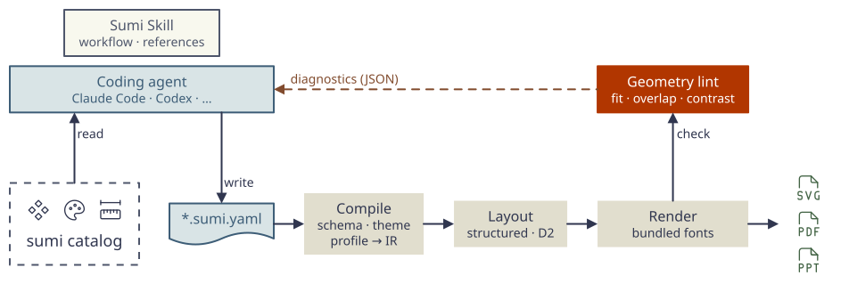

# Sumi

**Diagrams your coding agent can draw, check and fix.**

Sumi is a diagram-as-code CLI built for AI coding agents. The agent looks up the components, themes and page profiles Sumi offers, writes a `*.sumi.yaml` file, and Sumi renders it to SVG, PDF or PPTX. Sumi then measures the rendered figure and returns machine-readable diagnostics, such as overflowing text, colliding labels, low contrast or a figure too wide for its page. The agent fixes them before you ever look. The YAML stays readable and reviewable, and the output is deterministic.

[Website](https://nishide-dev.github.io/sumi-diagram/) · [Examples](https://nishide-dev.github.io/sumi-diagram/#examples) · [Components](https://nishide-dev.github.io/sumi-diagram/#components) · [Prompt builder](https://nishide-dev.github.io/sumi-diagram/#prompt) · [日本語](docs/README-ja.md)

<picture>
  <source media="(prefers-color-scheme: dark)" srcset="docs/assets/architecture.dark.svg">
  
</picture>

## Get started

**1. Install the CLI** (macOS and Linux, x64 and arm64; no runtime needed):

```sh
curl -fsSL https://raw.githubusercontent.com/nishide-dev/sumi-diagram/main/install.sh | sh
```

**2. Add the Skill to your agent.** [skills](https://github.com/vercel-labs/skills) installs it into the agent harnesses you choose:

```sh
npx skills add nishide-dev/sumi-diagram --skill sumi
```

**3. Ask for a figure**, for example: *“Use Sumi to draw our ingestion pipeline as a single-column paper figure.”* The Skill has the agent discover the catalog, write the YAML, run `fmt → lint → render` and look at the result. To write a fuller request, with sources, placement, layout and colours, use the [prompt builder](https://nishide-dev.github.io/sumi-diagram/#prompt).

## Why agents work well with Sumi

| | |
| --- | --- |
| **Discoverable** | `sumi catalog --json` lists every component, variant, prop, theme, palette and profile, so the agent uses what exists instead of guessing. |
| **Checked after rendering** | Schema and reference checks, then geometry lint on the rendered figure: page fit, overflow, collisions, crossings, contrast and colour. Diagnostics point to the place in the YAML and most carry a hint for the fix. |
| **Machine-readable** | `--json` reports for `lint` and `render`, and stable exit codes, for scripts and agent loops. |
| **Deterministic** | Bundled fonts and a pinned layout backend: with the same Sumi version and options, the same YAML renders the same bytes, so diffs are reviewable. |
| **Made for the target** | Profiles for a paper column, a full-width figure or a 16:9 slide, with page limits and minimum text sizes. |

## What you can draw

Flows and graphs with automatic layout; precise block diagrams with structured layout (rows, stacks, grids, anchors, residual connections). Eight themes: `minimal`, `academic`, `color`, `paper`, `slides`, `llama`, and `sumi` / `sumi-dark`, which match this project's site and are used for the figure above. Eight colour palettes, inline math, icons, emoji and images. Output as SVG, vector PDF with embedded fonts, or PPTX.

Browse every component under every theme and palette on the [website](https://nishide-dev.github.io/sumi-diagram/#components).

## Use the CLI yourself

```yaml
# hello.sumi.yaml
version: 1
figure:
  id: hello
  layout:
    direction: down
nodes:
  - {id: input, component: box, label: Input}
  - {id: output, component: box, label: Output}
edges:
  - {from: input, to: output}
```

```sh
sumi fmt hello.sumi.yaml
sumi lint hello.sumi.yaml
sumi render hello.sumi.yaml                 # writes hello.svg
sumi render hello.sumi.yaml -o hello.pdf    # writes a vector PDF
```

`render` reports the measured size and whether the figure fits its profile. See the [user guide](docs/usage.md) for every command, export option and the JSON output.

<details>
<summary>Install options, upgrade and uninstall</summary>

The installer downloads the latest release, verifies SHA-256, keeps D2 and fonts beside the binary, links `~/.local/bin/sumi` and runs `sumi doctor`. Add `~/.local/bin` to `PATH` if prompted. It needs curl or wget, tar, and sha256sum or shasum; no sudo.

To pin a version or choose directories (environment variables apply to `sh`):

```sh
curl -fsSL https://raw.githubusercontent.com/nishide-dev/sumi-diagram/main/install.sh | \
  SUMI_VERSION=0.18.0 SUMI_HOME="$HOME/.local/share/sumi" SUMI_BIN_DIR="$HOME/.local/bin" sh
```

**Upgrade:** rerun the installer. Older version directories stay available; remove them when no longer needed. **Uninstall** with the default paths:

```sh
rm "$HOME/.local/bin/sumi"
rm -rf "$HOME/.local/share/sumi"
```

See [manual installation and macOS notes](docs/usage.md#manual-installation).

</details>

## Documentation

- [User guide](docs/usage.md) · [日本語利用ガイド](docs/usage-ja.md): commands, diagnostics, exports, installation and environment options
- [Skill workflow](skills/sumi/SKILL.md) · [Figure format](skills/sumi/references/figure-format.md) · [Structured layout](skills/sumi/references/structured.md) · [Layout recipes](skills/sumi/references/layout-tips.md)
- [Themes](docs/themes.md) · [Lint rules](docs/lint-rules.md) · [Component gallery](docs/gallery/README.md) · [Examples](examples/README.md)
- [JSON Schema for editor completion](schema/figure.v1.schema.json) · [Contributing](CONTRIBUTING.md)

## License

[MIT](LICENSE). Bundled third-party components keep their own licenses; each release includes `NOTICE` and `licenses/`.
