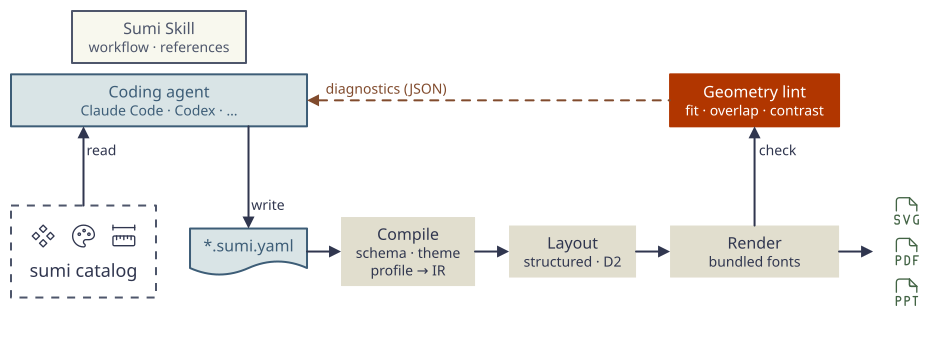

# Sumi

**コーディングエージェントが描き、検査し、直せる図。**

Sumi は AI コーディングエージェントのための Diagram-as-Code CLI です。エージェントは Sumi が提供するコンポーネント・テーマ・ページのプロファイルを調べ、`*.sumi.yaml` を書きます。Sumi はそれを SVG・PDF・PPTX に描画し、描画した図を計測して、文字のはみ出し、ラベルの重なり、コントラスト不足、ページ幅の超過などを機械可読な診断として返します。エージェントはあなたが見る前にそれを直せます。YAML は読みやすくレビューでき、出力は決定的です。

[Web サイト](https://nishide-dev.github.io/sumi-diagram/) · [作例](https://nishide-dev.github.io/sumi-diagram/#examples) · [コンポーネント](https://nishide-dev.github.io/sumi-diagram/#components) · [プロンプト作成](https://nishide-dev.github.io/sumi-diagram/#prompt) · [English](../README.md)

<picture>
  <source media="(prefers-color-scheme: dark)" srcset="assets/architecture.dark.svg">
  
</picture>

## はじめる

**1. CLI をインストールします**（macOS / Linux の x64 / arm64。ランタイムの導入は不要）:

```sh
curl -fsSL https://raw.githubusercontent.com/nishide-dev/sumi-diagram/main/install.sh | sh
```

**2. エージェントに Skill を追加します。** [skills](https://github.com/vercel-labs/skills) が、選んだエージェントのハーネスに導入します:

```sh
npx skills add nishide-dev/sumi-diagram --skill sumi
```

**3. 図を頼みます。** たとえば「データ取り込みのパイプラインを Sumi で論文の 1 段組の図にして」。Skill に従って、エージェントがカタログを調べ、YAML を書き、`fmt → lint → render` を実行して結果を目で確認します。参考資料・配置先・レイアウト・色まで含めた依頼文は[プロンプト作成](https://nishide-dev.github.io/sumi-diagram/#prompt)で作れます。

## エージェントと相性がよい理由

| | |
| --- | --- |
| **調べられる** | `sumi catalog --json` がコンポーネント・variant・props・テーマ・パレット・プロファイルをすべて返すので、エージェントは推測せず実在するものを使います。 |
| **描画後に検査する** | スキーマと参照の検査に加え、描画した図を幾何 lint で検査します（ページへの収まり、はみ出し、重なり、交差、コントラスト、色）。診断は YAML 上の位置を示し、多くは直し方のヒントを伴います。 |
| **機械可読** | `lint` と `render` の `--json` レポートと、安定した終了コード。スクリプトやエージェントのループに組み込めます。 |
| **決定的** | フォントを同梱し、レイアウトのバックエンドの版を固定しています。同じ版の Sumi と同じオプションなら、同じ YAML は同じバイト列になり、差分をレビューできます。 |
| **出力先に合わせる** | 論文の 1 段・全幅、16:9 のスライドのプロファイルが、ページの上限と最小文字サイズを持ちます。 |

## 描けるもの

フローやグラフは自動レイアウト、精密なブロック図は構造化レイアウト（行・列・グリッド・アンカー・残差接続）。テーマは `minimal`・`academic`・`color`・`paper`・`slides`・`llama` と、このプロジェクトのサイトに合わせた `sumi` / `sumi-dark`（上の図）の 8 種類。8 種類のカラーパレット、インライン数式、アイコン・絵文字・画像。出力は SVG、フォント埋め込みのベクター PDF、PPTX。

全コンポーネントを全テーマ・パレットで[Web サイト](https://nishide-dev.github.io/sumi-diagram/#components)で見られます。

## CLI を直接使う

```yaml
# hello.sumi.yaml
version: 1
figure:
  id: hello
  layout:
    direction: down
nodes:
  - {id: input, component: box, label: Input}
  - {id: output, component: box, label: Output}
edges:
  - {from: input, to: output}
```

```sh
sumi fmt hello.sumi.yaml
sumi lint hello.sumi.yaml
sumi render hello.sumi.yaml                 # hello.svg を書き出す
sumi render hello.sumi.yaml -o hello.pdf    # ベクター PDF を書き出す
```

`render` は実寸と、プロファイルに収まるかを表示します。コマンド、出力形式、JSON 出力の詳細は[利用ガイド](usage-ja.md)を参照してください。

<details>
<summary>インストールのオプション、更新、アンインストール</summary>

インストーラーは最新リリースをダウンロードして SHA-256 を検証し、D2 とフォントを本体の隣に置き、`~/.local/bin/sumi` にリンクして `sumi doctor` を実行します。案内が出たら `~/.local/bin` を `PATH` に追加してください。curl または wget、tar、sha256sum または shasum が必要です。sudo は使いません。

バージョンと導入先を指定する場合（環境変数は `sh` に渡します）:

```sh
curl -fsSL https://raw.githubusercontent.com/nishide-dev/sumi-diagram/main/install.sh | \
  SUMI_VERSION=0.18.1 SUMI_HOME="$HOME/.local/share/sumi" SUMI_BIN_DIR="$HOME/.local/bin" sh
```

**更新:** 同じインストーラーを再実行します。旧版のディレクトリは残るので、不要になったら削除できます。既定のパスでの**アンインストール**:

```sh
rm "$HOME/.local/bin/sumi"
rm -rf "$HOME/.local/share/sumi"
```

[手動インストールと macOS の注意点](usage-ja.md#インストールリリース版)も参照してください。

</details>

## ドキュメント

- [利用ガイド](usage-ja.md) · [User guide](usage.md): コマンド、診断、出力形式、インストール、環境変数
- [Skill の手順](../skills/sumi/SKILL.md) · [図の書式](../skills/sumi/references/figure-format.md) · [構造化レイアウト](../skills/sumi/references/structured.md) · [レイアウトのレシピ](../skills/sumi/references/layout-tips.md)
- [テーマ](themes-ja.md) · [lint ルール](lint-rules.md) · [コンポーネントギャラリー](gallery/README.md) · [作例](../examples/README.md)
- [エディタ補完用の JSON Schema](../schema/figure.v1.schema.json) · [コントリビュート](../CONTRIBUTING.md)

## ライセンス

[MIT](../LICENSE)。同梱のサードパーティ部品はそれぞれのライセンスに従い、各リリースに `NOTICE` と `licenses/` を含みます。
