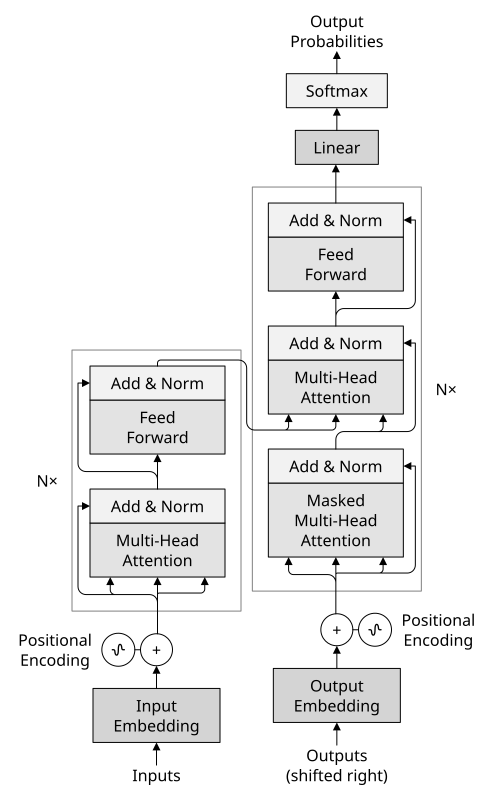
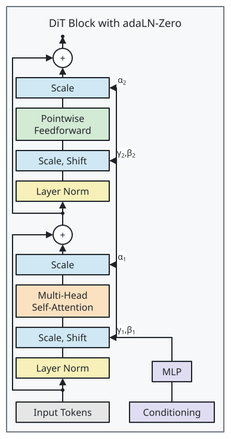

# Sumi

[English](../README.md)

**コードで描き、出力先に収まる図を。** Sumi は、コンポーネントライブラリとデザインシステムのテーマを使い、YAML から SVG・PDF・PPTX を生成する Diagram-as-Code CLI です。描画結果を幾何 lint で検査し、同梱フォントと固定版のレイアウトバックエンドで決定的な出力を得られます。本体は単一バイナリとして関連アセットと配布され、Bun・Node.js は不要です。同梱の Skill で Claude Code とも連携でき、作りたい図を伝えると、部品の探索、YAML の作成、検証まで進められます。

## 作れる図

公開されている参照図を Sumi で再現した Transformer アーキテクチャと DiT ブロックです。

<table>
  <tr>
    <th>Transformer</th>
    <th>DiT ブロック</th>
  </tr>
  <tr>
    <td></td>
    <td></td>
  </tr>
</table>

[コンポーネントギャラリー](gallery/README.md)と [YAML 付きの作例](../examples/README.md)をご覧ください。

## インストール

macOS / Linux の x64 / arm64 に対応。ランタイムの導入は不要です。

```sh
curl -fsSL https://raw.githubusercontent.com/nishide-dev/sumi-diagram/main/install.sh | sh
```

最新リリースをダウンロードし、SHA-256 を検証します。D2 とフォントの配置を保って展開し、`~/.local/bin/sumi` にリンクして `sumi doctor` を実行します。案内が出たら `~/.local/bin` を `PATH` に追加してください。curl または wget、tar、sha256sum または shasum が必要です。sudo は使いません。

バージョンと導入先を指定する場合（環境変数は `sh` に渡します）:

```sh
curl -fsSL https://raw.githubusercontent.com/nishide-dev/sumi-diagram/main/install.sh | \
  SUMI_VERSION=0.8.0 SUMI_HOME="$HOME/.local/share/sumi" SUMI_BIN_DIR="$HOME/.local/bin" sh
```

**更新:** 同じインストーラーを再実行します。旧版のディレクトリは残るので、不要になったら削除できます。既定のパスでの**アンインストール**:

```sh
rm "$HOME/.local/bin/sumi"
rm -rf "$HOME/.local/share/sumi"
```

導入先を変えた場合はそのパスに置き換えてください。[手動インストールと macOS の注意点](usage-ja.md#インストールリリース版)も参照できます。

## はじめての図

`hello.sumi.yaml` として保存します。

```yaml
version: 1
figure:
  id: hello
  layout:
    direction: down
nodes:
  - { id: input, component: box, label: Input }
  - { id: output, component: box, label: Output }
edges:
  - { from: input, to: output }
```

```sh
sumi fmt hello.sumi.yaml
sumi lint hello.sumi.yaml
sumi render hello.sumi.yaml                 # hello.svg を出力
sumi render hello.sumi.yaml -o hello.pdf    # ベクター PDF を出力
```

出力例:

```text
Wrote hello.svg: 23.64mm × 33.69mm (paper-single, max width 88mm; theme minimal).
```

描画すると実寸とプロファイルに収まるかを表示します。`hello.svg` をブラウザで開くか、`hello.pdf` を論文に取り込めます。一次ソースは YAML です。

## 主な機能

| 機能 | できること |
| --- | --- |
| [自動・構造化レイアウト](../skills/sumi/references/structured.md) | フローやグラフは自動配置。ブロック図は入れ子の行・列、アンカー、整列、残差接続の経路で構成できます。 |
| [テーマとプロファイル](usage-ja.md#テーマとプロファイル) | `minimal`・`academic`・`color`・`slides`・`paper`。見た目と、論文・スライドのページ寸法や最小文字サイズの制約を独立して選べます。 |
| [数式ラベル](../skills/sumi/references/figure-format.md) | 構造化レイアウトで、同梱の STIX Two フォントによるインライン数式を使えます。 |
| [アイコン・絵文字・画像](../skills/sumi/references/assets.md) | 同梱 Tabler アイコン、多色 Fluent 絵文字、ローカル PNG / JPEG / SVG を使えます。 |
| [PDF・PPTX](usage-ja.md#pdf-出力) | フォント埋め込みのベクター PDF、画像方式の PPTX、実験的な編集可能 PowerPoint オブジェクトを出力できます。 |
| [lint と診断](lint-rules.md) | スキーマや参照の検査に加え、描画後のページ上限、はみ出し、衝突を検査。[JSON 出力](usage-ja.md#機械可読な出力json)でスクリプトやエージェントと連携できます。 |

## Claude Code から使う

CLI を導入後、プロジェクトに Skill を追加します。

```sh
npx skills add nishide-dev/sumi-diagram --skill sumi -a claude-code -y
```

導入先のエージェントを対話的に選ぶ場合は `-a claude-code -y` を省略します。Skill は導入済み CLI を操作し、実行ファイル自体は含みません。`sumi` が `PATH` 上にあり、`sumi doctor` が通ることを確認してください。

Claude Code に **「このパイプラインを Sumi で論文の 1 段組の図にして」** と依頼します。Skill がカタログを探索し、YAML を書き、fmt → lint → render と目視確認まで行います。[Skill の手順](../skills/sumi/SKILL.md)と [CLI の探索順](usage-ja.md#claude-code-から使う)も参照してください。

## ドキュメント

- [English user guide](usage.md) · [日本語利用ガイド](usage-ja.md): コマンド、診断、出力形式、導入、環境設定
- [コンポーネントギャラリー](gallery/README.md) · [作例](../examples/README.md)
- [図の形式](../skills/sumi/references/figure-format.md) · [構造化レイアウト](../skills/sumi/references/structured.md) · [配置のレシピ](../skills/sumi/references/layout-tips.md)
- [エディタ補完用 JSON Schema](../schema/figure.v1.schema.json)
- [貢献ガイド](../CONTRIBUTING.md)

## ライセンス

[MIT](../LICENSE)。同梱のサードパーティ製コンポーネントには各ライセンスが適用され、リリースには `NOTICE` と `licenses/` が含まれます。
