# Sumi component gallery

> Generated by <code>bun run gallery</code> from the component catalog \(<code>sumi catalog \-\-json</code>\), the built\-in themes and profiles, and <code>examples/</code>\. Do not edit by hand\. The same content as a standalone page: [<code>index\.html</code>](index.html).

- [Components](#components)
  - [sumi/box](#sumibox)
  - [sumi/square](#sumisquare)
  - [sumi/circle](#sumicircle)
  - [sumi/ellipse](#sumiellipse)
  - [sumi/diamond](#sumidiamond)
  - [sumi/hexagon](#sumihexagon)
  - [sumi/parallelogram](#sumiparallelogram)
  - [sumi/cylinder](#sumicylinder)
  - [sumi/document](#sumidocument)
  - [sumi/trapezoid](#sumitrapezoid)
  - [sumi/stack](#sumistack)
  - [sumi/label](#sumilabel)
  - [sumi/operator](#sumioperator)
  - [sumi/junction](#sumijunction)
  - [sumi/image](#sumiimage)
  - [sumi/legend](#sumilegend)
  - [sumi/tokens](#sumitokens)
  - [sumi/matrix](#sumimatrix)
  - [sumi/container](#sumicontainer)
  - [sumi/arrow](#sumiarrow)
  - [sumi/line](#sumiline)
  - [sumi/double\-arrow](#sumidouble-arrow)
  - [sumi/zoom](#sumizoom)
- [Examples](#examples)
- [Themes and profiles](#themes-and-profiles)

## Components

Every built\-in component with every variant, under every built\-in theme \(profile <code>paper\-double</code>\)\. Each sample is the source shown below it; the other themes are rendered from the same source with <code>\-\-theme</code>\.

### sumi/box

A rectangle; the general\-purpose node\.

**kind**: <code>node</code> · **variants**: <code>default, emphasis, muted, filled, outlined, solid, tinted</code> · **since**: <code>0\.1\.0</code> · **shape**: <code>rectangle</code> · **sizing**: <code>auto</code>

| prop | type | required | description |
| --- | --- | --- | --- |
| <code>width</code> | <code>string</code> | no | Explicit width as a length such as &quot;30mm&quot; or &quot;40pt&quot; \(a multiple of 0\.5pt\)\. Omitted means sized to the label\. |
| <code>height</code> | <code>string</code> | no | Explicit height as a length such as &quot;10mm&quot; or &quot;20pt&quot; \(a multiple of 0\.5pt\)\. Omitted means sized to the label\. |

| <code>minimal</code> | <code>academic</code> | <code>slides</code> | <code>color</code> | <code>paper</code> |
| --- | --- | --- | --- | --- |
| 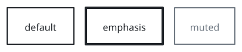 | 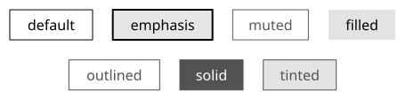 | 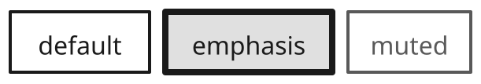 | 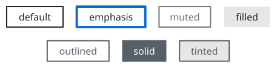 | 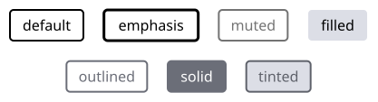 |
| <code>sumi render sumi\-box\.sumi\.yaml</code><br>80\.61mm × 19\.93mm \(max width 180mm, max height 220mm\) | <code>sumi render sumi\-box\.sumi\.yaml \-\-theme academic</code><br>80\.43mm × 19\.93mm \(max width 180mm, max height 220mm\) | <code>sumi render sumi\-box\.sumi\.yaml \-\-theme slides \-\-profile presentation\-16x9</code><br>160\.87mm × 40\.22mm \(max width 338\.7mm, max height 190\.5mm\) | <code>sumi render sumi\-box\.sumi\.yaml \-\-theme color</code><br>80\.61mm × 19\.93mm \(max width 180mm, max height 220mm\) | <code>sumi render sumi\-box\.sumi\.yaml \-\-theme paper</code><br>73\.55mm × 19\.93mm \(max width 180mm, max height 220mm\) |

<details>
<summary>Source: <code>sumi-box.sumi.yaml</code></summary>

```yaml
# sumi/box: every variant. Generated by `bun run gallery` (#17).
version: 1
figure:
  id: gallery-sumi-box
  title: sumi/box
  theme: minimal
  profile: paper-double
  layout:
    arrange:
      stack:
        items:
          - row: { items: [default, emphasis, muted, filled] }
          - row: { items: [outlined, solid, tinted] }

nodes:
  - id: default
    component: sumi/box
    label: default
  - id: emphasis
    component: sumi/box
    label: emphasis
    variant: emphasis
  - id: muted
    component: sumi/box
    label: muted
    variant: muted
  - id: filled
    component: sumi/box
    label: filled
    variant: filled
  - id: outlined
    component: sumi/box
    label: outlined
    variant: outlined
  - id: solid
    component: sumi/box
    label: solid
    variant: solid
  - id: tinted
    component: sumi/box
    label: tinted
    variant: tinted
```

</details>

### sumi/square

A square\.

**kind**: <code>node</code> · **variants**: <code>default, emphasis, muted, filled, outlined, solid, tinted</code> · **since**: <code>0\.1\.0</code> · **shape**: <code>square</code> · **sizing**: <code>fixed\-aspect\-1</code>

| prop | type | required | description |
| --- | --- | --- | --- |
| <code>width</code> | <code>string</code> | no | Explicit width as a length such as &quot;30mm&quot; or &quot;40pt&quot; \(a multiple of 0\.5pt\)\. Omitted means sized to the label\. |
| <code>height</code> | <code>string</code> | no | Explicit height as a length such as &quot;10mm&quot; or &quot;20pt&quot; \(a multiple of 0\.5pt\)\. Omitted means sized to the label\. |

| <code>minimal</code> | <code>academic</code> | <code>slides</code> | <code>color</code> | <code>paper</code> |
| --- | --- | --- | --- | --- |
| 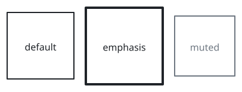 | 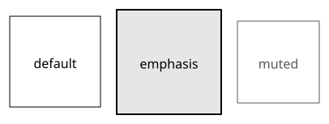 | 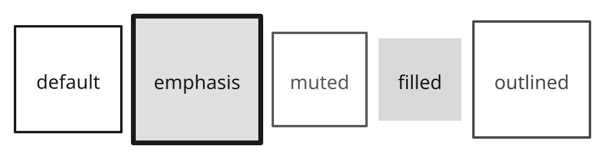 | 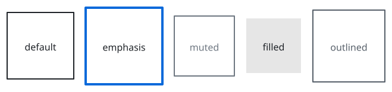 | 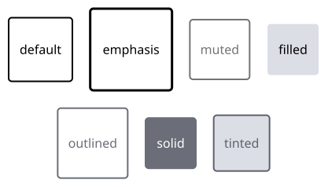 |
| <code>sumi render sumi\-square\.sumi\.yaml</code><br>80\.61mm × 45\.86mm \(max width 180mm, max height 220mm\) | <code>sumi render sumi\-square\.sumi\.yaml \-\-theme academic</code><br>80\.43mm × 45\.68mm \(max width 180mm, max height 220mm\) | <code>sumi render sumi\-square\.sumi\.yaml \-\-theme slides \-\-profile presentation\-16x9</code><br>160\.87mm × 91\.9mm \(max width 338\.7mm, max height 190\.5mm\) | <code>sumi render sumi\-square\.sumi\.yaml \-\-theme color</code><br>80\.61mm × 45\.86mm \(max width 180mm, max height 220mm\) | <code>sumi render sumi\-square\.sumi\.yaml \-\-theme paper</code><br>73\.55mm × 41\.98mm \(max width 180mm, max height 220mm\) |

<details>
<summary>Source: <code>sumi-square.sumi.yaml</code></summary>

```yaml
# sumi/square: every variant. Generated by `bun run gallery` (#17).
version: 1
figure:
  id: gallery-sumi-square
  title: sumi/square
  theme: minimal
  profile: paper-double
  layout:
    arrange:
      stack:
        items:
          - row: { items: [default, emphasis, muted, filled] }
          - row: { items: [outlined, solid, tinted] }

nodes:
  - id: default
    component: sumi/square
    label: default
  - id: emphasis
    component: sumi/square
    label: emphasis
    variant: emphasis
  - id: muted
    component: sumi/square
    label: muted
    variant: muted
  - id: filled
    component: sumi/square
    label: filled
    variant: filled
  - id: outlined
    component: sumi/square
    label: outlined
    variant: outlined
  - id: solid
    component: sumi/square
    label: solid
    variant: solid
  - id: tinted
    component: sumi/square
    label: tinted
    variant: tinted
```

</details>

### sumi/circle

A circle\.

**kind**: <code>node</code> · **variants**: <code>default, emphasis, muted, filled, outlined, solid, tinted</code> · **since**: <code>0\.1\.0</code> · **shape**: <code>circle</code> · **sizing**: <code>fixed\-aspect\-1</code>

| prop | type | required | description |
| --- | --- | --- | --- |
| <code>width</code> | <code>string</code> | no | Explicit width as a length such as &quot;30mm&quot; or &quot;40pt&quot; \(a multiple of 0\.5pt\)\. Omitted means sized to the label\. |
| <code>height</code> | <code>string</code> | no | Explicit height as a length such as &quot;10mm&quot; or &quot;20pt&quot; \(a multiple of 0\.5pt\)\. Omitted means sized to the label\. |

| <code>minimal</code> | <code>academic</code> | <code>slides</code> | <code>color</code> | <code>paper</code> |
| --- | --- | --- | --- | --- |
| 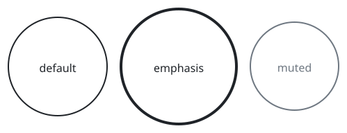 | 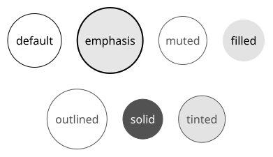 | 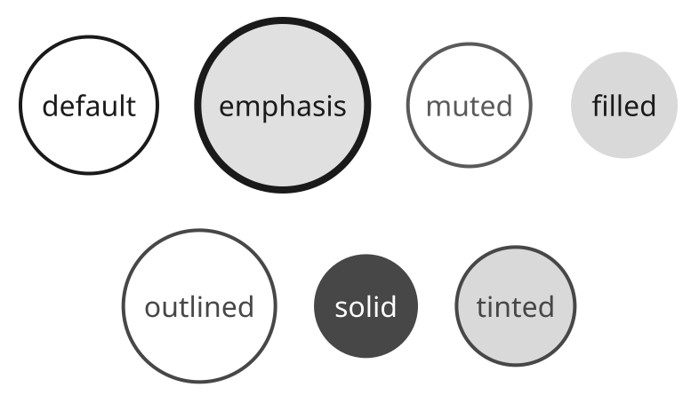 | 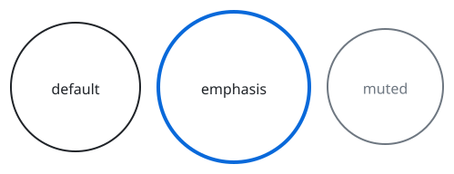 | 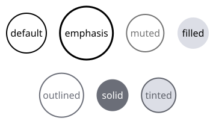 |
| <code>sumi render sumi\-circle\.sumi\.yaml</code><br>69\.32mm × 40\.04mm \(max width 180mm, max height 220mm\) | <code>sumi render sumi\-circle\.sumi\.yaml \-\-theme academic</code><br>68\.97mm × 39\.69mm \(max width 180mm, max height 220mm\) | <code>sumi render sumi\-circle\.sumi\.yaml \-\-theme slides \-\-profile presentation\-16x9</code><br>138\.64mm × 80\.08mm \(max width 338\.7mm, max height 190\.5mm\) | <code>sumi render sumi\-circle\.sumi\.yaml \-\-theme color</code><br>69\.32mm × 40\.04mm \(max width 180mm, max height 220mm\) | <code>sumi render sumi\-circle\.sumi\.yaml \-\-theme paper</code><br>63\.32mm × 36\.34mm \(max width 180mm, max height 220mm\) |

<details>
<summary>Source: <code>sumi-circle.sumi.yaml</code></summary>

```yaml
# sumi/circle: every variant. Generated by `bun run gallery` (#17).
version: 1
figure:
  id: gallery-sumi-circle
  title: sumi/circle
  theme: minimal
  profile: paper-double
  layout:
    arrange:
      stack:
        items:
          - row: { items: [default, emphasis, muted, filled] }
          - row: { items: [outlined, solid, tinted] }

nodes:
  - id: default
    component: sumi/circle
    label: default
  - id: emphasis
    component: sumi/circle
    label: emphasis
    variant: emphasis
  - id: muted
    component: sumi/circle
    label: muted
    variant: muted
  - id: filled
    component: sumi/circle
    label: filled
    variant: filled
  - id: outlined
    component: sumi/circle
    label: outlined
    variant: outlined
  - id: solid
    component: sumi/circle
    label: solid
    variant: solid
  - id: tinted
    component: sumi/circle
    label: tinted
    variant: tinted
```

</details>

### sumi/ellipse

An ellipse\.

**kind**: <code>node</code> · **variants**: <code>default, emphasis, muted, filled, outlined, solid, tinted</code> · **since**: <code>0\.1\.0</code> · **shape**: <code>oval</code> · **sizing**: <code>auto</code>

| prop | type | required | description |
| --- | --- | --- | --- |
| <code>width</code> | <code>string</code> | no | Explicit width as a length such as &quot;30mm&quot; or &quot;40pt&quot; \(a multiple of 0\.5pt\)\. Omitted means sized to the label\. |
| <code>height</code> | <code>string</code> | no | Explicit height as a length such as &quot;10mm&quot; or &quot;20pt&quot; \(a multiple of 0\.5pt\)\. Omitted means sized to the label\. |

| <code>minimal</code> | <code>academic</code> | <code>slides</code> | <code>color</code> | <code>paper</code> |
| --- | --- | --- | --- | --- |
| 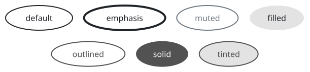 | 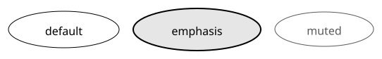 | 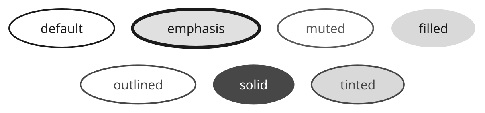 | 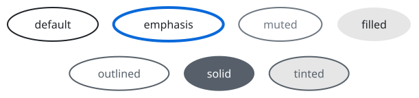 | 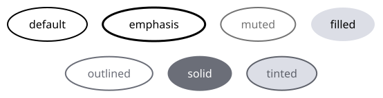 |
| <code>sumi render sumi\-ellipse\.sumi\.yaml</code><br>107\.77mm × 25\.22mm \(max width 180mm, max height 220mm\) | <code>sumi render sumi\-ellipse\.sumi\.yaml \-\-theme academic</code><br>107\.6mm × 25\.22mm \(max width 180mm, max height 220mm\) | <code>sumi render sumi\-ellipse\.sumi\.yaml \-\-theme slides \-\-profile presentation\-16x9</code><br>214\.67mm × 50\.45mm \(max width 338\.7mm, max height 190\.5mm\) | <code>sumi render sumi\-ellipse\.sumi\.yaml \-\-theme color</code><br>107\.77mm × 25\.22mm \(max width 180mm, max height 220mm\) | <code>sumi render sumi\-ellipse\.sumi\.yaml \-\-theme paper</code><br>97\.72mm × 25\.22mm \(max width 180mm, max height 220mm\) |

<details>
<summary>Source: <code>sumi-ellipse.sumi.yaml</code></summary>

```yaml
# sumi/ellipse: every variant. Generated by `bun run gallery` (#17).
version: 1
figure:
  id: gallery-sumi-ellipse
  title: sumi/ellipse
  theme: minimal
  profile: paper-double
  layout:
    arrange:
      stack:
        items:
          - row: { items: [default, emphasis, muted, filled] }
          - row: { items: [outlined, solid, tinted] }

nodes:
  - id: default
    component: sumi/ellipse
    label: default
  - id: emphasis
    component: sumi/ellipse
    label: emphasis
    variant: emphasis
  - id: muted
    component: sumi/ellipse
    label: muted
    variant: muted
  - id: filled
    component: sumi/ellipse
    label: filled
    variant: filled
  - id: outlined
    component: sumi/ellipse
    label: outlined
    variant: outlined
  - id: solid
    component: sumi/ellipse
    label: solid
    variant: solid
  - id: tinted
    component: sumi/ellipse
    label: tinted
    variant: tinted
```

</details>

### sumi/diamond

A diamond, e\.g\. for decisions\.

**kind**: <code>node</code> · **variants**: <code>default, emphasis, muted, filled, outlined, solid, tinted</code> · **since**: <code>0\.1\.0</code> · **shape**: <code>diamond</code> · **sizing**: <code>auto</code>

| prop | type | required | description |
| --- | --- | --- | --- |
| <code>width</code> | <code>string</code> | no | Explicit width as a length such as &quot;30mm&quot; or &quot;40pt&quot; \(a multiple of 0\.5pt\)\. Omitted means sized to the label\. |
| <code>height</code> | <code>string</code> | no | Explicit height as a length such as &quot;10mm&quot; or &quot;20pt&quot; \(a multiple of 0\.5pt\)\. Omitted means sized to the label\. |

| <code>minimal</code> | <code>academic</code> | <code>slides</code> | <code>color</code> | <code>paper</code> |
| --- | --- | --- | --- | --- |
| 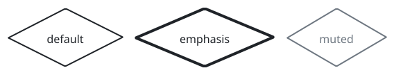 | 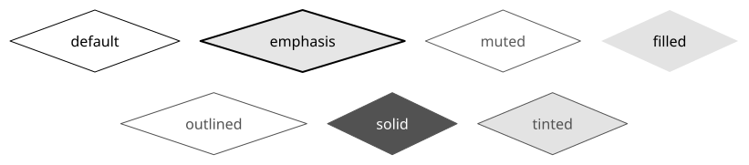 | 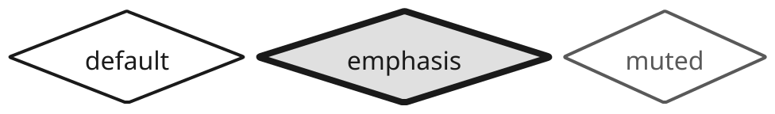 | 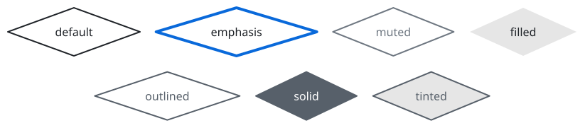 | 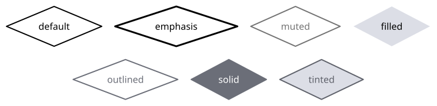 |
| <code>sumi render sumi\-diamond\.sumi\.yaml</code><br>145\.17mm × 31\.93mm \(max width 180mm, max height 220mm\) | <code>sumi render sumi\-diamond\.sumi\.yaml \-\-theme academic</code><br>144\.82mm × 31\.93mm \(max width 180mm, max height 220mm\) | <code>sumi render sumi\-diamond\.sumi\.yaml \-\-theme slides \-\-profile presentation\-16x9</code><br>289\.45mm × 64\.21mm \(max width 338\.7mm, max height 190\.5mm\) | <code>sumi render sumi\-diamond\.sumi\.yaml \-\-theme color</code><br>145\.17mm × 31\.93mm \(max width 180mm, max height 220mm\) | <code>sumi render sumi\-diamond\.sumi\.yaml \-\-theme paper</code><br>131\.06mm × 31\.93mm \(max width 180mm, max height 220mm\) |

<details>
<summary>Source: <code>sumi-diamond.sumi.yaml</code></summary>

```yaml
# sumi/diamond: every variant. Generated by `bun run gallery` (#17).
version: 1
figure:
  id: gallery-sumi-diamond
  title: sumi/diamond
  theme: minimal
  profile: paper-double
  layout:
    arrange:
      stack:
        items:
          - row: { items: [default, emphasis, muted, filled] }
          - row: { items: [outlined, solid, tinted] }

nodes:
  - id: default
    component: sumi/diamond
    label: default
  - id: emphasis
    component: sumi/diamond
    label: emphasis
    variant: emphasis
  - id: muted
    component: sumi/diamond
    label: muted
    variant: muted
  - id: filled
    component: sumi/diamond
    label: filled
    variant: filled
  - id: outlined
    component: sumi/diamond
    label: outlined
    variant: outlined
  - id: solid
    component: sumi/diamond
    label: solid
    variant: solid
  - id: tinted
    component: sumi/diamond
    label: tinted
    variant: tinted
```

</details>

### sumi/hexagon

A hexagon\.

**kind**: <code>node</code> · **variants**: <code>default, emphasis, muted, filled, outlined, solid, tinted</code> · **since**: <code>0\.1\.0</code> · **shape**: <code>hexagon</code> · **sizing**: <code>auto</code>

| prop | type | required | description |
| --- | --- | --- | --- |
| <code>width</code> | <code>string</code> | no | Explicit width as a length such as &quot;30mm&quot; or &quot;40pt&quot; \(a multiple of 0\.5pt\)\. Omitted means sized to the label\. |
| <code>height</code> | <code>string</code> | no | Explicit height as a length such as &quot;10mm&quot; or &quot;20pt&quot; \(a multiple of 0\.5pt\)\. Omitted means sized to the label\. |

| <code>minimal</code> | <code>academic</code> | <code>slides</code> | <code>color</code> | <code>paper</code> |
| --- | --- | --- | --- | --- |
| 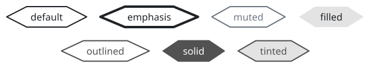 | 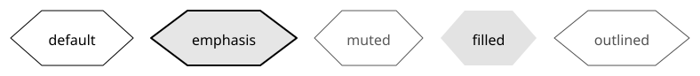 | 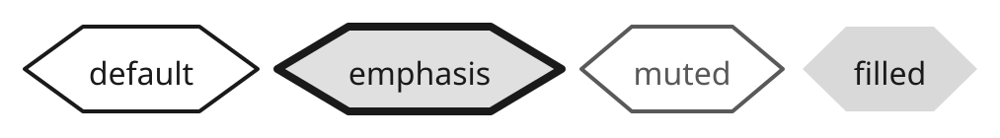 | 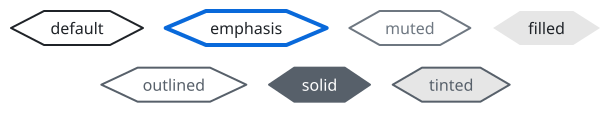 | 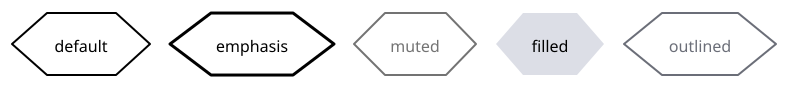 |
| <code>sumi render sumi\-hexagon\.sumi\.yaml</code><br>107\.95mm × 19\.93mm \(max width 180mm, max height 220mm\) | <code>sumi render sumi\-hexagon\.sumi\.yaml \-\-theme academic</code><br>107\.6mm × 19\.93mm \(max width 180mm, max height 220mm\) | <code>sumi render sumi\-hexagon\.sumi\.yaml \-\-theme slides \-\-profile presentation\-16x9</code><br>214\.84mm × 40\.22mm \(max width 338\.7mm, max height 190\.5mm\) | <code>sumi render sumi\-hexagon\.sumi\.yaml \-\-theme color</code><br>107\.95mm × 19\.93mm \(max width 180mm, max height 220mm\) | <code>sumi render sumi\-hexagon\.sumi\.yaml \-\-theme paper</code><br>97\.9mm × 19\.93mm \(max width 180mm, max height 220mm\) |

<details>
<summary>Source: <code>sumi-hexagon.sumi.yaml</code></summary>

```yaml
# sumi/hexagon: every variant. Generated by `bun run gallery` (#17).
version: 1
figure:
  id: gallery-sumi-hexagon
  title: sumi/hexagon
  theme: minimal
  profile: paper-double
  layout:
    arrange:
      stack:
        items:
          - row: { items: [default, emphasis, muted, filled] }
          - row: { items: [outlined, solid, tinted] }

nodes:
  - id: default
    component: sumi/hexagon
    label: default
  - id: emphasis
    component: sumi/hexagon
    label: emphasis
    variant: emphasis
  - id: muted
    component: sumi/hexagon
    label: muted
    variant: muted
  - id: filled
    component: sumi/hexagon
    label: filled
    variant: filled
  - id: outlined
    component: sumi/hexagon
    label: outlined
    variant: outlined
  - id: solid
    component: sumi/hexagon
    label: solid
    variant: solid
  - id: tinted
    component: sumi/hexagon
    label: tinted
    variant: tinted
```

</details>

### sumi/parallelogram

A parallelogram, e\.g\. for input or output\.

**kind**: <code>node</code> · **variants**: <code>default, emphasis, muted, filled, outlined, solid, tinted</code> · **since**: <code>0\.1\.0</code> · **shape**: <code>parallelogram</code> · **sizing**: <code>auto</code>

| prop | type | required | description |
| --- | --- | --- | --- |
| <code>width</code> | <code>string</code> | no | Explicit width as a length such as &quot;30mm&quot; or &quot;40pt&quot; \(a multiple of 0\.5pt\)\. Omitted means sized to the label\. |
| <code>height</code> | <code>string</code> | no | Explicit height as a length such as &quot;10mm&quot; or &quot;20pt&quot; \(a multiple of 0\.5pt\)\. Omitted means sized to the label\. |

| <code>minimal</code> | <code>academic</code> | <code>slides</code> | <code>color</code> | <code>paper</code> |
| --- | --- | --- | --- | --- |
| 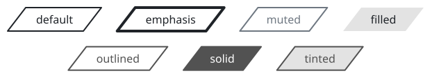 | 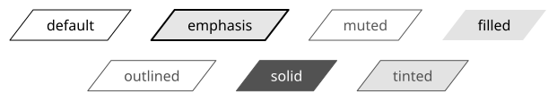 | 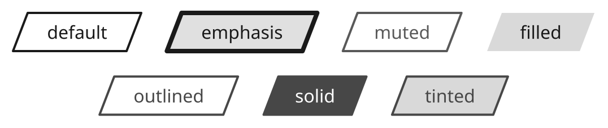 | 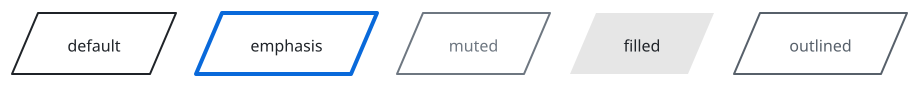 | 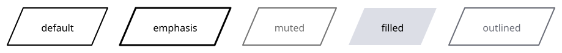 |
| <code>sumi render sumi\-parallelogram\.sumi\.yaml</code><br>109\.71mm × 19\.93mm \(max width 180mm, max height 220mm\) | <code>sumi render sumi\-parallelogram\.sumi\.yaml \-\-theme academic</code><br>109\.54mm × 19\.93mm \(max width 180mm, max height 220mm\) | <code>sumi render sumi\-parallelogram\.sumi\.yaml \-\-theme slides \-\-profile presentation\-16x9</code><br>189\.79mm × 40\.22mm \(max width 338\.7mm, max height 190\.5mm\) | <code>sumi render sumi\-parallelogram\.sumi\.yaml \-\-theme color</code><br>109\.71mm × 19\.93mm \(max width 180mm, max height 220mm\) | <code>sumi render sumi\-parallelogram\.sumi\.yaml \-\-theme paper</code><br>102\.83mm × 19\.93mm \(max width 180mm, max height 220mm\) |

<details>
<summary>Source: <code>sumi-parallelogram.sumi.yaml</code></summary>

```yaml
# sumi/parallelogram: every variant. Generated by `bun run gallery` (#17).
version: 1
figure:
  id: gallery-sumi-parallelogram
  title: sumi/parallelogram
  theme: minimal
  profile: paper-double
  layout:
    arrange:
      stack:
        items:
          - row: { items: [default, emphasis, muted, filled] }
          - row: { items: [outlined, solid, tinted] }

nodes:
  - id: default
    component: sumi/parallelogram
    label: default
  - id: emphasis
    component: sumi/parallelogram
    label: emphasis
    variant: emphasis
  - id: muted
    component: sumi/parallelogram
    label: muted
    variant: muted
  - id: filled
    component: sumi/parallelogram
    label: filled
    variant: filled
  - id: outlined
    component: sumi/parallelogram
    label: outlined
    variant: outlined
  - id: solid
    component: sumi/parallelogram
    label: solid
    variant: solid
  - id: tinted
    component: sumi/parallelogram
    label: tinted
    variant: tinted
```

</details>

### sumi/cylinder

A cylinder, e\.g\. for storage\.

**kind**: <code>node</code> · **variants**: <code>default, emphasis, muted, filled, outlined, solid, tinted</code> · **since**: <code>0\.1\.0</code> · **shape**: <code>cylinder</code> · **sizing**: <code>auto</code>

| prop | type | required | description |
| --- | --- | --- | --- |
| <code>width</code> | <code>string</code> | no | Explicit width as a length such as &quot;30mm&quot; or &quot;40pt&quot; \(a multiple of 0\.5pt\)\. Omitted means sized to the label\. |
| <code>height</code> | <code>string</code> | no | Explicit height as a length such as &quot;10mm&quot; or &quot;20pt&quot; \(a multiple of 0\.5pt\)\. Omitted means sized to the label\. |

| <code>minimal</code> | <code>academic</code> | <code>slides</code> | <code>color</code> | <code>paper</code> |
| --- | --- | --- | --- | --- |
| 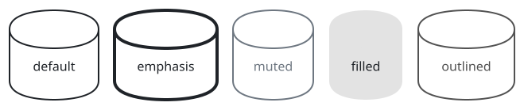 | 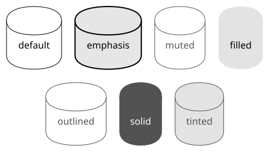 | 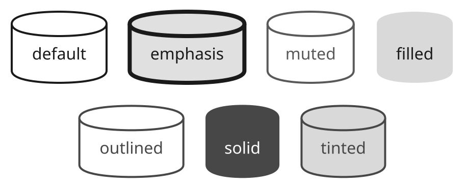 | 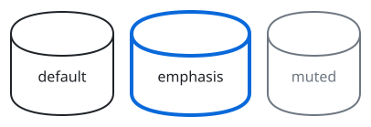 | 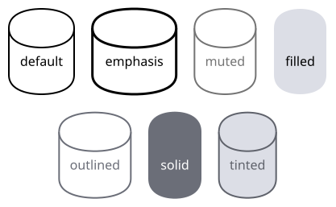 |
| <code>sumi render sumi\-cylinder\.sumi\.yaml</code><br>80\.61mm × 45\.33mm \(max width 180mm, max height 220mm\) | <code>sumi render sumi\-cylinder\.sumi\.yaml \-\-theme academic</code><br>80\.43mm × 45\.33mm \(max width 180mm, max height 220mm\) | <code>sumi render sumi\-cylinder\.sumi\.yaml \-\-theme slides \-\-profile presentation\-16x9</code><br>160\.87mm × 65\.62mm \(max width 338\.7mm, max height 190\.5mm\) | <code>sumi render sumi\-cylinder\.sumi\.yaml \-\-theme color</code><br>80\.61mm × 45\.33mm \(max width 180mm, max height 220mm\) | <code>sumi render sumi\-cylinder\.sumi\.yaml \-\-theme paper</code><br>73\.55mm × 45\.33mm \(max width 180mm, max height 220mm\) |

<details>
<summary>Source: <code>sumi-cylinder.sumi.yaml</code></summary>

```yaml
# sumi/cylinder: every variant. Generated by `bun run gallery` (#17).
version: 1
figure:
  id: gallery-sumi-cylinder
  title: sumi/cylinder
  theme: minimal
  profile: paper-double
  layout:
    arrange:
      stack:
        items:
          - row: { items: [default, emphasis, muted, filled] }
          - row: { items: [outlined, solid, tinted] }

nodes:
  - id: default
    component: sumi/cylinder
    label: default
  - id: emphasis
    component: sumi/cylinder
    label: emphasis
    variant: emphasis
  - id: muted
    component: sumi/cylinder
    label: muted
    variant: muted
  - id: filled
    component: sumi/cylinder
    label: filled
    variant: filled
  - id: outlined
    component: sumi/cylinder
    label: outlined
    variant: outlined
  - id: solid
    component: sumi/cylinder
    label: solid
    variant: solid
  - id: tinted
    component: sumi/cylinder
    label: tinted
    variant: tinted
```

</details>

### sumi/document

A page with a wavy bottom edge, e\.g\. for documents\.

**kind**: <code>node</code> · **variants**: <code>default, emphasis, muted, filled, outlined, solid, tinted</code> · **since**: <code>0\.1\.0</code> · **shape**: <code>document</code> · **sizing**: <code>auto</code>

| prop | type | required | description |
| --- | --- | --- | --- |
| <code>width</code> | <code>string</code> | no | Explicit width as a length such as &quot;30mm&quot; or &quot;40pt&quot; \(a multiple of 0\.5pt\)\. Omitted means sized to the label\. |
| <code>height</code> | <code>string</code> | no | Explicit height as a length such as &quot;10mm&quot; or &quot;20pt&quot; \(a multiple of 0\.5pt\)\. Omitted means sized to the label\. |

| <code>minimal</code> | <code>academic</code> | <code>slides</code> | <code>color</code> | <code>paper</code> |
| --- | --- | --- | --- | --- |
| 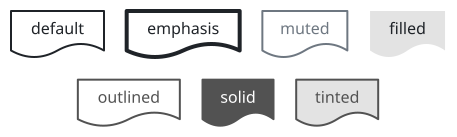 | 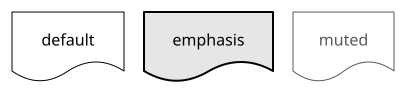 | 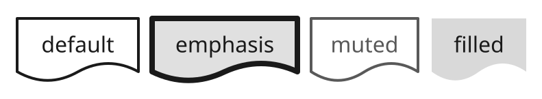 | 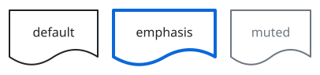 | 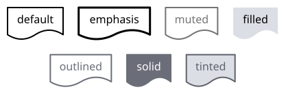 |
| <code>sumi render sumi\-document\.sumi\.yaml</code><br>80\.61mm × 24\.17mm \(max width 180mm, max height 220mm\) | <code>sumi render sumi\-document\.sumi\.yaml \-\-theme academic</code><br>80\.43mm × 24\.17mm \(max width 180mm, max height 220mm\) | <code>sumi render sumi\-document\.sumi\.yaml \-\-theme slides \-\-profile presentation\-16x9</code><br>160\.87mm × 48\.68mm \(max width 338\.7mm, max height 190\.5mm\) | <code>sumi render sumi\-document\.sumi\.yaml \-\-theme color</code><br>80\.61mm × 24\.17mm \(max width 180mm, max height 220mm\) | <code>sumi render sumi\-document\.sumi\.yaml \-\-theme paper</code><br>73\.55mm × 24\.17mm \(max width 180mm, max height 220mm\) |

<details>
<summary>Source: <code>sumi-document.sumi.yaml</code></summary>

```yaml
# sumi/document: every variant. Generated by `bun run gallery` (#17).
version: 1
figure:
  id: gallery-sumi-document
  title: sumi/document
  theme: minimal
  profile: paper-double
  layout:
    arrange:
      stack:
        items:
          - row: { items: [default, emphasis, muted, filled] }
          - row: { items: [outlined, solid, tinted] }

nodes:
  - id: default
    component: sumi/document
    label: default
  - id: emphasis
    component: sumi/document
    label: emphasis
    variant: emphasis
  - id: muted
    component: sumi/document
    label: muted
    variant: muted
  - id: filled
    component: sumi/document
    label: filled
    variant: filled
  - id: outlined
    component: sumi/document
    label: outlined
    variant: outlined
  - id: solid
    component: sumi/document
    label: solid
    variant: solid
  - id: tinted
    component: sumi/document
    label: tinted
    variant: tinted
```

</details>

### sumi/trapezoid

A trapezoid with a wider top and a narrower bottom\.

**kind**: <code>node</code> · **variants**: <code>default, emphasis, muted, filled, outlined, solid, tinted</code> · **since**: <code>0\.3\.0</code> · **shape**: <code>rectangle</code> · **sizing**: <code>auto</code> · **render**: <code>\{&quot;type&quot;:&quot;outline&quot;,&quot;renderer&quot;:&quot;sumi/trapezoid&quot;,&quot;params&quot;:\{&quot;slant&quot;:0\.4\}\}</code>

| prop | type | required | description |
| --- | --- | --- | --- |
| <code>width</code> | <code>string</code> | no | Explicit width as a length such as &quot;30mm&quot; or &quot;40pt&quot; \(a multiple of 0\.5pt\)\. Omitted means sized to the label\. |
| <code>height</code> | <code>string</code> | no | Explicit height as a length such as &quot;10mm&quot; or &quot;20pt&quot; \(a multiple of 0\.5pt\)\. Omitted means sized to the label\. |

| <code>minimal</code> | <code>academic</code> | <code>slides</code> | <code>color</code> | <code>paper</code> |
| --- | --- | --- | --- | --- |
| 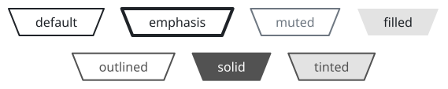 | 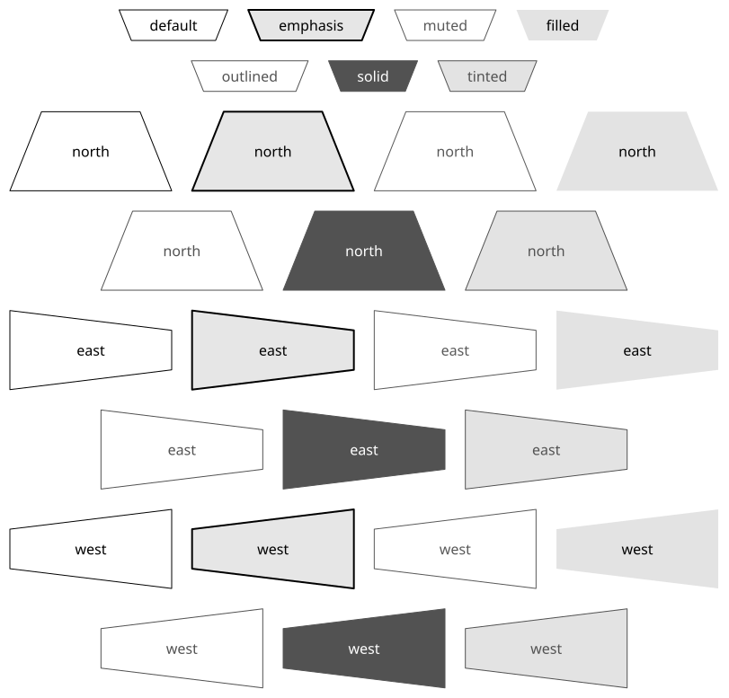 | 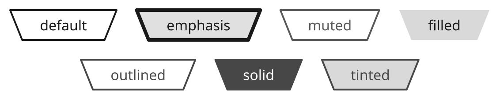 | 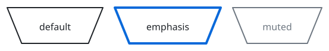 | 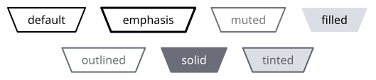 |
| <code>sumi render sumi\-trapezoid\.sumi\.yaml</code><br>100\.37mm × 19\.93mm \(max width 180mm, max height 220mm\) | <code>sumi render sumi\-trapezoid\.sumi\.yaml \-\-theme academic</code><br>100\.19mm × 19\.93mm \(max width 180mm, max height 220mm\) | <code>sumi render sumi\-trapezoid\.sumi\.yaml \-\-theme slides \-\-profile presentation\-16x9</code><br>199\.67mm × 40\.22mm \(max width 338\.7mm, max height 190\.5mm\) | <code>sumi render sumi\-trapezoid\.sumi\.yaml \-\-theme color</code><br>100\.37mm × 19\.93mm \(max width 180mm, max height 220mm\) | <code>sumi render sumi\-trapezoid\.sumi\.yaml \-\-theme paper</code><br>93\.31mm × 19\.93mm \(max width 180mm, max height 220mm\) |

<details>
<summary>Source: <code>sumi-trapezoid.sumi.yaml</code></summary>

```yaml
# sumi/trapezoid: every variant. Generated by `bun run gallery` (#17).
version: 1
figure:
  id: gallery-sumi-trapezoid
  title: sumi/trapezoid
  theme: minimal
  profile: paper-double
  layout:
    arrange:
      stack:
        items:
          - row: { items: [default, emphasis, muted, filled] }
          - row: { items: [outlined, solid, tinted] }

nodes:
  - id: default
    component: sumi/trapezoid
    label: default
  - id: emphasis
    component: sumi/trapezoid
    label: emphasis
    variant: emphasis
  - id: muted
    component: sumi/trapezoid
    label: muted
    variant: muted
  - id: filled
    component: sumi/trapezoid
    label: filled
    variant: filled
  - id: outlined
    component: sumi/trapezoid
    label: outlined
    variant: outlined
  - id: solid
    component: sumi/trapezoid
    label: solid
    variant: solid
  - id: tinted
    component: sumi/trapezoid
    label: tinted
    variant: tinted
```

</details>

### sumi/stack

Three overlapping rectangles, e\.g\. for a collection of documents or layers\.

**kind**: <code>node</code> · **variants**: <code>default, emphasis, muted, outlined, solid, tinted</code> · **since**: <code>0\.3\.0</code> · **shape**: <code>rectangle</code> · **sizing**: <code>auto</code> · **render**: <code>\{&quot;type&quot;:&quot;outline&quot;,&quot;renderer&quot;:&quot;sumi/stack&quot;,&quot;params&quot;:\{&quot;layers&quot;:3,&quot;offset&quot;:8\}\}</code>

| prop | type | required | description |
| --- | --- | --- | --- |
| <code>width</code> | <code>string</code> | no | Explicit width as a length such as &quot;30mm&quot; or &quot;40pt&quot; \(a multiple of 0\.5pt\)\. Omitted means sized to the label\. |
| <code>height</code> | <code>string</code> | no | Explicit height as a length such as &quot;10mm&quot; or &quot;20pt&quot; \(a multiple of 0\.5pt\)\. Omitted means sized to the label\. |

| <code>minimal</code> | <code>academic</code> | <code>slides</code> | <code>color</code> | <code>paper</code> |
| --- | --- | --- | --- | --- |
|  |  |  |  |  |
| <code>sumi render sumi\-stack\.sumi\.yaml</code><br>96\.66mm × 25\.58mm \(max width 180mm, max height 220mm\) | <code>sumi render sumi\-stack\.sumi\.yaml \-\-theme academic</code><br>96\.48mm × 25\.58mm \(max width 180mm, max height 220mm\) | <code>sumi render sumi\-stack\.sumi\.yaml \-\-theme slides \-\-profile presentation\-16x9</code><br>181\.86mm × 45\.86mm \(max width 338\.7mm, max height 190\.5mm\) | <code>sumi render sumi\-stack\.sumi\.yaml \-\-theme color</code><br>96\.66mm × 25\.58mm \(max width 180mm, max height 220mm\) | <code>sumi render sumi\-stack\.sumi\.yaml \-\-theme paper</code><br>89\.08mm × 25\.58mm \(max width 180mm, max height 220mm\) |

<details>
<summary>Source: <code>sumi-stack.sumi.yaml</code></summary>

```yaml
# sumi/stack: every variant. Generated by `bun run gallery` (#17).
version: 1
figure:
  id: gallery-sumi-stack
  title: sumi/stack
  theme: minimal
  profile: paper-double
  layout:
    arrange:
      stack:
        items:
          - row: { items: [default, emphasis, muted, outlined] }
          - row: { items: [solid, tinted] }

nodes:
  - id: default
    component: sumi/stack
    label: default
  - id: emphasis
    component: sumi/stack
    label: emphasis
    variant: emphasis
  - id: muted
    component: sumi/stack
    label: muted
    variant: muted
  - id: outlined
    component: sumi/stack
    label: outlined
    variant: outlined
  - id: solid
    component: sumi/stack
    label: solid
    variant: solid
  - id: tinted
    component: sumi/stack
    label: tinted
    variant: tinted
```

</details>

### sumi/label

Text without a border\.

**kind**: <code>node</code> · **variants**: <code>default, muted</code> · **since**: <code>0\.1\.0</code> · **shape**: <code>text</code> · **sizing**: <code>auto</code>

| prop | type | required | description |
| --- | --- | --- | --- |
| <code>width</code> | <code>string</code> | no | Explicit width as a length such as &quot;30mm&quot; or &quot;40pt&quot; \(a multiple of 0\.5pt\)\. Omitted means sized to the label\. |
| <code>height</code> | <code>string</code> | no | Explicit height as a length such as &quot;10mm&quot; or &quot;20pt&quot; \(a multiple of 0\.5pt\)\. Omitted means sized to the label\. |

| <code>minimal</code> | <code>academic</code> | <code>slides</code> | <code>color</code> | <code>paper</code> |
| --- | --- | --- | --- | --- |
|  |  |  |  |  |
| <code>sumi render sumi\-label\.sumi\.yaml</code><br>28\.4mm × 6\.7mm \(max width 180mm, max height 220mm\) | <code>sumi render sumi\-label\.sumi\.yaml \-\-theme academic</code><br>28\.4mm × 6\.7mm \(max width 180mm, max height 220mm\) | <code>sumi render sumi\-label\.sumi\.yaml \-\-theme slides</code><br>49\.04mm × 9\.53mm \(max width 180mm, max height 220mm\) | <code>sumi render sumi\-label\.sumi\.yaml \-\-theme color</code><br>28\.4mm × 6\.7mm \(max width 180mm, max height 220mm\) | <code>sumi render sumi\-label\.sumi\.yaml \-\-theme paper</code><br>28\.4mm × 6\.7mm \(max width 180mm, max height 220mm\) |

<details>
<summary>Source: <code>sumi-label.sumi.yaml</code></summary>

```yaml
# sumi/label: every variant. Generated by `bun run gallery` (#17).
version: 1
figure:
  id: gallery-sumi-label
  title: sumi/label
  theme: minimal
  profile: paper-double
  layout:
    direction: down

nodes:
  - id: default
    component: sumi/label
    label: default
  - id: muted
    component: sumi/label
    label: muted
    variant: muted
```

</details>

### sumi/operator

A small circle with an operator symbol, e\.g\. where inputs are added or combined; takes no label\.

**kind**: <code>node</code> · **variants**: <code>default, emphasis, muted, filled, outlined, solid, tinted</code> · **since**: <code>0\.4\.0</code> · **shape**: <code>circle</code> · **sizing**: <code>fixed\-aspect\-1</code> · **mark**: <code>\{&quot;type&quot;:&quot;glyph&quot;,&quot;prop&quot;:&quot;symbol&quot;,&quot;glyphs&quot;:\{&quot;plus&quot;:&quot;\+&quot;,&quot;minus&quot;:&quot;−&quot;,&quot;times&quot;:&quot;×&quot;,&quot;dot&quot;:&quot;•&quot;,&quot;concat&quot;:&quot;‖&quot;\},&quot;size&quot;:2\}</code>

| prop | type | required | description |
| --- | --- | --- | --- |
| <code>symbol</code> | <code>&quot;plus&quot; &#124; &quot;minus&quot; &#124; &quot;times&quot; &#124; &quot;dot&quot; &#124; &quot;concat&quot;</code> | yes | The operator drawn in the circle: plus \(\+\), minus \(−\), times \(×\), dot \(•\) or concat \(‖\)\. |

| <code>minimal</code> | <code>academic</code> | <code>slides</code> | <code>color</code> | <code>paper</code> |
| --- | --- | --- | --- | --- |
|  |  |  |  |  |
| <code>sumi render sumi\-operator\.sumi\.yaml</code><br>40\.75mm × 172\.16mm \(max width 180mm, max height 220mm\) | <code>sumi render sumi\-operator\.sumi\.yaml \-\-theme academic</code><br>40\.57mm × 172\.16mm \(max width 180mm, max height 220mm\) | <code>sumi render sumi\-operator\.sumi\.yaml \-\-theme slides</code><br>61\.56mm × 206\.38mm \(max width 180mm, max height 220mm\) | <code>sumi render sumi\-operator\.sumi\.yaml \-\-theme color</code><br>40\.75mm × 172\.16mm \(max width 180mm, max height 220mm\) | <code>sumi render sumi\-operator\.sumi\.yaml \-\-theme paper</code><br>40\.04mm × 172\.16mm \(max width 180mm, max height 220mm\) |

<details>
<summary>Source: <code>sumi-operator.sumi.yaml</code></summary>

```yaml
# sumi/operator: every variant. Generated by `bun run gallery` (#17).
version: 1
figure:
  id: gallery-sumi-operator
  title: sumi/operator
  theme: minimal
  profile: paper-double
  layout:
    direction: right

nodes:
  - id: default
    component: box
    label: default
  - id: default-operator
    component: sumi/operator
    props: { symbol: plus }
  - id: emphasis
    component: box
    label: emphasis
  - id: emphasis-operator
    component: sumi/operator
    variant: emphasis
    props: { symbol: plus }
  - id: muted
    component: box
    label: muted
  - id: muted-operator
    component: sumi/operator
    variant: muted
    props: { symbol: plus }
  - id: filled
    component: box
    label: filled
  - id: filled-operator
    component: sumi/operator
    variant: filled
    props: { symbol: plus }
  - id: outlined
    component: box
    label: outlined
  - id: outlined-operator
    component: sumi/operator
    variant: outlined
    props: { symbol: plus }
  - id: solid
    component: box
    label: solid
  - id: solid-operator
    component: sumi/operator
    variant: solid
    props: { symbol: plus }
  - id: tinted
    component: box
    label: tinted
  - id: tinted-operator
    component: sumi/operator
    variant: tinted
    props: { symbol: plus }
  - id: plus
    component: box
    label: plus
  - id: plus-operator
    component: sumi/operator
    props: { symbol: plus }
  - id: minus
    component: box
    label: minus
  - id: minus-operator
    component: sumi/operator
    props: { symbol: minus }
  - id: times
    component: box
    label: times
  - id: times-operator
    component: sumi/operator
    props: { symbol: times }
  - id: dot
    component: box
    label: dot
  - id: dot-operator
    component: sumi/operator
    props: { symbol: dot }
  - id: concat
    component: box
    label: concat
  - id: concat-operator
    component: sumi/operator
    props: { symbol: concat }

edges:
  - from: default
    to: default-operator
  - from: emphasis
    to: emphasis-operator
  - from: muted
    to: muted-operator
  - from: filled
    to: filled-operator
  - from: outlined
    to: outlined-operator
  - from: solid
    to: solid-operator
  - from: tinted
    to: tinted-operator
  - from: plus
    to: plus-operator
  - from: minus
    to: minus-operator
  - from: times
    to: times-operator
  - from: dot
    to: dot-operator
  - from: concat
    to: concat-operator
```

</details>

### sumi/junction

A point where lines branch or merge, drawn as a small dot \(variant hidden: no dot, for a smooth split or a line that ends in open space\); takes no label and no tone\.

**kind**: <code>node</code> · **variants**: <code>default, muted, hidden</code> · **since**: <code>0\.4\.0</code> · **shape**: <code>circle</code> · **sizing**: <code>fixed\-aspect\-1</code> · **mark**: <code>\{&quot;type&quot;:&quot;point&quot;,&quot;size&quot;:3\}</code>

No props.

| <code>minimal</code> | <code>academic</code> | <code>slides</code> | <code>color</code> | <code>paper</code> |
| --- | --- | --- | --- | --- |
|  |  |  |  |  |
| <code>sumi render sumi\-junction\.sumi\.yaml</code><br>51\.33mm × 86\.43mm \(max width 180mm, max height 220mm\) | <code>sumi render sumi\-junction\.sumi\.yaml \-\-theme academic</code><br>50\.8mm × 86\.43mm \(max width 180mm, max height 220mm\) | <code>sumi render sumi\-junction\.sumi\.yaml \-\-theme slides</code><br>66\.32mm × 103\.72mm \(max width 180mm, max height 220mm\) | <code>sumi render sumi\-junction\.sumi\.yaml \-\-theme color</code><br>51\.33mm × 86\.43mm \(max width 180mm, max height 220mm\) | <code>sumi render sumi\-junction\.sumi\.yaml \-\-theme paper</code><br>51\.33mm × 86\.43mm \(max width 180mm, max height 220mm\) |

<details>
<summary>Source: <code>sumi-junction.sumi.yaml</code></summary>

```yaml
# sumi/junction: every variant. Generated by `bun run gallery` (#17).
version: 1
figure:
  id: gallery-sumi-junction
  title: sumi/junction
  theme: minimal
  profile: paper-double
  layout:
    direction: right

nodes:
  - id: default
    component: box
    label: default
  - id: default-junction
    component: sumi/junction
  - id: default-a
    component: box
    label: A
  - id: default-b
    component: box
    label: B
  - id: muted
    component: box
    label: muted
  - id: muted-junction
    component: sumi/junction
    variant: muted
  - id: muted-a
    component: box
    label: A
  - id: muted-b
    component: box
    label: B
  - id: hidden
    component: box
    label: hidden
  - id: hidden-junction
    component: sumi/junction
    variant: hidden
  - id: hidden-a
    component: box
    label: A
  - id: hidden-b
    component: box
    label: B

edges:
  - from: default
    to: default-junction
    component: line
  - from: default-junction
    to: default-a
  - from: default-junction
    to: default-b
  - from: muted
    to: muted-junction
    component: line
  - from: muted-junction
    to: muted-a
  - from: muted-junction
    to: muted-b
  - from: hidden
    to: hidden-junction
    component: line
  - from: hidden-junction
    to: hidden-a
  - from: hidden-junction
    to: hidden-b
```

</details>

### sumi/image

A PNG, JPEG or SVG file embedded as it is, optionally stacked with up\-right copies; takes no label\.

**kind**: <code>node</code> · **variants**: <code>default, framed</code> · **since**: <code>0\.4\.0</code> · **shape**: <code>rectangle</code> · **sizing**: <code>auto</code> · **embed**: <code>image</code>

| prop | type | required | description |
| --- | --- | --- | --- |
| <code>src</code> | <code>string</code> | yes | Path of the image file relative to the figure's YAML file, with &quot;/&quot; between directories, e\.g\. &quot;img/photo\.png&quot;\. Absolute paths, URLs and paths outside that directory are not allowed\. |
| <code>sha256</code> | <code>string</code> | no | Expected sha256 of the file in hex\. Rendering fails if the file has changed\. Omitted means not checked\. |
| <code>fit</code> | <code>&quot;contain&quot; &#124; &quot;cover&quot; &#124; &quot;fill&quot;</code> | no | contain: the whole image, centered, keeping its aspect ratio \(the default\)\. cover: fills the box, keeping the aspect ratio and clipping the overflow\. fill: stretched to the box\. |
| <code>width</code> | <code>string</code> | no | Width as a length such as &quot;30mm&quot; \(a multiple of 0\.5pt\)\. Omitted means from the height and the image's aspect ratio\. |
| <code>height</code> | <code>string</code> | no | Height as a length such as &quot;20mm&quot; \(a multiple of 0\.5pt\)\. Omitted means from the width and the image's aspect ratio\. |
| <code>layers</code> | <code>object</code> | no | Repeat the unchanged image behind the front one, offset up\-right\. Width and height size each copy; the node footprint includes the whole stack\. |

| <code>minimal</code> | <code>academic</code> | <code>slides</code> | <code>color</code> | <code>paper</code> |
| --- | --- | --- | --- | --- |
|  |  |  |  |  |
| <code>sumi render sumi\-image\.sumi\.yaml</code><br>48\.68mm × 72\.5mm \(max width 180mm, max height 220mm\) | <code>sumi render sumi\-image\.sumi\.yaml \-\-theme academic</code><br>48\.68mm × 72\.5mm \(max width 180mm, max height 220mm\) | <code>sumi render sumi\-image\.sumi\.yaml \-\-theme slides</code><br>60\.33mm × 86\.61mm \(max width 180mm, max height 220mm\) | <code>sumi render sumi\-image\.sumi\.yaml \-\-theme color</code><br>48\.68mm × 72\.5mm \(max width 180mm, max height 220mm\) | <code>sumi render sumi\-image\.sumi\.yaml \-\-theme paper</code><br>48\.68mm × 72\.5mm \(max width 180mm, max height 220mm\) |

<details>
<summary>Source: <code>sumi-image.sumi.yaml</code></summary>

```yaml
# sumi/image: every variant. Generated by `bun run gallery` (#17).
version: 1
figure:
  id: gallery-sumi-image
  title: sumi/image
  theme: minimal
  profile: paper-double
  layout:
    direction: right

nodes:
  - id: default
    component: box
    label: default
  - id: default-image
    component: sumi/image
    props: { src: gradient.png, height: 24pt }
  - id: framed
    component: box
    label: framed
  - id: framed-image
    component: sumi/image
    variant: framed
    props: { src: gradient.png, height: 24pt }
  - id: cover
    component: box
    label: cover
  - id: cover-image
    component: sumi/image
    props: { src: gradient.png, width: 48pt, height: 18pt, fit: cover }
  - id: svg
    component: box
    label: svg
  - id: svg-image
    component: sumi/image
    props: { src: shapes.svg, height: 24pt }
  - id: layers
    component: box
    label: layers
  - id: layers-image
    component: sumi/image
    variant: framed
    props: { src: gradient.png, height: 24pt, layers: { count: 4, offset: 3pt } }

edges:
  - from: default
    to: default-image
  - from: framed
    to: framed-image
  - from: cover
    to: cover-image
  - from: svg
    to: svg-image
  - from: layers
    to: layers-image
```

</details>

### sumi/legend

A key that explains line and fill styles: one sample line or box per entry, drawn with the same fields as the edges or nodes it explains, followed by its text \(structured layout only\)\.

**kind**: <code>node</code> · **variants**: <code>default, plain</code> · **since**: <code>0\.5\.0</code> · **engines**: <code>\[&quot;structured&quot;\]</code> · **shape**: <code>rectangle</code> · **sizing**: <code>auto</code>

| prop | type | required | description |
| --- | --- | --- | --- |
| <code>entries</code> | <code>array</code> | yes | The entries, top to bottom\. Each has edge \(a sample line\), node \(a sample box\) or class \(the sample box of a matrix class\), and a label\. |

| <code>minimal</code> | <code>academic</code> | <code>slides</code> | <code>color</code> | <code>paper</code> |
| --- | --- | --- | --- | --- |
|  |  |  |  |  |
| <code>sumi render sumi\-legend\.sumi\.yaml</code><br>88\.02mm × 43\.39mm \(max width 180mm, max height 220mm\) | <code>sumi render sumi\-legend\.sumi\.yaml \-\-theme academic</code><br>88\.02mm × 42\.16mm \(max width 180mm, max height 220mm\) | <code>sumi render sumi\-legend\.sumi\.yaml \-\-theme slides</code><br>154\.69mm × 64\.91mm \(max width 180mm, max height 220mm\) | <code>sumi render sumi\-legend\.sumi\.yaml \-\-theme color</code><br>88\.02mm × 43\.39mm \(max width 180mm, max height 220mm\) | <code>sumi render sumi\-legend\.sumi\.yaml \-\-theme paper</code><br>80\.61mm × 42\.69mm \(max width 180mm, max height 220mm\) |

<details>
<summary>Source: <code>sumi-legend.sumi.yaml</code></summary>

```yaml
# sumi/legend: every variant. Generated by `bun run gallery` (#17, #131).
version: 1
figure:
  id: gallery-sumi-legend
  title: sumi/legend
  theme: minimal
  profile: paper-double
  layout:
    arrange:
      stack:
        gap: 6mm
        items:
          - row: { gap: 8mm, align: center, items: [input, model, output] }
          - row: { gap: 6mm, align: start, items: [default, plain] }

nodes:
  - id: input
    component: box
    label: input
    tone: blue
  - id: model
    component: box
    label: model
  - id: output
    component: box
    label: output
  - id: default
    component: sumi/legend
    label: default
    props:
      entries:
        - { edge: {}, label: data flow }
        - { edge: { variant: dashed }, label: skip connection }
        - { node: { tone: blue }, label: input }
  - id: plain
    component: sumi/legend
    label: plain
    variant: plain
    props:
      entries:
        - { edge: {}, label: data flow }
        - { edge: { variant: dashed }, label: skip connection }
        - { node: { tone: blue }, label: input }

edges:
  - from: input
    to: model
  - from: model
    to: output
  - from: input
    to: output
    variant: dashed
    fromAnchor: north
    toAnchor: north
```

</details>

### sumi/tokens

A sequence of cells side by side, e\.g\. tokens or keys, each drawn as its own node that edges address as &lt;node&gt;\.&lt;cell&gt; \(structured layout only\)\.

**kind**: <code>node</code> · **variants**: <code>default</code> · **since**: <code>0\.6\.0</code> · **engines**: <code>\[&quot;structured&quot;\]</code> · **shape**: <code>rectangle</code> · **sizing**: <code>auto</code>

| prop | type | required | description |
| --- | --- | --- | --- |
| <code>cells</code> | <code>array</code> | no | The cells in order: labels, or objects with id, label, tone, component, variant, width and height\. |
| <code>lines</code> | <code>array</code> | no | Instead of cells: several lines of cells, each laid out in direction, the lines placed across it \(below one another for right / left\), e\.g\. keys \[\[W\], \[A, S, D\]\]\. Cells are numbered across the lines\. |
| <code>direction</code> | <code>&quot;right&quot; &#124; &quot;left&quot; &#124; &quot;down&quot; &#124; &quot;up&quot;</code> | no | Where the cells run: right, left \(a row\), down or up \(a stack\)\. |
| <code>gap</code> | <code>any</code> | no | Space between cells, as an arrange gap\. Omitted means the layout default\. |
| <code>align</code> | <code>&quot;start&quot; &#124; &quot;center&quot; &#124; &quot;end&quot; &#124; &quot;stretch&quot;</code> | no | Cross\-axis alignment of the cells, as in an arrange box\. Omitted inherits from the enclosing box\. |
| <code>lineGap</code> | <code>any</code> | no | Space between lines \(with lines\)\. Omitted means gap\. |
| <code>lineAlign</code> | <code>&quot;start&quot; &#124; &quot;center&quot; &#124; &quot;end&quot; &#124; &quot;stretch&quot;</code> | no | Alignment of the lines across them, e\.g\. center to centre a short line \(with lines\)\. Omitted inherits from the enclosing box\. |
| <code>component</code> | <code>string</code> | no | The node component of every cell\. Omitted means box\. |
| <code>variant</code> | <code>string</code> | no | The variant of every cell\. Omitted means default\. |
| <code>width</code> | <code>string</code> | no | The width of every cell\. Omitted means sized to its label\. |
| <code>height</code> | <code>string</code> | no | The height of every cell\. Omitted means sized to its label\. |

| <code>minimal</code> | <code>academic</code> | <code>slides</code> | <code>color</code> | <code>paper</code> |
| --- | --- | --- | --- | --- |
|  |  |  |  |  |
| <code>sumi render sumi\-tokens\.sumi\.yaml</code><br>73\.38mm × 31\.57mm \(max width 180mm, max height 220mm\) | <code>sumi render sumi\-tokens\.sumi\.yaml \-\-theme academic</code><br>73\.38mm × 31\.57mm \(max width 180mm, max height 220mm\) | <code>sumi render sumi\-tokens\.sumi\.yaml \-\-theme slides</code><br>99\.48mm × 40\.22mm \(max width 180mm, max height 220mm\) | <code>sumi render sumi\-tokens\.sumi\.yaml \-\-theme color</code><br>73\.38mm × 31\.57mm \(max width 180mm, max height 220mm\) | <code>sumi render sumi\-tokens\.sumi\.yaml \-\-theme paper</code><br>69\.14mm × 31\.22mm \(max width 180mm, max height 220mm\) |

<details>
<summary>Source: <code>sumi-tokens.sumi.yaml</code></summary>

```yaml
# sumi/tokens: every variant. Generated by `bun run gallery` (#17, #181).
version: 1
figure:
  id: gallery-sumi-tokens
  title: sumi/tokens
  theme: minimal
  profile: paper-double
  layout:
    arrange:
      stack:
        gap: 6mm
        items:
          - default-model
          - row: { gap: 6mm, align: center, items: [default, default-keys] }

nodes:
  - id: default-model
    component: box
    label: default
  - id: default
    component: sumi/tokens
    tone: purple
    props:
      gap: 1.5pt
      cells:
        - { id: cls, label: CLS, tone: gray }
        - t1
        - t2
        - t3
        - { label: '…', component: label }
  - id: default-keys
    component: sumi/tokens
    tone: orange
    props: { gap: 1pt, component: square, lineAlign: center, lines: [[W], [A, S, D]] }

edges:
  - from: default-model
    to: default.cls
  - from: default-model
    to: default.3
```

</details>

### sumi/matrix

A grid of cells colored by class, e\.g\. an attention mask, with optional row and column headers; each class is a tone, a variant and a hatch pattern, and a legend explains it as \{ class: &lt;matrix&gt;\.&lt;class&gt; \} \(structured layout only\)\.

**kind**: <code>node</code> · **variants**: <code>default</code> · **since**: <code>0\.6\.0</code> · **engines**: <code>\[&quot;structured&quot;\]</code> · **shape**: <code>rectangle</code> · **sizing**: <code>auto</code>

| prop | type | required | description |
| --- | --- | --- | --- |
| <code>cells</code> | <code>array</code> | yes | The rows, top to bottom, each the class names of its cells from left to right: a list, or a string of names separated by spaces \(when every class name is one character, the characters themselves, e\.g\. &quot;o\.\.L&quot;\)\. Every row has the same number of cells\. |
| <code>classes</code> | <code>object</code> | yes | The classes by name \(1 to 16 characters without spaces\): each a tone, a variant and a pattern for its cells, and a label for a legend\. |
| <code>rows</code> | <code>array</code> | no | The row headers, one per row: text, or \{ label, tone \}\. Omitted means no row headers\. |
| <code>columns</code> | <code>array</code> | no | The column headers, one per column: text, or \{ label, tone \}\. Omitted means no column headers\. |
| <code>corner</code> | <code>string</code> | no | Text in the corner between the row and the column headers, e\.g\. &quot;Q / K&quot; \(needs both\)\. Omitted means none\. |
| <code>rowsAt</code> | <code>&quot;left&quot; &#124; &quot;right&quot;</code> | no | The side of the row headers: left or right\. |
| <code>columnsAt</code> | <code>&quot;top&quot; &#124; &quot;bottom&quot;</code> | no | The side of the column headers: top or bottom\. |
| <code>cellWidth</code> | <code>string</code> | no | The width of every cell \(and column header\)\. Omitted means 10pt\. |
| <code>cellHeight</code> | <code>string</code> | no | The height of every cell\. Omitted means the cell width\. |
| <code>gap</code> | <code>any</code> | no | Space between neighboring cells, across and down\. Omitted means 0 \(cells touch\)\. |
| <code>headerGap</code> | <code>any</code> | no | Space between the headers and the cells\. Omitted means gap\. |
| <code>headerWidth</code> | <code>string</code> | no | The width of every row header\. Omitted means each is as wide as its text \(aligned to the cells\)\. |
| <code>variant</code> | <code>string</code> | no | The variant of every cell, as on a box \(a class's variant overrides it\)\. Omitted means default\. |

| <code>minimal</code> | <code>academic</code> | <code>slides</code> | <code>color</code> | <code>paper</code> |
| --- | --- | --- | --- | --- |
|  |  |  |  |  |
| <code>sumi render sumi\-matrix\.sumi\.yaml</code><br>101\.6mm × 47\.1mm \(max width 180mm, max height 220mm\) | <code>sumi render sumi\-matrix\.sumi\.yaml \-\-theme academic</code><br>101\.6mm × 47\.1mm \(max width 180mm, max height 220mm\) | <code>sumi render sumi\-matrix\.sumi\.yaml \-\-theme slides</code><br>136\.7mm × 50\.62mm \(max width 180mm, max height 220mm\) | <code>sumi render sumi\-matrix\.sumi\.yaml \-\-theme color</code><br>101\.6mm × 47\.1mm \(max width 180mm, max height 220mm\) | <code>sumi render sumi\-matrix\.sumi\.yaml \-\-theme paper</code><br>97\.72mm × 47\.1mm \(max width 180mm, max height 220mm\) |

<details>
<summary>Source: <code>sumi-matrix.sumi.yaml</code></summary>

```yaml
# sumi/matrix: every variant. Generated by `bun run gallery` (#17, #180).
version: 1
figure:
  id: gallery-sumi-matrix
  title: sumi/matrix
  theme: minimal
  profile: paper-double
  layout:
    arrange:
      stack:
        gap: 6mm
        items:
          - row: { gap: 6mm, align: center, items: [default-input, default, default-key] }

nodes:
  - id: default-input
    component: box
    label: default
  - id: default
    component: sumi/matrix
    props:
      rows: [S, { label: '$A_1$', tone: purple }, { label: '$V_1$', tone: orange }, P]
      columns: [S, { label: '$A_1$', tone: purple }, { label: '$V_1$', tone: orange }, P]
      cellWidth: 22pt
      gap: 2pt
      variant: filled
      classes:
        o: { tone: green, label: Allowed }
        L: { tone: orange, label: Link }
        x: { pattern: hatch, variant: outlined, label: Masked }
      cells: [o x o x, o o L x, o L o x, x x x o]
  - id: default-key
    component: legend
    props:
      entries: [{ class: default.o }, { class: default.L }, { class: default.x }]

edges:
  - from: default-input
    to: default
```

</details>

### sumi/container

A rectangular container that groups nodes and other groups\. Variant muted: a dashed border in academic \(easy to confuse with dashed edges\), a white background instead of the shaded fill \(without a tone\) and a gray title in the other themes\. Variant plain: no border and no fill, only the title or caption; filled: a shaded fill without a border; dashed: a dashed border without a fill\. A tone sets the fill of any variant\.

**kind**: <code>group</code> · **variants**: <code>default, muted, plain, filled, dashed</code> · **since**: <code>0\.1\.0</code> · **shape**: <code>rectangle</code>

No props.

| <code>minimal</code> | <code>academic</code> | <code>slides</code> | <code>color</code> | <code>paper</code> |
| --- | --- | --- | --- | --- |
|  |  |  |  |  |
| <code>sumi render sumi\-container\.sumi\.yaml</code><br>162\.1mm × 24\.17mm \(max width 180mm, max height 220mm\) | <code>sumi render sumi\-container\.sumi\.yaml \-\-theme academic</code><br>162\.1mm × 23\.64mm \(max width 180mm, max height 220mm\) | <code>sumi render sumi\-container\.sumi\.yaml \-\-theme slides \-\-profile presentation\-16x9</code><br>268\.11mm × 38\.63mm \(max width 338\.7mm, max height 190\.5mm\) | <code>sumi render sumi\-container\.sumi\.yaml \-\-theme color</code><br>162\.1mm × 24\.17mm \(max width 180mm, max height 220mm\) | <code>sumi render sumi\-container\.sumi\.yaml \-\-theme paper</code><br>162\.1mm × 24\.17mm \(max width 180mm, max height 220mm\) |

<details>
<summary>Source: <code>sumi-container.sumi.yaml</code></summary>

```yaml
# sumi/container: every variant. Generated by `bun run gallery` (#17).
version: 1
figure:
  id: gallery-sumi-container
  title: sumi/container
  theme: minimal
  profile: paper-double
  layout:
    direction: down

groups:
  - id: default
    component: sumi/container
    label: default
  - id: muted
    component: sumi/container
    label: muted
    variant: muted
  - id: plain
    component: sumi/container
    label: plain
    variant: plain
  - id: filled
    component: sumi/container
    label: filled
    variant: filled
  - id: dashed
    component: sumi/container
    label: dashed
    variant: dashed

nodes:
  - id: default-member
    component: box
    label: member
    group: default
  - id: muted-member
    component: box
    label: member
    group: muted
  - id: plain-member
    component: box
    label: member
    group: plain
  - id: filled-member
    component: box
    label: member
    group: filled
  - id: dashed-member
    component: box
    label: member
    group: dashed
```

</details>

### sumi/arrow

A line with an arrowhead at the target\.

**kind**: <code>edge</code> · **variants**: <code>default, dashed, emphasis, muted</code> · **since**: <code>0\.1\.0</code> · **direction**: <code>forward</code> · **head**: <code>triangle</code>

No props.

| <code>minimal</code> | <code>academic</code> | <code>slides</code> | <code>color</code> | <code>paper</code> |
| --- | --- | --- | --- | --- |
|  |  |  |  |  |
| <code>sumi render sumi\-arrow\.sumi\.yaml</code><br>53\.09mm × 57\.86mm \(max width 180mm, max height 220mm\) | <code>sumi render sumi\-arrow\.sumi\.yaml \-\-theme academic</code><br>53\.09mm × 57\.86mm \(max width 180mm, max height 220mm\) | <code>sumi render sumi\-arrow\.sumi\.yaml \-\-theme slides</code><br>69\.5mm × 69\.5mm \(max width 180mm, max height 220mm\) | <code>sumi render sumi\-arrow\.sumi\.yaml \-\-theme color</code><br>53\.09mm × 57\.86mm \(max width 180mm, max height 220mm\) | <code>sumi render sumi\-arrow\.sumi\.yaml \-\-theme paper</code><br>53\.09mm × 57\.86mm \(max width 180mm, max height 220mm\) |

<details>
<summary>Source: <code>sumi-arrow.sumi.yaml</code></summary>

```yaml
# sumi/arrow: every variant. Generated by `bun run gallery` (#17).
version: 1
figure:
  id: gallery-sumi-arrow
  title: sumi/arrow
  theme: minimal
  profile: paper-double
  layout:
    direction: right

nodes:
  - id: default-a
    component: box
    label: A
  - id: default-b
    component: box
    label: B
  - id: dashed-a
    component: box
    label: A
  - id: dashed-b
    component: box
    label: B
  - id: emphasis-a
    component: box
    label: A
  - id: emphasis-b
    component: box
    label: B
  - id: muted-a
    component: box
    label: A
  - id: muted-b
    component: box
    label: B

edges:
  - from: default-a
    to: default-b
    component: sumi/arrow
    label: default
  - from: dashed-a
    to: dashed-b
    component: sumi/arrow
    label: dashed
    variant: dashed
  - from: emphasis-a
    to: emphasis-b
    component: sumi/arrow
    label: emphasis
    variant: emphasis
  - from: muted-a
    to: muted-b
    component: sumi/arrow
    label: muted
    variant: muted
```

</details>

### sumi/line

A line without arrowheads\.

**kind**: <code>edge</code> · **variants**: <code>default, dashed, emphasis, muted</code> · **since**: <code>0\.1\.0</code> · **direction**: <code>none</code>

No props.

| <code>minimal</code> | <code>academic</code> | <code>slides</code> | <code>color</code> | <code>paper</code> |
| --- | --- | --- | --- | --- |
|  |  |  |  |  |
| <code>sumi render sumi\-line\.sumi\.yaml</code><br>53\.09mm × 57\.86mm \(max width 180mm, max height 220mm\) | <code>sumi render sumi\-line\.sumi\.yaml \-\-theme academic</code><br>53\.09mm × 57\.86mm \(max width 180mm, max height 220mm\) | <code>sumi render sumi\-line\.sumi\.yaml \-\-theme slides</code><br>69\.5mm × 69\.5mm \(max width 180mm, max height 220mm\) | <code>sumi render sumi\-line\.sumi\.yaml \-\-theme color</code><br>53\.09mm × 57\.86mm \(max width 180mm, max height 220mm\) | <code>sumi render sumi\-line\.sumi\.yaml \-\-theme paper</code><br>53\.09mm × 57\.86mm \(max width 180mm, max height 220mm\) |

<details>
<summary>Source: <code>sumi-line.sumi.yaml</code></summary>

```yaml
# sumi/line: every variant. Generated by `bun run gallery` (#17).
version: 1
figure:
  id: gallery-sumi-line
  title: sumi/line
  theme: minimal
  profile: paper-double
  layout:
    direction: right

nodes:
  - id: default-a
    component: box
    label: A
  - id: default-b
    component: box
    label: B
  - id: dashed-a
    component: box
    label: A
  - id: dashed-b
    component: box
    label: B
  - id: emphasis-a
    component: box
    label: A
  - id: emphasis-b
    component: box
    label: B
  - id: muted-a
    component: box
    label: A
  - id: muted-b
    component: box
    label: B

edges:
  - from: default-a
    to: default-b
    component: sumi/line
    label: default
  - from: dashed-a
    to: dashed-b
    component: sumi/line
    label: dashed
    variant: dashed
  - from: emphasis-a
    to: emphasis-b
    component: sumi/line
    label: emphasis
    variant: emphasis
  - from: muted-a
    to: muted-b
    component: sumi/line
    label: muted
    variant: muted
```

</details>

### sumi/double\-arrow

A line with arrowheads at both ends\.

**kind**: <code>edge</code> · **variants**: <code>default, dashed, emphasis, muted</code> · **since**: <code>0\.1\.0</code> · **direction**: <code>both</code> · **head**: <code>triangle</code> · **tail**: <code>triangle</code>

No props.

| <code>minimal</code> | <code>academic</code> | <code>slides</code> | <code>color</code> | <code>paper</code> |
| --- | --- | --- | --- | --- |
|  |  |  |  |  |
| <code>sumi render sumi\-double\-arrow\.sumi\.yaml</code><br>53\.09mm × 57\.86mm \(max width 180mm, max height 220mm\) | <code>sumi render sumi\-double\-arrow\.sumi\.yaml \-\-theme academic</code><br>53\.09mm × 57\.86mm \(max width 180mm, max height 220mm\) | <code>sumi render sumi\-double\-arrow\.sumi\.yaml \-\-theme slides</code><br>69\.5mm × 69\.5mm \(max width 180mm, max height 220mm\) | <code>sumi render sumi\-double\-arrow\.sumi\.yaml \-\-theme color</code><br>53\.09mm × 57\.86mm \(max width 180mm, max height 220mm\) | <code>sumi render sumi\-double\-arrow\.sumi\.yaml \-\-theme paper</code><br>53\.09mm × 57\.86mm \(max width 180mm, max height 220mm\) |

<details>
<summary>Source: <code>sumi-double-arrow.sumi.yaml</code></summary>

```yaml
# sumi/double-arrow: every variant. Generated by `bun run gallery` (#17).
version: 1
figure:
  id: gallery-sumi-double-arrow
  title: sumi/double-arrow
  theme: minimal
  profile: paper-double
  layout:
    direction: right

nodes:
  - id: default-a
    component: box
    label: A
  - id: default-b
    component: box
    label: B
  - id: dashed-a
    component: box
    label: A
  - id: dashed-b
    component: box
    label: B
  - id: emphasis-a
    component: box
    label: A
  - id: emphasis-b
    component: box
    label: B
  - id: muted-a
    component: box
    label: A
  - id: muted-b
    component: box
    label: B

edges:
  - from: default-a
    to: default-b
    component: sumi/double-arrow
    label: default
  - from: dashed-a
    to: dashed-b
    component: sumi/double-arrow
    label: dashed
    variant: dashed
  - from: emphasis-a
    to: emphasis-b
    component: sumi/double-arrow
    label: emphasis
    variant: emphasis
  - from: muted-a
    to: muted-b
    component: sumi/double-arrow
    label: muted
    variant: muted
```

</details>

### sumi/zoom

Two straight lines joining the corners of the source to the matching corners of the target, which shows the source zoomed in \(structured layout only; no label, no arrowheads\)\.

**kind**: <code>edge</code> · **variants**: <code>default, solid, muted</code> · **since**: <code>0\.6\.0</code> · **engines**: <code>\[&quot;structured&quot;\]</code> · **direction**: <code>none</code> · **routing**: <code>zoom</code>

No props.

| <code>minimal</code> | <code>academic</code> | <code>slides</code> | <code>color</code> | <code>paper</code> |
| --- | --- | --- | --- | --- |
|  |  |  |  |  |
| <code>sumi render sumi\-zoom\.sumi\.yaml</code><br>56\.27mm × 67\.38mm \(max width 180mm, max height 220mm\) | <code>sumi render sumi\-zoom\.sumi\.yaml \-\-theme academic</code><br>56\.27mm × 65\.79mm \(max width 180mm, max height 220mm\) | <code>sumi render sumi\-zoom\.sumi\.yaml \-\-theme slides</code><br>72\.85mm × 89\.61mm \(max width 180mm, max height 220mm\) | <code>sumi render sumi\-zoom\.sumi\.yaml \-\-theme color</code><br>56\.27mm × 67\.38mm \(max width 180mm, max height 220mm\) | <code>sumi render sumi\-zoom\.sumi\.yaml \-\-theme paper</code><br>53\.8mm × 67\.38mm \(max width 180mm, max height 220mm\) |

<details>
<summary>Source: <code>sumi-zoom.sumi.yaml</code></summary>

```yaml
# sumi/zoom: every variant. Generated by `bun run gallery` (#17, #176).
version: 1
figure:
  id: gallery-sumi-zoom
  title: sumi/zoom
  theme: minimal
  profile: paper-double
  layout:
    arrange:
      stack:
        gap: 6mm
        items:
          - row: { gap: 10mm, align: center, items: [default-block, default] }
          - row: { gap: 10mm, align: center, items: [solid-block, solid] }
          - row: { gap: 10mm, align: center, items: [muted-block, muted] }

groups:
  - id: default
    label: default
    arrange: { row: { gap: 5mm, items: [default-in, default-out] } }
  - id: solid
    label: solid
    arrange: { row: { gap: 5mm, items: [solid-in, solid-out] } }
  - id: muted
    label: muted
    arrange: { row: { gap: 5mm, items: [muted-in, muted-out] } }

nodes:
  - id: default-block
    component: box
    label: block
  - id: default-in
    component: box
    label: in
  - id: default-out
    component: box
    label: out
  - id: solid-block
    component: box
    label: block
  - id: solid-in
    component: box
    label: in
  - id: solid-out
    component: box
    label: out
  - id: muted-block
    component: box
    label: block
  - id: muted-in
    component: box
    label: in
  - id: muted-out
    component: box
    label: out

edges:
  - from: default-block
    to: default
    component: sumi/zoom
  - from: solid-block
    to: solid
    component: sumi/zoom
    variant: solid
  - from: muted-block
    to: muted
    component: sumi/zoom
    variant: muted
  - from: default-in
    to: default-out
  - from: solid-in
    to: solid-out
  - from: muted-in
    to: muted-out
```

</details>

## Examples

The committed SVGs of <code>examples/</code>, rendered from their sources as written\.

### Generic decision flow

[<code>examples/decision\-flow/decision\-flow\.sumi\.yaml</code>](../../examples/decision-flow/decision-flow.sumi.yaml) · [PDF](../../examples/decision-flow/decision-flow.pdf) · theme <code>minimal</code> · profile <code>paper\-single</code> · 59\.62mm × 149\.4mm \(max width 88mm, max height 220mm\)


### examples/dit\-block/dit\-block\.sumi\.yaml

[<code>examples/dit\-block/dit\-block\.sumi\.yaml</code>](../../examples/dit-block/dit-block.sumi.yaml) · [PDF](../../examples/dit-block/dit-block.pdf) · theme <code>color</code> · profile <code>paper\-single</code> · 68\.26mm × 127mm \(max width 88mm, max height 220mm\)


### Nested groups

[<code>examples/grouped/grouped\.sumi\.yaml</code>](../../examples/grouped/grouped.sumi.yaml) · [PDF](../../examples/grouped/grouped.pdf) · theme <code>minimal</code> · profile <code>paper\-double</code> · 167\.57mm × 65\.97mm \(max width 180mm, max height 220mm\)


### Generic processing pipeline

[<code>examples/pipeline/pipeline\.sumi\.yaml</code>](../../examples/pipeline/pipeline.sumi.yaml) · [PDF](../../examples/pipeline/pipeline.pdf) · theme <code>academic</code> · profile <code>paper\-single</code> · 61\.74mm × 150\.28mm \(max width 88mm, max height 220mm\)


### Generic three\-tier system

[<code>examples/system\-architecture/system\-architecture\.sumi\.yaml</code>](../../examples/system-architecture/system-architecture.sumi.yaml) · [PDF](../../examples/system-architecture/system-architecture.pdf) · theme <code>academic</code> · profile <code>paper\-double</code> · 157\.34mm × 71\.97mm \(max width 180mm, max height 220mm\)


### examples/transformer/transformer\.sumi\.yaml

[<code>examples/transformer/transformer\.sumi\.yaml</code>](../../examples/transformer/transformer.sumi.yaml) · [PDF](../../examples/transformer/transformer.pdf) · theme <code>academic</code> · profile <code>paper\-single</code> · 86\.78mm × 140\.58mm \(max width 88mm, max height 220mm\)


## Themes and profiles

| theme | description | font set |
| --- | --- | --- |
| <code>minimal</code> | Monochrome theme with clear outlines | <code>sumi/biz\-ud\-gothic</code> |
| <code>academic</code> | Restrained theme for papers: thin lines, black text, gray emphasis | <code>sumi/biz\-ud\-gothic</code> |
| <code>slides</code> | Large text and thick lines for slides \(use with presentation\-16x9\) | <code>sumi/biz\-ud\-gothic</code> |
| <code>color</code> | General\-purpose theme with color: pastel tone fills, blue accent for emphasis | <code>sumi/biz\-ud\-gothic</code> |
| <code>paper</code> | For paper figures: rounded corners, pastel tone fills, small arrowheads, Inter for Latin text | <code>sumi/inter\-biz\-ud\-gothic</code> |

### Tones

A node or group picks a color category with <code>tone</code> \(gray, red, orange, yellow, green, blue, purple, pink\); the theme decides the color\. <code>color</code> fills each tone with its own pastel hue\. The monochrome themes map the tones to three gray steps so a figure still prints in grayscale; tones in the same step look alike there\. A tone changes only colors, over the variant\.

| <code>minimal</code> | <code>academic</code> | <code>slides</code> | <code>color</code> | <code>paper</code> |
| --- | --- | --- | --- | --- |
|  |  |  |  |  |
| <code>sumi render tones\.sumi\.yaml</code><br>116\.59mm × 56\.44mm \(max width 180mm, max height 220mm\) | <code>sumi render tones\.sumi\.yaml \-\-theme academic</code><br>114\.65mm × 55\.92mm \(max width 180mm, max height 220mm\) | <code>sumi render tones\.sumi\.yaml \-\-theme slides</code><br>174\.1mm × 71\.26mm \(max width 180mm, max height 220mm\) | <code>sumi render tones\.sumi\.yaml \-\-theme color</code><br>116\.59mm × 56\.44mm \(max width 180mm, max height 220mm\) | <code>sumi render tones\.sumi\.yaml \-\-theme paper</code><br>116\.59mm × 55\.74mm \(max width 180mm, max height 220mm\) |

<details>
<summary>Source: <code>tones.sumi.yaml</code></summary>

```yaml
# Every tone. Generated by `bun run gallery` (#92).
version: 1
figure:
  id: gallery-tones
  title: Tones
  theme: minimal
  profile: paper-double
  layout:
    direction: down

groups:
  - id: group
    label: group (blue)
    tone: blue

nodes:
  - id: gray
    component: box
    label: gray
    tone: gray
  - id: red
    component: box
    label: red
    tone: red
  - id: orange
    component: box
    label: orange
    tone: orange
  - id: yellow
    component: box
    label: yellow
    tone: yellow
  - id: green
    component: box
    label: green
    tone: green
  - id: blue
    component: box
    label: blue
    tone: blue
  - id: purple
    component: box
    label: purple
    tone: purple
  - id: pink
    component: box
    label: pink
    tone: pink
  - id: member
    component: box
    label: no tone
    group: group
  - id: operator
    component: operator
    tone: orange
    props: { symbol: plus }
    group: group

edges:
  - from: gray
    to: green
  - from: red
    to: blue
  - from: orange
    to: purple
  - from: yellow
    to: pink
  - from: member
    to: operator
```

</details>

### Solid and tinted tones

<code>solid</code> uses tone ink with white text; <code>tinted</code> uses a pastel fill with matching border and text, darkening the ink as needed for 4\.5:1 contrast\. Both default to gray and work in tokens and legends\.

| <code>minimal</code> | <code>academic</code> | <code>slides</code> | <code>color</code> | <code>paper</code> |
| --- | --- | --- | --- | --- |
|  |  |  |  |  |
| <code>sumi render filled\-tones\.sumi\.yaml</code><br>75\.32mm × 65\.97mm \(max width 180mm, max height 220mm\) | <code>sumi render filled\-tones\.sumi\.yaml \-\-theme academic</code><br>75\.32mm × 65\.97mm \(max width 180mm, max height 220mm\) | <code>sumi render filled\-tones\.sumi\.yaml \-\-theme slides</code><br>114\.83mm × 94\.19mm \(max width 180mm, max height 220mm\) | <code>sumi render filled\-tones\.sumi\.yaml \-\-theme color</code><br>75\.32mm × 65\.97mm \(max width 180mm, max height 220mm\) | <code>sumi render filled\-tones\.sumi\.yaml \-\-theme paper</code><br>70\.56mm × 65\.97mm \(max width 180mm, max height 220mm\) |

<details>
<summary>Source: <code>filled-tones.sumi.yaml</code></summary>

```yaml
# Solid and tinted tones. Generated by `bun run gallery` (#214).
version: 1
figure:
  id: gallery-filled-tones
  theme: minimal
  profile: paper-double
  layout:
    arrange:
      row: { gap: 8mm, align: start, items: [solid, tinted, key] }
nodes:
  - id: solid
    component: tokens
    props:
      direction: down
      gap: 2mm
      align: stretch
      variant: solid
      cells:
        - { id: gray, label: gray, tone: gray }
        - { id: red, label: red, tone: red }
        - { id: orange, label: orange, tone: orange }
        - { id: yellow, label: yellow, tone: yellow }
        - { id: green, label: green, tone: green }
        - { id: blue, label: blue, tone: blue }
        - { id: purple, label: purple, tone: purple }
        - { id: pink, label: pink, tone: pink }
  - id: tinted
    component: tokens
    props:
      direction: down
      gap: 2mm
      align: stretch
      variant: tinted
      cells:
        - { id: gray, label: gray, tone: gray }
        - { id: red, label: red, tone: red }
        - { id: orange, label: orange, tone: orange }
        - { id: yellow, label: yellow, tone: yellow }
        - { id: green, label: green, tone: green }
        - { id: blue, label: blue, tone: blue }
        - { id: purple, label: purple, tone: purple }
        - { id: pink, label: pink, tone: pink }
  - id: key
    component: legend
    props:
      entries:
        - { node: { variant: solid, tone: blue }, label: solid }
        - { node: { variant: tinted, tone: blue }, label: tinted }
edges:
  - { from: solid.gray, to: tinted.gray, tone: gray }
  - { from: solid.red, to: tinted.red, tone: red }
  - { from: solid.orange, to: tinted.orange, tone: orange }
  - { from: solid.yellow, to: tinted.yellow, tone: yellow }
  - { from: solid.green, to: tinted.green, tone: green }
  - { from: solid.blue, to: tinted.blue, tone: blue }
  - { from: solid.purple, to: tinted.purple, tone: purple }
  - { from: solid.pink, to: tinted.pink, tone: pink }
```

</details>

### Outlined tones and edge tones

With <code>variant: outlined</code> a tone colors the outline and the text of a node instead of its fill \(left column; without a tone, tone gray's\)\. An edge's <code>tone</code> colors its line, arrowheads and label\. Both use the tone's line color: a dark shade of the hue in <code>color</code> and <code>paper</code>, readable as text \(at least 4\.5:1 on white\), and one of three gray steps in the monochrome themes\. The right column shows the same tones as fills \(default variant\) for comparison\.

| <code>minimal</code> | <code>academic</code> | <code>slides</code> | <code>color</code> | <code>paper</code> |
| --- | --- | --- | --- | --- |
|  |  |  |  |  |
| <code>sumi render outlined\-tones\.sumi\.yaml</code><br>101\.6mm × 65\.97mm \(max width 180mm, max height 220mm\) | <code>sumi render outlined\-tones\.sumi\.yaml \-\-theme academic</code><br>101\.6mm × 65\.97mm \(max width 180mm, max height 220mm\) | <code>sumi render outlined\-tones\.sumi\.yaml \-\-theme slides</code><br>159\.1mm × 94\.19mm \(max width 180mm, max height 220mm\) | <code>sumi render outlined\-tones\.sumi\.yaml \-\-theme color</code><br>101\.6mm × 65\.97mm \(max width 180mm, max height 220mm\) | <code>sumi render outlined\-tones\.sumi\.yaml \-\-theme paper</code><br>94\.02mm × 65\.97mm \(max width 180mm, max height 220mm\) |

<details>
<summary>Source: <code>outlined-tones.sumi.yaml</code></summary>

```yaml
# Every tone as an outline and on edges. Generated by `bun run gallery` (#177).
version: 1
figure:
  id: gallery-outlined-tones
  title: Outlined tones and edge tones
  theme: minimal
  profile: paper-double
  layout:
    arrange:
      row: { gap: 12mm, align: start, items: [outlined, filled, key] }

nodes:
  - id: outlined
    component: tokens
    props:
      direction: down
      gap: 2mm
      align: stretch
      variant: outlined
      cells:
        - { id: gray, label: gray, tone: gray }
        - { id: red, label: red, tone: red }
        - { id: orange, label: orange, tone: orange }
        - { id: yellow, label: yellow, tone: yellow }
        - { id: green, label: green, tone: green }
        - { id: blue, label: blue, tone: blue }
        - { id: purple, label: purple, tone: purple }
        - { id: pink, label: pink, tone: pink }
  - id: filled
    component: tokens
    props:
      direction: down
      gap: 2mm
      align: stretch
      cells:
        - { id: gray, label: gray, tone: gray }
        - { id: red, label: red, tone: red }
        - { id: orange, label: orange, tone: orange }
        - { id: yellow, label: yellow, tone: yellow }
        - { id: green, label: green, tone: green }
        - { id: blue, label: blue, tone: blue }
        - { id: purple, label: purple, tone: purple }
        - { id: pink, label: pink, tone: pink }
  - id: key
    component: legend
    props:
      entries:
        - { node: { variant: outlined, tone: gray }, label: outlined (gray) }
        - { node: { variant: outlined, tone: orange }, label: outlined (orange) }
        - { node: { tone: orange }, label: default (orange) }
        - { edge: { tone: orange }, label: edge (orange) }

edges:
  - { from: outlined.gray, to: filled.gray, tone: gray }
  - { from: outlined.red, to: filled.red, tone: red }
  - { from: outlined.orange, to: filled.orange, tone: orange }
  - { from: outlined.yellow, to: filled.yellow, tone: yellow }
  - { from: outlined.green, to: filled.green, tone: green }
  - { from: outlined.blue, to: filled.blue, tone: blue }
  - { from: outlined.purple, to: filled.purple, tone: purple }
  - { from: outlined.pink, to: filled.pink, tone: pink }
```

</details>

### Dimmed groups

A group with <code>dim: true</code> is drawn pale with everything inside it: its nested groups, nodes, caption and the edges whose two ends are inside\. Text and lines take the theme's dim gray and fills move toward white, so tones stay recognizable; sizes, dashes and the layout do not change\. The group keeps its own variant and tone\. The dashed line from the left panel ends inside the dimmed one and is drawn as written\.

| <code>minimal</code> | <code>academic</code> | <code>slides</code> | <code>color</code> | <code>paper</code> |
| --- | --- | --- | --- | --- |
|  |  |  |  |  |
| <code>sumi render dim\.sumi\.yaml</code><br>66\.67mm × 68\.79mm \(max width 180mm, max height 220mm\) | <code>sumi render dim\.sumi\.yaml \-\-theme academic</code><br>66\.67mm × 67\.73mm \(max width 180mm, max height 220mm\) | <code>sumi render dim\.sumi\.yaml \-\-theme slides</code><br>98\.25mm × 92\.78mm \(max width 180mm, max height 220mm\) | <code>sumi render dim\.sumi\.yaml \-\-theme color</code><br>66\.67mm × 68\.79mm \(max width 180mm, max height 220mm\) | <code>sumi render dim\.sumi\.yaml \-\-theme paper</code><br>62\.79mm × 68\.09mm \(max width 180mm, max height 220mm\) |

<details>
<summary>Source: <code>dim.sumi.yaml</code></summary>

```yaml
# A dimmed group beside the same group as written. Generated by `bun run gallery` (#175).
version: 1
figure:
  id: gallery-dim
  title: Dimmed group
  theme: minimal
  profile: paper-double
  layout:
    arrange: { row: { gap: 8mm, align: stretch, items: [plain, dimmed] } }

groups:
  - id: plain
    label: As written
    caption: (a) not dimmed
    arrange: { stack: { gap: 10mm, items: [plain-in, plain-op, plain-sub] } }
  - id: plain-sub
    label: nested
    labelAt: bottom
    variant: dashed
    tone: blue
    arrange: { stack: { items: [plain-out] } }
  - id: dimmed
    label: Dimmed
    caption: (b) dimmed
    dim: true
    arrange: { stack: { gap: 10mm, items: [dimmed-in, dimmed-op, dimmed-sub] } }
  - id: dimmed-sub
    label: nested
    labelAt: bottom
    variant: dashed
    tone: blue
    arrange: { stack: { items: [dimmed-out] } }

nodes:
  - { id: plain-in, component: box, label: Input, tone: orange }
  - { id: plain-op, component: operator, props: { symbol: plus } }
  - { id: plain-out, component: box, label: Output, tone: green }
  - { id: dimmed-in, component: box, label: Input, tone: orange }
  - { id: dimmed-op, component: operator, props: { symbol: plus } }
  - { id: dimmed-out, component: box, label: Output, tone: green }

edges:
  - { from: plain-in, to: plain-op, label: x }
  - { from: plain-op, to: plain-out }
  - { from: dimmed-in, to: dimmed-op, label: x }
  - { from: dimmed-op, to: dimmed-out }
  - { from: plain-op, to: dimmed-op, component: line, variant: dashed }
```

</details>

### Profiles

| profile | description | max width | max height | min font size |
| --- | --- | --- | --- | --- |
| <code>paper\-single</code> | Single\-column figure in a two\-column paper | 88mm | 220mm | 7pt |
| <code>paper\-double</code> | Full\-width \(double\-column\) figure in a two\-column paper | 180mm | 220mm | 7pt |
| <code>presentation\-16x9</code> | 16:9 presentation slide \(13\.33in × 7\.5in\); used as an upper bound only | 338\.7mm | 190\.5mm | 14pt |

### One figure, every theme × profile

The same source rendered with <code>\-\-theme</code> and <code>\-\-profile</code> overrides: nothing is duplicated\. Profiles never scale a figure\. The paper profiles share their spacing and differ only in the width limit that the geometry lint checks, so their drawings match\. A profile whose minimum font size is larger than a theme's font sizes rejects the figure before rendering \(<code>profile/font\-too\-small</code>\): <code>presentation\-16x9</code> requires 14pt text, so it accepts only the <code>slides</code> theme, and the other themes are not rendered there by design\. Theme and profile stay independent; for slides use <code>theme: slides</code> with <code>profile: presentation\-16x9</code>\. A figure that exceeds a page limit is still drawn, with the geometry error below it: <code>slides</code> doubles the text and the presentation profile doubles the spacing, so this tall top\-to\-bottom figure is taller than a slide\. A slide needs a shallow figure: fewer layers, or several figures\.

| theme \ profile | <code>paper\-single</code> | <code>paper\-double</code> | <code>presentation\-16x9</code> |
| --- | --- | --- | --- |
| <code>minimal</code> | <br><code>sumi render examples/pipeline/pipeline\.sumi\.yaml \-\-theme minimal \-\-profile paper\-single</code><br>61\.74mm × 151\.34mm \(max width 88mm, max height 220mm\)<br>info geometry/edge\-touches\-label: Edge edges\[3\] touches the label of group &quot;storage&quot; \(0\.25mm from the letters\)\. | <br><code>sumi render examples/pipeline/pipeline\.sumi\.yaml \-\-theme minimal \-\-profile paper\-double</code><br>61\.74mm × 151\.34mm \(max width 180mm, max height 220mm\)<br>info geometry/edge\-touches\-label: Edge edges\[3\] touches the label of group &quot;storage&quot; \(0\.25mm from the letters\)\. | _rejected before drawing_<br><code>sumi render examples/pipeline/pipeline\.sumi\.yaml \-\-theme minimal \-\-profile presentation\-16x9</code><br>not rendered<br>error profile/font\-too\-small \(×11\): Font size 9pt of group &quot;stages&quot; is below the minimum 14pt of profile &quot;presentation\-16x9&quot;\. |
| <code>academic</code> | <br><code>sumi render examples/pipeline/pipeline\.sumi\.yaml \-\-theme academic \-\-profile paper\-single</code><br>61\.74mm × 150\.28mm \(max width 88mm, max height 220mm\) | <br><code>sumi render examples/pipeline/pipeline\.sumi\.yaml \-\-theme academic \-\-profile paper\-double</code><br>61\.74mm × 150\.28mm \(max width 180mm, max height 220mm\) | _rejected before drawing_<br><code>sumi render examples/pipeline/pipeline\.sumi\.yaml \-\-theme academic \-\-profile presentation\-16x9</code><br>not rendered<br>error profile/font\-too\-small \(×11\): Font size 8pt of group &quot;stages&quot; is below the minimum 14pt of profile &quot;presentation\-16x9&quot;\. |
| <code>slides</code> | <br><code>sumi render examples/pipeline/pipeline\.sumi\.yaml \-\-theme slides \-\-profile paper\-single</code><br>83\.78mm × 178\.51mm \(max width 88mm, max height 220mm\)<br>warning geometry/label\-collision: The label of group &quot;storage&quot; overlaps the label of edge edges\[6\]\.<br>warning geometry/edge\-crosses\-label: Edge edges\[3\] crosses the label of group &quot;storage&quot;\. | <br><code>sumi render examples/pipeline/pipeline\.sumi\.yaml \-\-theme slides \-\-profile paper\-double</code><br>83\.78mm × 178\.51mm \(max width 180mm, max height 220mm\)<br>warning geometry/label\-collision: The label of group &quot;storage&quot; overlaps the label of edge edges\[6\]\.<br>warning geometry/edge\-crosses\-label: Edge edges\[3\] crosses the label of group &quot;storage&quot;\. | <br><code>sumi render examples/pipeline/pipeline\.sumi\.yaml \-\-theme slides \-\-profile presentation\-16x9</code><br>95\.78mm × 239\.18mm \(max width 338\.7mm, max height 190\.5mm\)<br>error geometry/exceeds\-page\-height: The figure is 239\.18mm tall, more than the 190\.5mm maximum height of profile &quot;presentation\-16x9&quot;\.<br>warning geometry/edge\-crosses\-label: Edge edges\[3\] crosses the label of group &quot;storage&quot;\.<br>warning geometry/label\-collision: The label of edge edges\[6\] overlaps the border of group &quot;storage&quot;\. |
| <code>color</code> | <br><code>sumi render examples/pipeline/pipeline\.sumi\.yaml \-\-theme color \-\-profile paper\-single</code><br>61\.74mm × 151\.34mm \(max width 88mm, max height 220mm\)<br>info geometry/edge\-touches\-label: Edge edges\[3\] touches the label of group &quot;storage&quot; \(0\.25mm from the letters\)\. | <br><code>sumi render examples/pipeline/pipeline\.sumi\.yaml \-\-theme color \-\-profile paper\-double</code><br>61\.74mm × 151\.34mm \(max width 180mm, max height 220mm\)<br>info geometry/edge\-touches\-label: Edge edges\[3\] touches the label of group &quot;storage&quot; \(0\.25mm from the letters\)\. | _rejected before drawing_<br><code>sumi render examples/pipeline/pipeline\.sumi\.yaml \-\-theme color \-\-profile presentation\-16x9</code><br>not rendered<br>error profile/font\-too\-small \(×11\): Font size 9pt of group &quot;stages&quot; is below the minimum 14pt of profile &quot;presentation\-16x9&quot;\. |
| <code>paper</code> | <br><code>sumi render examples/pipeline/pipeline\.sumi\.yaml \-\-theme paper \-\-profile paper\-single</code><br>61\.74mm × 151\.34mm \(max width 88mm, max height 220mm\)<br>info geometry/edge\-touches\-label: Edge edges\[3\] touches the label of group &quot;storage&quot; \(0\.34mm from the letters\)\. | <br><code>sumi render examples/pipeline/pipeline\.sumi\.yaml \-\-theme paper \-\-profile paper\-double</code><br>61\.74mm × 151\.34mm \(max width 180mm, max height 220mm\)<br>info geometry/edge\-touches\-label: Edge edges\[3\] touches the label of group &quot;storage&quot; \(0\.34mm from the letters\)\. | _rejected before drawing_<br><code>sumi render examples/pipeline/pipeline\.sumi\.yaml \-\-theme paper \-\-profile presentation\-16x9</code><br>not rendered<br>error profile/font\-too\-small \(×11\): Font size 9pt of group &quot;stages&quot; is below the minimum 14pt of profile &quot;presentation\-16x9&quot;\. |
