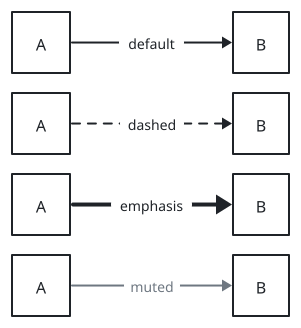
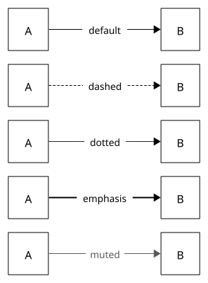
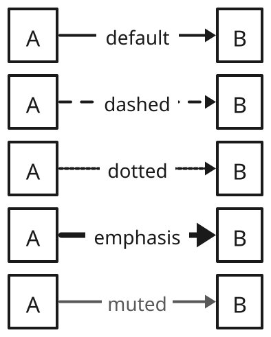
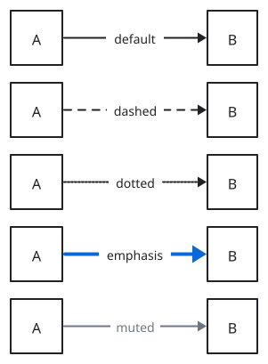
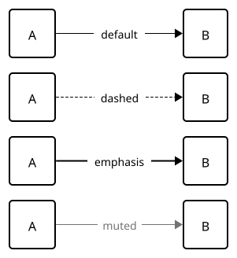
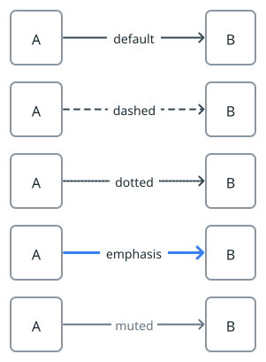

# sumi/arrow

[Gallery](../README.md) · Generated by <code>bun run gallery</code>; do not edit by hand\.

A line with an arrowhead at the target\.

**kind**: <code>edge</code> · **variants**: <code>default, dashed, dotted, emphasis, muted</code> · **since**: <code>0\.1\.0</code> · **direction**: <code>forward</code> · **head**: <code>triangle</code>

No props.

| <code>minimal</code> | <code>academic</code> | <code>slides</code> | <code>color</code> | <code>paper</code> | <code>llama</code> |
| --- | --- | --- | --- | --- | --- |
|  |  |  |  |  |  |
| <code>sumi render sumi\-arrow\.sumi\.yaml</code><br>53\.09mm × 72\.14mm \(max width 180mm, max height 220mm\) | <code>sumi render sumi\-arrow\.sumi\.yaml \-\-theme academic</code><br>53\.09mm × 72\.14mm \(max width 180mm, max height 220mm\) | <code>sumi render sumi\-arrow\.sumi\.yaml \-\-theme slides</code><br>69\.5mm × 86\.61mm \(max width 180mm, max height 220mm\) | <code>sumi render sumi\-arrow\.sumi\.yaml \-\-theme color</code><br>53\.09mm × 72\.14mm \(max width 180mm, max height 220mm\) | <code>sumi render sumi\-arrow\.sumi\.yaml \-\-theme paper</code><br>53\.09mm × 72\.14mm \(max width 180mm, max height 220mm\) | <code>sumi render sumi\-arrow\.sumi\.yaml \-\-theme llama</code><br>53\.09mm × 72\.14mm \(max width 180mm, max height 220mm\) |

<details>
<summary>Source: <code>sumi-arrow.sumi.yaml</code></summary>

```yaml
# sumi/arrow: every variant. Generated by `bun run gallery` (#17).
version: 1
figure:
  id: gallery-sumi-arrow
  title: sumi/arrow
  theme: minimal
  profile: paper-double
  layout:
    direction: right

nodes:
  - id: default-a
    component: box
    label: A
  - id: default-b
    component: box
    label: B
  - id: dashed-a
    component: box
    label: A
  - id: dashed-b
    component: box
    label: B
  - id: dotted-a
    component: box
    label: A
  - id: dotted-b
    component: box
    label: B
  - id: emphasis-a
    component: box
    label: A
  - id: emphasis-b
    component: box
    label: B
  - id: muted-a
    component: box
    label: A
  - id: muted-b
    component: box
    label: B

edges:
  - from: default-a
    to: default-b
    component: sumi/arrow
    label: default
  - from: dashed-a
    to: dashed-b
    component: sumi/arrow
    label: dashed
    variant: dashed
  - from: dotted-a
    to: dotted-b
    component: sumi/arrow
    label: dotted
    variant: dotted
  - from: emphasis-a
    to: emphasis-b
    component: sumi/arrow
    label: emphasis
    variant: emphasis
  - from: muted-a
    to: muted-b
    component: sumi/arrow
    label: muted
    variant: muted
```

</details>
