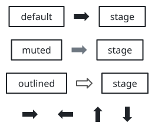
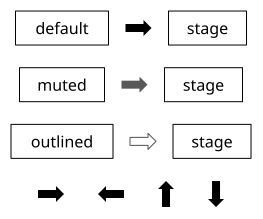
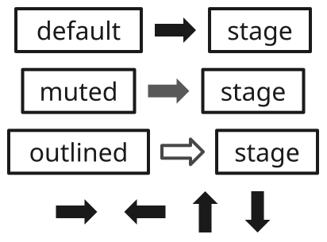
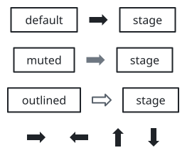
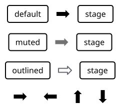
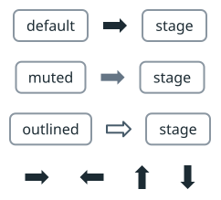
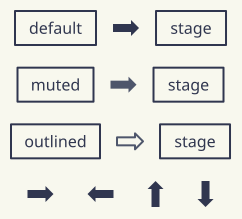
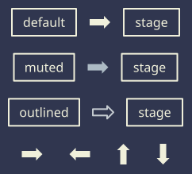

# sumi/block\-arrow

[Gallery](../README.md) · Generated by <code>bun run gallery</code>; do not edit by hand\.

A thick block arrow \(a shaft and a head, 1\.6 em long and 1 em thick by default\) that marks the flow between stages, e\.g\. between two panels of a row\. Takes no label, is not an edge endpoint and does not stretch\. Solid ink with no outline; muted is gray and outlined an outline only\. Structured layout only\.

**kind**: <code>node</code> · **variants**: <code>default, muted, outlined</code> · **since**: <code>0\.16\.0</code> · **engines**: <code>\[&quot;structured&quot;\]</code> · **shape**: <code>rectangle</code> · **sizing**: <code>auto</code> · **render**: <code>\{&quot;type&quot;:&quot;outline&quot;,&quot;renderer&quot;:&quot;sumi/flow\-arrow&quot;,&quot;params&quot;:\{&quot;form&quot;:&quot;block&quot;,&quot;direction&quot;:&quot;right&quot;,&quot;em&quot;:16,&quot;head&quot;:0\.5,&quot;shaft&quot;:0\.5\}\}</code>

| prop | type | required | description |
| --- | --- | --- | --- |
| <code>direction</code> | <code>&quot;right&quot; &#124; &quot;left&quot; &#124; &quot;up&quot; &#124; &quot;down&quot;</code> | no | The way it points: right \(the default\), left, up or down\. |
| <code>length</code> | <code>string</code> | no | Explicit length along the arrow as a length such as &quot;24pt&quot; \(a multiple of 0\.5pt\), whichever way it points\. Omitted means a multiple of the theme text size\. |
| <code>thickness</code> | <code>string</code> | no | Explicit thickness across the arrow as a length such as &quot;12pt&quot; \(a multiple of 0\.5pt\)\. Omitted means the theme text size \(1 em\)\. |
| <code>head</code> | <code>number</code> | no | Head length as a fraction of the shorter side of the arrow, from 0\.1 to 1\. Omitted means 0\.5\. |
| <code>shaft</code> | <code>number</code> | no | Shaft thickness as a fraction of the thickness, from 0\.1 to 0\.9\. Omitted means 0\.5\. |

| <code>minimal</code> | <code>academic</code> | <code>slides</code> | <code>color</code> | <code>paper</code> | <code>llama</code> | <code>sumi</code> | <code>sumi\-dark</code> |
| --- | --- | --- | --- | --- | --- | --- | --- |
|  |  |  |  |  |  |  |  |
| <code>sumi render sumi\-block\-arrow\.sumi\.yaml</code><br>46\.39mm × 38\.63mm \(max width 180mm, max height 220mm\) | <code>sumi render sumi\-block\-arrow\.sumi\.yaml \-\-theme academic</code><br>46\.39mm × 38\.63mm \(max width 180mm, max height 220mm\) | <code>sumi render sumi\-block\-arrow\.sumi\.yaml \-\-theme slides</code><br>72\.67mm × 53\.8mm \(max width 180mm, max height 220mm\) | <code>sumi render sumi\-block\-arrow\.sumi\.yaml \-\-theme color</code><br>46\.39mm × 38\.63mm \(max width 180mm, max height 220mm\) | <code>sumi render sumi\-block\-arrow\.sumi\.yaml \-\-theme paper</code><br>42\.69mm × 38\.63mm \(max width 180mm, max height 220mm\) | <code>sumi render sumi\-block\-arrow\.sumi\.yaml \-\-theme llama</code><br>42\.69mm × 38\.63mm \(max width 180mm, max height 220mm\) | <code>sumi render sumi\-block\-arrow\.sumi\.yaml \-\-theme sumi</code><br>42\.69mm × 38\.63mm \(max width 180mm, max height 220mm\) | <code>sumi render sumi\-block\-arrow\.sumi\.yaml \-\-theme sumi\-dark</code><br>42\.69mm × 38\.63mm \(max width 180mm, max height 220mm\) |

<details>
<summary>Source: <code>sumi-block-arrow.sumi.yaml</code></summary>

```yaml
# sumi/block-arrow: every variant and direction. Generated by `bun run gallery` (#426).
version: 1
figure:
  id: gallery-sumi-block-arrow
  title: sumi/block-arrow
  theme: minimal
  profile: paper-double
  layout:
    arrange:
      stack:
        gap: 4mm
        items:
          - row: { gap: 3mm, align: center, items: [default-a, default, default-b] }
          - row: { gap: 3mm, align: center, items: [muted-a, muted, muted-b] }
          - row: { gap: 3mm, align: center, items: [outlined-a, outlined, outlined-b] }
          - row: { gap: 6mm, align: center, items: [dir-right, dir-left, dir-up, dir-down] }
nodes:
  - { id: default-a, component: box, label: default }
  - { id: default, component: block-arrow, variant: default }
  - { id: default-b, component: box, label: stage }
  - { id: muted-a, component: box, label: muted }
  - { id: muted, component: block-arrow, variant: muted }
  - { id: muted-b, component: box, label: stage }
  - { id: outlined-a, component: box, label: outlined }
  - { id: outlined, component: block-arrow, variant: outlined }
  - { id: outlined-b, component: box, label: stage }
  - { id: dir-right, component: block-arrow, props: { direction: right } }
  - { id: dir-left, component: block-arrow, props: { direction: left } }
  - { id: dir-up, component: block-arrow, props: { direction: up } }
  - { id: dir-down, component: block-arrow, props: { direction: down } }
```

</details>
