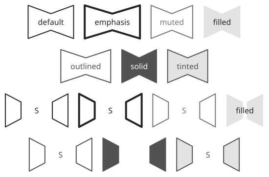
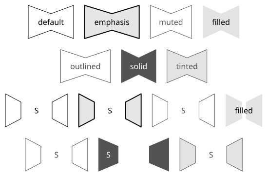
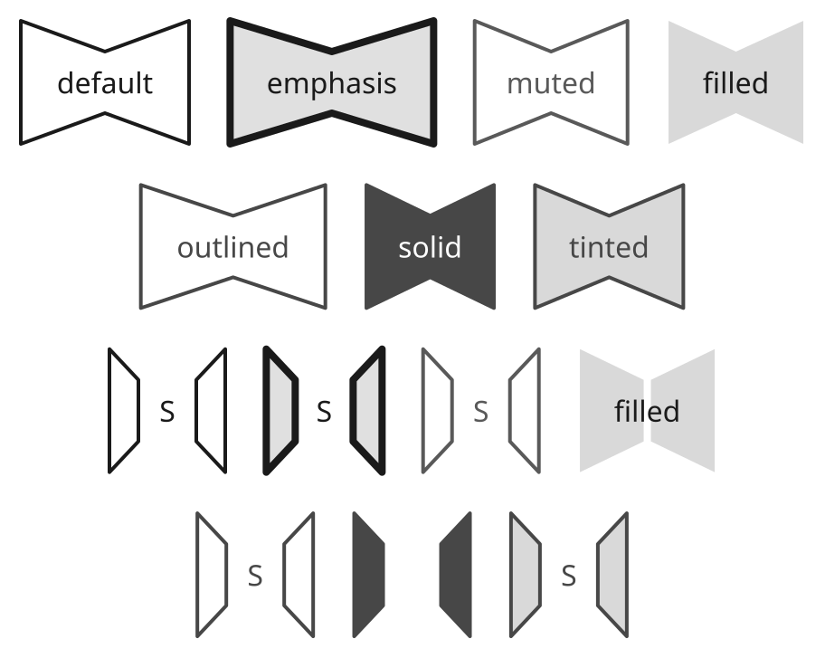
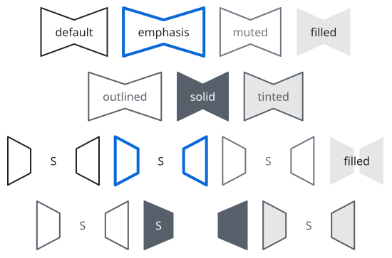
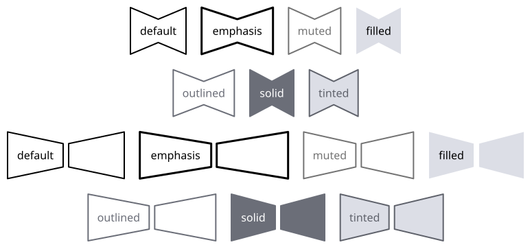

# sumi/bowtie

[Gallery](../README.md) · Generated by <code>bun run gallery</code>; do not edit by hand\.

A bowtie silhouette with two opposing tapered halves and a central waist\.

**kind**: <code>node</code> · **variants**: <code>default, emphasis, muted, filled, outlined, solid, tinted</code> · **since**: <code>0\.7\.0</code> · **shape**: <code>rectangle</code> · **sizing**: <code>auto</code> · **render**: <code>\{&quot;type&quot;:&quot;outline&quot;,&quot;renderer&quot;:&quot;sumi/bowtie&quot;,&quot;params&quot;:\{\}\}</code>

| prop | type | required | description |
| --- | --- | --- | --- |
| <code>width</code> | <code>string</code> | no | Explicit width as a length such as &quot;30mm&quot; or &quot;40pt&quot; \(a multiple of 0\.5pt\)\. Omitted means sized to the label\. |
| <code>height</code> | <code>string</code> | no | Explicit height as a length such as &quot;10mm&quot; or &quot;20pt&quot; \(a multiple of 0\.5pt\)\. Omitted means sized to the label\. |
| <code>gap</code> | <code>number</code> | no | Horizontal separation of the two tapered halves in D2 units \(0\.5pt each\), from 0 to 64; omitted or 0 keeps the joined silhouette\. One label is centered across both halves and the gap when readable on the page; low\-contrast text \(including solid\) sits on the sized left painted body\. Borderless filled may overlay the bodies, while stroked outline crossings are reported by geometry lint\. Clamped to half the drawn width for small explicit sizes\. |

| <code>minimal</code> | <code>academic</code> | <code>slides</code> | <code>color</code> | <code>paper</code> |
| --- | --- | --- | --- | --- |
|  |  |  |  |  |
| <code>sumi render sumi\-bowtie\.sumi\.yaml</code><br>97\.01mm × 64\.03mm \(max width 180mm, max height 220mm\) | <code>sumi render sumi\-bowtie\.sumi\.yaml \-\-theme academic</code><br>97\.01mm × 64\.03mm \(max width 180mm, max height 220mm\) | <code>sumi render sumi\-bowtie\.sumi\.yaml \-\-theme slides \-\-profile presentation\-16x9</code><br>160\.87mm × 128\.23mm \(max width 338\.7mm, max height 190\.5mm\) | <code>sumi render sumi\-bowtie\.sumi\.yaml \-\-theme color</code><br>97\.01mm × 64\.03mm \(max width 180mm, max height 220mm\) | <code>sumi render sumi\-bowtie\.sumi\.yaml \-\-theme paper</code><br>95\.25mm × 64\.03mm \(max width 180mm, max height 220mm\) |

<details>
<summary>Source: <code>sumi-bowtie.sumi.yaml</code></summary>

```yaml
# sumi/bowtie: every variant. Generated by `bun run gallery` (#17).
version: 1
figure:
  id: gallery-sumi-bowtie
  title: sumi/bowtie
  theme: minimal
  profile: paper-double
  layout:
    arrange:
      stack:
        items:
          - row: { items: [default, emphasis, muted, filled] }
          - row: { items: [outlined, solid, tinted] }
          - row: { items: [split-default, split-emphasis, split-muted, split-filled] }
          - row: { items: [split-outlined, split-solid, split-tinted] }

nodes:
  - id: default
    component: sumi/bowtie
    label: default
  - id: emphasis
    component: sumi/bowtie
    label: emphasis
    variant: emphasis
  - id: muted
    component: sumi/bowtie
    label: muted
    variant: muted
  - id: filled
    component: sumi/bowtie
    label: filled
    variant: filled
  - id: outlined
    component: sumi/bowtie
    label: outlined
    variant: outlined
  - id: solid
    component: sumi/bowtie
    label: solid
    variant: solid
  - id: tinted
    component: sumi/bowtie
    label: tinted
    variant: tinted
  - { id: split-default, component: bowtie, label: "S", variant: default, props: { gap: 64 } }
  - { id: split-emphasis, component: bowtie, label: "S", variant: emphasis, props: { gap: 64 } }
  - { id: split-muted, component: bowtie, label: "S", variant: muted, props: { gap: 64 } }
  - { id: split-filled, component: bowtie, label: "filled", variant: filled, props: { gap: 8 } }
  - { id: split-outlined, component: bowtie, label: "S", variant: outlined, props: { gap: 64 } }
  - { id: split-solid, component: bowtie, label: "S", variant: solid, props: { gap: 64 } }
  - { id: split-tinted, component: bowtie, label: "S", variant: tinted, props: { gap: 64 } }
```

</details>
