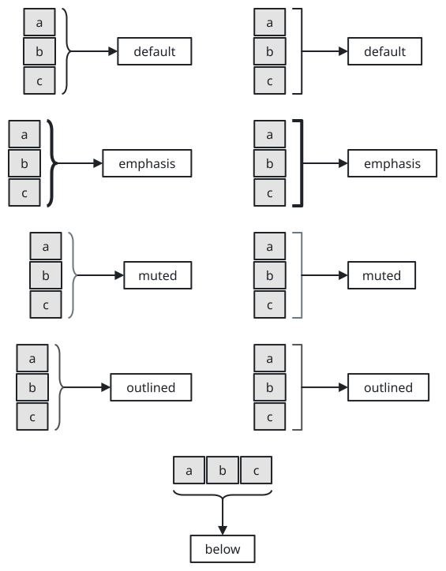
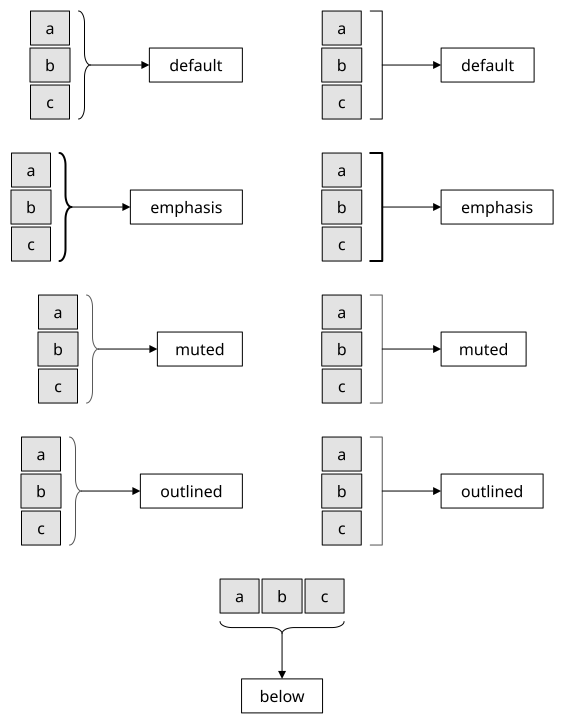
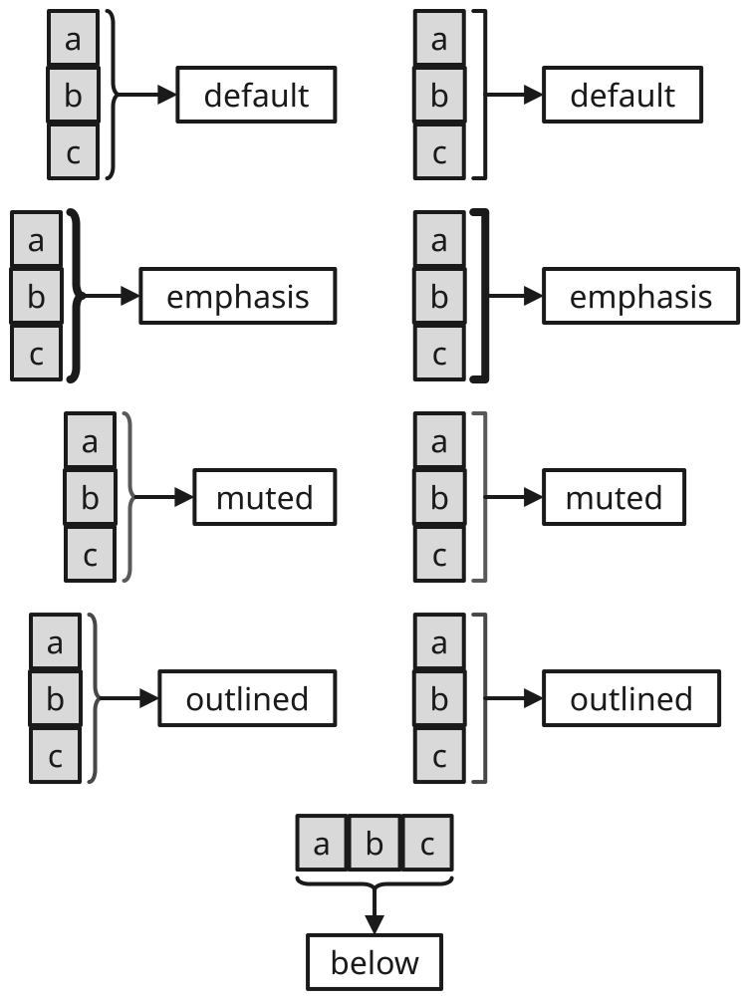
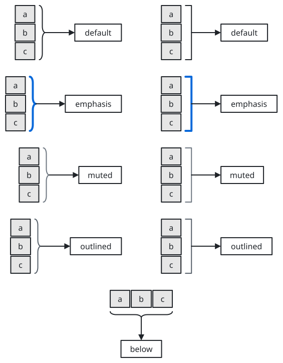
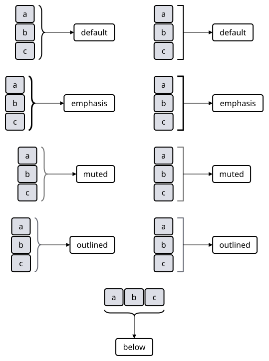

# sumi/bracket

[Gallery](../README.md) · Generated by <code>bun run gallery</code>; do not edit by hand\.

A square bracket or curly brace that gathers a column or row of elements; takes no label\. Attached to a group, matrix or tokens node it is as long as that side, and an edge leaves from the middle of its spine \(the tip of a brace\)\. Structured layout only\. A tone colors it with variant outlined\.

**kind**: <code>node</code> · **variants**: <code>default, emphasis, muted, outlined</code> · **since**: <code>0\.10\.0</code> · **engines**: <code>\[&quot;structured&quot;\]</code> · **shape**: <code>rectangle</code> · **sizing**: <code>auto</code> · **render**: <code>\{&quot;type&quot;:&quot;outline&quot;,&quot;renderer&quot;:&quot;sumi/bracket&quot;,&quot;params&quot;:\{&quot;form&quot;:&quot;square&quot;,&quot;points&quot;:&quot;east&quot;\}\}</code>

| prop | type | required | description |
| --- | --- | --- | --- |
| <code>form</code> | <code>&quot;square&quot; &#124; &quot;curly&quot;</code> | no | square: a square bracket \(the default\)\. curly: a curly brace with a pointed tip\. |
| <code>points</code> | <code>&quot;east&quot; &#124; &quot;west&quot; &#124; &quot;north&quot; &#124; &quot;south&quot;</code> | no | The side the spine or tip is on, where edges leave: east gathers the elements to its west \(the default\), west those to its east, south those above it and north those below it\. |
| <code>width</code> | <code>string</code> | no | Explicit width as a length such as &quot;10pt&quot; \(a multiple of 0\.5pt\)\. Omitted means 6pt deep for east / west, or as long as the attach target's side \(24pt without one\) for north / south\. |
| <code>height</code> | <code>string</code> | no | Explicit height as a length such as &quot;40pt&quot; \(a multiple of 0\.5pt\)\. Omitted means as long as the attach target's side \(24pt without one\) for east / west, or 6pt deep for north / south\. |

| <code>minimal</code> | <code>academic</code> | <code>slides</code> | <code>color</code> | <code>paper</code> |
| --- | --- | --- | --- | --- |
|  |  |  |  |  |
| <code>sumi render sumi\-bracket\.sumi\.yaml</code><br>99\.66mm × 127\.71mm \(max width 180mm, max height 220mm\) | <code>sumi render sumi\-bracket\.sumi\.yaml \-\-theme academic</code><br>99\.66mm × 127\.71mm \(max width 180mm, max height 220mm\) | <code>sumi render sumi\-bracket\.sumi\.yaml \-\-theme slides</code><br>132\.82mm × 177\.09mm \(max width 180mm, max height 220mm\) | <code>sumi render sumi\-bracket\.sumi\.yaml \-\-theme color</code><br>99\.66mm × 127\.71mm \(max width 180mm, max height 220mm\) | <code>sumi render sumi\-bracket\.sumi\.yaml \-\-theme paper</code><br>95\.07mm × 127\.71mm \(max width 180mm, max height 220mm\) |

<details>
<summary>Source: <code>sumi-bracket.sumi.yaml</code></summary>

```yaml
# sumi/bracket: every variant. Generated by `bun run gallery` (#17, #281).
version: 1
figure:
  id: gallery-sumi-bracket
  title: sumi/bracket
  theme: minimal
  profile: paper-double
  layout:
    arrange:
      stack:
        gap: 6mm
        items:
          - row: { gap: 14mm, align: center, items: [default-curly-set, default-curly-out, default-square-set, default-square-out] }
          - row: { gap: 14mm, align: center, items: [emphasis-curly-set, emphasis-curly-out, emphasis-square-set, emphasis-square-out] }
          - row: { gap: 14mm, align: center, items: [muted-curly-set, muted-curly-out, muted-square-set, muted-square-out] }
          - row: { gap: 14mm, align: center, items: [outlined-curly-set, outlined-curly-out, outlined-square-set, outlined-square-out] }
          - { row: { gap: 6mm, items: [row-set] } }

nodes:
  - { id: default-curly-set, component: tokens, tone: gray, props: { direction: down, gap: 1.5pt, cells: [a, b, c] } }
  - id: default-curly
    component: sumi/bracket
    attach: { to: default-curly-set, side: east, gap: 1.5mm }
    props: { form: curly }
  - { id: default-curly-out, component: box, label: default }
  - { id: default-square-set, component: tokens, tone: gray, props: { direction: down, gap: 1.5pt, cells: [a, b, c] } }
  - id: default-square
    component: sumi/bracket
    attach: { to: default-square-set, side: east, gap: 1.5mm }
    props: { form: square }
  - { id: default-square-out, component: box, label: default }
  - { id: emphasis-curly-set, component: tokens, tone: gray, props: { direction: down, gap: 1.5pt, cells: [a, b, c] } }
  - id: emphasis-curly
    component: sumi/bracket
    variant: emphasis
    attach: { to: emphasis-curly-set, side: east, gap: 1.5mm }
    props: { form: curly }
  - { id: emphasis-curly-out, component: box, label: emphasis }
  - { id: emphasis-square-set, component: tokens, tone: gray, props: { direction: down, gap: 1.5pt, cells: [a, b, c] } }
  - id: emphasis-square
    component: sumi/bracket
    variant: emphasis
    attach: { to: emphasis-square-set, side: east, gap: 1.5mm }
    props: { form: square }
  - { id: emphasis-square-out, component: box, label: emphasis }
  - { id: muted-curly-set, component: tokens, tone: gray, props: { direction: down, gap: 1.5pt, cells: [a, b, c] } }
  - id: muted-curly
    component: sumi/bracket
    variant: muted
    attach: { to: muted-curly-set, side: east, gap: 1.5mm }
    props: { form: curly }
  - { id: muted-curly-out, component: box, label: muted }
  - { id: muted-square-set, component: tokens, tone: gray, props: { direction: down, gap: 1.5pt, cells: [a, b, c] } }
  - id: muted-square
    component: sumi/bracket
    variant: muted
    attach: { to: muted-square-set, side: east, gap: 1.5mm }
    props: { form: square }
  - { id: muted-square-out, component: box, label: muted }
  - { id: outlined-curly-set, component: tokens, tone: gray, props: { direction: down, gap: 1.5pt, cells: [a, b, c] } }
  - id: outlined-curly
    component: sumi/bracket
    variant: outlined
    attach: { to: outlined-curly-set, side: east, gap: 1.5mm }
    props: { form: curly }
  - { id: outlined-curly-out, component: box, label: outlined }
  - { id: outlined-square-set, component: tokens, tone: gray, props: { direction: down, gap: 1.5pt, cells: [a, b, c] } }
  - id: outlined-square
    component: sumi/bracket
    variant: outlined
    attach: { to: outlined-square-set, side: east, gap: 1.5mm }
    props: { form: square }
  - { id: outlined-square-out, component: box, label: outlined }
  - { id: row-set, component: tokens, tone: gray, props: { gap: 1.5pt, cells: [a, b, c] } }
  - { id: row-bracket, component: sumi/bracket, attach: { to: row-set, side: south, gap: 1.5mm }, props: { form: curly, points: south } }
  - { id: row-out, component: box, label: below, attach: { to: row-bracket, side: south, gap: 8mm } }

edges:
  - { from: default-curly, to: default-curly-out }
  - { from: default-square, to: default-square-out }
  - { from: emphasis-curly, to: emphasis-curly-out }
  - { from: emphasis-square, to: emphasis-square-out }
  - { from: muted-curly, to: muted-curly-out }
  - { from: muted-square, to: muted-square-out }
  - { from: outlined-curly, to: outlined-curly-out }
  - { from: outlined-square, to: outlined-square-out }
  - { from: row-bracket, to: row-out }
```

</details>
