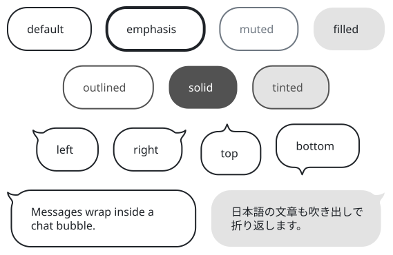
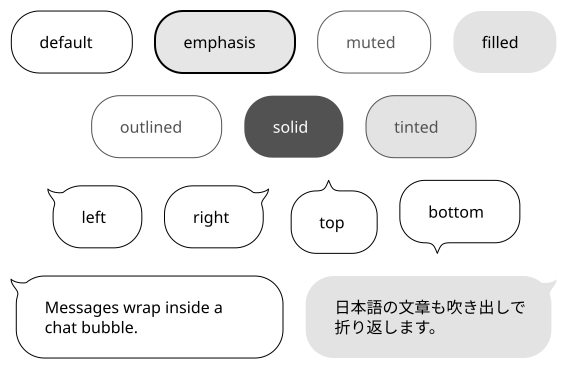
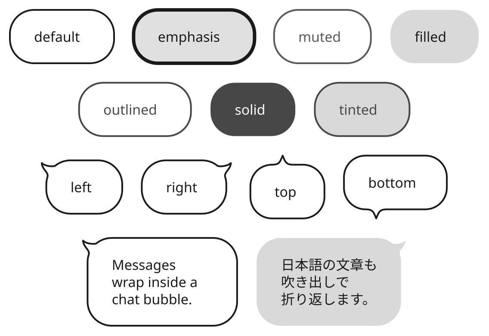
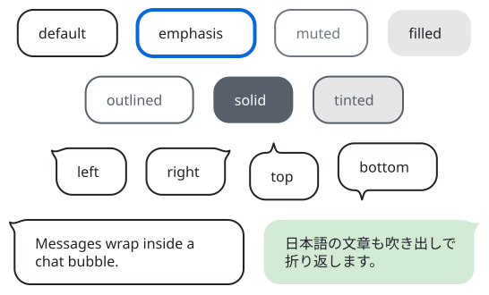
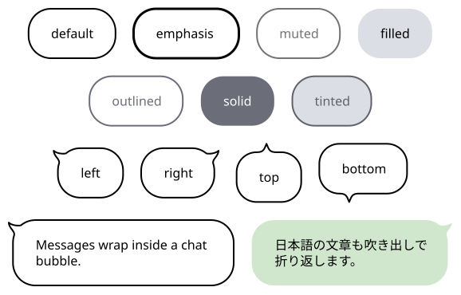
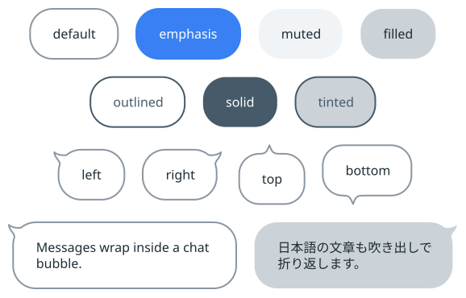

# sumi/bubble

[Gallery](../README.md) · Generated by <code>bun run gallery</code>; do not edit by hand\.

A rounded speech bubble or callout with an optional outward tail and wrapped text, including Japanese; edges attach to the body, never the tail tip\.

**kind**: <code>node</code> · **variants**: <code>default, emphasis, muted, filled, outlined, solid, tinted</code> · **since**: <code>0\.16\.0</code> · **shape**: <code>rectangle</code> · **sizing**: <code>auto</code> · **render**: <code>\{&quot;type&quot;:&quot;outline&quot;,&quot;renderer&quot;:&quot;sumi/bubble&quot;,&quot;params&quot;:\{&quot;tail&quot;:&quot;none&quot;,&quot;tailAt&quot;:&quot;start&quot;,&quot;tailSize&quot;:12,&quot;radius&quot;:18\}\}</code>

| prop | type | required | description |
| --- | --- | --- | --- |
| <code>width</code> | <code>string</code> | no | Explicit width as a length such as &quot;30mm&quot; or &quot;40pt&quot; \(a multiple of 0\.5pt\)\. Omitted means sized to the label\. |
| <code>height</code> | <code>string</code> | no | Explicit height as a length such as &quot;10mm&quot; or &quot;20pt&quot; \(a multiple of 0\.5pt\)\. Omitted means sized to the label\. |
| <code>tail</code> | <code>&quot;left&quot; &#124; &quot;right&quot; &#124; &quot;top&quot; &#124; &quot;bottom&quot; &#124; &quot;none&quot;</code> | no | Tail side; none \(the default\) draws a rounded bubble without a pointer\. |
| <code>tailAt</code> | <code>any</code> | no | Tail base position from the body's top on left/right, or left on top/bottom; start \(default\), center, end or a length\. Clamped clear of rounded corners\. |
| <code>tailSize</code> | <code>string</code> | no | Outward tail depth; omitted means 0\.6 times the theme font size\. Clamped for very small explicit sizes\. |
| <code>maxWidth</code> | <code>string</code> | no | Maximum text\-line width for automatic wrapping, including Japanese; omitted means 120pt\. Width/height props size the complete footprint, including the tail\. |

| <code>minimal</code> | <code>academic</code> | <code>slides</code> | <code>color</code> | <code>paper</code> | <code>llama</code> |
| --- | --- | --- | --- | --- | --- |
|  |  |  |  |  |  |
| <code>sumi render sumi\-bubble\.sumi\.yaml</code><br>96\.66mm × 55\.74mm \(max width 180mm, max height 220mm\) | <code>sumi render sumi\-bubble\.sumi\.yaml \-\-theme academic</code><br>96\.66mm × 55\.74mm \(max width 180mm, max height 220mm\) | <code>sumi render sumi\-bubble\.sumi\.yaml \-\-theme slides \-\-profile presentation\-16x9</code><br>181\.33mm × 118\.18mm \(max width 338\.7mm, max height 190\.5mm\) | <code>sumi render sumi\-bubble\.sumi\.yaml \-\-theme color</code><br>96\.66mm × 55\.74mm \(max width 180mm, max height 220mm\) | <code>sumi render sumi\-bubble\.sumi\.yaml \-\-theme paper</code><br>98\.43mm × 55\.74mm \(max width 180mm, max height 220mm\) | <code>sumi render sumi\-bubble\.sumi\.yaml \-\-theme llama</code><br>98\.43mm × 55\.74mm \(max width 180mm, max height 220mm\) |

<details>
<summary>Source: <code>sumi-bubble.sumi.yaml</code></summary>

```yaml
# sumi/bubble: every variant. Generated by `bun run gallery` (#17).
version: 1
figure:
  id: gallery-sumi-bubble
  title: sumi/bubble
  theme: minimal
  profile: paper-double
  layout:
    arrange:
      stack:
        items:
          - row: { items: [default, emphasis, muted, filled] }
          - row: { items: [outlined, solid, tinted] }
          - row: { items: [tail-left, tail-right, tail-top, tail-bottom] }
          - row: { items: [english, japanese] }

nodes:
  - id: default
    component: sumi/bubble
    label: default
  - id: emphasis
    component: sumi/bubble
    label: emphasis
    variant: emphasis
  - id: muted
    component: sumi/bubble
    label: muted
    variant: muted
  - id: filled
    component: sumi/bubble
    label: filled
    variant: filled
  - id: outlined
    component: sumi/bubble
    label: outlined
    variant: outlined
  - id: solid
    component: sumi/bubble
    label: solid
    variant: solid
  - id: tinted
    component: sumi/bubble
    label: tinted
    variant: tinted
  - { id: tail-left, component: bubble, label: left, props: { tail: left } }
  - { id: tail-right, component: bubble, label: right, props: { tail: right } }
  - { id: tail-top, component: bubble, label: top, props: { tail: top } }
  - { id: tail-bottom, component: bubble, label: bottom, props: { tail: bottom } }
  - { id: english, component: bubble, label: "Messages wrap inside a chat bubble.", props: { tail: left, maxWidth: 120pt } }
  - { id: japanese, component: bubble, variant: filled, tone: green, label: "日本語の文章も吹き出しで折り返します。", props: { tail: right, maxWidth: 120pt } }
```

</details>
