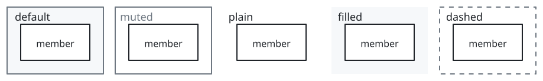
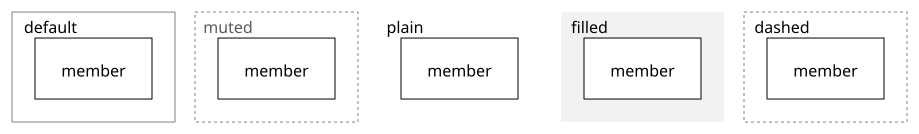
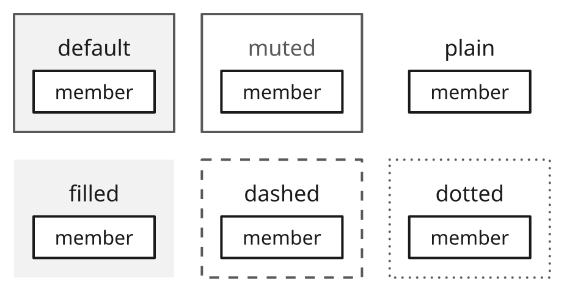
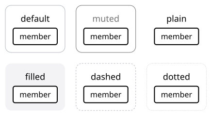
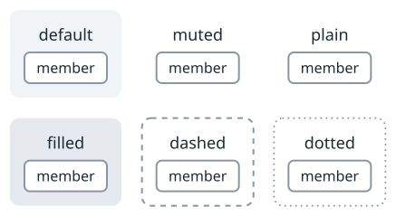
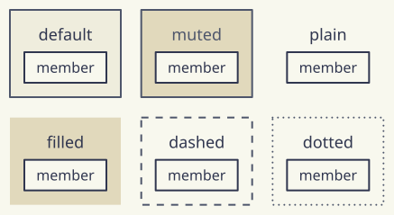
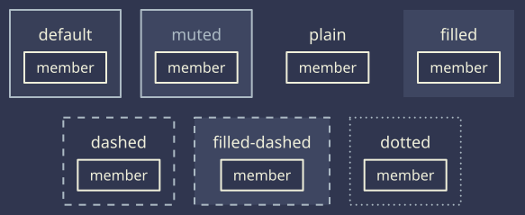

# sumi/container

[Gallery](../README.md) · Generated by <code>bun run gallery</code>; do not edit by hand\.

A rectangular container that groups nodes and other groups\. Variant muted: a dashed border in academic \(easy to confuse with dashed edges\), a white background instead of the shaded fill \(without a tone\) and a gray title in the other themes\. Variant plain: no border and no fill, only the title or caption; filled: a shaded fill without a border; dashed: a dashed border without a fill; filled\-dashed: a dashed border and a shaded fill; dotted: a dashed border with round dots and no fill\. A tone sets the fill of any variant\.

**kind**: <code>group</code> · **variants**: <code>default, muted, plain, filled, dashed, filled\-dashed, dotted</code> · **since**: <code>0\.1\.0</code> · **shape**: <code>rectangle</code>

| prop | type | required | description |
| --- | --- | --- | --- |
| <code>layers</code> | <code>object</code> | no | Repeat the frame behind the front card, offset up\-right\. The footprint includes every card; only the front contains children and a title\. Structured layout only; plain is unsupported\. |

| <code>minimal</code> | <code>academic</code> | <code>slides</code> | <code>color</code> | <code>paper</code> | <code>llama</code> | <code>sumi</code> | <code>sumi\-dark</code> |
| --- | --- | --- | --- | --- | --- | --- | --- |
|  |  |  |  |  |  |  |  |
| <code>sumi render sumi\-container\.sumi\.yaml</code><br>108\.48mm × 42\.16mm \(max width 180mm, max height 220mm\) | <code>sumi render sumi\-container\.sumi\.yaml \-\-theme academic</code><br>108\.48mm × 41\.1mm \(max width 180mm, max height 220mm\) | <code>sumi render sumi\-container\.sumi\.yaml \-\-theme slides \-\-profile presentation\-16x9</code><br>217\.13mm × 84\.31mm \(max width 338\.7mm, max height 190\.5mm\) | <code>sumi render sumi\-container\.sumi\.yaml \-\-theme color</code><br>108\.48mm × 42\.16mm \(max width 180mm, max height 220mm\) | <code>sumi render sumi\-container\.sumi\.yaml \-\-theme paper</code><br>102\.83mm × 42\.16mm \(max width 180mm, max height 220mm\) | <code>sumi render sumi\-container\.sumi\.yaml \-\-theme llama</code><br>102\.83mm × 42\.16mm \(max width 180mm, max height 220mm\) | <code>sumi render sumi\-container\.sumi\.yaml \-\-theme sumi</code><br>102\.83mm × 42\.16mm \(max width 180mm, max height 220mm\) | <code>sumi render sumi\-container\.sumi\.yaml \-\-theme sumi\-dark</code><br>102\.83mm × 42\.16mm \(max width 180mm, max height 220mm\) |

<details>
<summary>Source: <code>sumi-container.sumi.yaml</code></summary>

```yaml
# sumi/container: every variant. Generated by `bun run gallery` (#17).
version: 1
figure:
  id: gallery-sumi-container
  title: sumi/container
  theme: minimal
  profile: paper-double
  layout:
    arrange:
      stack:
        items:
          - row: { items: [default, muted, plain, filled] }
          - row: { items: [dashed, filled-dashed, dotted] }

groups:
  - id: default
    component: sumi/container
    label: default
    arrange: { row: { items: [default-member] } }
  - id: muted
    component: sumi/container
    label: muted
    variant: muted
    arrange: { row: { items: [muted-member] } }
  - id: plain
    component: sumi/container
    label: plain
    variant: plain
    arrange: { row: { items: [plain-member] } }
  - id: filled
    component: sumi/container
    label: filled
    variant: filled
    arrange: { row: { items: [filled-member] } }
  - id: dashed
    component: sumi/container
    label: dashed
    variant: dashed
    arrange: { row: { items: [dashed-member] } }
  - id: filled-dashed
    component: sumi/container
    label: filled-dashed
    variant: filled-dashed
    arrange: { row: { items: [filled-dashed-member] } }
  - id: dotted
    component: sumi/container
    label: dotted
    variant: dotted
    arrange: { row: { items: [dotted-member] } }

nodes:
  - id: default-member
    component: box
    label: member
  - id: muted-member
    component: box
    label: member
  - id: plain-member
    component: box
    label: member
  - id: filled-member
    component: box
    label: member
  - id: dashed-member
    component: box
    label: member
  - id: filled-dashed-member
    component: box
    label: member
  - id: dotted-member
    component: box
    label: member
```

</details>
