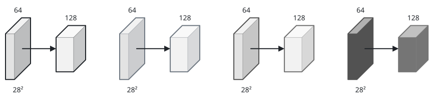
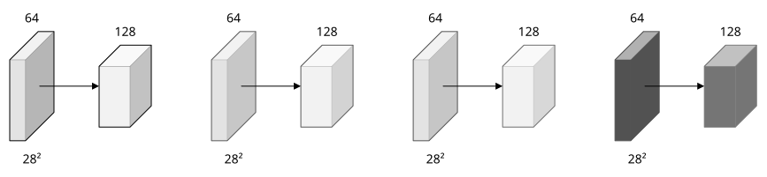
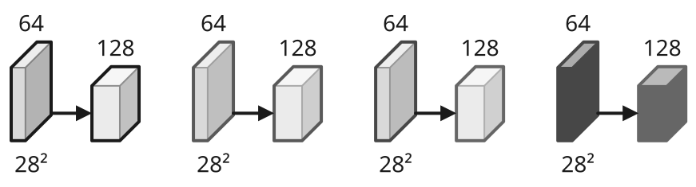
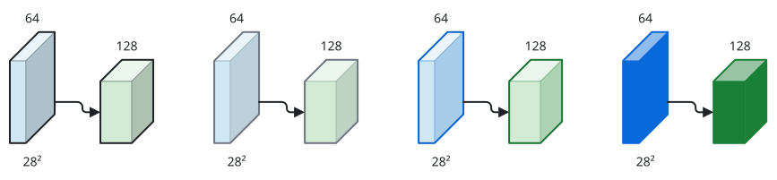
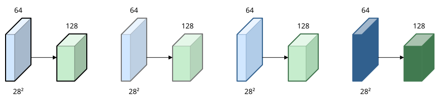
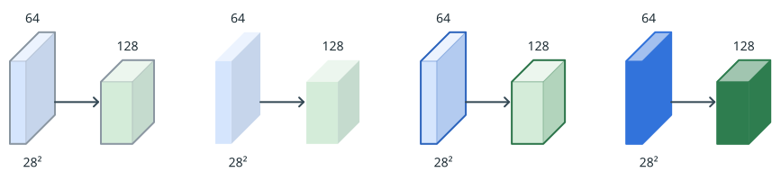
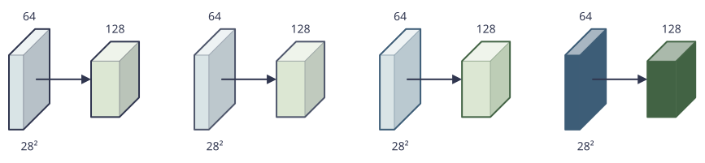
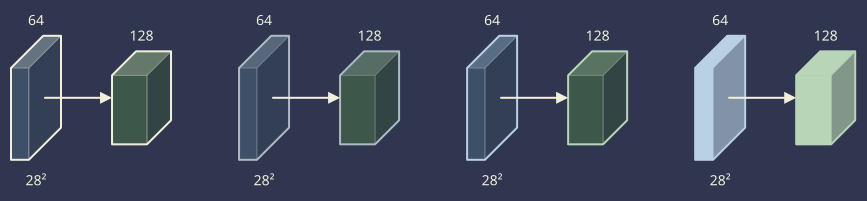

# sumi/cuboid

[Gallery](../README.md) · Generated by <code>bun run gallery</code>; do not edit by hand\.

A cuboid in oblique projection \(a CNN layer, a feature map or a volume\): a front, top and side face, the top lighter and the side darker than the tone's fill\. Depth runs up and right at figure\.projection \(default 45 degrees, scale 0\.5\)\. The label sits on the front face \(leave it empty on a thin plate and use dims\); edges leave from the front face's left and bottom, the back edge's top and the silhouette's right\. Structured layout only\.

**kind**: <code>node</code> · **variants**: <code>default, muted, tinted, solid</code> · **since**: <code>0\.19\.0</code> · **engines**: <code>\[&quot;structured&quot;\]</code> · **shape**: <code>rectangle</code> · **sizing**: <code>auto</code> · **render**: <code>\{&quot;type&quot;:&quot;outline&quot;,&quot;renderer&quot;:&quot;sumi/cuboid&quot;,&quot;params&quot;:\{&quot;depth&quot;:16,&quot;angle&quot;:45,&quot;depthScale&quot;:0\.5\}\}</code>

| prop | type | required | description |
| --- | --- | --- | --- |
| <code>width</code> | <code>string</code> | yes | Width of the front face as a length such as &quot;6mm&quot; \(rounded to the nearest 0\.5pt\); a longer label widens it\. |
| <code>height</code> | <code>string</code> | yes | Height of the front face as a length such as &quot;30mm&quot; \(rounded to the nearest 0\.5pt\); a taller label raises it\. |
| <code>depth</code> | <code>string</code> | yes | Depth of the solid as a length such as &quot;30mm&quot; before figure\.projection scales it \(cabinet projection draws it half as long\)\. |
| <code>dims</code> | <code>object</code> | no | Dimension texts, always horizontal\. Each is a label node with the ID &lt;id&gt;\-dim\-width, \-dim\-height or \-dim\-depth, attached to the cuboid \(the box of the text 1\.2mm above the silhouette, 2mm below the front face, at its lower right corner; the text itself sits a little farther by its padding\), so geometry lint checks it like any text\. |

| <code>minimal</code> | <code>academic</code> | <code>slides</code> | <code>color</code> | <code>paper</code> | <code>llama</code> | <code>sumi</code> | <code>sumi\-dark</code> |
| --- | --- | --- | --- | --- | --- | --- | --- |
|  |  |  |  |  |  |  |  |
| <code>sumi render sumi\-cuboid\.sumi\.yaml</code><br>152\.93mm × 35\.45mm \(max width 180mm, max height 220mm\) | <code>sumi render sumi\-cuboid\.sumi\.yaml \-\-theme academic</code><br>152\.93mm × 35\.45mm \(max width 180mm, max height 220mm\) | <code>sumi render sumi\-cuboid\.sumi\.yaml \-\-theme slides</code><br>153\.63mm × 41\.45mm \(max width 180mm, max height 220mm\) | <code>sumi render sumi\-cuboid\.sumi\.yaml \-\-theme color</code><br>152\.93mm × 35\.45mm \(max width 180mm, max height 220mm\) | <code>sumi render sumi\-cuboid\.sumi\.yaml \-\-theme paper</code><br>152\.93mm × 35\.45mm \(max width 180mm, max height 220mm\) | <code>sumi render sumi\-cuboid\.sumi\.yaml \-\-theme llama</code><br>152\.93mm × 35\.45mm \(max width 180mm, max height 220mm\) | <code>sumi render sumi\-cuboid\.sumi\.yaml \-\-theme sumi</code><br>152\.93mm × 35\.45mm \(max width 180mm, max height 220mm\)<br>info geometry/theme\-color\-use: 2 nodes are solid with a tone \(node &quot;solid\-a&quot; blue, node &quot;solid\-b&quot; green\): a dark block of saturated hue; theme sumi allows none\. | <code>sumi render sumi\-cuboid\.sumi\.yaml \-\-theme sumi\-dark</code><br>152\.93mm × 35\.45mm \(max width 180mm, max height 220mm\)<br>info geometry/theme\-color\-use: 2 nodes are solid with a tone \(node &quot;solid\-a&quot; blue, node &quot;solid\-b&quot; green\): a dark block of saturated hue; theme sumi\-dark allows none\. |

<details>
<summary>Source: <code>sumi-cuboid.sumi.yaml</code></summary>

```yaml
# sumi/cuboid: every variant, with dimensions. Generated by `bun run gallery` (#575).
version: 1
figure:
  id: gallery-sumi-cuboid
  title: sumi/cuboid
  theme: minimal
  profile: paper-double
  layout:
    arrange:
      row:
        gap: 12mm
        align: end
        items:
          - row: { gap: 9mm, align: end, items: [default-a, default-b] }
          - row: { gap: 9mm, align: end, items: [muted-a, muted-b] }
          - row: { gap: 9mm, align: end, items: [tinted-a, tinted-b] }
          - row: { gap: 9mm, align: end, items: [solid-a, solid-b] }
nodes:
  - { id: default-a, component: cuboid, variant: default, tone: blue, props: { width: 3mm, height: 16mm, depth: 16mm, dims: { width: "64", height: "28²" } } }
  - { id: default-b, component: cuboid, variant: default, tone: green, props: { width: 6mm, height: 12mm, depth: 12mm, dims: { width: "128" } } }
  - { id: muted-a, component: cuboid, variant: muted, tone: blue, props: { width: 3mm, height: 16mm, depth: 16mm, dims: { width: "64", height: "28²" } } }
  - { id: muted-b, component: cuboid, variant: muted, tone: green, props: { width: 6mm, height: 12mm, depth: 12mm, dims: { width: "128" } } }
  - { id: tinted-a, component: cuboid, variant: tinted, tone: blue, props: { width: 3mm, height: 16mm, depth: 16mm, dims: { width: "64", height: "28²" } } }
  - { id: tinted-b, component: cuboid, variant: tinted, tone: green, props: { width: 6mm, height: 12mm, depth: 12mm, dims: { width: "128" } } }
  - { id: solid-a, component: cuboid, variant: solid, tone: blue, props: { width: 3mm, height: 16mm, depth: 16mm, dims: { width: "64", height: "28²" } } }
  - { id: solid-b, component: cuboid, variant: solid, tone: green, props: { width: 6mm, height: 12mm, depth: 12mm, dims: { width: "128" } } }
edges:
  - { from: default-a, to: default-b }
  - { from: muted-a, to: muted-b }
  - { from: tinted-a, to: tinted-b }
  - { from: solid-a, to: solid-b }
```

</details>
