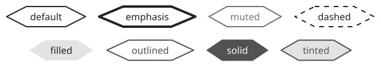
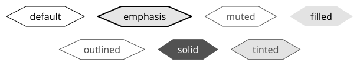
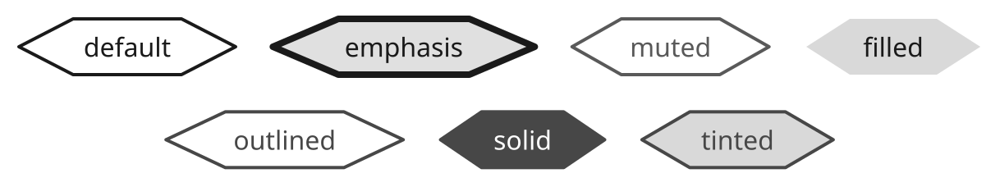
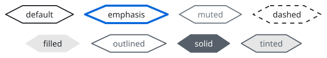
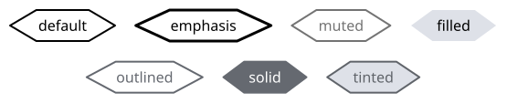
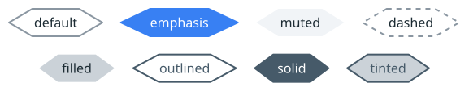
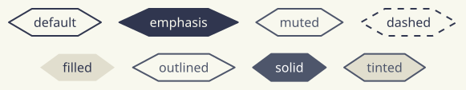
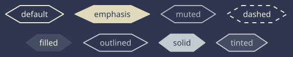

# sumi/hexagon

[Gallery](../README.md) · Generated by <code>bun run gallery</code>; do not edit by hand\.

A hexagon\.

**kind**: <code>node</code> · **variants**: <code>default, emphasis, muted, dashed, filled, outlined, solid, tinted</code> · **since**: <code>0\.1\.0</code> · **shape**: <code>hexagon</code> · **sizing**: <code>auto</code>

| prop | type | required | description |
| --- | --- | --- | --- |
| <code>width</code> | <code>string</code> | no | Explicit width as a length such as &quot;30mm&quot; or &quot;40pt&quot; \(a multiple of 0\.5pt\)\. Omitted means sized to the label\. |
| <code>height</code> | <code>string</code> | no | Explicit height as a length such as &quot;10mm&quot; or &quot;20pt&quot; \(a multiple of 0\.5pt\)\. Omitted means sized to the label\. |

| <code>minimal</code> | <code>academic</code> | <code>slides</code> | <code>color</code> | <code>paper</code> | <code>llama</code> | <code>sumi</code> | <code>sumi\-dark</code> |
| --- | --- | --- | --- | --- | --- | --- | --- |
|  |  |  |  |  |  |  |  |
| <code>sumi render sumi\-hexagon\.sumi\.yaml</code><br>112\.36mm × 19\.93mm \(max width 180mm, max height 220mm\) | <code>sumi render sumi\-hexagon\.sumi\.yaml \-\-theme academic</code><br>112\.01mm × 19\.93mm \(max width 180mm, max height 220mm\) | <code>sumi render sumi\-hexagon\.sumi\.yaml \-\-theme slides \-\-profile presentation\-16x9</code><br>224\.01mm × 40\.22mm \(max width 338\.7mm, max height 190\.5mm\) | <code>sumi render sumi\-hexagon\.sumi\.yaml \-\-theme color</code><br>112\.36mm × 19\.93mm \(max width 180mm, max height 220mm\) | <code>sumi render sumi\-hexagon\.sumi\.yaml \-\-theme paper</code><br>102\.48mm × 19\.93mm \(max width 180mm, max height 220mm\) | <code>sumi render sumi\-hexagon\.sumi\.yaml \-\-theme llama</code><br>101\.78mm × 19\.93mm \(max width 180mm, max height 220mm\) | <code>sumi render sumi\-hexagon\.sumi\.yaml \-\-theme sumi</code><br>102\.48mm × 19\.93mm \(max width 180mm, max height 220mm\) | <code>sumi render sumi\-hexagon\.sumi\.yaml \-\-theme sumi\-dark</code><br>102\.48mm × 19\.93mm \(max width 180mm, max height 220mm\) |

<details>
<summary>Source: <code>sumi-hexagon.sumi.yaml</code></summary>

```yaml
# sumi/hexagon: every variant. Generated by `bun run gallery` (#17).
version: 1
figure:
  id: gallery-sumi-hexagon
  title: sumi/hexagon
  theme: minimal
  profile: paper-double
  layout:
    arrange:
      stack:
        items:
          - row: { items: [default, emphasis, muted, dashed] }
          - row: { items: [filled, outlined, solid, tinted] }

nodes:
  - id: default
    component: sumi/hexagon
    label: default
  - id: emphasis
    component: sumi/hexagon
    label: emphasis
    variant: emphasis
  - id: muted
    component: sumi/hexagon
    label: muted
    variant: muted
  - id: dashed
    component: sumi/hexagon
    label: dashed
    variant: dashed
  - id: filled
    component: sumi/hexagon
    label: filled
    variant: filled
  - id: outlined
    component: sumi/hexagon
    label: outlined
    variant: outlined
  - id: solid
    component: sumi/hexagon
    label: solid
    variant: solid
  - id: tinted
    component: sumi/hexagon
    label: tinted
    variant: tinted
```

</details>
