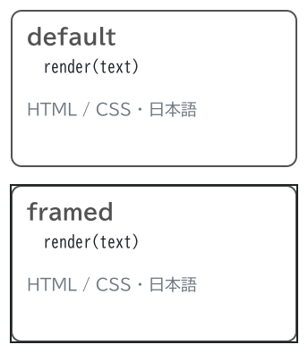
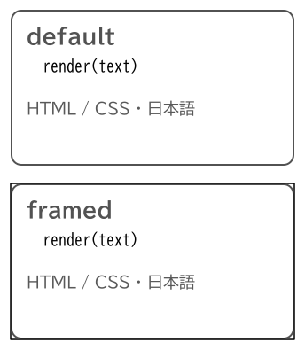
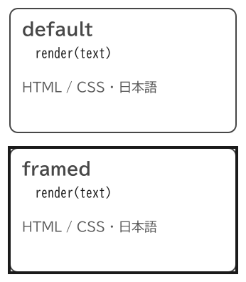
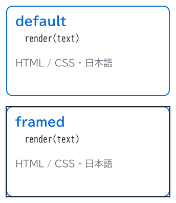
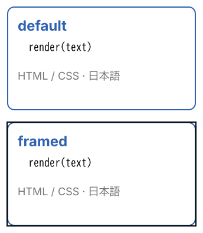

# sumi/html

[Gallery](../README.md) · Generated by <code>bun run gallery</code>; do not edit by hand\.

A restricted HTML/CSS leaf rendered as outlined vector artwork with bundled fonts and theme variables; takes no label\.

**kind**: <code>node</code> · **variants**: <code>default, framed</code> · **since**: <code>0\.11\.0</code> · **shape**: <code>rectangle</code> · **sizing**: <code>auto</code> · **embed**: <code>image</code>

| prop | type | required | description |
| --- | --- | --- | --- |
| <code>html</code> | <code>string</code> | yes | Restricted HTML: div, span, p, b, i, br; only inline style\. No URLs, images, scripts, overflow, transforms, gradients or shadows\. Text becomes outlines, not searchable text\. |
| <code>viewport</code> | <code>string</code> | yes | Required CSS pixel viewport WxH, e\.g\. 320x176; at most 2048 per side and 2097152 total pixels\. |
| <code>width</code> | <code>string</code> | no | Display width, e\.g\. 120pt; missing side follows viewport aspect ratio\. If neither side is given, uses the viewport at 0\.75pt per CSS px\. |
| <code>height</code> | <code>string</code> | no | Display height; missing side follows viewport aspect ratio\. |
| <code>fit</code> | <code>&quot;contain&quot; &#124; &quot;cover&quot; &#124; &quot;fill&quot;</code> | no | Image placement: contain \(default\), cover, or fill\. |

| <code>minimal</code> | <code>academic</code> | <code>slides</code> | <code>color</code> | <code>paper</code> |
| --- | --- | --- | --- | --- |
|  |  |  |  |  |
| <code>sumi render sumi\-html\.sumi\.yaml</code><br>60\.68mm × 69\.67mm \(max width 180mm, max height 220mm\) | <code>sumi render sumi\-html\.sumi\.yaml \-\-theme academic</code><br>60\.68mm × 69\.67mm \(max width 180mm, max height 220mm\) | <code>sumi render sumi\-html\.sumi\.yaml \-\-theme slides</code><br>61\.03mm × 69\.85mm \(max width 180mm, max height 220mm\) | <code>sumi render sumi\-html\.sumi\.yaml \-\-theme color</code><br>60\.68mm × 69\.67mm \(max width 180mm, max height 220mm\) | <code>sumi render sumi\-html\.sumi\.yaml \-\-theme paper</code><br>60\.68mm × 69\.67mm \(max width 180mm, max height 220mm\) |

<details>
<summary>Source: <code>sumi-html.sumi.yaml</code></summary>

```yaml
# sumi/html: every variant. Generated by `bun run gallery` (#17).
version: 1
figure:
  id: gallery-sumi-html
  title: sumi/html
  theme: minimal
  profile: paper-double
  layout:
    direction: right

nodes:
  - id: default
    component: html
    variant: default
    props:
      viewport: 320x176
      width: 160pt
      html: |
        <div style="display:flex;flex-direction:column;gap:12px;padding:16px;width:320px;height:176px;background-color:var(--sumi-bg);border:2px solid var(--sumi-accent);border-radius:12px">
          <b style="font-size:24px;color:var(--sumi-accent)">default</b>
          <div style="font-family:var(--sumi-mono);white-space:pre;font-size:18px">  render(text)</div>
          <p style="font-size:18px;color:var(--sumi-muted)">HTML / CSS · 日本語</p>
        </div>
  - id: framed
    component: html
    variant: framed
    props:
      viewport: 320x176
      width: 160pt
      html: |
        <div style="display:flex;flex-direction:column;gap:12px;padding:16px;width:320px;height:176px;background-color:var(--sumi-bg);border:2px solid var(--sumi-accent);border-radius:12px">
          <b style="font-size:24px;color:var(--sumi-accent)">framed</b>
          <div style="font-family:var(--sumi-mono);white-space:pre;font-size:18px">  render(text)</div>
          <p style="font-size:18px;color:var(--sumi-muted)">HTML / CSS · 日本語</p>
        </div>
```

</details>
