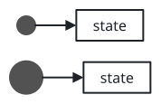
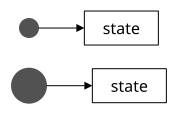
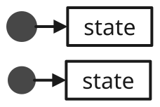
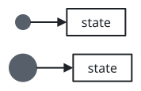
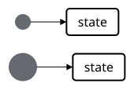
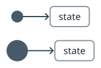
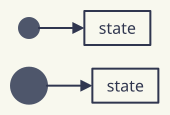
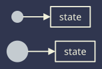

# sumi/initial

[Gallery](../README.md) · Generated by <code>bun run gallery</code>; do not edit by hand\.

The start of a state machine: a solid dot \(1\.25 em across by default\); takes no label\. Connect it with an edge to the first state\.

**kind**: <code>node</code> · **variants**: <code>default</code> · **since**: <code>0\.18\.0</code> · **engines**: <code>\[&quot;structured&quot;\]</code> · **shape**: <code>rectangle</code> · **sizing**: <code>auto</code> · **render**: <code>\{&quot;type&quot;:&quot;outline&quot;,&quot;renderer&quot;:&quot;sumi/state\-marker&quot;,&quot;params&quot;:\{&quot;kind&quot;:&quot;initial&quot;,&quot;em&quot;:16\}\}</code>

| prop | type | required | description |
| --- | --- | --- | --- |
| <code>size</code> | <code>string</code> | no | Explicit diameter as a length such as &quot;10pt&quot; \(a multiple of 0\.5pt\)\. Omitted means a multiple of the theme text size\. |

| <code>minimal</code> | <code>academic</code> | <code>slides</code> | <code>color</code> | <code>paper</code> | <code>llama</code> | <code>sumi</code> | <code>sumi\-dark</code> |
| --- | --- | --- | --- | --- | --- | --- | --- |
|  |  |  |  |  |  |  |  |
| <code>sumi render sumi\-initial\.sumi\.yaml</code><br>31\.4mm × 20\.28mm \(max width 180mm, max height 220mm\) | <code>sumi render sumi\-initial\.sumi\.yaml \-\-theme academic</code><br>31\.4mm × 20\.28mm \(max width 180mm, max height 220mm\) | <code>sumi render sumi\-initial\.sumi\.yaml \-\-theme slides</code><br>40\.22mm × 26\.99mm \(max width 180mm, max height 220mm\) | <code>sumi render sumi\-initial\.sumi\.yaml \-\-theme color</code><br>31\.4mm × 20\.28mm \(max width 180mm, max height 220mm\) | <code>sumi render sumi\-initial\.sumi\.yaml \-\-theme paper</code><br>29\.99mm × 20\.28mm \(max width 180mm, max height 220mm\) | <code>sumi render sumi\-initial\.sumi\.yaml \-\-theme llama</code><br>29\.99mm × 20\.28mm \(max width 180mm, max height 220mm\) | <code>sumi render sumi\-initial\.sumi\.yaml \-\-theme sumi</code><br>29\.99mm × 20\.28mm \(max width 180mm, max height 220mm\) | <code>sumi render sumi\-initial\.sumi\.yaml \-\-theme sumi\-dark</code><br>29\.99mm × 20\.28mm \(max width 180mm, max height 220mm\) |

<details>
<summary>Source: <code>sumi-initial.sumi.yaml</code></summary>

```yaml
# sumi/initial: its default and an explicit size. Generated by `bun run gallery` (#519).
version: 1
figure:
  id: gallery-sumi-initial
  title: sumi/initial
  theme: minimal
  profile: paper-double
  layout:
    arrange:
      stack:
        gap: 4mm
        items:
          - row: { gap: 8mm, align: center, items: [mark, mark-state] }
          - row: { gap: 8mm, align: center, items: [big, big-state] }
nodes:
  - { id: mark, component: initial }
  - { id: big, component: initial, props: { size: 18pt } }
  - { id: mark-state, component: box, label: state }
  - { id: big-state, component: box, label: state }
edges:
  - { from: mark, to: mark-state }
  - { from: big, to: big-state }
```

</details>
