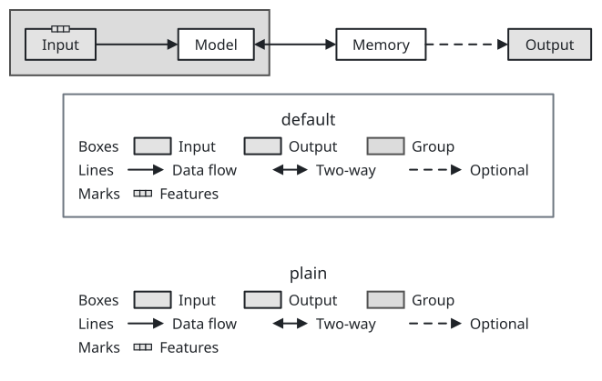
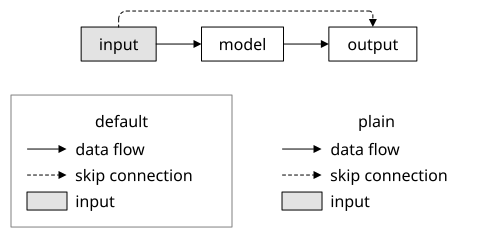
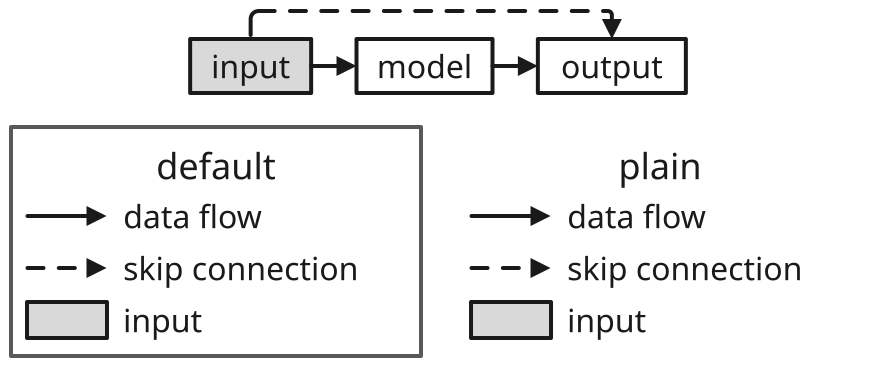
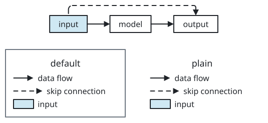
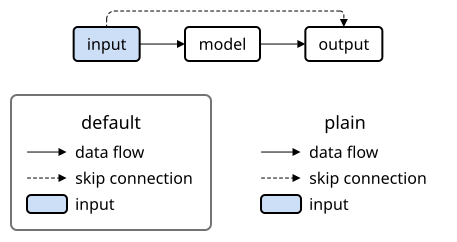
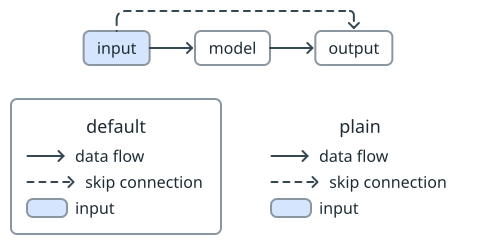
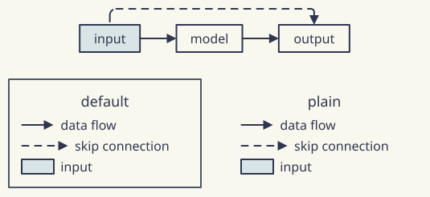
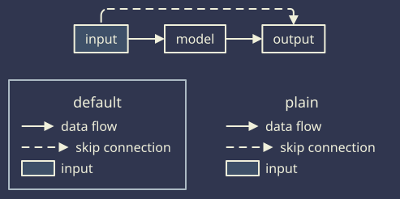

# sumi/legend

[Gallery](../README.md) · Generated by <code>bun run gallery</code>; do not edit by hand\.

A key that explains styles: one sample per entry \(a line, a box, an icon, a glyph such as a feature vector, or a set swatch\), drawn with the same fields as the edges, nodes, glyphs or sets it explains, beside its text; in a column, a row or rows, with optional group headings \(structured layout only\)\.

**kind**: <code>node</code> · **variants**: <code>default, plain</code> · **since**: <code>0\.5\.0</code> · **engines**: <code>\[&quot;structured&quot;\]</code> · **shape**: <code>rectangle</code> · **sizing**: <code>auto</code>

| prop | type | required | description |
| --- | --- | --- | --- |
| <code>entries</code> | <code>array</code> | yes | The entries, in order\. Each has one sample: edge \(a line\), node \(a box\), class \(the sample box of a matrix class\), icon, glyph or set; and a label\. An entry may start a group with a heading\. |
| <code>flow</code> | <code>&quot;column&quot; &#124; &quot;row&quot;</code> | no | column \(default\): one entry per line, top to bottom\. row: the entries side by side on one line \(see perRow for several lines\)\. With flow: row, a heading starts a new line unless headings: inline\. |
| <code>headings</code> | <code>&quot;line&quot; &#124; &quot;inline&quot;</code> | no | With flow: row, where a heading goes\. line \(default\): a table, each group on its own lines with the headings in one column\. inline: the heading sits on the line of its group's first entry, and groups follow one another on the same line, wrapping after perRow entries\. |
| <code>perRow</code> | <code>integer</code> | no | With flow: row, the most entries on a line before it wraps; each group wraps by itself \(with headings: inline, the whole legend wraps, headings not counted\)\. Omitted means no wrapping\. |

| <code>minimal</code> | <code>academic</code> | <code>slides</code> | <code>color</code> | <code>paper</code> | <code>llama</code> | <code>sumi</code> | <code>sumi\-dark</code> |
| --- | --- | --- | --- | --- | --- | --- | --- |
|  |  |  |  |  |  |  |  |
| <code>sumi render sumi\-legend\.sumi\.yaml</code><br>119\.59mm × 70\.2mm \(max width 180mm, max height 220mm\) | <code>sumi render sumi\-legend\.sumi\.yaml \-\-theme academic</code><br>119\.59mm × 69\.14mm \(max width 180mm, max height 220mm\) | <code>sumi render sumi\-legend\.sumi\.yaml \-\-theme slides \-\-profile presentation\-16x9</code><br>195\.44mm × 128\.41mm \(max width 338\.7mm, max height 190\.5mm\) | <code>sumi render sumi\-legend\.sumi\.yaml \-\-theme color</code><br>119\.59mm × 70\.2mm \(max width 180mm, max height 220mm\) | <code>sumi render sumi\-legend\.sumi\.yaml \-\-theme paper</code><br>113\.42mm × 70\.2mm \(max width 180mm, max height 220mm\) | <code>sumi render sumi\-legend\.sumi\.yaml \-\-theme llama</code><br>113\.42mm × 70\.2mm \(max width 180mm, max height 220mm\) | <code>sumi render sumi\-legend\.sumi\.yaml \-\-theme sumi</code><br>113\.42mm × 70\.2mm \(max width 180mm, max height 220mm\) | <code>sumi render sumi\-legend\.sumi\.yaml \-\-theme sumi\-dark</code><br>113\.42mm × 70\.2mm \(max width 180mm, max height 220mm\) |

<details>
<summary>Source: <code>sumi-legend.sumi.yaml</code></summary>

```yaml
# sumi/legend: every variant, each explaining the figure above it. Generated by `bun run gallery` (#17, #131, #550).
version: 1
figure:
  id: gallery-sumi-legend
  title: sumi/legend
  theme: minimal
  profile: paper-double
  layout:
    arrange:
      stack:
        gap: 7mm
        align: center
        items:
          - row: { gap: 18mm, align: center, items: [input, model, store, output] }
          - stack: { gap: 0mm, align: center, items: [default, plain] }

nodes:
  - { id: input, component: box, label: Input, tone: blue, glyphs: [{ kind: vector, tone: gray, direction: right, at: north }] }
  - { id: model, component: box, label: Model }
  - { id: store, component: box, label: Memory }
  - { id: output, component: box, label: Output, tone: orange }
  - id: default
    component: sumi/legend
    label: default
    props:
      flow: row
      headings: inline
      perRow: 3
      entries:
        - { heading: Boxes, node: { tone: blue }, label: Input }
        - { node: { tone: orange }, label: Output }
        - { heading: Lines, edge: {}, label: Data flow }
        - { edge: { component: double-arrow }, label: Two-way }
        - { edge: { variant: dashed }, label: Optional }
        - { heading: Marks, set: { tone: gray }, label: Group }
        - { glyph: { kind: vector, tone: gray, direction: right }, label: Features }
  - id: plain
    component: sumi/legend
    label: plain
    variant: plain
    props:
      flow: row
      headings: inline
      perRow: 3
      entries:
        - { heading: Boxes, node: { tone: blue }, label: Input }
        - { node: { tone: orange }, label: Output }
        - { heading: Lines, edge: {}, label: Data flow }
        - { edge: { component: double-arrow }, label: Two-way }
        - { edge: { variant: dashed }, label: Optional }
        - { heading: Marks, set: { tone: gray }, label: Group }
        - { glyph: { kind: vector, tone: gray, direction: right }, label: Features }

edges:
  - { from: input, to: model }
  - { from: model, to: store, component: double-arrow }
  - { from: store, to: output, variant: dashed }

sets:
  - { id: stage, members: [model, store], shape: rect, tone: gray, padding: 5mm, enclose: footprint }
```

</details>
