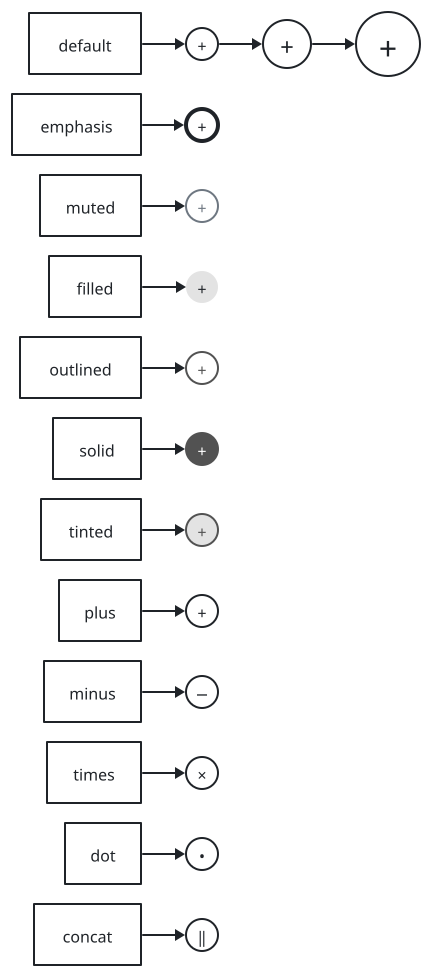
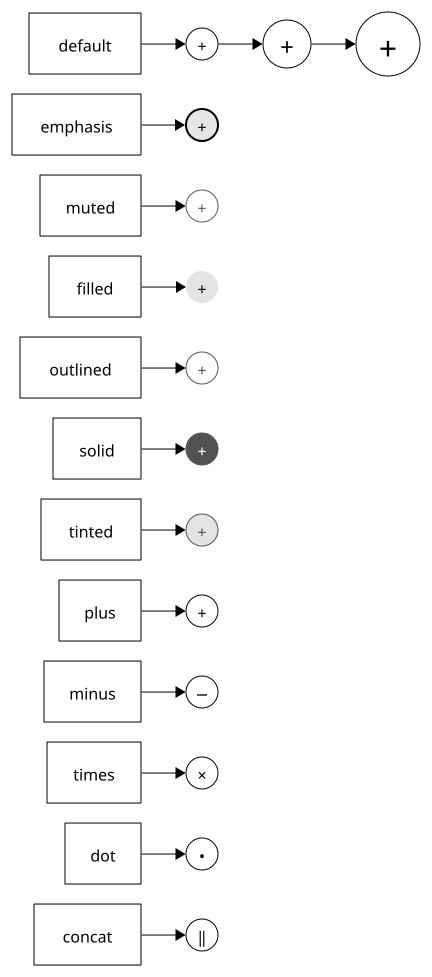
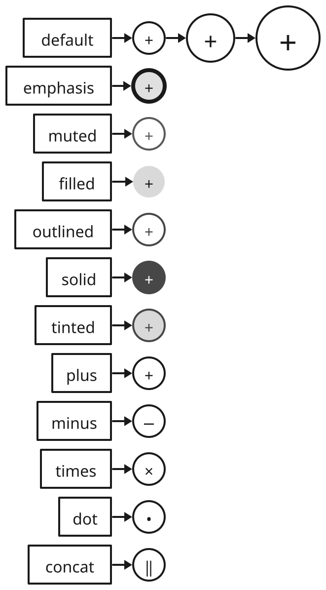
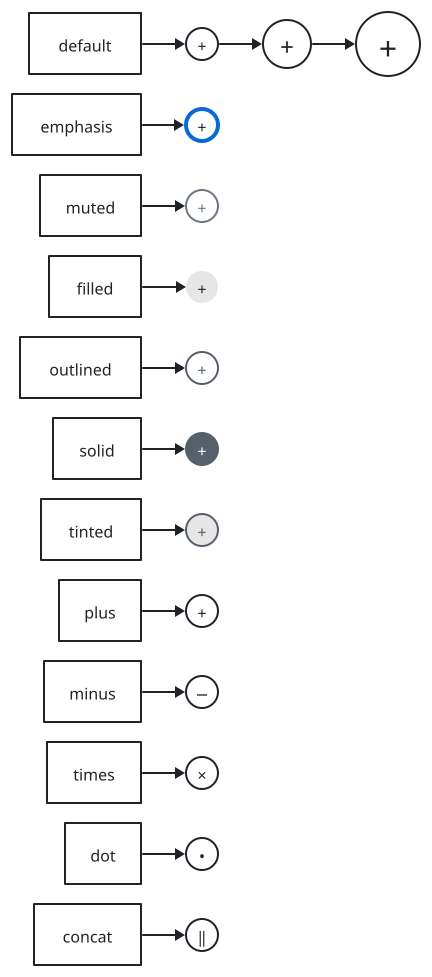
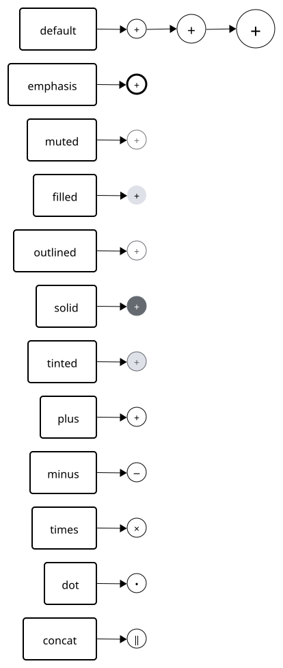
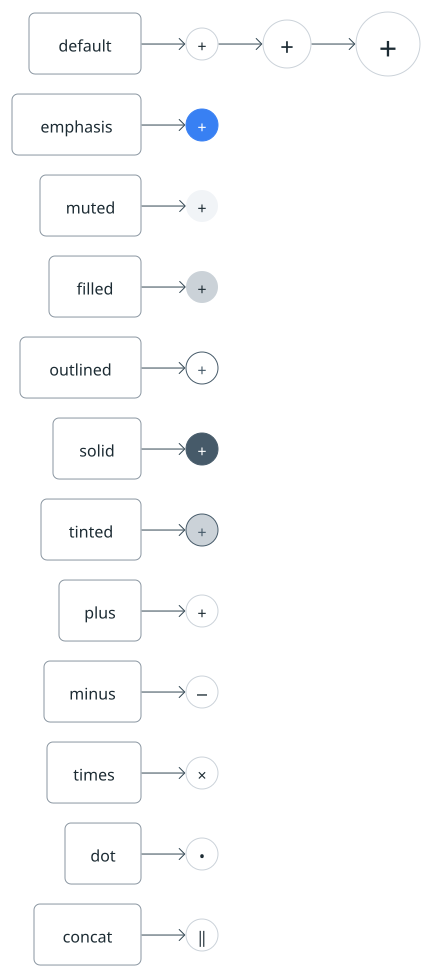

# sumi/operator

[Gallery](../README.md) · Generated by <code>bun run gallery</code>; do not edit by hand\.

A small circle with an operator symbol, e\.g\. where inputs are added or combined; takes no label\.

**kind**: <code>node</code> · **variants**: <code>default, emphasis, muted, filled, outlined, solid, tinted</code> · **since**: <code>0\.4\.0</code> · **shape**: <code>circle</code> · **sizing**: <code>fixed\-aspect\-1</code> · **mark**: <code>\{&quot;type&quot;:&quot;glyph&quot;,&quot;prop&quot;:&quot;symbol&quot;,&quot;glyphs&quot;:\{&quot;plus&quot;:&quot;\+&quot;,&quot;minus&quot;:&quot;−&quot;,&quot;times&quot;:&quot;×&quot;,&quot;dot&quot;:&quot;•&quot;,&quot;concat&quot;:&quot;‖&quot;\},&quot;size&quot;:2\}</code>

| prop | type | required | description |
| --- | --- | --- | --- |
| <code>symbol</code> | <code>&quot;plus&quot; &#124; &quot;minus&quot; &#124; &quot;times&quot; &#124; &quot;dot&quot; &#124; &quot;concat&quot;</code> | yes | The operator drawn in the circle: plus \(\+\), minus \(−\), times \(×\), dot \(•\) or concat \(‖\)\. |
| <code>size</code> | <code>&quot;regular&quot; &#124; &quot;large&quot; &#124; &quot;xlarge&quot;</code> | no | Size of the circle and the symbol together, relative to the theme's operator \(since 0\.12\.0\): regular \(the theme's size, the default\), large \(1\.5x\) or xlarge \(2x\)\. The frame's line weight stays the theme's\. |

| <code>minimal</code> | <code>academic</code> | <code>slides</code> | <code>color</code> | <code>paper</code> | <code>llama</code> |
| --- | --- | --- | --- | --- | --- |
|  |  |  |  |  |  |
| <code>sumi render sumi\-operator\.sumi\.yaml</code><br>76\.2mm × 172\.33mm \(max width 180mm, max height 220mm\)<br>info geometry/dead\-space: The figure has large empty rectangles: middle\-right 35\.45mm × 156\.81mm \(42\.3% of the canvas\)\. | <code>sumi render sumi\-operator\.sumi\.yaml \-\-theme academic</code><br>76\.2mm × 172\.33mm \(max width 180mm, max height 220mm\)<br>info geometry/dead\-space: The figure has large empty rectangles: middle\-right 35\.54mm × 156\.81mm \(42\.4% of the canvas\)\. | <code>sumi render sumi\-operator\.sumi\.yaml \-\-theme slides</code><br>116\.59mm × 210\.78mm \(max width 180mm, max height 220mm\)<br>info geometry/dead\-space: The figure has large empty rectangles: middle\-right 55\.03mm × 183\.62mm \(41\.1% of the canvas\)\. | <code>sumi render sumi\-operator\.sumi\.yaml \-\-theme color</code><br>76\.2mm × 172\.33mm \(max width 180mm, max height 220mm\)<br>info geometry/dead\-space: The figure has large empty rectangles: middle\-right 35\.45mm × 156\.81mm \(42\.3% of the canvas\)\. | <code>sumi render sumi\-operator\.sumi\.yaml \-\-theme paper</code><br>73\.03mm × 172\.16mm \(max width 180mm, max height 220mm\)<br>info geometry/dead\-space: The figure has large empty rectangles: middle\-right 32\.98mm × 157\.78mm \(41\.4% of the canvas\)\. | <code>sumi render sumi\-operator\.sumi\.yaml \-\-theme llama</code><br>76\.2mm × 172\.33mm \(max width 180mm, max height 220mm\)<br>info geometry/dead\-space: The figure has large empty rectangles: middle\-right 35\.63mm × 156\.81mm \(42\.5% of the canvas\)\. |

<details>
<summary>Source: <code>sumi-operator.sumi.yaml</code></summary>

```yaml
# sumi/operator: every variant. Generated by `bun run gallery` (#17).
version: 1
figure:
  id: gallery-sumi-operator
  title: sumi/operator
  theme: minimal
  profile: paper-double
  layout:
    direction: right

nodes:
  - id: default
    component: box
    label: default
  - id: default-operator
    component: sumi/operator
    props: { symbol: plus }
  - id: emphasis
    component: box
    label: emphasis
  - id: emphasis-operator
    component: sumi/operator
    variant: emphasis
    props: { symbol: plus }
  - id: muted
    component: box
    label: muted
  - id: muted-operator
    component: sumi/operator
    variant: muted
    props: { symbol: plus }
  - id: filled
    component: box
    label: filled
  - id: filled-operator
    component: sumi/operator
    variant: filled
    props: { symbol: plus }
  - id: outlined
    component: box
    label: outlined
  - id: outlined-operator
    component: sumi/operator
    variant: outlined
    props: { symbol: plus }
  - id: solid
    component: box
    label: solid
  - id: solid-operator
    component: sumi/operator
    variant: solid
    props: { symbol: plus }
  - id: tinted
    component: box
    label: tinted
  - id: tinted-operator
    component: sumi/operator
    variant: tinted
    props: { symbol: plus }
  - id: plus
    component: box
    label: plus
  - id: plus-operator
    component: sumi/operator
    props: { symbol: plus }
  - id: minus
    component: box
    label: minus
  - id: minus-operator
    component: sumi/operator
    props: { symbol: minus }
  - id: times
    component: box
    label: times
  - id: times-operator
    component: sumi/operator
    props: { symbol: times }
  - id: dot
    component: box
    label: dot
  - id: dot-operator
    component: sumi/operator
    props: { symbol: dot }
  - id: concat
    component: box
    label: concat
  - id: concat-operator
    component: sumi/operator
    props: { symbol: concat }
  - id: size-large-operator
    component: sumi/operator
    props: { symbol: plus, size: large }
  - id: size-xlarge-operator
    component: sumi/operator
    props: { symbol: plus, size: xlarge }

edges:
  - from: default
    to: default-operator
  - from: emphasis
    to: emphasis-operator
  - from: muted
    to: muted-operator
  - from: filled
    to: filled-operator
  - from: outlined
    to: outlined-operator
  - from: solid
    to: solid-operator
  - from: tinted
    to: tinted-operator
  - from: plus
    to: plus-operator
  - from: minus
    to: minus-operator
  - from: times
    to: times-operator
  - from: dot
    to: dot-operator
  - from: concat
    to: concat-operator
  - from: default-operator
    to: size-large-operator
  - from: size-large-operator
    to: size-xlarge-operator
```

</details>
