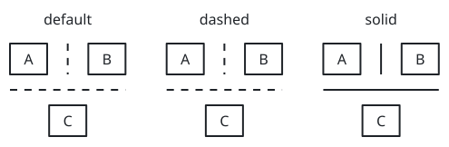
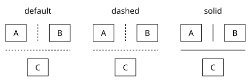
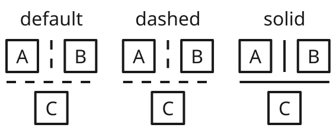
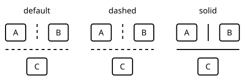

# sumi/separator

[Gallery](../README.md) · Generated by <code>bun run gallery</code>; do not edit by hand\.

A decorative panel divider that spans its enclosing structured row's height or stack's width, independently of align; takes no label and is not a connection or a geometry\-lint obstacle\. Use arrange gap for spacing\.

**kind**: <code>node</code> · **variants**: <code>default, dashed, solid</code> · **since**: <code>0\.12\.0</code> · **engines**: <code>\[&quot;structured&quot;\]</code> · **shape**: <code>rectangle</code> · **sizing**: <code>auto</code>

No props.

| <code>minimal</code> | <code>academic</code> | <code>slides</code> | <code>color</code> | <code>paper</code> |
| --- | --- | --- | --- | --- |
|  |  |  |  |  |
| <code>sumi render sumi\-separator\.sumi\.yaml</code><br>87\.31mm × 28\.58mm \(max width 180mm, max height 220mm\) | <code>sumi render sumi\-separator\.sumi\.yaml \-\-theme academic</code><br>87\.31mm × 28\.58mm \(max width 180mm, max height 220mm\) | <code>sumi render sumi\-separator\.sumi\.yaml \-\-theme slides</code><br>100\.01mm × 39\.16mm \(max width 180mm, max height 220mm\) | <code>sumi render sumi\-separator\.sumi\.yaml \-\-theme color</code><br>87\.31mm × 28\.58mm \(max width 180mm, max height 220mm\) | <code>sumi render sumi\-separator\.sumi\.yaml \-\-theme paper</code><br>85\.73mm × 28\.58mm \(max width 180mm, max height 220mm\) |

<details>
<summary>Source: <code>sumi-separator.sumi.yaml</code></summary>

```yaml
# sumi/separator: every variant and orientation. Generated by `bun run gallery`.
version: 1
figure:
  id: gallery-sumi-separator
  title: sumi/separator
  theme: minimal
  profile: paper-double
  layout:
    arrange:
      row:
        gap: 8mm
        items:
          - stack: { gap: 3mm, items: [default-title, { row: { gap: 4mm, items: [default-a, default-vertical, default-b] } }, default-horizontal, default-c] }
          - stack: { gap: 3mm, items: [dashed-title, { row: { gap: 4mm, items: [dashed-a, dashed-vertical, dashed-b] } }, dashed-horizontal, dashed-c] }
          - stack: { gap: 3mm, items: [solid-title, { row: { gap: 4mm, items: [solid-a, solid-vertical, solid-b] } }, solid-horizontal, solid-c] }
nodes:
  - { id: default-title, component: label, label: default }
  - { id: default-a, component: box, label: A }
  - { id: default-b, component: box, label: B }
  - { id: default-c, component: box, label: C }
  - { id: default-vertical, component: separator, variant: default }
  - { id: default-horizontal, component: separator, variant: default }
  - { id: dashed-title, component: label, label: dashed }
  - { id: dashed-a, component: box, label: A }
  - { id: dashed-b, component: box, label: B }
  - { id: dashed-c, component: box, label: C }
  - { id: dashed-vertical, component: separator, variant: dashed }
  - { id: dashed-horizontal, component: separator, variant: dashed }
  - { id: solid-title, component: label, label: solid }
  - { id: solid-a, component: box, label: A }
  - { id: solid-b, component: box, label: B }
  - { id: solid-c, component: box, label: C }
  - { id: solid-vertical, component: separator, variant: solid }
  - { id: solid-horizontal, component: separator, variant: solid }
```

</details>
