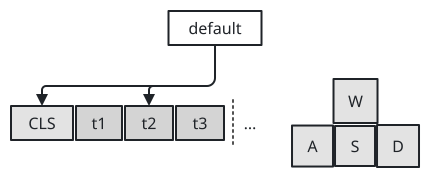
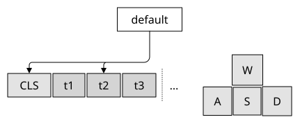
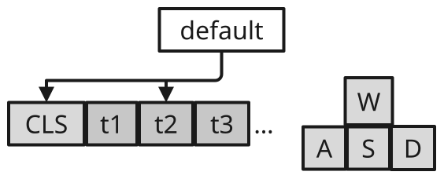
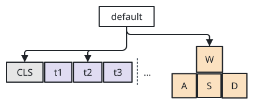
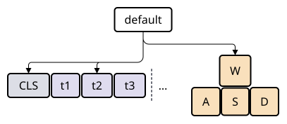

# sumi/tokens

[Gallery](../README.md) · Generated by <code>bun run gallery</code>; do not edit by hand\.

A sequence of cells side by side, e\.g\. tokens or keys, each drawn as its own node that edges address as &lt;node&gt;\.&lt;cell&gt; \(structured layout only\)\.

**kind**: <code>node</code> · **variants**: <code>default</code> · **since**: <code>0\.6\.0</code> · **engines**: <code>\[&quot;structured&quot;\]</code> · **shape**: <code>rectangle</code> · **sizing**: <code>auto</code>

| prop | type | required | description |
| --- | --- | --- | --- |
| <code>cells</code> | <code>array</code> | no | The cells in order: labels, objects with id, label, tone, mono, component, variant, width and height, or \{ separator: dotted, id?, tone?, width?, height? \} divider cells \(since 0\.7\.0\)\. Dividers count in positional cell references\. |
| <code>lines</code> | <code>array</code> | no | Instead of cells: several lines of cells, each laid out in direction, the lines placed across it \(below one another for right / left\), e\.g\. keys \[\[W\], \[A, S, D\]\]\. Cells are numbered across the lines\. |
| <code>direction</code> | <code>&quot;right&quot; &#124; &quot;left&quot; &#124; &quot;down&quot; &#124; &quot;up&quot;</code> | no | Where the cells run: right, left \(a row\), down or up \(a stack\)\. |
| <code>gap</code> | <code>any</code> | no | Space between cells, as an arrange gap\. Omitted means the layout default\. |
| <code>align</code> | <code>&quot;start&quot; &#124; &quot;center&quot; &#124; &quot;end&quot; &#124; &quot;stretch&quot;</code> | no | Cross\-axis alignment of the cells, as in an arrange box\. Omitted inherits from the enclosing box\. |
| <code>lineGap</code> | <code>any</code> | no | Space between lines \(with lines\)\. Omitted means gap\. |
| <code>lineAlign</code> | <code>&quot;start&quot; &#124; &quot;center&quot; &#124; &quot;end&quot; &#124; &quot;stretch&quot;</code> | no | Alignment of the lines across them, e\.g\. center to centre a short line \(with lines\)\. Omitted inherits from the enclosing box\. |
| <code>component</code> | <code>string</code> | no | The node component of every cell\. Omitted means box\. |
| <code>variant</code> | <code>string</code> | no | The variant of every cell\. Omitted means default\. |
| <code>width</code> | <code>string</code> | no | The width of every cell\. Omitted means sized to its label\. |
| <code>height</code> | <code>string</code> | no | The height of every cell\. Omitted means sized to its label\. |

| <code>minimal</code> | <code>academic</code> | <code>slides</code> | <code>color</code> | <code>paper</code> |
| --- | --- | --- | --- | --- |
|  |  |  |  |  |
| <code>sumi render sumi\-tokens\.sumi\.yaml</code><br>76\.02mm × 31\.57mm \(max width 180mm, max height 220mm\) | <code>sumi render sumi\-tokens\.sumi\.yaml \-\-theme academic</code><br>76\.02mm × 31\.57mm \(max width 180mm, max height 220mm\) | <code>sumi render sumi\-tokens\.sumi\.yaml \-\-theme slides</code><br>102\.13mm × 40\.22mm \(max width 180mm, max height 220mm\) | <code>sumi render sumi\-tokens\.sumi\.yaml \-\-theme color</code><br>76\.02mm × 31\.57mm \(max width 180mm, max height 220mm\) | <code>sumi render sumi\-tokens\.sumi\.yaml \-\-theme paper</code><br>71\.79mm × 31\.22mm \(max width 180mm, max height 220mm\) |

<details>
<summary>Source: <code>sumi-tokens.sumi.yaml</code></summary>

```yaml
# sumi/tokens: every variant. Generated by `bun run gallery` (#17, #181).
version: 1
figure:
  id: gallery-sumi-tokens
  title: sumi/tokens
  theme: minimal
  profile: paper-double
  layout:
    arrange:
      stack:
        gap: 6mm
        items:
          - default-model
          - row: { gap: 6mm, align: center, items: [default, default-keys] }

nodes:
  - id: default-model
    component: box
    label: default
  - id: default
    component: sumi/tokens
    tone: purple
    props:
      gap: 1.5pt
      cells:
        - { id: cls, label: CLS, tone: gray }
        - t1
        - t2
        - t3
        - { separator: dotted, tone: gray, height: 24pt }
        - { label: '…', component: label }
  - id: default-keys
    component: sumi/tokens
    tone: orange
    props: { gap: 1pt, component: square, lineAlign: center, lines: [[W], [A, S, D]] }

edges:
  - from: default-model
    to: default.cls
  - from: default-model
    to: default.3
```

</details>
