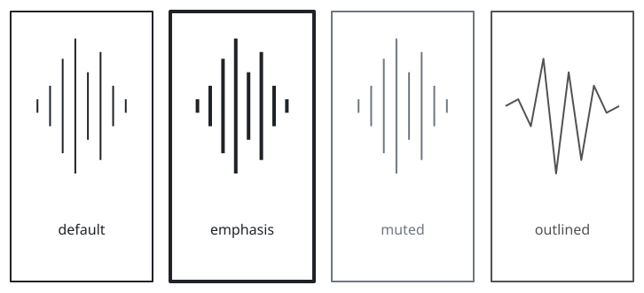
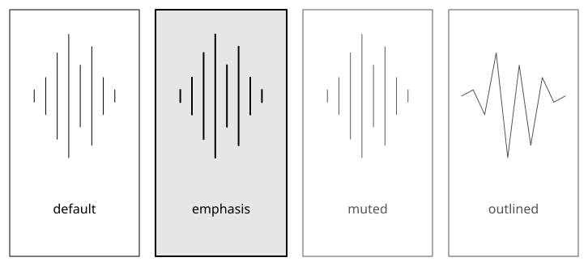
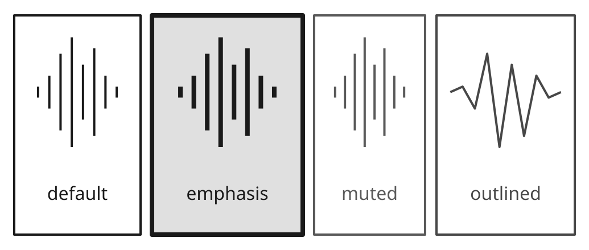
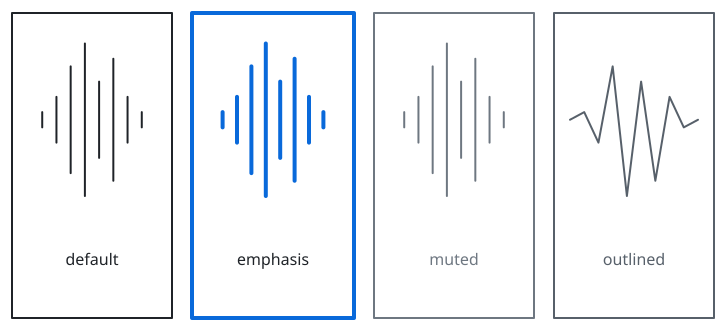
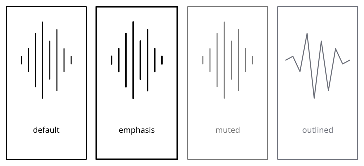

# sumi/waveform

[Gallery](../README.md) · Generated by <code>bun run gallery</code>; do not edit by hand\.

A deterministic sample\-driven waveform in a rectangular frame, with an optional label below the signal; no audio decoding or synthesis\.

**kind**: <code>node</code> · **variants**: <code>default, emphasis, muted, outlined</code> · **since**: <code>0\.10\.0</code> · **shape**: <code>rectangle</code> · **sizing**: <code>auto</code> · **render**: <code>\{&quot;type&quot;:&quot;outline&quot;,&quot;renderer&quot;:&quot;sumi/waveform&quot;,&quot;params&quot;:\{&quot;samples&quot;:&quot;0,0&quot;,&quot;mode&quot;:&quot;bars&quot;,&quot;hasLabel&quot;:false\}\}</code>

| prop | type | required | description |
| --- | --- | --- | --- |
| <code>width</code> | <code>string</code> | no | Explicit width as a length such as &quot;30mm&quot; or &quot;40pt&quot; \(a multiple of 0\.5pt\)\. Omitted means sized to the label\. |
| <code>height</code> | <code>string</code> | no | Explicit height as a length such as &quot;10mm&quot; or &quot;20pt&quot; \(a multiple of 0\.5pt\)\. Omitted means sized to the label\. |
| <code>frameStroke</code> | <code>string</code> | no | Independent \#RRGGBB frame color; the signal retains its resolved tone color\. Omit to use the theme stroke for both\. |
| <code>samples</code> | <code>array</code> | yes | Two to 2048 explicit finite amplitudes in \[\-1, 1\], evenly spaced; no resampling or normalization\. Bars mirror absolute amplitudes around the center; line mode preserves signs\. |
| <code>mode</code> | <code>&quot;bars&quot; &#124; &quot;line&quot;</code> | no | bars draws mirrored vertical amplitudes; line joins signed samples with straight segments\. |

| <code>minimal</code> | <code>academic</code> | <code>slides</code> | <code>color</code> | <code>paper</code> |
| --- | --- | --- | --- | --- |
|  |  |  |  |  |
| <code>sumi render sumi\-waveform\.sumi\.yaml</code><br>128\.06mm × 58\.38mm \(max width 180mm, max height 220mm\) | <code>sumi render sumi\-waveform\.sumi\.yaml \-\-theme academic</code><br>128\.06mm × 58\.03mm \(max width 180mm, max height 220mm\) | <code>sumi render sumi\-waveform\.sumi\.yaml \-\-theme slides \-\-profile presentation\-16x9</code><br>182\.56mm × 77\.43mm \(max width 338\.7mm, max height 190\.5mm\) | <code>sumi render sumi\-waveform\.sumi\.yaml \-\-theme color</code><br>128\.06mm × 58\.38mm \(max width 180mm, max height 220mm\) | <code>sumi render sumi\-waveform\.sumi\.yaml \-\-theme paper</code><br>128\.06mm × 58\.38mm \(max width 180mm, max height 220mm\) |

<details>
<summary>Source: <code>sumi-waveform.sumi.yaml</code></summary>

```yaml
# sumi/waveform: every variant. Generated by `bun run gallery` (#17).
version: 1
figure:
  id: gallery-sumi-waveform
  title: sumi/waveform
  theme: minimal
  profile: paper-double
  layout:
    direction: down

nodes:
  - id: default
    component: sumi/waveform
    label: default
    props:
      samples: [0, 0.1, -0.3, 0.7, -1, 0.5, -0.8, 0.3, -0.1, 0]
      mode: bars
  - id: emphasis
    component: sumi/waveform
    label: emphasis
    variant: emphasis
    props:
      samples: [0, 0.1, -0.3, 0.7, -1, 0.5, -0.8, 0.3, -0.1, 0]
      mode: bars
  - id: muted
    component: sumi/waveform
    label: muted
    variant: muted
    props:
      samples: [0, 0.1, -0.3, 0.7, -1, 0.5, -0.8, 0.3, -0.1, 0]
      mode: bars
  - id: outlined
    component: sumi/waveform
    label: outlined
    variant: outlined
    props:
      samples: [0, 0.1, -0.3, 0.7, -1, 0.5, -0.8, 0.3, -0.1, 0]
      mode: line
```

</details>
