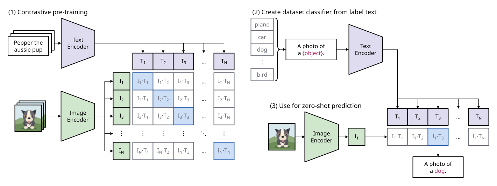

# Examples

[Gallery](README.md) · [Examples](examples.md) · [Themes](themes.md) · [Tones](tones.md) · [Dimmed groups](dim.md) · [Profiles and comparison](compare.md)

The committed SVGs of <code>examples/</code>, rendered from their sources as written\.

## CLIP — Summary of our approach

[<code>examples/clip/clip\.sumi\.yaml</code>](../../examples/clip/clip.sumi.yaml) · [PDF](../../examples/clip/clip.pdf) · theme <code>paper</code> · profile <code>paper\-double</code> · 180mm × 67\.64mm \(max width 180mm, max height 220mm\) info geometry/script\-too\-small: Subscripts or superscripts of label math print at down to 4\.02pt \(5\.6pt shrunk to 71\.8% by figure\.fit: scale\), below the 5pt minimum font size of profile &quot;paper\-double&quot; for a scaled figure: in cell &quot;1&quot; of tokens &quot;text\-tokens&quot;, cell &quot;2&quot; of tokens &quot;text\-tokens&quot;, cell &quot;3&quot; of tokens &quot;text\-tokens&quot; and 30 more labels\.

## Generic decision flow

[<code>examples/decision\-flow/decision\-flow\.sumi\.yaml</code>](../../examples/decision-flow/decision-flow.sumi.yaml) · [PDF](../../examples/decision-flow/decision-flow.pdf) · theme <code>minimal</code> · profile <code>paper\-single</code> · 59\.62mm × 149\.4mm \(max width 88mm, max height 220mm\)

## DiT block variants \(structured layout, paper theme\)

[<code>examples/dit\-block/dit\-block\.sumi\.yaml</code>](../../examples/dit-block/dit-block.sumi.yaml) · [PDF](../../examples/dit-block/dit-block.pdf) · theme <code>paper</code> · profile <code>paper\-double</code> · 180mm × 84\.69mm \(max width 180mm, max height 220mm\) info geometry/script\-too\-small: Subscripts or superscripts of label math print at down to 3\.99pt \(4\.9pt shrunk to 81\.4% by figure\.fit: scale\), below the 5pt minimum font size of profile &quot;paper\-double&quot; for a scaled figure: in edge edges\[25\], edge edges\[26\], edge edges\[27\] and 1 more label\. info geometry/group\-empty\-area \(×2\): Group &quot;cross&quot; has 75\.3% empty bounding\-box area \(threshold 75%; edges excluded\)\. info geometry/arrowhead\-cramped \(×3\): The target arrowhead of edge edges\[26\] has only 1\.63pt of visible straight stem before a bend \(less than 2pt\)\.

## Nested groups

[<code>examples/grouped/grouped\.sumi\.yaml</code>](../../examples/grouped/grouped.sumi.yaml) · [PDF](../../examples/grouped/grouped.pdf) · theme <code>minimal</code> · profile <code>paper\-double</code> · 167\.57mm × 65\.97mm \(max width 180mm, max height 220mm\)

## Generic processing pipeline

[<code>examples/pipeline/pipeline\.sumi\.yaml</code>](../../examples/pipeline/pipeline.sumi.yaml) · [PDF](../../examples/pipeline/pipeline.pdf) · theme <code>academic</code> · profile <code>paper\-single</code> · 61\.74mm × 150\.28mm \(max width 88mm, max height 220mm\)

## Generic three\-tier system

[<code>examples/system\-architecture/system\-architecture\.sumi\.yaml</code>](../../examples/system-architecture/system-architecture.sumi.yaml) · [PDF](../../examples/system-architecture/system-architecture.pdf) · theme <code>academic</code> · profile <code>paper\-double</code> · 157\.34mm × 71\.97mm \(max width 180mm, max height 220mm\)

## Transformer \(structured layout, paper theme\)

[<code>examples/transformer/transformer\.sumi\.yaml</code>](../../examples/transformer/transformer.sumi.yaml) · [PDF](../../examples/transformer/transformer.pdf) · theme <code>paper</code> · profile <code>paper\-single</code> · 78\.49mm × 114\.12mm \(max width 88mm, max height 220mm\)

