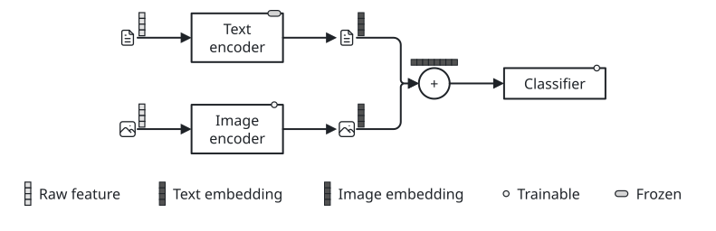
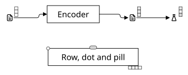
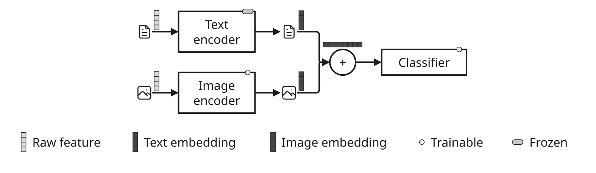
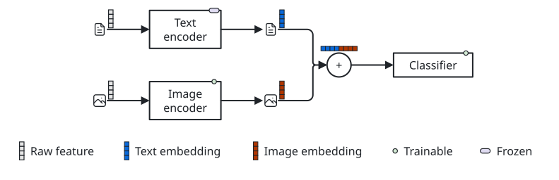
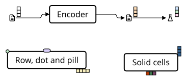
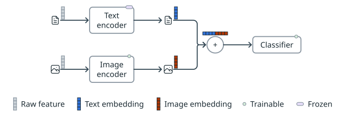
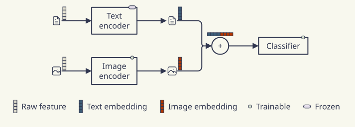
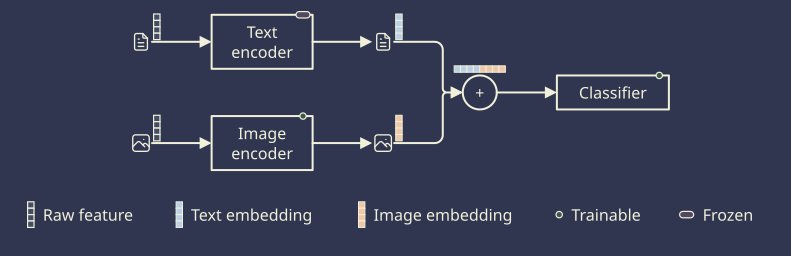

# Node glyphs

[Gallery](README.md) · [Examples](examples.md) · [Legend samples](legend-samples.md) · [Themes](themes.md) · [Tones](tones.md) · [Dimmed groups](dim.md) · [Node glyphs](glyphs.md) · [Set enclosures](sets.md) · [Stroke options](strokes.md) · [Palettes](palettes.md) · [Profiles and comparison](compare.md)

Two encoders turn a caption and an image into embeddings for a classifier\. Soft gray vector glyphs mark raw features; solid blue and orange vectors distinguish the embeddings\. Their concatenation uses multiple <code>tones</code> and <code>direction: right</code>\. A dot marks a trainable model and a pill a frozen one\. Glyphs attach to node borders, with <code>dx</code> / <code>dy</code> offsets in ems; layout reserves their room and edges attach to the node body\.

| <code>minimal</code> | <code>academic</code> | <code>slides</code> | <code>color</code> | <code>paper</code> | <code>llama</code> | <code>sumi</code> | <code>sumi\-dark</code> |
| --- | --- | --- | --- | --- | --- | --- | --- |
|  |  |  |  |  |  |  |  |
| <code>sumi render glyphs\.sumi\.yaml</code><br>139\.52mm × 45\.16mm \(max width 180mm, max height 220mm\) | <code>sumi render glyphs\.sumi\.yaml \-\-theme academic</code><br>139\.17mm × 44\.8mm \(max width 180mm, max height 220mm\) | <code>sumi render glyphs\.sumi\.yaml \-\-theme slides \-\-profile presentation\-16x9</code><br>277\.64mm × 80\.96mm \(max width 338\.7mm, max height 190\.5mm\) | <code>sumi render glyphs\.sumi\.yaml \-\-theme color</code><br>139\.52mm × 45\.16mm \(max width 180mm, max height 220mm\) | <code>sumi render glyphs\.sumi\.yaml \-\-theme paper</code><br>125\.77mm × 45\.16mm \(max width 180mm, max height 220mm\) | <code>sumi render glyphs\.sumi\.yaml \-\-theme llama</code><br>125\.77mm × 45\.16mm \(max width 180mm, max height 220mm\) | <code>sumi render glyphs\.sumi\.yaml \-\-theme sumi</code><br>125\.77mm × 45\.16mm \(max width 180mm, max height 220mm\) | <code>sumi render glyphs\.sumi\.yaml \-\-theme sumi\-dark</code><br>125\.77mm × 45\.16mm \(max width 180mm, max height 220mm\) |

<details>
<summary>Source: <code>glyphs.sumi.yaml</code></summary>

```yaml
# Two encoders turn a caption and an image into embeddings that are concatenated; the vector glyphs follow each feature, and dot / pill marks tell trainable from frozen encoders.
version: 1
figure:
  id: gallery-glyphs
  title: Node glyphs
  theme: minimal
  profile: paper-double
  layout:
    arrange:
      stack:
        gap: 2mm
        align: center
        items:
          - row:
              gap: 9mm
              align: center
              items:
                - grid: { columns: 3, rowGap: 7mm, columnGap: 9mm, items: [caption, text-enc, text-emb, image, image-enc, image-emb] }
                - fused
                - head
          - key

nodes:
  - { id: caption, component: label, icon: tabler/file-text, iconSize: 1.4, glyphs: [{ kind: vector, cells: 4, tone: gray, at: north-east, dx: 0.3, dy: -0.25 }] }
  - { id: image, component: label, icon: tabler/photo, iconSize: 1.4, glyphs: [{ kind: vector, cells: 4, tone: gray, at: north-east, dx: 0.3, dy: -0.25 }] }
  - { id: text-enc, component: box, label: "Text\nencoder", glyphs: [{ kind: pill, tone: purple, at: north-east, dx: -0.6 }] }
  - { id: image-enc, component: box, label: "Image\nencoder", glyphs: [{ kind: dot, tone: green, at: north-east, dx: -0.6 }] }
  - { id: text-emb, component: label, icon: tabler/file-text, iconSize: 1.4, glyphs: [{ kind: vector, cells: 4, tone: blue, strength: solid, at: north-east, dx: 0.3, dy: -0.25 }] }
  - { id: image-emb, component: label, icon: tabler/photo, iconSize: 1.4, glyphs: [{ kind: vector, cells: 4, tone: orange, strength: solid, at: north-east, dx: 0.3, dy: -0.25 }] }
  - { id: fused, component: circle, label: "+", glyphs: [{ kind: vector, tones: [blue, blue, blue, blue, orange, orange, orange, orange], strength: solid, direction: right, at: north, dy: -0.4 }] }
  - { id: head, component: box, label: Classifier, glyphs: [{ kind: dot, tone: green, at: north-east, dx: -0.6 }] }
  - id: key
    component: legend
    variant: plain
    props:
      flow: row
      entries:
        - { glyph: { kind: vector, cells: 4, tone: gray }, label: Raw feature }
        - { glyph: { kind: vector, cells: 4, tone: blue, strength: solid }, label: Text embedding }
        - { glyph: { kind: vector, cells: 4, tone: orange, strength: solid }, label: Image embedding }
        - { glyph: { kind: dot, tone: green }, label: Trainable }
        - { glyph: { kind: pill, tone: purple }, label: Frozen }

edges:
  - { from: caption, to: text-enc }
  - { from: text-enc, to: text-emb }
  - { from: image, to: image-enc }
  - { from: image-enc, to: image-emb }
  - { from: text-emb, to: fused }
  - { from: image-emb, to: fused }
  - { from: fused, to: head }
```

</details>
