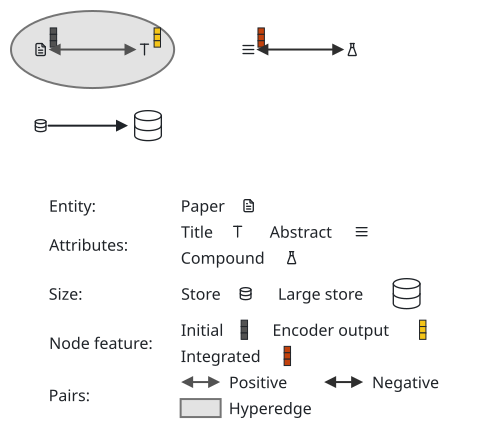
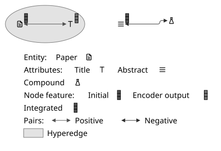
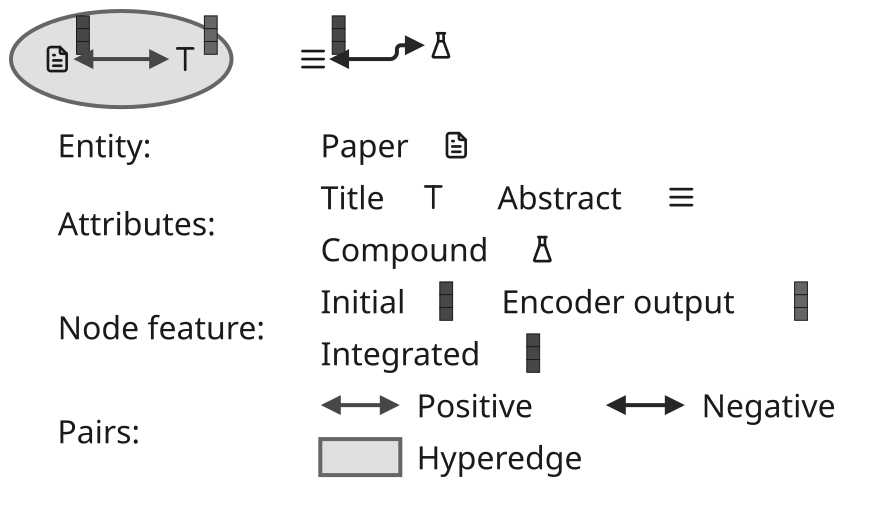
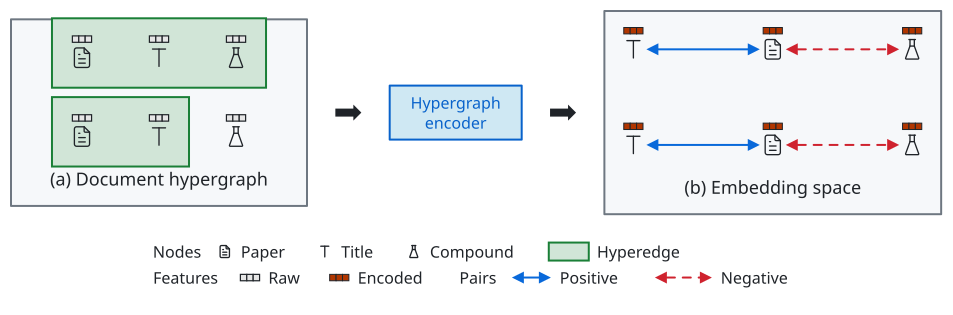
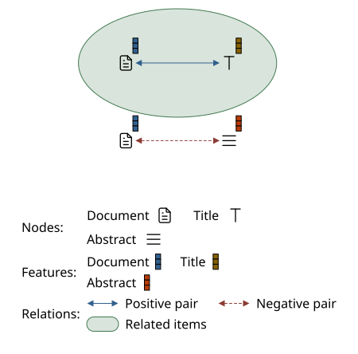
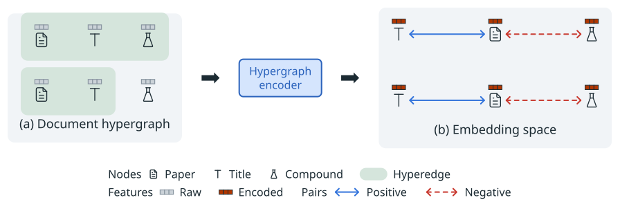

# Legend samples

[Gallery](README.md) · [Examples](examples.md) · [Themes](themes.md) · [Tones](tones.md) · [Dimmed groups](dim.md) · [Node glyphs](glyphs.md) · [Set enclosures](sets.md) · [Legend samples](legend-samples.md) · [Profiles and comparison](compare.md)

A <code>legend</code> entry takes one sample: an <code>edge</code> \(a line with its dash, tone and arrowheads, e\.g\. <code>double\-arrow</code> for a pair\), a <code>node</code> box, an <code>icon</code>, a <code>glyph</code> \(a feature vector, dot or pill with the fields of a node glyph\) or a <code>set</code> swatch painted like a set enclosure\. <code>flow: row</code> puts the entries on a line \(<code>perRow</code> wraps them\), <code>heading</code> starts a group on its own line, and <code>labelAt: left</code> puts the text before the sample\. Every sample is drawn by the same theme rules as what it explains, so no colors are written\.

| <code>minimal</code> | <code>academic</code> | <code>slides</code> | <code>color</code> | <code>paper</code> | <code>llama</code> |
| --- | --- | --- | --- | --- | --- |
|  |  |  |  |  |  |
| <code>sumi render legend\-samples\.sumi\.yaml</code><br>80\.08mm × 54\.86mm \(max width 180mm, max height 220mm\) | <code>sumi render legend\-samples\.sumi\.yaml \-\-theme academic</code><br>80\.08mm × 54\.86mm \(max width 180mm, max height 220mm\) | <code>sumi render legend\-samples\.sumi\.yaml \-\-theme slides</code><br>147\.28mm × 89\.08mm \(max width 180mm, max height 220mm\) | <code>sumi render legend\-samples\.sumi\.yaml \-\-theme color</code><br>80\.08mm × 54\.86mm \(max width 180mm, max height 220mm\) | <code>sumi render legend\-samples\.sumi\.yaml \-\-theme paper</code><br>70\.73mm × 54\.86mm \(max width 180mm, max height 220mm\) | <code>sumi render legend\-samples\.sumi\.yaml \-\-theme llama</code><br>70\.73mm × 54\.86mm \(max width 180mm, max height 220mm\) |

<details>
<summary>Source: <code>legend-samples.sumi.yaml</code></summary>

```yaml
# Legend entries with icon, glyph, edge and set samples, in rows under headings. Generated by `bun run gallery` (#409).
version: 1
figure:
  id: gallery-legend-samples
  title: Legend samples
  theme: minimal
  profile: paper-double
  layout:
    arrange:
      stack:
        gap: 6mm
        align: start
        items:
          - row: { gap: 14mm, align: center, items: [paper, title, abstract, compound] }
          - key

nodes:
  - { id: paper, component: label, icon: tabler/file-text, glyphs: [{ kind: vector, tone: blue, strength: solid, dx: 0.3, dy: -0.25 }] }
  - { id: title, component: label, icon: tabler/letter-t, glyphs: [{ kind: vector, tone: yellow, strength: solid, dx: 0.3, dy: -0.25 }] }
  - { id: abstract, component: label, icon: tabler/menu-2, glyphs: [{ kind: vector, tone: orange, strength: solid, dx: 0.3, dy: -0.25 }] }
  - { id: compound, component: label, icon: tabler/flask }
  - id: key
    component: legend
    variant: plain
    props:
      flow: row
      perRow: 2
      entries:
        - { heading: "Entity:", icon: tabler/file-text, labelAt: left, label: Paper }
        - { heading: "Attributes:", icon: tabler/letter-t, labelAt: left, label: Title }
        - { icon: tabler/menu-2, labelAt: left, label: Abstract }
        - { icon: tabler/flask, labelAt: left, label: Compound }
        - { heading: "Node feature:", glyph: { kind: vector, tone: blue, strength: solid }, labelAt: left, label: Initial }
        - { glyph: { kind: vector, tone: yellow, strength: solid }, labelAt: left, label: Encoder output }
        - { glyph: { kind: vector, tone: orange, strength: solid }, labelAt: left, label: Integrated }
        - { heading: "Pairs:", edge: { component: double-arrow, tone: blue }, label: Positive }
        - { edge: { component: double-arrow, tone: red }, label: Negative }
        - { set: { tone: green }, label: Hyperedge }

edges:
  - { from: paper, to: title, component: double-arrow, tone: blue }
  - { from: abstract, to: compound, component: double-arrow, tone: red }

sets:
  - { id: entities, members: [paper, title], shape: ellipse, tone: green, padding: 3mm }
```

</details>
