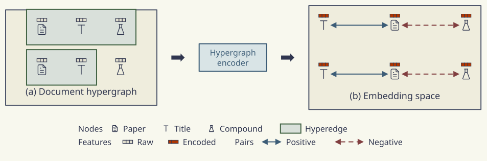
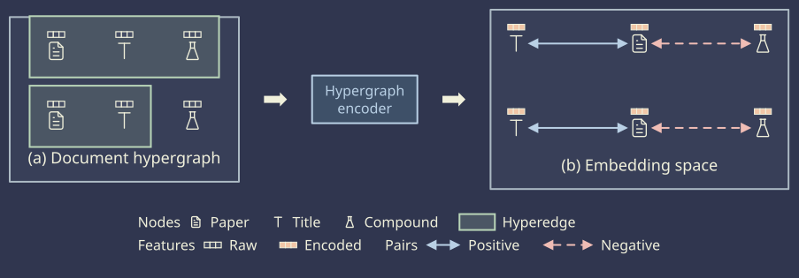

# Legend samples

[Gallery](README.md) · [Examples](examples.md) · [Legend samples](legend-samples.md) · [Themes](themes.md) · [Tones](tones.md) · [Dimmed groups](dim.md) · [Node glyphs](glyphs.md) · [Set enclosures](sets.md) · [Stroke options](strokes.md) · [Palettes](palettes.md) · [Profiles and comparison](compare.md)

A hypergraph encoder transforms document features into embeddings for contrastive learning\. The legend identifies icon, glyph, set and edge samples, including positive and negative pairs\. Entries use <code>flow: row</code>, <code>headings: inline</code> and <code>perRow</code> to group and wrap the samples\.

| <code>minimal</code> | <code>academic</code> | <code>slides</code> | <code>color</code> | <code>paper</code> | <code>llama</code> | <code>sumi</code> | <code>sumi\-dark</code> |
| --- | --- | --- | --- | --- | --- | --- | --- |
|  |  |  |  |  |  |  |  |
| <code>sumi render legend\-samples\.sumi\.yaml</code><br>168\.1mm × 55\.56mm \(max width 180mm, max height 220mm\)<br>info geometry/group\-empty\-area \(×2\): Group &quot;input&quot; has 82\.4% empty bounding\-box area \(threshold 75%; edges excluded\)\. | <code>sumi render legend\-samples\.sumi\.yaml \-\-theme academic</code><br>162\.98mm × 55\.03mm \(max width 180mm, max height 220mm\)<br>info geometry/group\-empty\-area \(×2\): Group &quot;input&quot; has 82\.3% empty bounding\-box area \(threshold 75%; edges excluded\)\. | <code>sumi render legend\-samples\.sumi\.yaml \-\-theme slides \-\-profile presentation\-16x9</code><br>284\.69mm × 99\.48mm \(max width 338\.7mm, max height 190\.5mm\)<br>info geometry/group\-empty\-area \(×2\): Group &quot;input&quot; has 80\.8% empty bounding\-box area \(threshold 75%; edges excluded\)\. | <code>sumi render legend\-samples\.sumi\.yaml \-\-theme color</code><br>168\.1mm × 55\.56mm \(max width 180mm, max height 220mm\)<br>info geometry/group\-empty\-area \(×2\): Group &quot;input&quot; has 82\.4% empty bounding\-box area \(threshold 75%; edges excluded\)\. | <code>sumi render legend\-samples\.sumi\.yaml \-\-theme paper</code><br>159\.28mm × 55\.56mm \(max width 180mm, max height 220mm\)<br>info geometry/group\-empty\-area \(×2\): Group &quot;input&quot; has 79\.5% empty bounding\-box area \(threshold 75%; edges excluded\)\. | <code>sumi render legend\-samples\.sumi\.yaml \-\-theme llama</code><br>158\.04mm × 55\.56mm \(max width 180mm, max height 220mm\)<br>info geometry/group\-empty\-area \(×2\): Group &quot;input&quot; has 79\.2% empty bounding\-box area \(threshold 75%; edges excluded\)\. | <code>sumi render legend\-samples\.sumi\.yaml \-\-theme sumi</code><br>168\.1mm × 55\.56mm \(max width 180mm, max height 220mm\)<br>info geometry/group\-empty\-area \(×2\): Group &quot;input&quot; has 82\.4% empty bounding\-box area \(threshold 75%; edges excluded\)\. | <code>sumi render legend\-samples\.sumi\.yaml \-\-theme sumi\-dark</code><br>168\.1mm × 55\.56mm \(max width 180mm, max height 220mm\)<br>info geometry/group\-empty\-area \(×2\): Group &quot;input&quot; has 82\.4% empty bounding\-box area \(threshold 75%; edges excluded\)\. |

<details>
<summary>Source: <code>legend-samples.sumi.yaml</code></summary>

```yaml
# Contrastive pre-training on a document hypergraph: the encoder turns raw features into embeddings, and related items are pulled together. Generated by `bun run gallery` (#456).
version: 1
figure:
  id: gallery-legend-samples
  title: Legend samples
  theme: minimal
  profile: paper-double
  layout:
    arrange:
      stack:
        gap: 2mm
        align: center
        items:
          - row: { gap: 5mm, align: center, items: [input, a1, encoder, a2, space] }
          - key

groups:
  - id: input
    label: (a) Document hypergraph
    labelAt: bottom
    arrange:
      grid:
        columns: 3
        rowGap: 6mm
        columnGap: 9mm
        items: [d1, t1, s1, d2, t2, s2]
  - id: space
    label: (b) Embedding space
    labelAt: bottom
    arrange:
      grid:
        columns: 3
        rowGap: 9mm
        columnGap: 20mm
        items: [f1, e1, g2, f2, e2, g1]

nodes:
  - { id: d1, component: label, icon: tabler/file-text, iconSize: 1.6, glyphs: [{ kind: vector, tone: gray, direction: right, at: north, dy: -0.35 }] }
  - { id: t1, component: label, icon: tabler/letter-t, iconSize: 1.6, glyphs: [{ kind: vector, tone: gray, direction: right, at: north, dy: -0.35 }] }
  - { id: s1, component: label, icon: tabler/flask, iconSize: 1.6, glyphs: [{ kind: vector, tone: gray, direction: right, at: north, dy: -0.35 }] }
  - { id: d2, component: label, icon: tabler/file-text, iconSize: 1.6, glyphs: [{ kind: vector, tone: gray, direction: right, at: north, dy: -0.35 }] }
  - { id: t2, component: label, icon: tabler/letter-t, iconSize: 1.6, glyphs: [{ kind: vector, tone: gray, direction: right, at: north, dy: -0.35 }] }
  - { id: s2, component: label, icon: tabler/flask, iconSize: 1.6, glyphs: [{ kind: vector, tone: gray, direction: right, at: north, dy: -0.35 }] }
  - { id: a1, component: block-arrow }
  - { id: encoder, component: box, label: "Hypergraph\nencoder", variant: tinted, tone: blue }
  - { id: a2, component: block-arrow }
  - { id: e1, component: label, icon: tabler/file-text, iconSize: 1.6, glyphs: [{ kind: vector, tone: orange, strength: solid, direction: right, at: north, dy: -0.35 }] }
  - { id: f1, component: label, icon: tabler/letter-t, iconSize: 1.6, glyphs: [{ kind: vector, tone: orange, strength: solid, direction: right, at: north, dy: -0.35 }] }
  - { id: g1, component: label, icon: tabler/flask, iconSize: 1.6, glyphs: [{ kind: vector, tone: orange, strength: solid, direction: right, at: north, dy: -0.35 }] }
  - { id: g2, component: label, icon: tabler/flask, iconSize: 1.6, glyphs: [{ kind: vector, tone: orange, strength: solid, direction: right, at: north, dy: -0.35 }] }
  - { id: e2, component: label, icon: tabler/file-text, iconSize: 1.6, glyphs: [{ kind: vector, tone: orange, strength: solid, direction: right, at: north, dy: -0.35 }] }
  - { id: f2, component: label, icon: tabler/letter-t, iconSize: 1.6, glyphs: [{ kind: vector, tone: orange, strength: solid, direction: right, at: north, dy: -0.35 }] }
  - id: key
    component: legend
    variant: plain
    props:
      flow: row
      headings: inline
      perRow: 4
      entries:
        - { heading: "Nodes", icon: tabler/file-text, label: Paper }
        - { icon: tabler/letter-t, label: Title }
        - { icon: tabler/flask, label: Compound }
        - { set: { tone: green }, label: Hyperedge }
        - { heading: "Features", glyph: { kind: vector, tone: gray, direction: right }, label: Raw }
        - { glyph: { kind: vector, tone: orange, strength: solid, direction: right }, label: Encoded }
        - { heading: "Pairs", edge: { component: double-arrow, tone: blue }, label: Positive }
        - { edge: { component: double-arrow, variant: dashed, tone: red }, label: Negative }

edges:
  - { from: f1, to: e1, component: double-arrow, tone: blue }
  - { from: e1, to: g2, component: double-arrow, variant: dashed, tone: red }
  - { from: f2, to: e2, component: double-arrow, tone: blue }
  - { from: e2, to: g1, component: double-arrow, variant: dashed, tone: red }

sets:
  - { id: h1, members: [d1, t1, s1], shape: rect, tone: green, padding: 3mm, enclose: footprint }
  - { id: h2, members: [d2, t2], shape: rect, tone: green, padding: 3mm, enclose: footprint }
```

</details>
