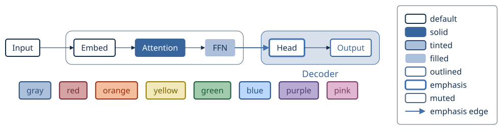
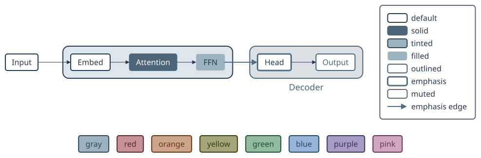
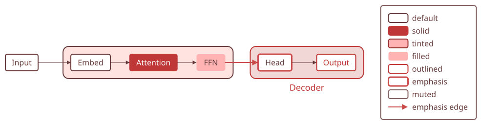
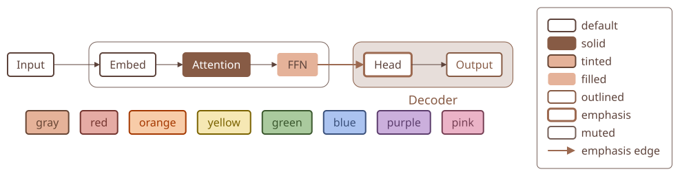
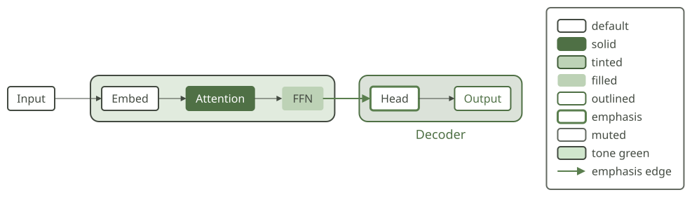
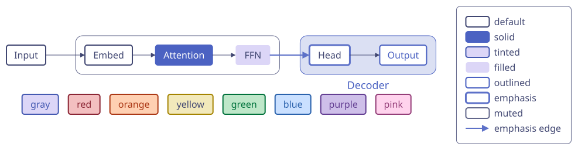
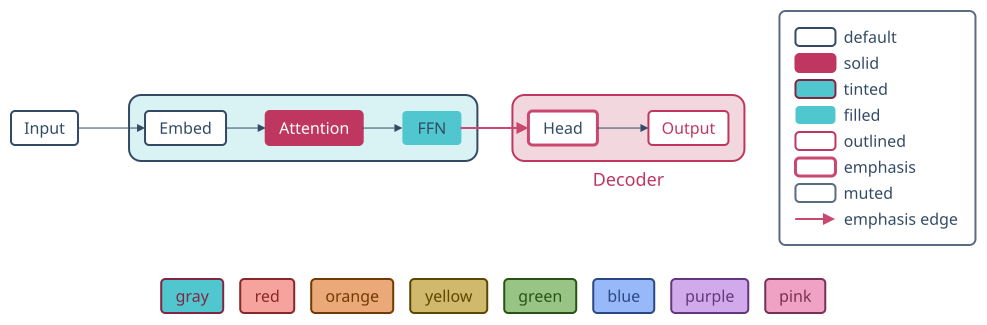
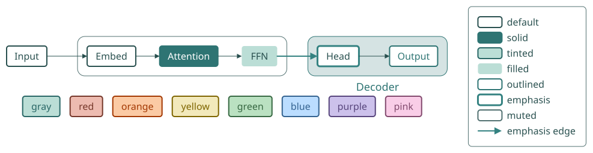

# Palettes

[Gallery](README.md) · [Examples](examples.md) · [Legend samples](legend-samples.md) · [Themes](themes.md) · [Tones](tones.md) · [Dimmed groups](dim.md) · [Node glyphs](glyphs.md) · [Set enclosures](sets.md) · [Stroke options](strokes.md) · [Palettes](palettes.md) · [Profiles and comparison](compare.md)

<code>figure\.themeOverrides\.palette: &lt;name&gt;</code> recolors a theme with four colors from a popular Color Hunt palette: panels \(group fill\) take the palest, filled and tinted nodes and the <code>gray</code> tone the tint, solid fills and emphasis the accent \(deepened for white text\), and text, frames and edges the ink \(the darkest color, darkened to 9:1 on white when it is paler\)\. Every text keeps at least 4\.5:1 on the fill it sits on, so the same figure reads in each palette\. The tones are derived from the palette too \(\#423\): <code>gray</code> is its neutral, and <code>red</code>, <code>green</code>, <code>blue</code> and the rest keep their hue but take the palette's lightness and chroma \(the row of tinted tone boxes\), so a figure in a palette stays in one family of colors; an explicit <code>themeOverrides\.tones</code> color wins\. Sizes and fonts stay the theme's\. The figure is the same in every palette: only <code>palette</code> changes in the source\. Colors: Color Hunt popular palettes, retrieved 2026\-11\-08\. <code>sumi catalog \-\-section palettes</code> lists them\.

| palette | colors as published | roles | derived or adjusted |
| --- | --- | --- | --- |
| <code>cool\-blue</code> | <code>\#f9f7f7</code><br><code>\#dbe2ef</code><br><code>\#3f72af</code><br><code>\#112d4e</code> | <code>panel \#dbe2ef</code><br><code>tint \#acc0dc</code><br><code>accent \#3f72af</code><br><code>ink \#112d4e</code><br><code>muted \#51667e</code><br><code>strong \#38659c</code><br><code>soft \#edf1f7</code><br><code>frame \#7e94b1</code> | tint, strong, muted, soft, frame |
| <code>slate</code> | <code>\#27374d</code><br><code>\#526d82</code><br><code>\#9db2bf</code><br><code>\#dde6ed</code> | <code>panel \#dde6ed</code><br><code>tint \#9db2bf</code><br><code>accent \#526d82</code><br><code>ink \#27374d</code><br><code>muted \#5b6778</code><br><code>strong \#4c6579</code><br><code>soft \#eef3f6</code><br><code>frame \#7a8d9d</code> | strong, muted, soft, frame |
| <code>coral</code> | <code>\#fff5e4</code><br><code>\#ffe3e1</code><br><code>\#ffd1d1</code><br><code>\#ff9494</code> | <code>panel \#ffe3e1</code><br><code>tint \#ffb3b3</code><br><code>accent \#cb4b4b</code><br><code>ink \#663b3b</code><br><code>muted \#836060</code><br><code>strong \#bf3737</code><br><code>soft \#fff1f0</code><br><code>frame \#d18f8f</code> | ink, tint, accent, strong, muted, soft, frame |
| <code>terracotta</code> | <code>\#7d5a50</code><br><code>\#b4846c</code><br><code>\#e5b299</code><br><code>\#fcdec0</code> | <code>panel \#fcdec0</code><br><code>tint \#e5b299</code><br><code>accent \#9c6950</code><br><code>ink \#5d433b</code><br><code>muted \#755f58</code><br><code>strong \#875b45</code><br><code>soft \#feefe0</code><br><code>frame \#bc917d</code> | ink, accent, strong, muted, soft, frame |
| <code>sage</code> | <code>\#f8ede3</code><br><code>\#bdd2b6</code><br><code>\#a2b29f</code><br><code>\#798777</code> | <code>panel \#e1ebde</code><br><code>tint \#bdd2b6</code><br><code>accent \#5a7e4e</code><br><code>ink \#434a41</code><br><code>muted \#636961</code><br><code>strong \#4f7045</code><br><code>soft \#f0f5ef</code><br><code>frame \#98a993</code> | ink, panel, accent, strong, muted, soft, frame |
| <code>lavender</code> | <code>\#f4eeff</code><br><code>\#dcd6f7</code><br><code>\#a6b1e1</code><br><code>\#424874</code> | <code>panel \#ece8fb</code><br><code>tint \#dcd6f7</code><br><code>accent \#5d71c8</code><br><code>ink \#404671</code><br><code>muted \#62678b</code><br><code>strong \#4b62c2</code><br><code>soft \#f6f4fd</code><br><code>frame \#adabcf</code> | ink, panel, accent, strong, muted, soft, frame |
| <code>cyan\-pink</code> | <code>\#364f6b</code><br><code>\#3fc1c9</code><br><code>\#f5f5f5</code><br><code>\#fc5185</code> | <code>panel \#d9f3f4</code><br><code>tint \#50c7ce</code><br><code>accent \#ca476f</code><br><code>ink \#334a65</code><br><code>muted \#5a6c82</code><br><code>strong \#bf3761</code><br><code>soft \#ecf9fa</code><br><code>frame \#47a2af</code> | ink, panel, tint, accent, strong, muted, soft, frame |
| <code>seafoam</code> | <code>\#ffb6b9</code><br><code>\#fae3d9</code><br><code>\#bbded6</code><br><code>\#61c0bf</code> | <code>panel \#e0f0ed</code><br><code>tint \#bbded6</code><br><code>accent \#348281</code><br><code>ink \#284f4e</code><br><code>muted \#517070</code><br><code>strong \#2e7473</code><br><code>soft \#f0f8f6</code><br><code>frame \#8fb3ad</code> | ink, panel, accent, strong, muted, soft, frame |

| <code>cool\-blue</code> | <code>slate</code> | <code>coral</code> | <code>terracotta</code> | <code>sage</code> | <code>lavender</code> | <code>cyan\-pink</code> | <code>seafoam</code> |
| --- | --- | --- | --- | --- | --- | --- | --- |
|  |  |  |  |  |  |  |  |
| <code>themeOverrides\.palette: cool\-blue</code><br>174\.1mm × 57\.33mm \(max width 180mm, max height 220mm\)<br>info geometry/dead\-space: The figure has large empty rectangles: bottom\-left 135\.55mm × 20\.46mm \(27\.8% of the canvas\)\. | <code>themeOverrides\.palette: slate</code><br>174\.1mm × 57\.33mm \(max width 180mm, max height 220mm\)<br>info geometry/dead\-space: The figure has large empty rectangles: bottom\-left 135\.55mm × 20\.46mm \(27\.8% of the canvas\)\. | <code>themeOverrides\.palette: coral</code><br>174\.1mm × 57\.33mm \(max width 180mm, max height 220mm\)<br>info geometry/dead\-space: The figure has large empty rectangles: bottom\-left 135\.55mm × 20\.46mm \(27\.8% of the canvas\)\. | <code>themeOverrides\.palette: terracotta</code><br>174\.1mm × 57\.33mm \(max width 180mm, max height 220mm\)<br>info geometry/dead\-space: The figure has large empty rectangles: bottom\-left 135\.55mm × 20\.46mm \(27\.8% of the canvas\)\. | <code>themeOverrides\.palette: sage</code><br>174\.1mm × 57\.33mm \(max width 180mm, max height 220mm\)<br>info geometry/dead\-space: The figure has large empty rectangles: bottom\-left 135\.55mm × 20\.46mm \(27\.8% of the canvas\)\. | <code>themeOverrides\.palette: lavender</code><br>174\.1mm × 57\.33mm \(max width 180mm, max height 220mm\)<br>info geometry/dead\-space: The figure has large empty rectangles: bottom\-left 135\.55mm × 20\.46mm \(27\.8% of the canvas\)\. | <code>themeOverrides\.palette: cyan\-pink</code><br>174\.1mm × 57\.33mm \(max width 180mm, max height 220mm\)<br>info geometry/dead\-space: The figure has large empty rectangles: bottom\-left 135\.55mm × 20\.46mm \(27\.8% of the canvas\)\. | <code>themeOverrides\.palette: seafoam</code><br>174\.1mm × 57\.33mm \(max width 180mm, max height 220mm\)<br>info geometry/dead\-space: The figure has large empty rectangles: bottom\-left 135\.55mm × 20\.46mm \(27\.8% of the canvas\)\. |

<details>
<summary>Source: <code>palette.sumi.yaml</code></summary>

```yaml
# One figure in every built-in palette. Generated by `bun run gallery` (#417).
version: 1
figure:
  id: gallery-palette
  title: Palette
  theme: paper
  profile: paper-double
  themeOverrides:
    palette: cool-blue
  layout:
    arrange:
      stack:
        gap: 6mm
        items:
          - row:
              gap: 9mm
              align: center
              items: [input, encoder, head, out, key]
          - row: { gap: 3mm, items: [t-gray, t-red, t-orange, t-yellow, t-green, t-blue, t-purple, t-pink] }

groups:
  - id: encoder
    arrange: { row: { gap: 7mm, items: [embed, attn, ffn] } }

nodes:
  - { id: input, component: box, label: Input }
  - { id: embed, component: box, label: Embed }
  - { id: attn, component: box, label: Attention, variant: solid }
  - { id: ffn, component: box, label: FFN, variant: filled }
  - { id: head, component: box, label: Head, variant: emphasis }
  - { id: out, component: box, label: Output, variant: outlined }
  - { id: t-gray, component: box, label: gray, tone: gray, variant: tinted }
  - { id: t-red, component: box, label: red, tone: red, variant: tinted }
  - { id: t-orange, component: box, label: orange, tone: orange, variant: tinted }
  - { id: t-yellow, component: box, label: yellow, tone: yellow, variant: tinted }
  - { id: t-green, component: box, label: green, tone: green, variant: tinted }
  - { id: t-blue, component: box, label: blue, tone: blue, variant: tinted }
  - { id: t-purple, component: box, label: purple, tone: purple, variant: tinted }
  - { id: t-pink, component: box, label: pink, tone: pink, variant: tinted }
  - id: key
    component: legend
    props:
      entries:
        - { node: {}, label: default }
        - { node: { variant: solid }, label: solid }
        - { node: { variant: tinted }, label: tinted }
        - { node: { variant: filled }, label: filled }
        - { node: { variant: outlined }, label: outlined }
        - { node: { variant: emphasis }, label: emphasis }
        - { node: { variant: muted }, label: muted }
        - { edge: { variant: emphasis }, label: emphasis edge }

edges:
  - { from: input, to: embed }
  - { from: embed, to: attn }
  - { from: attn, to: ffn }
  - { from: ffn, to: head, variant: emphasis }
  - { from: head, to: out }

sets:
  - { id: decoder, label: Decoder, members: [head, out], shape: rect, labelAt: bottom }
```

</details>
