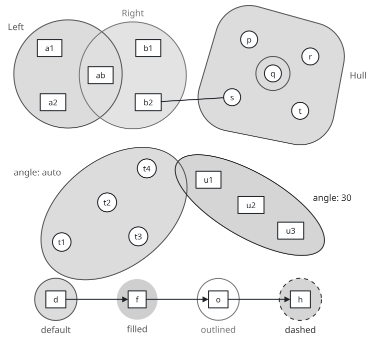
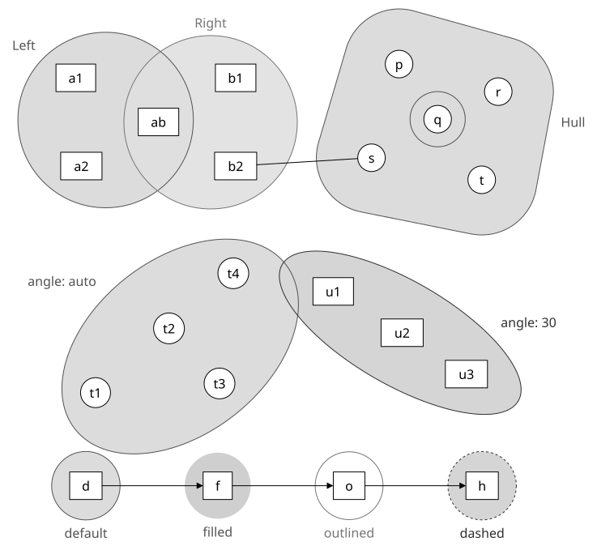
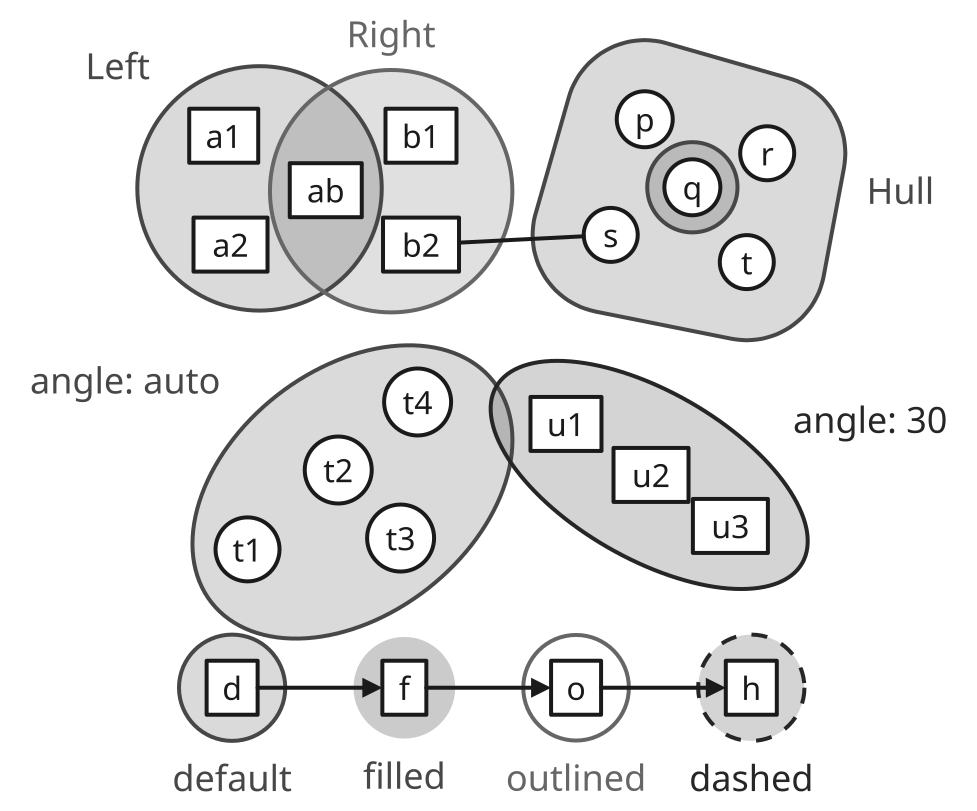
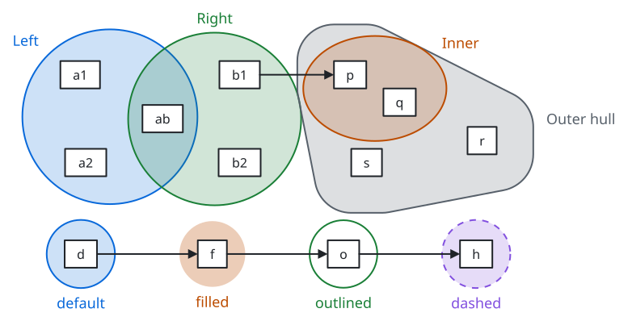
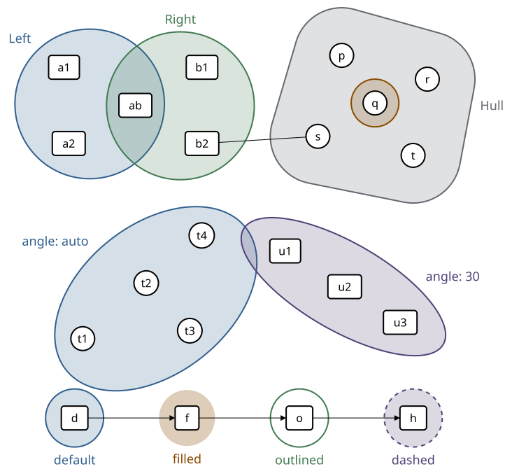
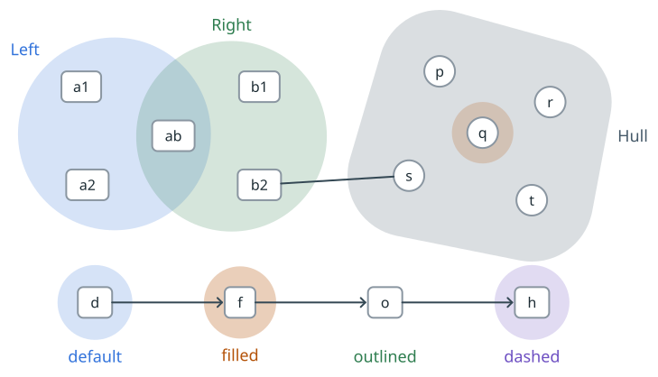

# Set enclosures

[Gallery](README.md) · [Examples](examples.md) · [Themes](themes.md) · [Tones](tones.md) · [Dimmed groups](dim.md) · [Set enclosures](sets.md) · [Profiles and comparison](compare.md)

<code>sets</code> draws a translucent circle, ellipse, rounded hull or rounded rectangle around nodes and groups after they are placed, so a node can belong to several sets and sets may overlap: a Venn diagram, or the hyperedges of a hypergraph\. The tint is the tone's line color at low opacity, so overlaps show in every theme, also the monochrome ones\. Sets take no space in the arrange trees: place the members with <code>place</code> and leave room for the outline and label\. A node inside the outline that is not a member is reported \(<code>geometry/set\-contains\-non\-member</code>\)\.

| <code>minimal</code> | <code>academic</code> | <code>slides</code> | <code>color</code> | <code>paper</code> | <code>llama</code> |
| --- | --- | --- | --- | --- | --- |
|  |  |  |  |  |  |
| <code>sumi render sets\.sumi\.yaml</code><br>131\.94mm × 73\.91mm \(max width 180mm, max height 220mm\) | <code>sumi render sets\.sumi\.yaml \-\-theme academic</code><br>130mm × 73\.2mm \(max width 180mm, max height 220mm\) | <code>sumi render sets\.sumi\.yaml \-\-theme slides</code><br>156\.63mm × 91\.55mm \(max width 180mm, max height 220mm\) | <code>sumi render sets\.sumi\.yaml \-\-theme color</code><br>131\.94mm × 73\.91mm \(max width 180mm, max height 220mm\) | <code>sumi render sets\.sumi\.yaml \-\-theme paper</code><br>129\.12mm × 73\.73mm \(max width 180mm, max height 220mm\) | <code>sumi render sets\.sumi\.yaml \-\-theme llama</code><br>128\.59mm × 73\.73mm \(max width 180mm, max height 220mm\) |

<details>
<summary>Source: <code>sets.sumi.yaml</code></summary>

```yaml
# Set enclosures: overlapping sets for Venn diagrams and hyperedges. Generated by `bun run gallery` (#407).
version: 1
figure:
  id: gallery-sets
  title: Set enclosures
  theme: minimal
  profile: paper-double
  layout:
    arrange:
      stack:
        gap: 14mm
        items:
          - row:
              gap: 22mm
              align: center
              items:
                - place:
                    unit: 12mm
                    items:
                      - { item: a1, at: [0, 0] }
                      - { item: a2, at: [0.1, 1.6] }
                      - { item: ab, at: [1.5, 0.8] }
                      - { item: b1, at: [2.9, 0] }
                      - { item: b2, at: [2.9, 1.6] }
                - place:
                    unit: 12mm
                    items:
                      - { item: p, at: [0.5, 0] }
                      - { item: r, at: [2.3, 0.5] }
                      - { item: q, at: [1.2, 1.0] }
                      - { item: s, at: [0, 1.7] }
                      - { item: t, at: [2.0, 2.1] }
          - row:
              gap: 22mm
              items: [d, f, o, h]

nodes:
  - { id: a1, component: box, label: a1 }
  - { id: a2, component: box, label: a2 }
  - { id: ab, component: box, label: ab }
  - { id: b1, component: box, label: b1 }
  - { id: b2, component: box, label: b2 }
  - { id: p, component: circle, label: p }
  - { id: q, component: circle, label: q }
  - { id: r, component: circle, label: r }
  - { id: s, component: circle, label: s }
  - { id: t, component: circle, label: t }
  - { id: d, component: box, label: d }
  - { id: f, component: box, label: f }
  - { id: o, component: box, label: o }
  - { id: h, component: box, label: h }

edges:
  - { from: b2, to: s, component: line, route: straight }
  - { from: d, to: f }
  - { from: f, to: o }
  - { from: o, to: h }

sets:
  - { id: left, label: Left, members: [a1, a2, ab], tone: blue, labelAt: top-left }
  - { id: right, label: Right, members: [ab, b1, b2], tone: green, labelAt: top }
  - { id: outer, label: Hull, members: [p, q, r, s, t], tone: gray, shape: hull, padding: 9mm, labelAt: right }
  - { id: inner, members: [q], tone: orange, shape: circle, padding: 3mm }
  - { id: default, label: default, members: [d], tone: blue, labelAt: bottom }
  - { id: filled, label: filled, members: [f], tone: orange, variant: filled, labelAt: bottom }
  - { id: outlined, label: outlined, members: [o], tone: green, variant: outlined, labelAt: bottom }
  - { id: dashed, label: dashed, members: [h], tone: purple, variant: dashed, labelAt: bottom }
```

</details>
