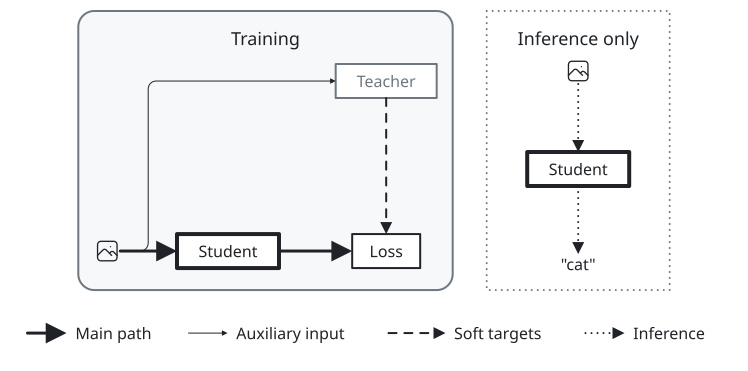
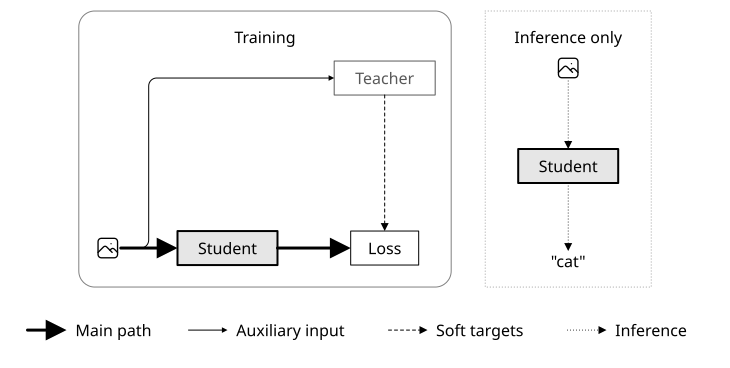
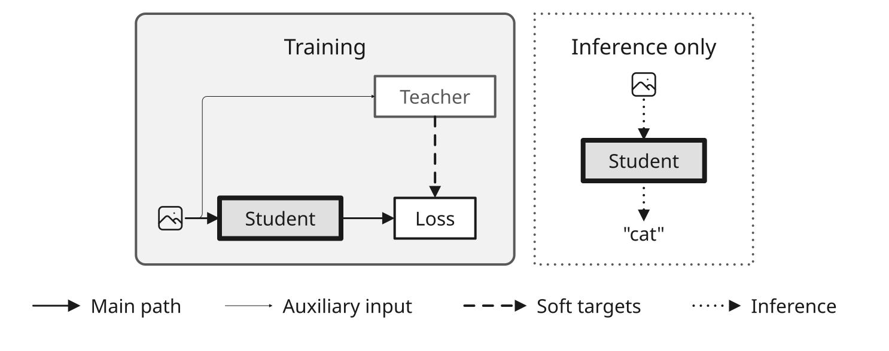
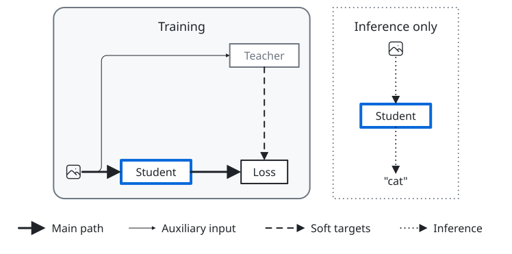
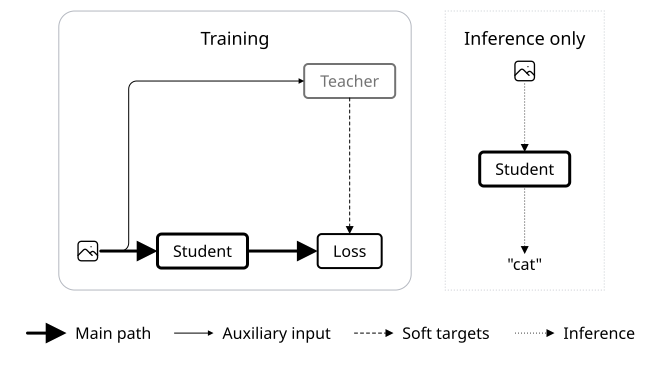
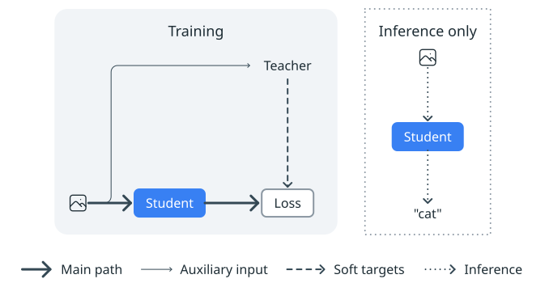
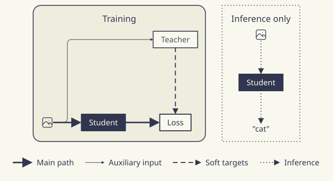
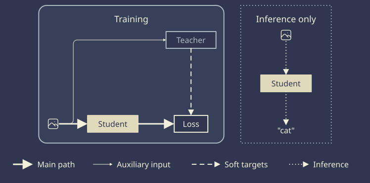

# Stroke options

[Gallery](README.md) · [Examples](examples.md) · [Legend samples](legend-samples.md) · [Themes](themes.md) · [Tones](tones.md) · [Dimmed groups](dim.md) · [Node glyphs](glyphs.md) · [Set enclosures](sets.md) · [Stroke options](strokes.md) · [Palettes](palettes.md) · [Profiles and comparison](compare.md)

In knowledge distillation, per\-edge <code>lineWidth</code> and <code>arrowheadScale</code> distinguish the main training path from auxiliary teacher input\. Dashed arrows carry soft targets; dotted arrows show inference\. Group <code>cornerRadius</code> distinguishes the rounded training frame from the square, dotted inference frame\. Element <code>lineWidth</code> is absolute: the 1\.5pt main path is thinner than the slides theme's 2pt default line\. The same options can also be set figure\-wide with <code>themeOverrides</code>\.

| <code>minimal</code> | <code>academic</code> | <code>slides</code> | <code>color</code> | <code>paper</code> | <code>llama</code> | <code>sumi</code> | <code>sumi\-dark</code> |
| --- | --- | --- | --- | --- | --- | --- | --- |
|  |  |  |  |  |  |  |  |
| <code>sumi render strokes\.sumi\.yaml</code><br>131\.94mm × 65\.44mm \(max width 180mm, max height 220mm\)<br>info geometry/group\-empty\-area \(×2\): Group &quot;training&quot; has 89\.1% empty bounding\-box area \(threshold 75%; edges excluded\)\. | <code>sumi render strokes\.sumi\.yaml \-\-theme academic</code><br>128\.76mm × 64\.91mm \(max width 180mm, max height 220mm\)<br>info geometry/group\-empty\-area \(×2\): Group &quot;training&quot; has 89\.3% empty bounding\-box area \(threshold 75%; edges excluded\)\. | <code>sumi render strokes\.sumi\.yaml \-\-theme slides \-\-profile presentation\-16x9</code><br>262\.11mm × 103\.72mm \(max width 338\.7mm, max height 190\.5mm\)<br>info geometry/group\-empty\-area \(×2\): Group &quot;training&quot; has 83\.0% empty bounding\-box area \(threshold 75%; edges excluded\)\. | <code>sumi render strokes\.sumi\.yaml \-\-theme color</code><br>131\.94mm × 65\.44mm \(max width 180mm, max height 220mm\)<br>info geometry/group\-empty\-area \(×2\): Group &quot;training&quot; has 89\.1% empty bounding\-box area \(threshold 75%; edges excluded\)\. | <code>sumi render strokes\.sumi\.yaml \-\-theme paper</code><br>116\.95mm × 65\.44mm \(max width 180mm, max height 220mm\)<br>info geometry/group\-empty\-area \(×2\): Group &quot;training&quot; has 89\.2% empty bounding\-box area \(threshold 75%; edges excluded\)\. | <code>sumi render strokes\.sumi\.yaml \-\-theme llama</code><br>118\.71mm × 65\.44mm \(max width 180mm, max height 220mm\)<br>info geometry/group\-empty\-area \(×2\): Group &quot;training&quot; has 89\.3% empty bounding\-box area \(threshold 75%; edges excluded\)\. | <code>sumi render strokes\.sumi\.yaml \-\-theme sumi</code><br>120\.12mm × 65\.44mm \(max width 180mm, max height 220mm\)<br>info geometry/group\-empty\-area \(×2\): Group &quot;training&quot; has 89\.2% empty bounding\-box area \(threshold 75%; edges excluded\)\. | <code>sumi render strokes\.sumi\.yaml \-\-theme sumi\-dark</code><br>120\.12mm × 65\.44mm \(max width 180mm, max height 220mm\)<br>info geometry/color\-on\-panel: Group &quot;training&quot; is filled \#383f58 and holds 3 colored elements \(node &quot;teacher&quot;, node &quot;student&quot;, node &quot;loss&quot;\): the colors compete with the panel's\.<br>info geometry/group\-empty\-area \(×2\): Group &quot;training&quot; has 89\.2% empty bounding\-box area \(threshold 75%; edges excluded\)\. |

<details>
<summary>Source: <code>strokes.sumi.yaml</code></summary>

```yaml
# Knowledge distillation: line weight, dash and frame style separate the main training path, the auxiliary teacher signal and the inference-only part.
version: 1
figure:
  id: gallery-strokes
  title: Stroke options
  theme: minimal
  profile: paper-double
  layout:
    arrange:
      stack:
        gap: 3mm
        align: center
        items:
          - row: { gap: 6mm, align: stretch, items: [ training, inference ] }
          - key

groups:
  - id: training
    label: Training
    cornerRadius: 8pt
    arrange:
      grid: { columns: 3, rowGap: 24mm, columnGap: 10mm, items: [ null, null, teacher, images, student, loss ] }
  - id: inference
    label: Inference only
    variant: dotted
    cornerRadius: 0pt
    arrange:
      stack: { gap: 12mm, align: center, items: [ query, student-copy, answer ] }

nodes:
  - { id: images, component: label, icon: tabler/photo, iconSize: 1.6 }
  - { id: teacher, component: box, label: Teacher, variant: muted }
  - { id: student, component: box, label: Student, variant: emphasis }
  - { id: loss, component: box, label: Loss }
  - { id: query, component: label, icon: tabler/photo, iconSize: 1.6 }
  - { id: student-copy, component: box, label: Student, variant: emphasis }
  - { id: answer, component: label, label: '"cat"' }
  - id: key
    component: legend
    variant: plain
    props:
      flow: row
      entries:
        - { edge: { lineWidth: 1.5pt, arrowheadScale: 1.3 }, label: Main path }
        - { edge: { lineWidth: 0.5pt, arrowheadScale: 0.7 }, label: Auxiliary input }
        - { edge: { variant: dashed }, label: Soft targets }
        - { edge: { variant: dotted }, label: Inference }

edges:
  - { from: images, to: student, lineWidth: 1.5pt, arrowheadScale: 1.3 }
  - { from: student, to: loss, lineWidth: 1.5pt, arrowheadScale: 1.3 }
  - { from: images, to: teacher, lineWidth: 0.5pt, arrowheadScale: 0.7 }
  - { from: teacher, to: loss, variant: dashed }
  - { from: query, to: student-copy, variant: dotted }
  - { from: student-copy, to: answer, variant: dotted }
```

</details>
