# Themes

[Gallery](README.md) · [Examples](examples.md) · [Legend samples](legend-samples.md) · [Themes](themes.md) · [Tones](tones.md) · [Dimmed groups](dim.md) · [Node glyphs](glyphs.md) · [Set enclosures](sets.md) · [Stroke options](strokes.md) · [Palettes](palettes.md) · [Profiles and comparison](compare.md)

| theme | description | font set |
| --- | --- | --- |
| <code>minimal</code> | Monochrome theme with clear outlines | <code>sumi/biz\-ud\-gothic</code> |
| <code>academic</code> | Grayscale, print\-friendly journal style: thin black lines, square corners, gray tones and emphasis | <code>sumi/biz\-ud\-gothic</code> |
| <code>slides</code> | Large text and thick lines for slides \(use with presentation\-16x9\) | <code>sumi/biz\-ud\-gothic</code> |
| <code>color</code> | General\-purpose theme with color: pastel tone fills, blue accent for emphasis | <code>sumi/biz\-ud\-gothic</code> |
| <code>paper</code> | Color ML\-paper style: pastel tones, rounded corners, 1pt frames and 0\.5pt edges, white panels with a thin light gray frame \(gray only when asked: the filled variant, groupFill\), Inter for Latin text | <code>sumi/inter\-biz\-ud\-gothic</code> |
| <code>llama</code> | After Meta's Llama 4 MoE figure: slate lines with open arrowheads, gray\-framed white blocks, dark slate solid blocks, blue accent emphasis, borderless pale panels, Inter for Latin text | <code>sumi/inter\-biz\-ud\-gothic</code> |
| <code>sumi</code> | Warm cream canvas with navy ink and sand accents | <code>sumi/inter\-biz\-ud\-gothic</code> |
| <code>sumi\-dark</code> | Navy canvas with cream ink and sand accents | <code>sumi/inter\-biz\-ud\-gothic</code> |

## The structured Transformer under every theme

The same structured figure \(the Transformer, <code>examples/transformer/</code>\) under every built\-in theme, through <code>\-\-theme</code> and <code>\-\-profile paper\-double</code> overrides\. <code>slides</code> doubles the text and uses its own profile, <code>presentation\-16x9</code>; this tall figure is taller than a slide there, which the geometry error below it reports\. Tones are the same everywhere; the theme decides how they are drawn\.

| <code>minimal</code> | <code>academic</code> | <code>slides</code> |
| --- | --- | --- |
| 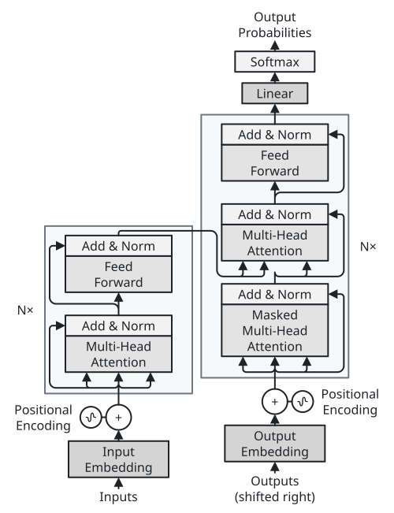 | 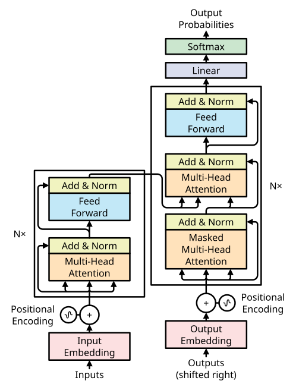 | 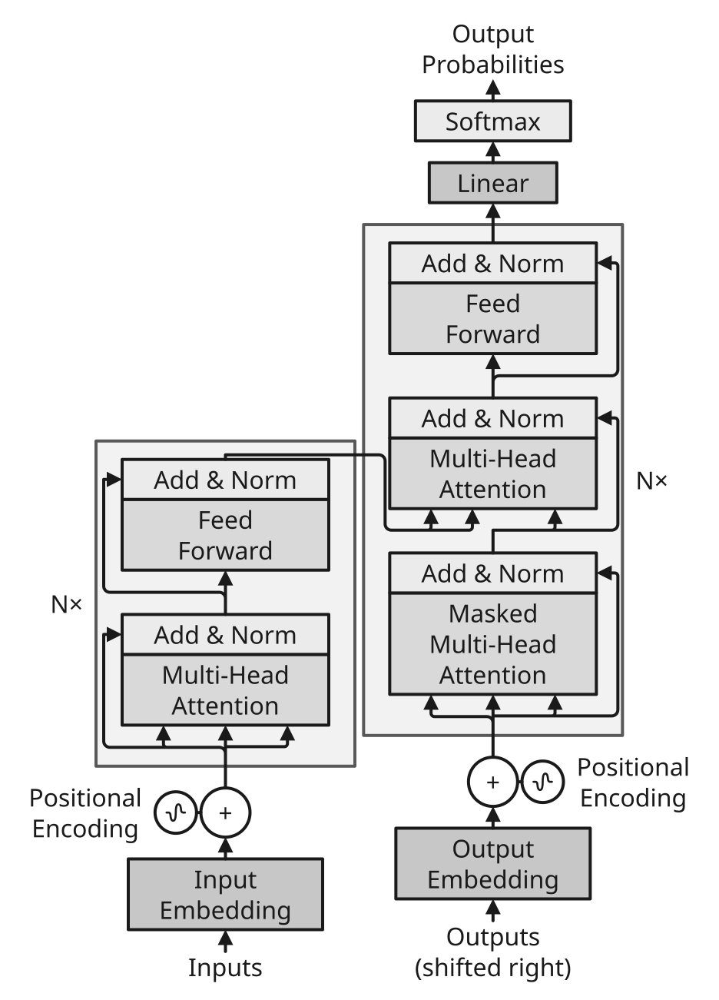 |
| <code>sumi render examples/transformer/transformer\.sumi\.yaml \-\-theme minimal \-\-profile paper\-double</code> 87\.84mm × 114\.83mm \(max width 180mm, max height 220mm\) info geometry/color\-on\-panel \(×2\): Group &quot;encoder&quot; is filled \#f2f2f2 and holds 4 colored elements \(node &quot;enc\-mha&quot;, node &quot;enc\-norm1&quot;, node &quot;enc\-ff&quot;, and 1 more\): the colors compete with the panel's\. | <code>sumi render examples/transformer/transformer\.sumi\.yaml \-\-theme academic \-\-profile paper\-double</code> 87\.84mm × 114\.83mm \(max width 180mm, max height 220mm\) | <code>sumi render examples/transformer/transformer\.sumi\.yaml \-\-theme slides \-\-profile presentation\-16x9</code> 161\.75mm × 229\.48mm \(max width 338\.7mm, max height 190\.5mm\) error geometry/exceeds\-page\-height: The figure is 229\.48mm tall, more than the 190\.5mm maximum height of profile &quot;presentation\-16x9&quot;\. info geometry/color\-on\-panel \(×2\): Group &quot;encoder&quot; is filled \#f2f2f2 and holds 4 colored elements \(node &quot;enc\-mha&quot;, node &quot;enc\-norm1&quot;, node &quot;enc\-ff&quot;, and 1 more\): the colors compete with the panel's\. error geometry/label\-overflow \(×5\): The label of node &quot;input\-embedding&quot; \(98\.4pt × 36pt, measured with the theme's fonts\) does not fit inside its rectangle shape \(68pt × 46pt\)\. |

| <code>color</code> | <code>paper</code> | <code>llama</code> |
| --- | --- | --- |
| 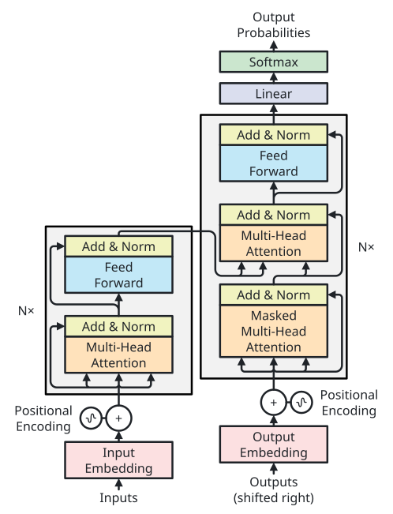 | 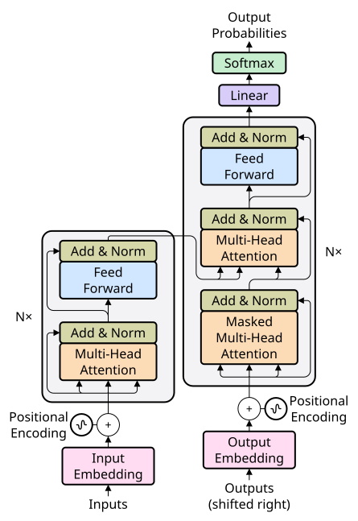 | 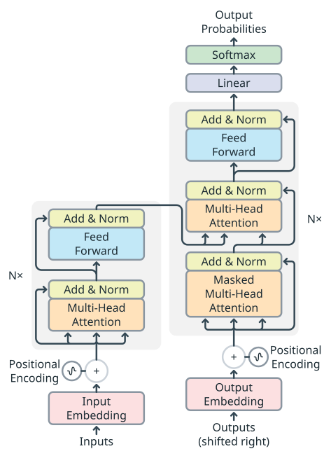 |
| <code>sumi render examples/transformer/transformer\.sumi\.yaml \-\-theme color \-\-profile paper\-double</code> 87\.84mm × 114\.83mm \(max width 180mm, max height 220mm\) info geometry/color\-on\-panel \(×2\): Group &quot;encoder&quot; is filled \#f2f2f2 and holds 4 colored elements \(node &quot;enc\-mha&quot;, node &quot;enc\-norm1&quot;, node &quot;enc\-ff&quot;, and 1 more\): the colors compete with the panel's\. | <code>sumi render examples/transformer/transformer\.sumi\.yaml \-\-theme paper \-\-profile paper\-double</code> 83\.43mm × 114\.12mm \(max width 180mm, max height 220mm\) info geometry/color\-on\-panel \(×2\): Group &quot;encoder&quot; is filled \#f2f2f2 and holds 4 colored elements \(node &quot;enc\-mha&quot;, node &quot;enc\-norm1&quot;, node &quot;enc\-ff&quot;, and 1 more\): the colors compete with the panel's\. | <code>sumi render examples/transformer/transformer\.sumi\.yaml \-\-theme llama \-\-profile paper\-double</code> 83\.43mm × 114\.83mm \(max width 180mm, max height 220mm\) info geometry/color\-on\-panel \(×2\): Group &quot;encoder&quot; is filled \#f2f2f2 and holds 4 colored elements \(node &quot;enc\-mha&quot;, node &quot;enc\-norm1&quot;, node &quot;enc\-ff&quot;, and 1 more\): the colors compete with the panel's\. |

| <code>sumi</code> | <code>sumi\-dark</code> |
| --- | --- |
| 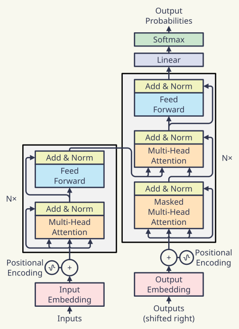 | 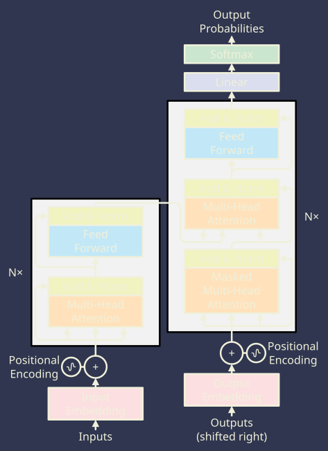 |
| <code>sumi render examples/transformer/transformer\.sumi\.yaml \-\-theme sumi \-\-profile paper\-double</code> 83\.43mm × 114\.83mm \(max width 180mm, max height 220mm\) info geometry/theme\-color\-use: The figure uses 6 accent tones \(yellow, orange, pink, blue, purple, green\); theme sumi is neutral with at most 3\. info geometry/color\-on\-panel \(×2\): Group &quot;encoder&quot; is filled \#f2f2f2 and holds 4 colored elements \(node &quot;enc\-mha&quot;, node &quot;enc\-norm1&quot;, node &quot;enc\-ff&quot;, and 1 more\): the colors compete with the panel's\. | <code>sumi render examples/transformer/transformer\.sumi\.yaml \-\-theme sumi\-dark \-\-profile paper\-double</code> 83\.43mm × 114\.83mm \(max width 180mm, max height 220mm\) info geometry/theme\-color\-use: The figure uses 6 accent tones \(yellow, orange, pink, blue, purple, green\); theme sumi\-dark is neutral with at most 3\. info geometry/color\-on\-panel \(×2\): Group &quot;encoder&quot; is filled \#f2f2f2 and holds 4 colored elements \(node &quot;enc\-mha&quot;, node &quot;enc\-norm1&quot;, node &quot;enc\-ff&quot;, and 1 more\): the colors compete with the panel's\. info geometry/low\-stroke\-contrast \(×28\): node &quot;enc\-mha&quot; has a stroke contrast of 1\.03:1 against background \#f2f2f2 \(minimum 2:1\)\. |

Source: [<code>examples/transformer/transformer\.sumi\.yaml</code>](../../examples/transformer/transformer.sumi.yaml)

## The auto-layout pipeline under every theme

The same auto\-layout figure \(D2 with ELK, <code>examples/pipeline/pipeline\.sumi\.yaml</code>\) with <code>\-\-theme</code> overrides on profile <code>paper\-single</code>\. This profile imposes a minimum font size \(7pt\), not a maximum; <code>slides</code> meets it and the pipeline fits the page\. Its two collision warnings \(<code>geometry/label\-collision</code> and <code>geometry/edge\-crosses\-label</code>\) are distinct from the <code>geometry/exceeds\-page\-height</code> error under <code>presentation\-16x9</code>, whose larger spacing makes the pipeline taller than a slide\.

| <code>minimal</code> | <code>academic</code> | <code>slides</code> |
| --- | --- | --- |
| 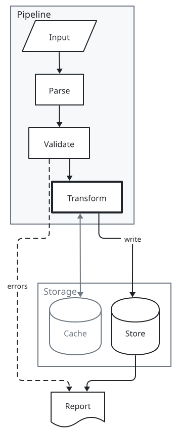 | 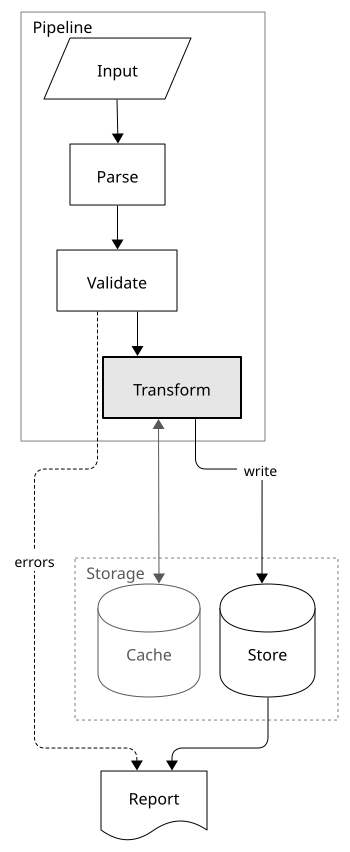 | 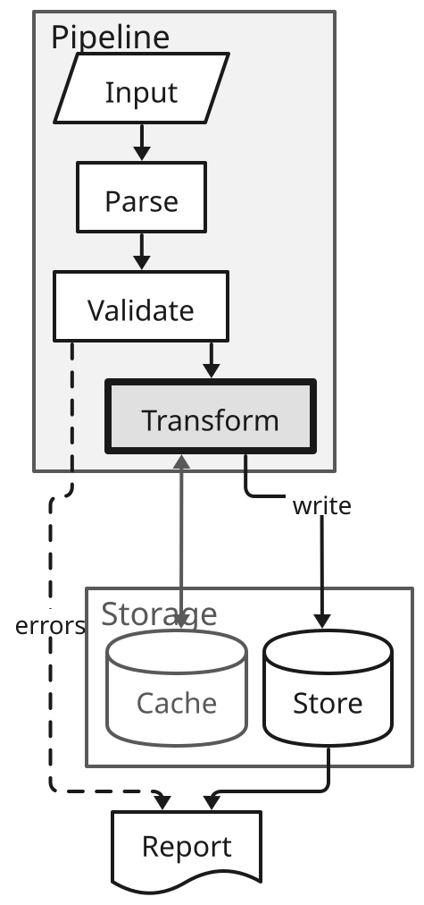 |
| <code>sumi render examples/pipeline/pipeline\.sumi\.yaml \-\-theme minimal \-\-profile paper\-single</code> 61\.74mm × 151\.34mm \(max width 88mm, max height 220mm\) info geometry/edge\-touches\-label: Edge edges\[3\] touches the label of group &quot;storage&quot; \(0\.25mm from the letters\)\. | <code>sumi render examples/pipeline/pipeline\.sumi\.yaml \-\-theme academic \-\-profile paper\-single</code> 61\.74mm × 150\.28mm \(max width 88mm, max height 220mm\) | <code>sumi render examples/pipeline/pipeline\.sumi\.yaml \-\-theme slides \-\-profile paper\-single</code> 83\.78mm × 178\.51mm \(max width 88mm, max height 220mm\) warning geometry/label\-collision: The label of group &quot;storage&quot; overlaps the label of edge edges\[6\]\. warning geometry/edge\-crosses\-label: Edge edges\[3\] crosses the label of group &quot;storage&quot;\. |

| <code>color</code> | <code>paper</code> | <code>llama</code> |
| --- | --- | --- |
| 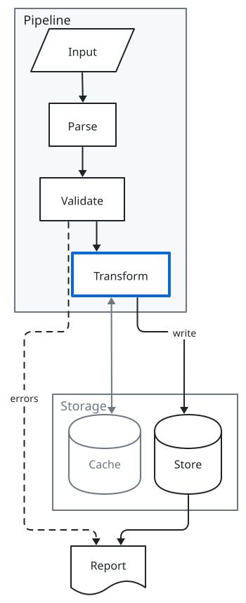 | 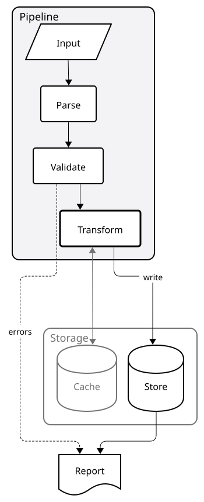 | 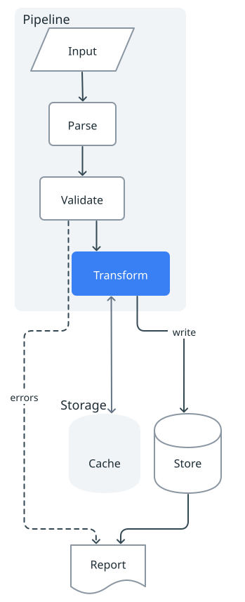 |
| <code>sumi render examples/pipeline/pipeline\.sumi\.yaml \-\-theme color \-\-profile paper\-single</code> 61\.74mm × 151\.34mm \(max width 88mm, max height 220mm\) info geometry/edge\-touches\-label: Edge edges\[3\] touches the label of group &quot;storage&quot; \(0\.25mm from the letters\)\. | <code>sumi render examples/pipeline/pipeline\.sumi\.yaml \-\-theme paper \-\-profile paper\-single</code> 61\.74mm × 151\.34mm \(max width 88mm, max height 220mm\) info geometry/edge\-touches\-label: Edge edges\[3\] touches the label of group &quot;storage&quot; \(0\.34mm from the letters\)\. | <code>sumi render examples/pipeline/pipeline\.sumi\.yaml \-\-theme llama \-\-profile paper\-single</code> 61\.56mm × 151\.17mm \(max width 88mm, max height 220mm\) info geometry/edge\-touches\-label: Edge edges\[3\] touches the label of group &quot;storage&quot; \(0\.25mm from the letters\)\. |

| <code>sumi</code> | <code>sumi\-dark</code> |
| --- | --- |
| 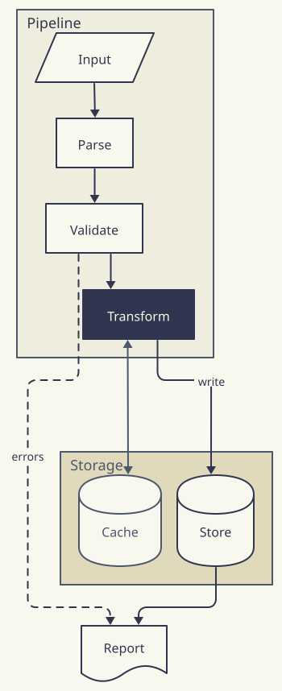 | 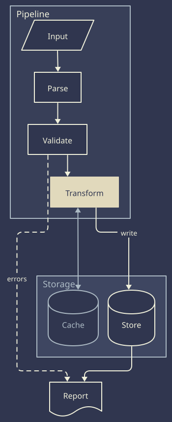 |
| <code>sumi render examples/pipeline/pipeline\.sumi\.yaml \-\-theme sumi \-\-profile paper\-single</code> 61\.74mm × 151\.34mm \(max width 88mm, max height 220mm\) info geometry/edge\-touches\-label: Edge edges\[3\] touches the label of group &quot;storage&quot; \(touching the letters\)\. | <code>sumi render examples/pipeline/pipeline\.sumi\.yaml \-\-theme sumi\-dark \-\-profile paper\-single</code> 61\.74mm × 151\.34mm \(max width 88mm, max height 220mm\) info geometry/color\-on\-panel: Group &quot;stages&quot; is filled \#383f58 and holds 4 colored elements \(node &quot;input&quot;, node &quot;parse&quot;, node &quot;validate&quot;, and 1 more\): the colors compete with the panel's\. info geometry/edge\-touches\-label: Edge edges\[3\] touches the label of group &quot;storage&quot; \(touching the letters\)\. |

Source: [<code>examples/pipeline/pipeline\.sumi\.yaml</code>](../../examples/pipeline/pipeline.sumi.yaml)
