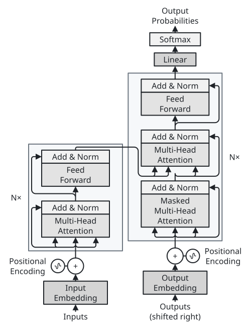
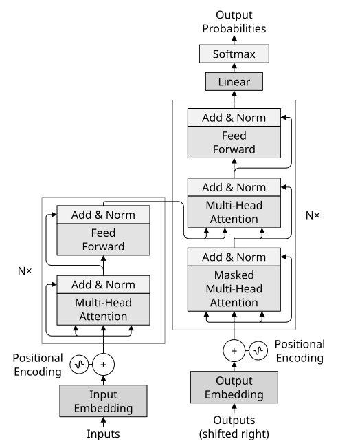
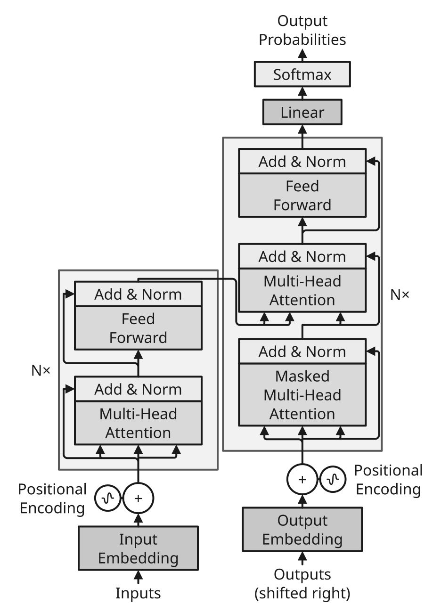
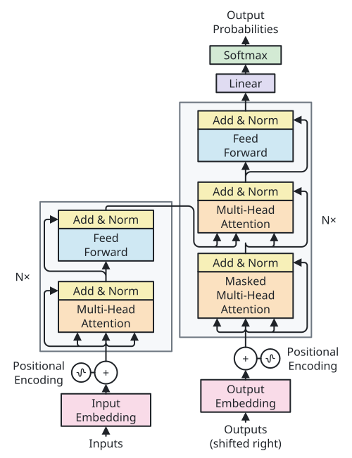
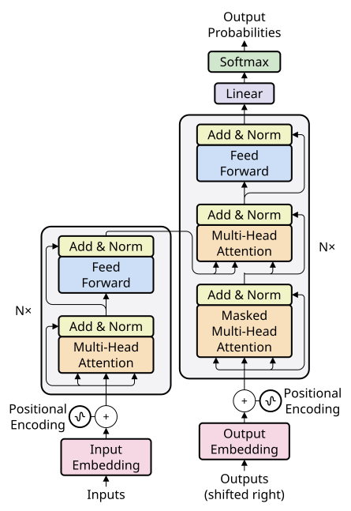

# Themes

[Gallery](README.md) · [Examples](examples.md) · [Themes](themes.md) · [Tones](tones.md) · [Dimmed groups](dim.md) · [Profiles and comparison](compare.md)

| theme | description | font set |
| --- | --- | --- |
| <code>minimal</code> | Monochrome theme with clear outlines | <code>sumi/biz\-ud\-gothic</code> |
| <code>academic</code> | Grayscale, print\-friendly journal style: thin black lines, square corners, gray tones and emphasis | <code>sumi/biz\-ud\-gothic</code> |
| <code>slides</code> | Large text and thick lines for slides \(use with presentation\-16x9\) | <code>sumi/biz\-ud\-gothic</code> |
| <code>color</code> | General\-purpose theme with color: pastel tone fills, blue accent for emphasis | <code>sumi/biz\-ud\-gothic</code> |
| <code>paper</code> | Color ML\-paper style: pastel tones, rounded corners, 1pt frames and 0\.5pt edges, light gray panels, Inter for Latin text | <code>sumi/inter\-biz\-ud\-gothic</code> |

## The structured Transformer under every theme

The same structured figure \(the Transformer, <code>examples/transformer/</code>\) under every built\-in theme, through <code>\-\-theme</code> and <code>\-\-profile paper\-double</code> overrides\. <code>slides</code> doubles the text and uses its own profile, <code>presentation\-16x9</code>; this tall figure is taller than a slide there, which the geometry error below it reports\. Tones are the same everywhere; the theme decides how they are drawn\.

| <code>minimal</code> | <code>academic</code> | <code>slides</code> |
| --- | --- | --- |
|  |  |  |
| <code>sumi render examples/transformer/transformer\.sumi\.yaml \-\-theme minimal \-\-profile paper\-double</code> 88\.19mm × 114\.83mm \(max width 180mm, max height 220mm\) | <code>sumi render examples/transformer/transformer\.sumi\.yaml \-\-theme academic \-\-profile paper\-double</code> 86\.78mm × 114\.83mm \(max width 180mm, max height 220mm\) | <code>sumi render examples/transformer/transformer\.sumi\.yaml \-\-theme slides \-\-profile presentation\-16x9</code> 165\.1mm × 229\.48mm \(max width 338\.7mm, max height 190\.5mm\) error geometry/exceeds\-page\-height: The figure is 229\.48mm tall, more than the 190\.5mm maximum height of profile &quot;presentation\-16x9&quot;\. info geometry/edge\-near\-border \(×3\): Edge edges\[18\] runs right beside the border of group &quot;decoder&quot; for 30\.7mm \(0\.35mm between the lines\), so it reads as part of the frame\. |

| <code>color</code> | <code>paper</code> |
| --- | --- |
|  |  |
| <code>sumi render examples/transformer/transformer\.sumi\.yaml \-\-theme color \-\-profile paper\-double</code> 88\.19mm × 114\.83mm \(max width 180mm, max height 220mm\) | <code>sumi render examples/transformer/transformer\.sumi\.yaml \-\-theme paper \-\-profile paper\-double</code> 78\.49mm × 114\.12mm \(max width 180mm, max height 220mm\) |

Source: [<code>examples/transformer/transformer\.sumi\.yaml</code>](../../examples/transformer/transformer.sumi.yaml)

## The auto-layout pipeline under every theme

The same auto\-layout figure \(D2 with ELK, <code>examples/pipeline/pipeline\.sumi\.yaml</code>\) with <code>\-\-theme</code> overrides on profile <code>paper\-single</code>\. This profile imposes a minimum font size \(7pt\), not a maximum; <code>slides</code> meets it and the pipeline fits the page\. Its two collision warnings \(<code>geometry/label\-collision</code> and <code>geometry/edge\-crosses\-label</code>\) are distinct from the <code>geometry/exceeds\-page\-height</code> error under <code>presentation\-16x9</code>, whose larger spacing makes the pipeline taller than a slide\.

| <code>minimal</code> | <code>academic</code> | <code>slides</code> |
| --- | --- | --- |
|  |  |  |
| <code>sumi render examples/pipeline/pipeline\.sumi\.yaml \-\-theme minimal \-\-profile paper\-single</code> 61\.74mm × 151\.34mm \(max width 88mm, max height 220mm\) info geometry/edge\-touches\-label: Edge edges\[3\] touches the label of group &quot;storage&quot; \(0\.25mm from the letters\)\. | <code>sumi render examples/pipeline/pipeline\.sumi\.yaml \-\-theme academic \-\-profile paper\-single</code> 61\.74mm × 150\.28mm \(max width 88mm, max height 220mm\) | <code>sumi render examples/pipeline/pipeline\.sumi\.yaml \-\-theme slides \-\-profile paper\-single</code> 83\.78mm × 178\.51mm \(max width 88mm, max height 220mm\) warning geometry/label\-collision: The label of group &quot;storage&quot; overlaps the label of edge edges\[6\]\. warning geometry/edge\-crosses\-label: Edge edges\[3\] crosses the label of group &quot;storage&quot;\. |

| <code>color</code> | <code>paper</code> |
| --- | --- |
|  |  |
| <code>sumi render examples/pipeline/pipeline\.sumi\.yaml \-\-theme color \-\-profile paper\-single</code> 61\.74mm × 151\.34mm \(max width 88mm, max height 220mm\) info geometry/edge\-touches\-label: Edge edges\[3\] touches the label of group &quot;storage&quot; \(0\.25mm from the letters\)\. | <code>sumi render examples/pipeline/pipeline\.sumi\.yaml \-\-theme paper \-\-profile paper\-single</code> 61\.74mm × 151\.34mm \(max width 88mm, max height 220mm\) info geometry/edge\-touches\-label: Edge edges\[3\] touches the label of group &quot;storage&quot; \(0\.34mm from the letters\)\. |

Source: [<code>examples/pipeline/pipeline\.sumi\.yaml</code>](../../examples/pipeline/pipeline.sumi.yaml)
