# テーマ

テーマは図の見た目（色・角・線の太さ・グループ・フォント）を決めます。レイアウトの規則やページの制約は変えません（それは[プロファイル](usage-ja.md#テーマとプロファイル)の役割です）。`figure.theme` または `--theme` で選び、同じ YAML をどのテーマでも描画できます。

組み込みテーマは 8 つです。

- **`minimal`**（既定）: 白黒で輪郭のはっきりしたテーマ。中立の出発点です。
- **`academic`**: 白黒（グレースケール）で印刷できるジャーナル調。色を一切使わないので、白黒プリンターでも同じ見た目になります。
- **`color`**: 色を使う汎用テーマ。`minimal` と同じ線・文字で、tone は淡い色、強調は青です。
- **`paper`**: カラーの ML 論文風。公開されている Transformer・DiT の図を手本に、パステルの tone、角丸、細い枠線とエッジ、白地に枠のパネル（灰色は `variant: filled` や `groupFill` で頼んだときだけ）、欧文は Inter です。
- **`slides`**: 投影向けの大きな文字と太い線。`presentation-16x9` プロファイルと組み合わせます。
- **`llama`**: Meta の Llama 4 の発表記事の Mixture-of-Experts の図にならったテーマ。青灰色の線と開いた山形の矢じり、灰色の枠の白い箱、濃い青灰色の `solid`、青い `emphasis`、枠のない淡いパネル、欧文は Inter です。
- **`sumi`**: 温かみのあるクリーム色の地に紺色の文字と砂色のアクセント。欧文は Inter。プロジェクトのサイトと同じデザインです。
- **`sumi-dark`**: その暗い版。紺色の地にクリーム色の文字と砂色のアクセント。欧文は Inter。

`academic` と `paper` はどちらも論文向けです。**白黒・グレースケールで印刷するなら `academic`、カラーの ML 論文なら `paper`** を選びます。

## 比較表

| | `minimal` | `academic` | `slides` | `color` | `paper` | `llama` |
| --- | --- | --- | --- | --- | --- | --- |
| 用途 | 汎用・中立の既定 | ジャーナルの図、白黒印刷 | 投影 | 色を使う汎用 | カラーの ML 論文の図 | Llama 4 の MoE の図の調子の図 |
| 色 | 白黒。tone は 3 段階の灰色 | 灰色のみ。tone は 3 段階の灰色 | 白黒（濃いめの灰色）。tone は 3 段階の灰色 | パステルの tone、強調は青 | パステルの tone と tone ごとの線色。青は tone の 1 つ | 青灰色と灰色。`solid` は濃い青灰色、`emphasis` は青、`filled` / `muted` は枠のない灰色 / 淡い箱。tone は淡い塗り |
| 角 | 四角 | 四角 | 四角 | 四角 | 角丸（箱 2pt、グループ 6pt） | 角丸（箱 3pt、グループ 5pt） |
| 線 | 1pt、強調 2pt | 0.5pt、強調 1pt | 2pt、強調 4pt | 1pt、強調 2pt | 枠 1pt、エッジ 0.5pt（矢じりは小さい）。強調は図形 1.5pt、エッジ 1pt | 枠とエッジ 1pt、**開いた山形の矢じり**（箱から少し離す）。強調のエッジは 1.5pt の青、拡大の破線は 0.5pt |
| グループ | 薄い灰色の塗り、灰色の枠 | 塗りなし、灰色の枠 | 薄い灰色の塗り、灰色の枠 | 薄い灰色の塗り、灰色の枠 | 白いパネル、黒 1pt の枠、角丸（`filled` は薄い灰色で枠なし） | 枠のない淡いパネル、見出しは細字。`muted` は白いパネル |
| フォント | BIZ UDPGothic。8pt、エッジ 7pt | BIZ UDPGothic。8pt、エッジ 7pt | BIZ UDPGothic。16pt、エッジ 14pt | BIZ UDPGothic。8pt、エッジ 7pt | structured の図の欧文は Inter、日本語は BIZ UDPGothic。8pt、エッジ 7pt | `paper` と同じ |
| 典型的なプロファイル | `paper-single`、`paper-double` | `paper-single`、`paper-double` | `presentation-16x9` | `paper-single`、`paper-double` | `paper-single`、`paper-double` | `paper-single`、`paper-double` |

## 同じ structured の図を 5 テーマで

Transformer（[`examples/transformer`](../examples/transformer/transformer.sumi.yaml)、structured レイアウト）を `--theme` で描き分けたものです。`slides` は専用の `presentation-16x9` で描いており、この縦長の図はスライドより高くなります。

| `minimal` | `academic` | `slides` | `color` | `paper` | `llama` |
| --- | --- | --- | --- | --- | --- |
| 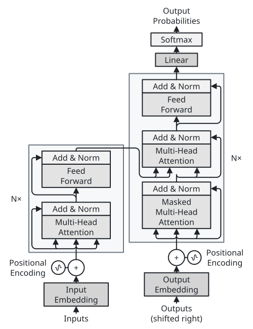 | 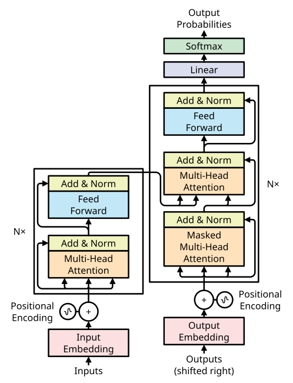 | 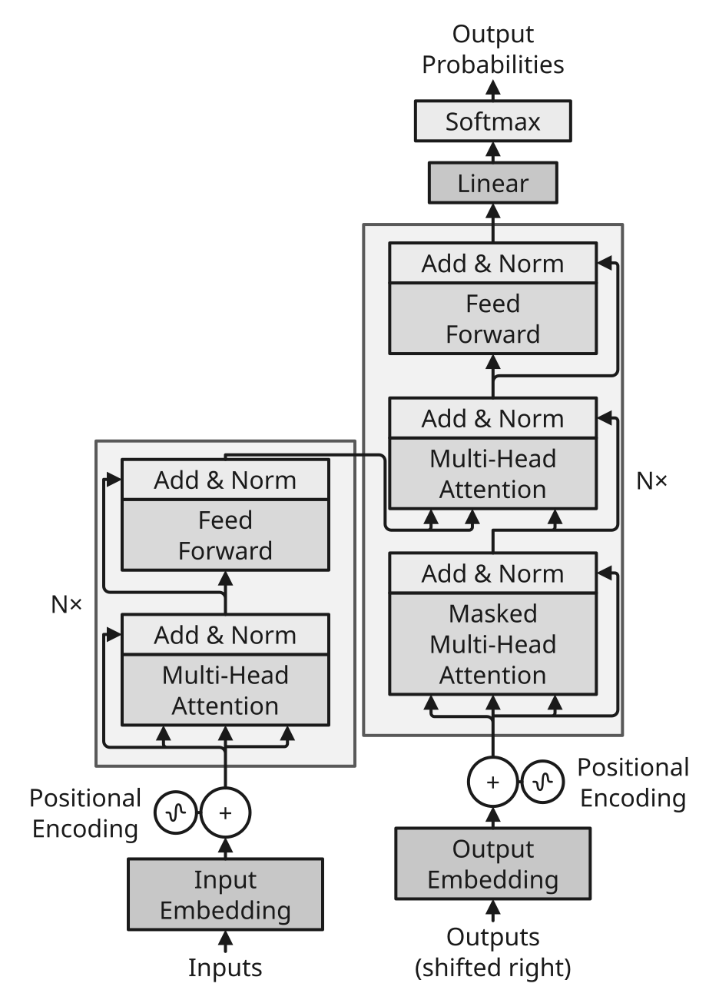 | 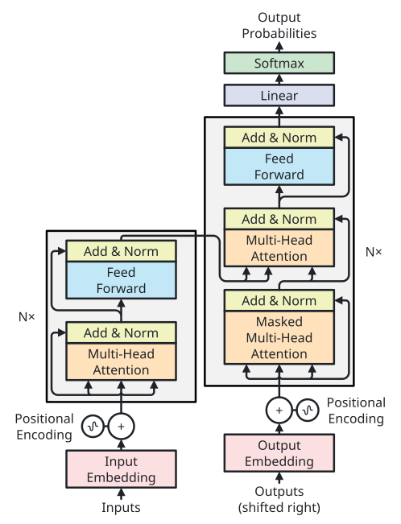 | 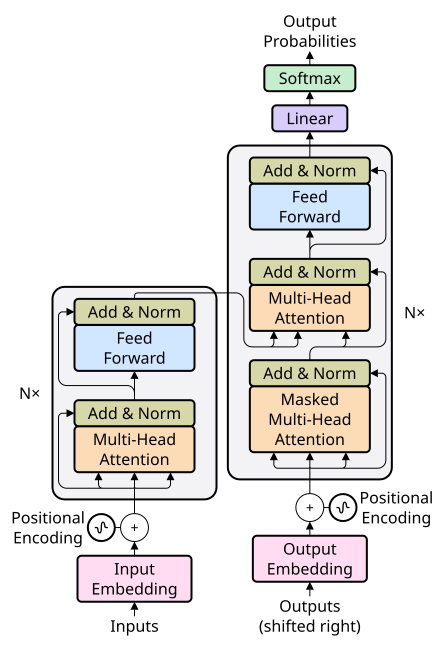 | 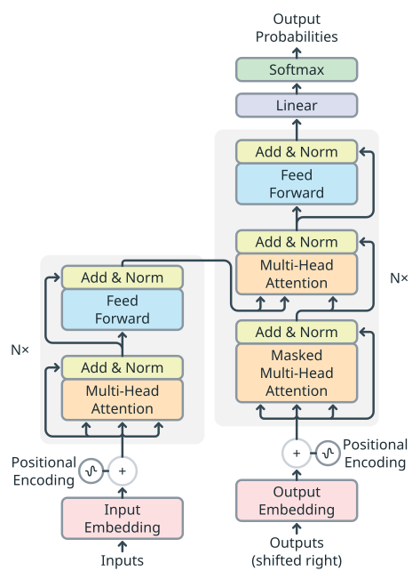 |

## 同じ自動配置の図を 5 テーマで

pipeline（[`examples/pipeline`](../examples/pipeline/pipeline.sumi.yaml)、自動配置）を `paper-single` プロファイルで描いたものです。

| `minimal` | `academic` | `slides` | `color` | `paper` | `llama` |
| --- | --- | --- | --- | --- | --- |
| 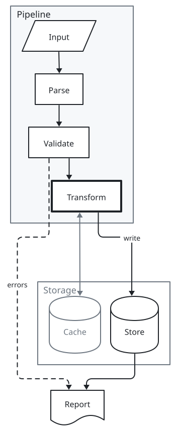 | 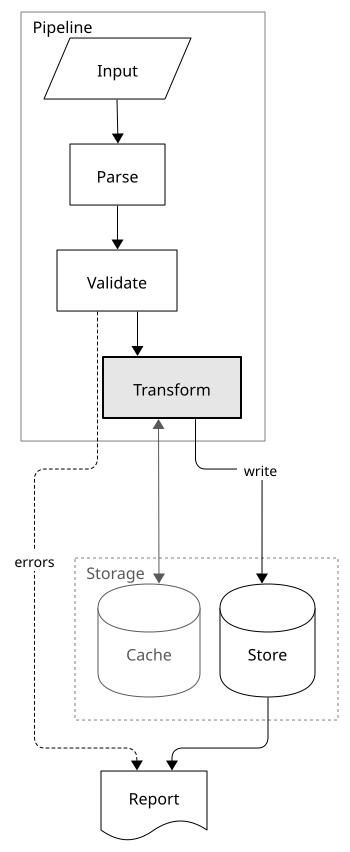 | 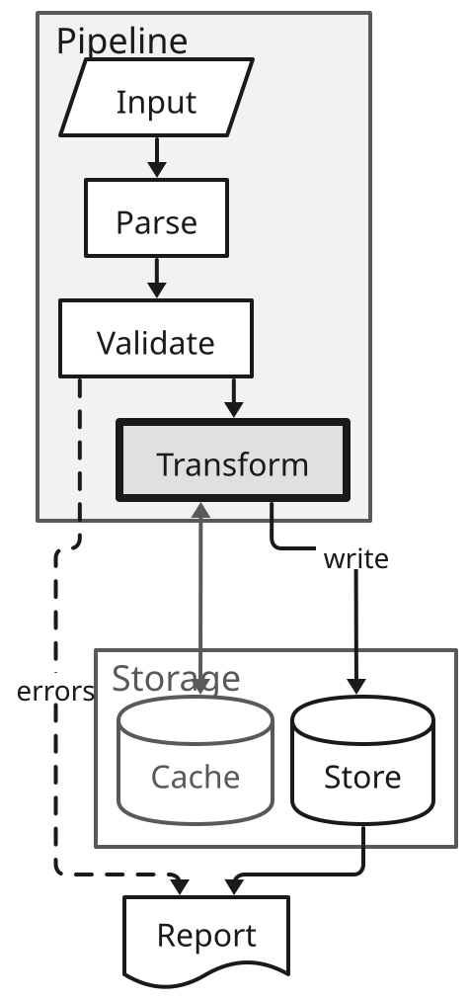 | 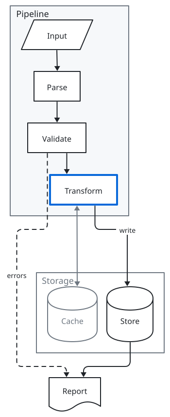 | 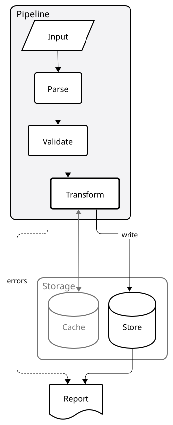 | 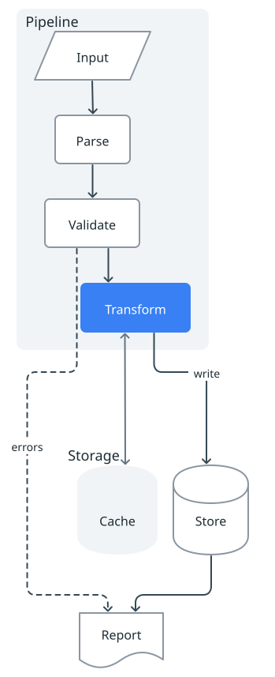 |

`paper-single` が定めるのはフォントサイズの下限（7pt）であり、上限ではありません。`slides` の文字はこの下限を満たし、この pipeline はページ内に収まりますが、衝突の warning が 2 件（`geometry/label-collision`・`geometry/edge-crosses-label`）出ます。これは、間隔が広がって縦長の pipeline がスライドの高さを超える `presentation-16x9` の error（`geometry/exceeds-page-height`）とは別です（[プロファイルの比較](gallery/compare.md)）。投影には `slides` と `presentation-16x9` を使い、段数を減らしたレイアウトにしてください。

## パレット

`figure.themeOverrides.palette: <名前>` で、どのテーマにも 4 色の組み込みパレット（`cool-blue`・`slate`・`coral`・`terracotta`・`sage`・`lavender`・`cyan-pink`・`seafoam`）を重ねて図全体の色合いを変えられます。文字・枠・辺はパレットの ink、グループのパネルは最も淡い色、filled のノードと `gray` tone は tint、`solid` と `emphasis` は accent になります。大きさ・フォントはテーマのままです。コントラストはテーマのキャンバスを基準に測り、暗いキャンバス（`sumi-dark`）ではパレットの暗色版（キャンバスより一段明るいパネル、明るい ink、色相を保って明るくした accent と tone）になります。[パレットのギャラリー](gallery/palettes.md)と `sumi catalog --section palettes` を参照してください。

`themeOverrides.tones.<tone>.line` を明示すると、黄色を含めその tone の solid の塗りになります。文字は 4.5:1 以上に調整され、組み込み黄色の 7:1 は保証されません。`fill` だけの上書きは solid を変えません。`solidFills.<tone>` は `line` より優先され、solid glyph と凡例の見本にも適用されます。

## 関連

- [ギャラリー: テーマ](gallery/themes.md)・[tone](gallery/tones.md)・[dim](gallery/dim.md)・[テーマ × プロファイルの一覧](gallery/compare.md)
- [利用ガイド: テーマとプロファイル](usage-ja.md#テーマとプロファイル)
- English: [Themes](themes.md)
