# Themes

A theme decides how a figure looks: colors, corners, line widths, groups and fonts. It never changes the layout rules or the page limits, which belong to the [profile](usage.md#themes-and-profiles). Choose one with `figure.theme` or `--theme`; the same YAML renders under every theme.

`figure.background: transparent` (or `render --background transparent`) omits the outer canvas while retaining the theme canvas as the assumed ground for contrast and label backgrounds.

Sumi has eight built-in themes:

- **`minimal`** (default): monochrome with clear outlines. A neutral starting point.
- **`academic`**: grayscale and print-friendly, in the manner of a journal. Nothing is colored, so the figure prints the same on a black-and-white printer.
- **`color`**: general purpose with color. The lines and type of `minimal`, with pastel tones and a blue accent.
- **`paper`**: color ML-paper style, after published Transformer and DiT figures: pastel tones, rounded corners, thin frames and edges, white framed panels (gray only when asked: `variant: filled`, `groupFill`), Inter for Latin text.
- **`slides`**: large text and thick lines for projection, used with the `presentation-16x9` profile.
- **`llama`**: after the mixture-of-experts figure of Meta's Llama 4 announcement: slate lines with open chevron arrowheads, gray-framed white boxes, dark slate `solid` blocks, a blue `emphasis` block, borderless pale panels, Inter for Latin text.
- **`sumi`**: warm cream canvas with navy ink and sand accents, Inter for Latin text; the design system of the project site.
- **`sumi-dark`**: the dark counterpart: navy canvas, cream ink and sand accents, Inter for Latin text.

`academic` and `paper` are both for papers; choose by how the paper is printed. **Grayscale or black-and-white print: `academic`. A color ML paper: `paper`.**

## Comparison

| | `minimal` | `academic` | `slides` | `color` | `paper` | `llama` |
| --- | --- | --- | --- | --- | --- | --- |
| Purpose | general, neutral default | journal figures, grayscale print | projection | general, with color | color ML-paper figures | figures in the style of the Llama 4 MoE figure |
| Color | monochrome; tones are 3 gray steps | grayscale only; tones are 3 gray steps | monochrome, darker grays; tones are 3 gray steps | pastel tone fills, blue emphasis | pastel tone fills and colored tone lines; blue is one of the tones | slate and gray; `solid` dark slate, `emphasis` blue accent, `filled` / `muted` borderless gray / pale blocks; pale tone fills |
| Corners | square | square | square | square | rounded (boxes 2pt, groups 6pt) | rounded (boxes 3pt, groups 5pt) |
| Lines | 1pt, emphasis 2pt | 0.5pt, emphasis 1pt | 2pt, emphasis 4pt | 1pt, emphasis 2pt | frames 1pt, edges 0.5pt (small arrowheads); emphasis: shapes 1.5pt, edges 1pt | frames and edges 1pt, **open chevron arrowheads** (a small gap before the box); emphasis edges 1.5pt blue, zoom lines 0.5pt |
| Groups | light gray fill, gray frame | no fill, gray frame | light gray fill, gray frame | light gray fill, gray frame | white panel, black 1pt frame, rounded (`filled`: light gray, no frame) | pale borderless panel, regular-weight title; `muted`: white panel |
| Font | BIZ UDPGothic; 8pt, edges 7pt | BIZ UDPGothic; 8pt, edges 7pt | BIZ UDPGothic; 16pt, edges 14pt | BIZ UDPGothic; 8pt, edges 7pt | Inter for Latin text in structured figures, BIZ UDPGothic for Japanese; 8pt, edges 7pt | as `paper` |
| Typical profile | `paper-single`, `paper-double` | `paper-single`, `paper-double` | `presentation-16x9` | `paper-single`, `paper-double` | `paper-single`, `paper-double` | `paper-single`, `paper-double` |

## The same structured figure under every theme

The Transformer ([`examples/transformer`](../examples/transformer/transformer.sumi.yaml), structured layout), drawn with `--theme` overrides. `slides` uses its own profile, `presentation-16x9`, and this tall figure is taller than a slide there.

| `minimal` | `academic` | `slides` | `color` | `paper` | `llama` |
| --- | --- | --- | --- | --- | --- |
| 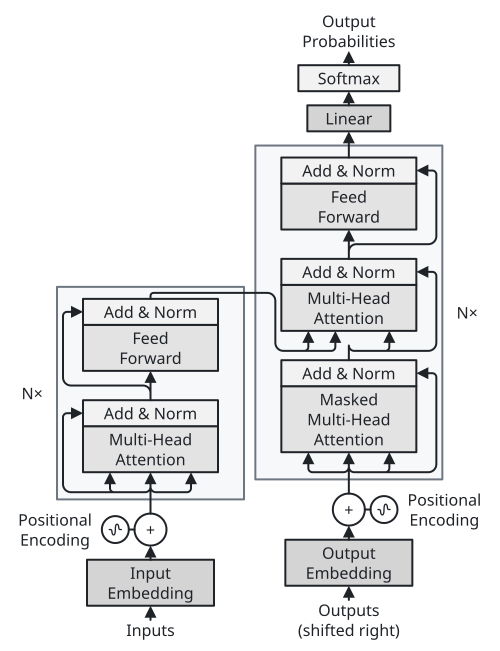 | 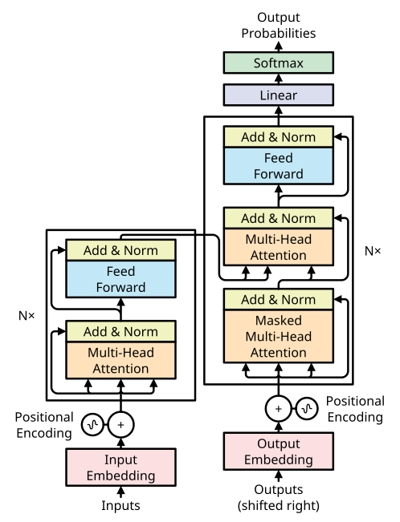 | 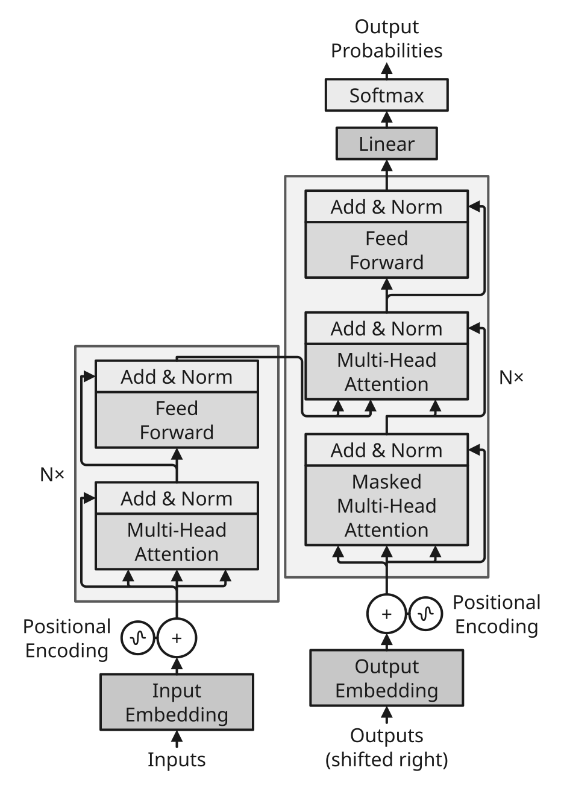 | 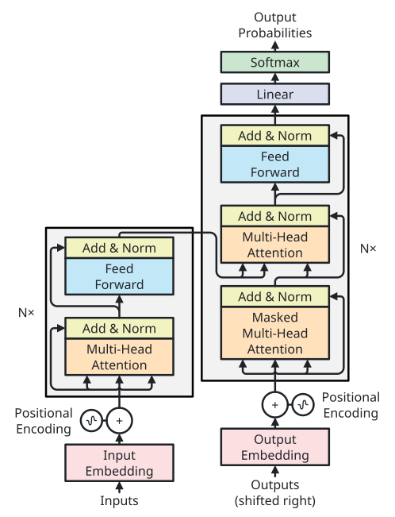 | 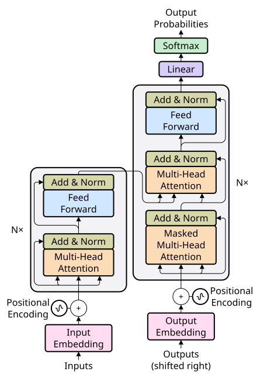 | 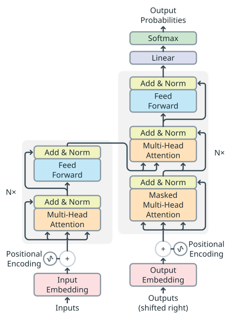 |

## The same auto-layout figure under every theme

The pipeline ([`examples/pipeline`](../examples/pipeline/pipeline.sumi.yaml), automatic layout), with the `paper-single` profile.

| `minimal` | `academic` | `slides` | `color` | `paper` | `llama` |
| --- | --- | --- | --- | --- | --- |
| 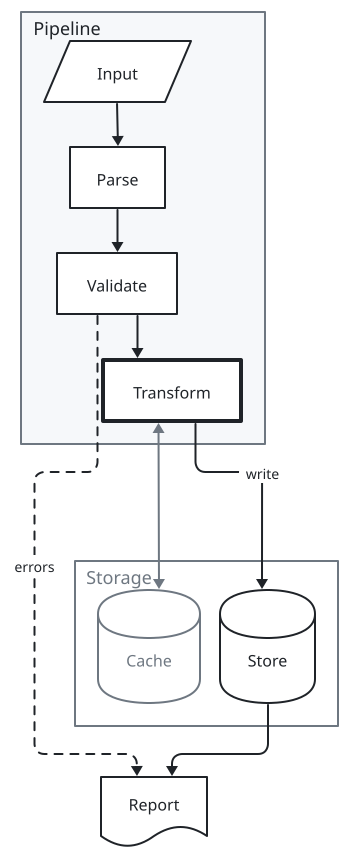 | 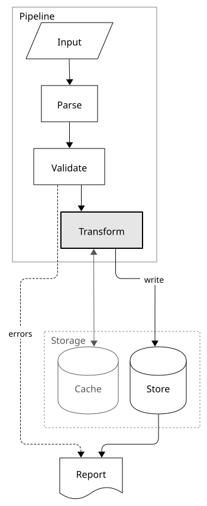 | 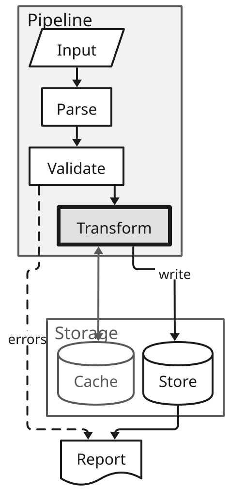 | 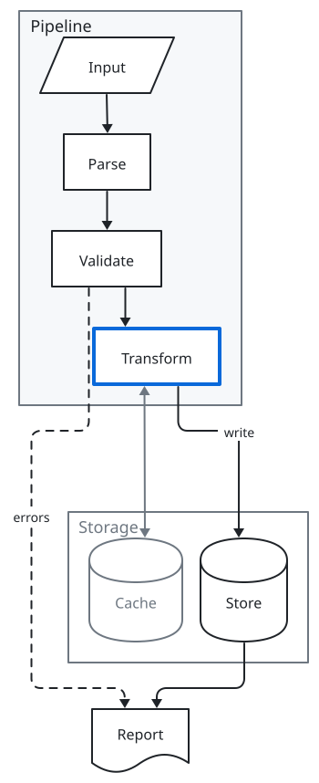 | 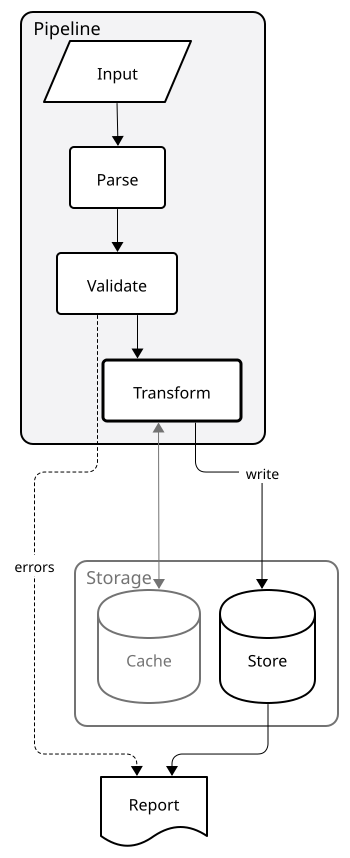 | 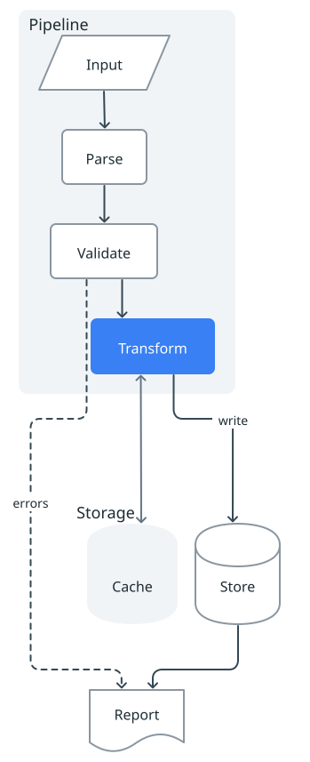 |

`paper-single` imposes a minimum font size (7pt), not a maximum: `slides` text meets it. This pipeline renders within the page limits, with two collision warnings (`geometry/label-collision` and `geometry/edge-crosses-label`). These are distinct from the `geometry/exceeds-page-height` error under `presentation-16x9`, where the larger spacing makes this tall pipeline exceed the slide height; see the [profile comparison](gallery/compare.md). For projection, use `slides` with `presentation-16x9` and a shallower layout.

## Palettes

`figure.themeOverrides.palette: <name>` recolors any theme with one of eight built-in four-color palettes (`cool-blue`, `slate`, `coral`, `terracotta`, `sage`, `lavender`, `cyan-pink`, `seafoam`): text, frames and edges take the palette's ink, group panels its palest color, filled nodes and the `gray` tone its tint, `solid` fills and `emphasis` its accent. Sizes and fonts stay the theme's. Contrasts are measured against the theme's canvas; on a dark canvas (`sumi-dark`) the palette draws a dark variant of itself (panels a step lighter than the canvas, light ink, the accent and tones lightened in their hue). See the [palette gallery](gallery/palettes.md) and `sumi catalog --section palettes`.

An explicit `themeOverrides.tones.<tone>.line` sets that tone's solid fill, including yellow; its text is adjusted to at least 4.5:1 rather than the built-in yellow's 7:1. A `fill`-only tone override does not change solid fills. `solidFills.<tone>` takes precedence over `line` and also applies to solid glyphs and legend samples.

## More

- [Gallery: themes](gallery/themes.md), [tones](gallery/tones.md), [dimmed groups](gallery/dim.md) and the [theme and profile matrix](gallery/compare.md)
- [User guide: themes and profiles](usage.md#themes-and-profiles)
- Japanese: [テーマの比較](themes-ja.md)
