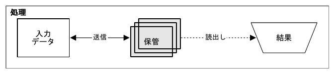
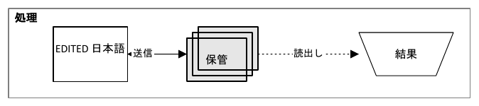

# #62 実験的な編集可能 DrawingML PPTX

## 契約と使い方

```sh
sumi render figure.sumi.yaml -o editable.pptx --pptx-mode editable
sumi render figure.sumi.yaml -o glued.pptx --pptx-mode editable --pptx-connectors glued
```

保証するのは **図形と文字を個別に選択・編集できること**。見た目の完全一致、編集後のレイアウト維持、YAML への逆変換は保証しない。一次ソースは `*.sumi.yaml`。画像方式の `--pptx-mode picture` は既定のままで、既存の出力バイトも維持する。

生成環境は macOS/Linux × x64/arm64、実アプリの確認は PowerPoint for Mac 16.114.1。#61 と同じ範囲で、Windows PowerPoint・Keynote・Google Slides は今回の保証対象外。今回の明示的な実装依頼を、#62 の前提である需要の確認として扱う。

- node / group は1つずつの `p:sp`、文字は各図形の `p:txBody`。ラベルだけのノードとエッジラベルは編集可能なテキストボックスになる。メディア画像やアウトライン文字で代用しない。
- コンテナは独立した枠であり、子を一緒に動かす PowerPoint グループではない。
- **freeform（既定）**: エッジは `p:sp` の開いた自由形状。元の M/L/C 経路を持ち、編集点を動かせるが、ノードを動かしても追従しない。
- **glued**: `p:cxnSp` の標準直線コネクタ。接着先は出力図形の上下左右（楕円は対応するプリセット接続点）。元のELK経路を失い、エッジラベルは固定される。カスタム輪郭では bbox ベースの接着点であり、Sumi の固定ポート機能を追加するものではない。
- グルー接着の自己ループ、DrawingML の標準矢じりに対応しない box/cross、一部の非塗りつぶし矢じり等は `pptx/unsupported-geometry` で拒否する。自己ループは freeform を使う。
- 文字は同梱 TTF で位置を計測し、実際の family / weight / italic を参照するが、フォントはPPTXへ埋め込まない。閲覧環境に無ければ置換され、幅や行送りも変わる。Mac の実確認では **MS-Gothic への置換**を確認した。
- 角丸や複合輪郭は自由形状へ写し、円弧は cubic の近似。エッジのラベル用 mask は白背景テキストボックスで近似する。完璧な表示一致には画像方式を選ぶ。
- 矢じりは SVG marker の幅/高さに最も近い DrawingML の離散サイズへ対応させる。Mac 16.114.1 の .5/1/2pt 線の対照では sm/med/lg は概ね4/6/10ptとなり、線幅比では一致しなかった。完全一致は保証しない。
- `pptx/experimental-editable` は常に warning、glued は `pptx/glued-routing` も返す。確認承認を要求するものではなく、通常どおり warning のみなら exit 0。

## 自動検証と再現

```sh
bun test src/render/pptx
SUMI_UPDATE_GOLDEN=1 bun test src/render/pptx/editable.test.ts # 意図して更新するときだけ
bun scripts/check-pptx-editable.ts
dotnet build scripts/pptx-validator/Validator.csproj --configuration Release \
  --artifacts-path .sumi/pptx-validator -p:RestoreLockedMode=true
dotnet .sumi/pptx-validator/bin/Validator/release/Validator.dll .sumi/pptx-editable/*.pptx
```

53 ケース（examples4、部品48、日本語1）×2モードの **106 slide XML golden** と **106 PPTX SHA-256** をコミットし、両OSのCIとreleaseの全4ターゲットで検査する。各IR要素の個別オブジェクト、live text、接着参照、画像なし、ZIP CRC・日時・反復決定性も検査する。日本語fixtureのSVGは `tests/fixtures/figures/export/editable.sumi.yaml` から生成し、corpus helper が入力hashの古さを検出する。生成には通常の `sumi render … -o tests/fixtures/pptx-editable-japanese.svg` を使う。

4個の対照を加えた110ファイルを独立した Open XML SDK 3.3.0 / Office2019スキーマで検証する（製品に.NETを同梱しない）。CIは `pptx-editable-fixtures` artifact に出力を残す。既存の画像PPTX106ファイルも同じジョブで検査する。

## Mac PowerPoint 16.114.1 の実確認

検証用ファイルだけを開き、期待する名前を確認してから保存・終了する。ユーザーの他のpresentationやアプリ全体は閉じない。生成物は PowerPoint 自身の一時領域等、アクセスできる専用ディレクトリに置く。

```sh
bun scripts/check-pptx-editable.ts --out "$HOME/Library/Containers/com.microsoft.Powerpoint/Data/tmp/sumi-62-native"
# 次をfreeform / gluedの両方で実行する（fixture名とprefixも対応させる）
osascript scripts/pptx-validator/editable-powerpoint.applescript \
  "$HOME/Library/Containers/com.microsoft.Powerpoint/Data/tmp/sumi-62-native/japanese.freeform.pptx" \
  "$HOME/Library/Containers/com.microsoft.Powerpoint/Data/tmp/sumi-62-native/japanese.freeform" \
  japanese.freeform.pptx n:source
bun scripts/record-editable-powerpoint.ts \
  --dir "$HOME/Library/Containers/com.microsoft.Powerpoint/Data/tmp/sumi-62-native" --record
```

記録: [`62-powerpoint.json`](62-powerpoint.json)。両モードとも8オブジェクトで開けた。`n:source` の文字を **EDITED 日本語** に変更し、右へ **20pt（254000EMU）** 動かしてPPTX保存、PDF再出力後も保持された。Nodeの移動と文字変更はappから読み戻すだけでなく、Open XML SDKで保存済みPPTXを独立検査した。

- freeform: `e:transfer` の位置・幅は変わらず、ノードへ追従しなかった。
- glued: 同じエッジの始点側位置が20pt移動し、幅が20pt縮んだ。接着コネクタが追従した。エッジラベルは固定されたまま。
- 日本語・太字・台形・stack・矢印が表示され、PDFでも文字を抽出できた。ただし使用フォントは MS-Gothic であり、同梱 BIZ での表示一致を確認したと主張しない。





### 自由形状コネクタの再確認

`control.cxn-line.pptx`（標準コネクタ）と `control.shape-custom.pptx`（通常図形の自由形状）は各1オブジェクトで開いた。`control.cxn-custom.pptx`（`p:cxnSp`＋`a:custGeom`）は期待するfixtureがactiveにならず保護チェックで中止した。スキーマ上は有効だったが、このMac版で正常に開けたという結果は得られなかった。従ってこの構造を公開モードに使わず、#19 の b1 / b2 の境界を維持する。

## 依存・配布

追加のランタイム依存・WASM変更はない。既存ZIP/OOXMLのパッケージを共有する。画像方式のSVG/PNGメディア関係やプロパティはバイト一致を維持する。CLIの実験オプション・制限・warningをヘルプ/README/Skillに明記し、配布smokeでは両モードのlive text・画像なし・ソースとのbyte一致を検査する。
