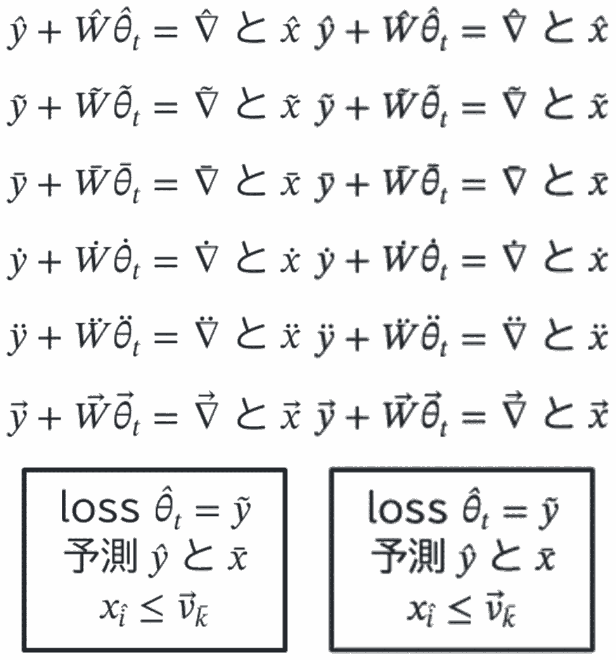

# #129 数式のアクセント: 製品の PDF エンジンとヘッドレス Chrome の一致（検証記録）

[Issue #129](https://github.com/nishide-dev/sumi-diagram/issues/129)、[設計 §6.29](../../docs/design/phase1.md#629-129-の数式のアクセント)、計画は [#124 の調査 §3.6](../../docs/research/124-stage-b.md)。

受け入れ条件「SVG のアクセントの位置が計測と一致し、製品の PDF エンジンとヘッドレス Chrome で同じ位置（検証記録を残す）」のうち、Chrome を使う部分の記録。Chrome が要るので CI では実行しない。計測との一致・PDF の run ごとの書体と位置・抽出・編集可能 PPTX は CI のテスト（`src/render/label-math.test.ts` の `accents (#129)`、`src/render/label-math-fonts.test.ts`）が検査する。

## 環境

| 対象 | 版 |
| --- | --- |
| Sumi | このブランチ（`feat/129-math-accents`。基点 `cb406e0`） |
| Bun | 1.3.14 |
| PDF エンジン | 製品の `assets/wasm/sumi-pdf.wasm`（krilla 0.8.2 / resvg 0.47.0、無変更。画像方式 PPTX と同じ resvg） |
| フォント | 同梱の BIZ UDPGothic 1.051、STIX Two Math / Text Italic 2.13 |
| Chrome | Google Chrome 156.0.8078.48（`--headless=new`） |
| Poppler | 26.04.0（`pdftotext -raw`、`pdftoppm`） |
| ImageMagick | 7.1.2（並べた画像のみ） |
| OS | macOS 26.2 / arm64 |

## 方法

`verify.ts` が `figure.sumi.yaml`（6 種のアクセント × 小文字 `y`・大文字 `W`・ギリシャ `θ`（添字 `t` 付き）・STIX Two Math の `∇`・日本語の後の `x`、および 3 行の箱: 添字の中のアクセント `x_{\hat i}`、アクセントの後の下付き `\vec{v}_{\bar k}`）を製品の経路で描く。

1. SVG を製品の PDF エンジンで PDF にし、Sumi の PDF reader で各 glyph の原点（pen の位置）を読む。
2. 同じ SVG を HTML に埋め込んでヘッドレス Chrome で開き、フォントの読み込み後に `SVGTextContentElement.getStartPositionOfChar()` で各文字の開始位置を読む。
3. どちらも SVG の単位に直し、空白を除いて描く順に対にして、文字が同じことと位置の差を調べる。
4. 両方の描画を PNG にして並べる（`previews/engine-vs-chrome.png`）。

## 結果（`results/verify.json`）

- 109 文字（うち結合文字のアクセント 37）が、両方で同じ順・同じ文字。
- 位置の差は最大 **0.022 単位**（0.011pt。`測`）、アクセントでは最大 **0.008 単位**。Chrome の位置は LayoutUnit（1/64px）に丸められるので、この大きさの差はその丸めの範囲。
- 目視でも同じ（`previews/engine-vs-chrome.png`。左が製品の PDF エンジン、右が Chrome）。背の高い基底（`W`・`θ`・`∇`）でもアクセントは字形の上端から離れている。
- `pdftotext -raw` の抽出は、各基底の後に結合文字（`y` U+0302 …）。`\vec{W}` だけ `W` と U+20D7 の間に空白が入る（#124 の試作と同じ、Poppler の判断）。



## 再現

```sh
bun install --frozen-lockfile
bun research/129-math-accents/verify.ts            # 結果を表示。out/（gitignore）に SVG・PDF・PNG
bun research/129-math-accents/verify.ts --record   # results/verify.json も書き換える
```

`previews/engine-vs-chrome.png` は `out/side-by-side.png` を `magick out/side-by-side.png -resize 75% -colors 8 previews/engine-vs-chrome.png` で縮小・減色したもの。Chrome は macOS の既定の場所（`/Applications/Google Chrome.app`）を使う。
