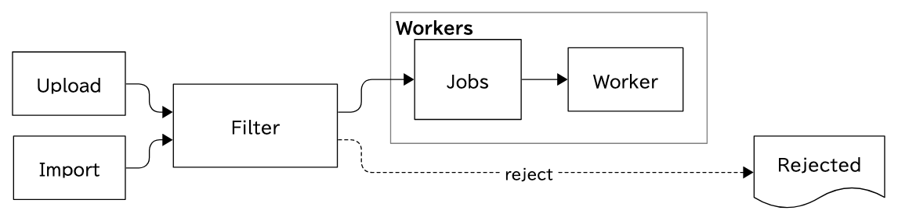
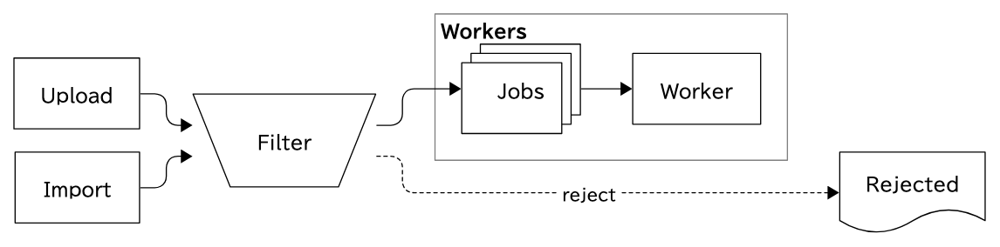
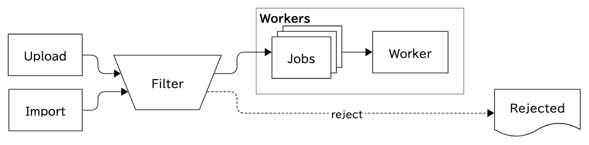
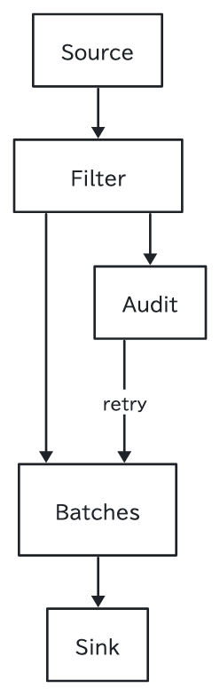
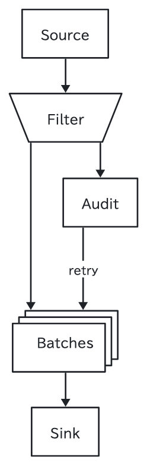
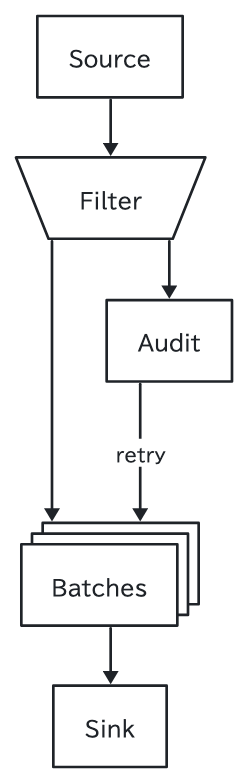

# #18 PoC: カスタム SVG 輪郭の合成

[#18](https://github.com/nishide-dev/sumi-diagram/issues/18) の技術検証用の PoC です。設計メモは [docs/research/18-custom-svg-components.md](../../docs/research/18-custom-svg-components.md) にあります。**製品のコードからは参照しません**（`src/` はこのフォルダを import しません）。

D2 の標準形状にない汎用形状 2 つ（台形 `trapezoid`、重なった矩形 `stack`）を、次の方式で描きます。

1. 部品は D2 には **プレースホルダの `rectangle`**（レイアウト用の占有矩形 = footprint）として出力する。
2. 1 回目の描画で D2 が決めたラベル込みの大きさから、形状ごとの `footprintFor()` で footprint を求め、`props.width` / `height` に入れて 2 回目を描画する（ラベルが安全領域に収まる大きさ）。
3. Sumi の通常の経路（compile → D2 → finalize → inspect）で得た SVG と geometry を使い、後処理で
   - `g.shape` の中身を形状のレイヤー（`<path>`）に置き換える（塗り・線・破線などの属性はプレースホルダの `<rect>` からそのまま写すので、Theme の解決結果がそのまま効く）
   - ラベルを安全領域の中心へ移す（stack は手前の矩形の中心）
   - エッジの端点を、最後の線分の向きに沿って footprint から輪郭まで延ばす（D2 が矢尻のために空けた距離は保つ）
4. 仕上げた SVG を `inspectSvg()` と幾何 lint にもう一度通し、§6 の契約が保たれていることを確かめる。

## 実行

```sh
bun run d2:install                     # 固定版の D2 v0.9.0
bun research/18-custom-svg/run.ts      # out/ に SVG とレポートを書く
bun research/18-custom-svg/run.ts --png  # PNG も書く（ヘッドレス Chrome。なければ省略）
bun research/18-custom-svg/probe-d2.ts # メモが根拠にした D2 の挙動の観察（out/probe-*）
bun test research                      # 形状の幾何の smoke test（D2 不要）
```

出力はバイト単位で決定的です（SVG を 2 回生成して sha1 が一致することを確認済み。PNG は Chrome に依存するので対象外）。

| ファイル | 内容 |
| --- | --- |
| `shapes.ts` | 形状の定義。footprint の矩形 → レイヤー・輪郭・安全領域を返す純関数と、ラベルの箱 → footprint の大きさ |
| `compose.ts` | SVG の後処理（`g.shape` の置換、ラベルの移動、エッジ端点の補正）。厳格な XML parser（`src/render/xml.ts`）の offset で開始タグと `g.shape` の中身だけを差し替える |
| `run.ts` | 図を 2 パスで描画し、3 段階の SVG とレポートを書く |
| `probe-d2.ts` | `shape: image`・`style.multiple`・`step` のエッジの端点など、D2 の挙動の観察 |
| `figures/*.sumi.yaml` | 入力の図（`research/trapezoid` と `research/stack` を使う） |
| `out/` | 生成物（コミット済み。Biome の対象外） |

## 結果

### `flow-right`（academic / paper-double、左→右）

| 段階 | 画像 |
| --- | --- |
| 1. プレースホルダ（Sumi の通常の出力） |  |
| 2. 輪郭だけ差し替え（エッジ・ラベルはそのまま） |  |
| 3. 輪郭 + ラベル移動 + エッジ端点の補正 |  |

- 2 では、台形の斜辺に入るエッジが輪郭の手前で止まる。隙間は 10.8 unit（5.4pt）と 21.4 unit（10.7pt）。ELK が同じ辺に入る 2 本を辺の高さ方向に散らすため、下側（台形が細い側）ほど隙間が大きい（最大は斜辺の水平オフセット `0.4h` = 32 unit = 16pt）。
- 3 では、全 6 端点で「端点 → 輪郭」の距離が D2 の元の「端点 → footprint」の距離（矢尻のある端 2 unit、ない端 1 unit）と一致した（`out/flow-right.report.json` の `endToFootprintUnits` / `composedEndToOutlineUnits`）。
- stack（`Jobs`）はコンテナの中でも同じ手順で描ける。footprint はコンテナの中に収まり、輪郭は footprint の内側なので包含関係は崩れない。stack に入る・出るエッジの隙間は 0（ELK が手前・奥の矩形が footprint に接する位置に端点を置いた）。

### `flow-down`（minimal / paper-single、上→下）

| 1. プレースホルダ | 2. 輪郭のみ | 3. 合成 |
| --- | --- | --- |
|  |  |  |

- 上下方向では、台形の上辺・下辺（水平）にエッジが入るため、6 端点すべてで隙間は 0。斜辺の問題は「エッジが斜めの辺に入るか」で決まる。
- `Batches`（stack）のラベルは手前の矩形の中心へ移した（−8, +8 unit）。

### 契約と lint

- 合成後の SVG は `inspectSvg()` を通り、カスタム部品の bbox はプレースホルダと完全に一致した（輪郭を footprint の内側に描くため）。
- 幾何 lint（`lintGeometry()`）は、プレースホルダ・合成後とも 0 件。ただし lint はカスタム部品を `rectangle` として扱っている（輪郭・安全領域を知らない）ので、正式実装では lint に形状の情報を渡す必要がある（メモ §5）。

## 制約（PoC の範囲外）

- 形状のパラメータ（台形の傾き、stack の枚数・ずれ）は固定。props からは変えられない。
- 明示サイズの付いたカスタム部品の扱い、自己ループ、曲線で終わるエッジは検証していない（曲線の端は制御点ごと平行移動するコードだけある）。
- 2 パスの描画は D2 を 2 回呼ぶ（1 回 20ms 程度）。
