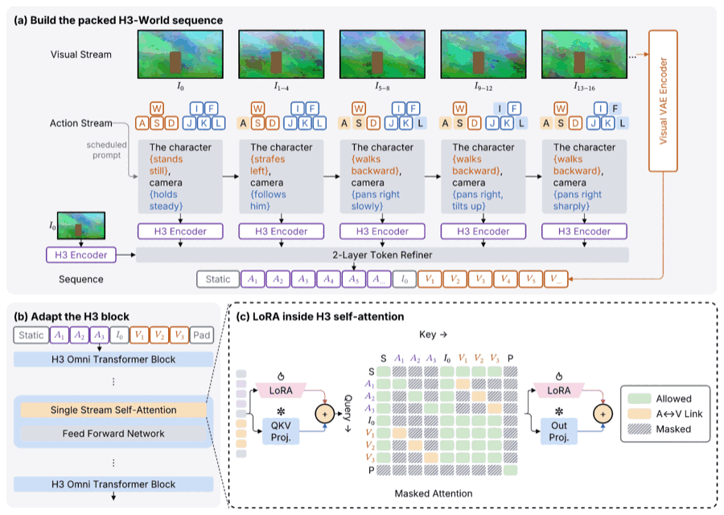

# #186: H3-World の色つきプロンプトと左揃え

`c-h3world.sumi.yaml` は `research/185-acceptance/figures/c-h3world.sumi.yaml`
の再構成からコピーしたもの。私有の原図は参照していない。5 つの prompt の動作を
orange、カメラの動きを blue の `\textcolor` にし、`textAlign: left` を指定した。
波括弧は文字として残し、72pt の箱に収まるよう句を複数行に分けた。
`assets/` は元の仮フレーム画像のコピー。



## 確認

- 180 × 128.09mm、paper / paper-double、fit: scale（82.9%）。
- PNG を開いて、orange / blue の句、共通の左端、箱内の収まりを確認した。
- `lint --geometry`: error 0、warning 5（6 行の prompt の `lint/long-label`）、
  info 1（縮小した数式の添字は 4.64pt。既存の `geometry/script-too-small`）。
  プロンプトの内容と箱幅を保つため改行を優先した。
- プレビューは SVG と同じ resvg エンジンの PPTX PNG を縮小・128 色に量子化した
  900px の PNG（150KB 未満）。生成 SVG / PDF / PPTX は `out/` に置き、コミットしない。

```sh
bun src/cli/index.ts fmt research/186-color-spans/c-h3world.sumi.yaml
bun src/cli/index.ts lint --geometry --json research/186-color-spans/c-h3world.sumi.yaml
bun src/cli/index.ts render research/186-color-spans/c-h3world.sumi.yaml -o research/186-color-spans/out/c-h3world.svg
```

実装前の 140 YAML × 6 Theme 条件、成功 574 通りの SVG / PDF / PPTX（画像方式と編集可能方式）/
auto の D2 の SHA-256 はすべて実装後と同じ。gallery 155 ファイルと PDF / PPTX / assets の
golden の再生成も差分 0。もともと `textAlign` を含む未対応の ideal 図だけは、
今回受理するようになった unknown-field の診断が 5 件減る。
