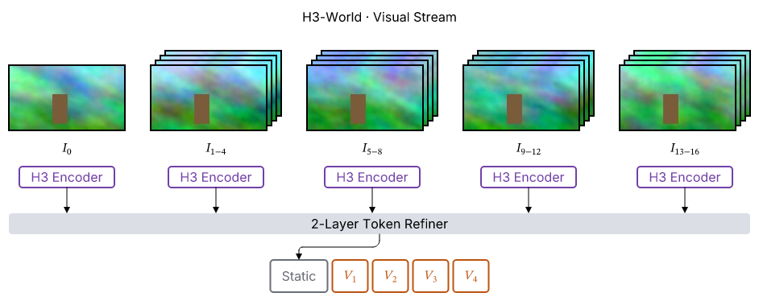

# #187: 画像を右上へ重ねる

## 作例と目視確認

`h3-world-frames.sumi.yaml` は #185 の H3-World から visual stream の部分を
抜き出した作例。先頭の `$I_0$` は 1 枚、後続の 4 区間は各 4 枚の束にした。
`assets/` は `research/185-acceptance/figures/assets/` の placeholder JPEG を
バイトを変えずにコピーしたもの。Sumi は画素を加工しない。

```sh
bun src/cli/index.ts lint --geometry --json research/187-image-layers/h3-world-frames.sumi.yaml
bun research/187-image-layers/render.ts
```

SVG / PDF / PNG は `out/` に生成する。PNG は図全体を通常の picture PPTX の
75% の寸法で rasterize した preview（画像ファイル自体の縮小処理ではない）。
**98,473 bytes**（150KB 未満）。PNG を開いて、後続 4 区間それぞれの画像が
右上へ 3 段見え、最前面が左下、枠線・ラベル・encoder と交差しないことを確認した。
診断は構造 lint・幾何 lint を含め **0 件**。図は **471 × 187pt**、paper-double 内。



## 寸法と埋め込み

構文は `props.layers: { count: 4, offset: 3pt }`。count は最前面を含み、
width / height は 1 枚の大きさ。どちらかの省略時は先にアスペクト比で補完する。

| 対象 | 1 枚 | 束の足跡 | 描画コピー | SVG 画像定義 | PDF Image XObject |
| --- | --- | --- | --- | --- | --- |
| fixture（両 engine） | 48 × 27pt | 57 × 36pt | 4 | 1 | **1** |
| H3-World の frame0 | 72 × 40.5pt | 同左 | 1 | 1 | 1 |
| H3-World の frame1〜4、各組 | 72 × 40.5pt | **81 × 49.5pt** | 4 | 1 | 1 |
| H3-World 合計 | — | — | **17** | **5** | **5** |

足跡は各辺に `(count - 1) × offset` を足した矩形。
配置、inspect、幾何 lint、edge port はこの矩形を使う（階段状輪郭ではない）。
SVG は束ごとに 1 個の image を定義し use で再利用し、奥から手前へ描く。
PDF の JPEG 再利用は `inspectPdf().images` で計数。PNG も 1 個、SVG は
vector のままで raster image 0 個であることをテストした。
編集可能 PPTX は各 image に既存の `pptx/unsupported-asset` を返す。
picture PPTX は束を保持する。

## 出力互換性

実装前に全 **138** `*.sumi.yaml` を収集し、元の theme と組み込み 5 theme
（minimal / academic / slides / color / paper）の **828** 組を実際に描画。
実装後は同じファイル一覧で再実行し、成功した各出力の SHA-256 を比較した。
作業時の生の記録は `.sumi/review/before.json` / `after.json` にある。

| 出力 | 比較した SHA-256 | 変化 |
| --- | --- | --- |
| SVG | 562 | 0 |
| PDF | 562 | 0 |
| picture PPTX | 562 | 0 |
| editable PPTX | 416 | 0 |
| D2（auto のみ） | 222 | 0 |
| 合計 | **2,324** | **0** |

266 組は変更前から描画不可（意図的な不正 fixture、未実装構文の研究案、
theme と profile の不整合など）で、変更後も描画不可。出力を捏造せずに失敗を記録。
理想構文の旧案 `research/86-paper-figures/figures/ideal/c-h3world.sumi.yaml`
だけは、元から未対応だった整数 `layers: 4` の診断が unknown-prop から
invalid-prop になったが、どちらにも生成出力はない。

既存の出力の変更は gallery の image サンプル（5 theme）とカタログ説明を載せる
ページだけ。新規 fixture の SVG / PDF / picture PPTX の hash は指定の golden
更新コマンドで追加。gallery image の PDF / PPTX golden は各 5 件を更新し、
layers を使わない既存 fixture の golden は変わらない。設計判断は §6.60 を参照。

## 最終検証

- `bun run check` / `bun run typecheck` / `bun run schema:check`: 成功
- `CI=1 bun test`: **2,794 pass / 13 skip / 0 fail**（117 files）
- `bun run gallery:check`: **155 files** がバイト一致
- golden 更新は `bun run gallery` および
  `SUMI_UPDATE_GOLDEN=1 CI=1 bun test src/render/pdf src/render/pptx src/render/assets.integration.test.ts` のみ
