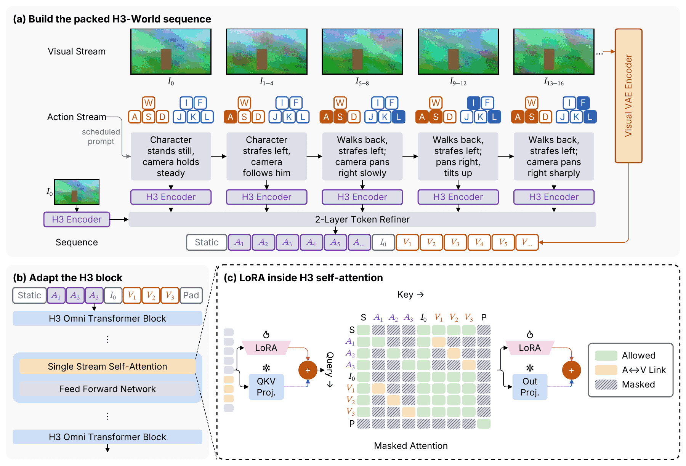

# #214 solid / tinted の検証

## 構文と判断

```yaml
nodes:
  - { id: pressed, component: square, label: A, tone: orange, variant: solid }
  - { id: encoder, component: box, label: Encoder, tone: purple, variant: tinted }
  - { id: add, component: operator, tone: orange, variant: solid, props: { symbol: plus } }
```

12 shape component、全 5 Theme、8 tone に対応。tone 未指定は gray。
tokens の `props.variant` / セルの `variant` と legend の `node.variant` も同じ構文。
solid は toneLines の濃色と白文字、tinted は tones の淡色面と同じ色相の枠・文字。
既存 palette を変えず、tinted に限り line 色を黒へ 1% 刻みで混ぜて 4.5:1 を満たす。
solid stack は白い枠で層を区別する。dim は lighten した面を保ち、solid の文字を
dim gray から必要最小限 darken して 3:1 以上を確保。dimmed solid stack の枠も同じ文字色。
設計の詳細は [§6.63](../../docs/design/phase1.md#663-214-の濃い塗りと色付き淡色面solid--tinted)。

## H3-World の受け入れ図

- 一次ソース: [figures/c-h3world.sumi.yaml](figures/c-h3world.sumi.yaml)。#185 の写し。
- 押したキーと ⊕ を solid、H3 / Visual VAE Encoder と A の tokens セルを tinted に変更。
  配置、辺、placeholder frame は元の図と同じ。
- 再現: `bun research/214-solid-tinted/render.ts`（pdftoppm と ImageMagick が必要）。
  #185 の placeholder を ignored `figures/assets/` に複製して fmt → lint → render。
  生成 SVG / PDF / 中間 PNG は ignored `out/` に出す。
- [previews/c-h3world.png](previews/c-h3world.png) を目視確認。180 × 122.24mm、scale 0.829。
  PNG は **113,800 bytes**（150KB 未満）。濃色の押したキーと白文字、紫の淡色 Encoder / A セル、
  オレンジの VAE と ⊕ が読み分けられ、ラベル・枠のはみ出しはない。
- lint は診断 0、render は error / warning 0。
  元図から継続する `geometry/script-too-small`（縮小後の添字 4.64pt）が info 1 件。



## 既存出力の互換性

変更前に repo 内の **140 枚の `*.sumi.yaml`** を列挙し、それぞれ元の Theme と
組み込み 5 Theme で描画した（840 通り）。変更後も同じ入力リスト・assetBase・override で再描画。

| 対象 | 比較結果 |
| --- | --- |
| 成功した 574 通りの SVG / PDF / picture PPTX | 全 sha256 一致 |
| うち auto の 222 通りの D2 | 全 sha256 一致 |
| 失敗した 266 通り | 同じ入力が同じ段階で失敗 |
| `component-no-cascade.sumi.yaml` の 6 通り | 出力なし。unknown-variant の候補に solid / tinted が増えた診断文だけ変更 |
| 既存 examples、assets の golden | 変更なし |

成功ケースの `file::theme` 順の出力 hash record 全体の sha256 は前後とも
`894ba025c0fa8c0878ec15bd710993943790aa569d687d6ef093333f465759c8`。
ローカル検証用のリスト・前後の hash と失敗診断は `.sumi/compat-214-{files,before,after}.json`。

## 意図して変更した生成出力の全一覧

新 variant を使う gallery だけを変更。`bun run gallery` で再生成した。
下記の **12 行 × 5 Theme の全 60 SVG** が既存ファイルの変更一覧。
すべて `docs/gallery/components/` 配下で、ファイル名は表のとおり。

| minimal | academic | slides | color | paper |
| --- | --- | --- | --- | --- |
| sumi-box.minimal.svg | sumi-box.academic.svg | sumi-box.slides.svg | sumi-box.color.svg | sumi-box.paper.svg |
| sumi-square.minimal.svg | sumi-square.academic.svg | sumi-square.slides.svg | sumi-square.color.svg | sumi-square.paper.svg |
| sumi-circle.minimal.svg | sumi-circle.academic.svg | sumi-circle.slides.svg | sumi-circle.color.svg | sumi-circle.paper.svg |
| sumi-ellipse.minimal.svg | sumi-ellipse.academic.svg | sumi-ellipse.slides.svg | sumi-ellipse.color.svg | sumi-ellipse.paper.svg |
| sumi-diamond.minimal.svg | sumi-diamond.academic.svg | sumi-diamond.slides.svg | sumi-diamond.color.svg | sumi-diamond.paper.svg |
| sumi-hexagon.minimal.svg | sumi-hexagon.academic.svg | sumi-hexagon.slides.svg | sumi-hexagon.color.svg | sumi-hexagon.paper.svg |
| sumi-parallelogram.minimal.svg | sumi-parallelogram.academic.svg | sumi-parallelogram.slides.svg | sumi-parallelogram.color.svg | sumi-parallelogram.paper.svg |
| sumi-cylinder.minimal.svg | sumi-cylinder.academic.svg | sumi-cylinder.slides.svg | sumi-cylinder.color.svg | sumi-cylinder.paper.svg |
| sumi-document.minimal.svg | sumi-document.academic.svg | sumi-document.slides.svg | sumi-document.color.svg | sumi-document.paper.svg |
| sumi-trapezoid.minimal.svg | sumi-trapezoid.academic.svg | sumi-trapezoid.slides.svg | sumi-trapezoid.color.svg | sumi-trapezoid.paper.svg |
| sumi-stack.minimal.svg | sumi-stack.academic.svg | sumi-stack.slides.svg | sumi-stack.color.svg | sumi-stack.paper.svg |
| sumi-operator.minimal.svg | sumi-operator.academic.svg | sumi-operator.slides.svg | sumi-operator.color.svg | sumi-operator.paper.svg |

- 理由: 全 variant の部品見本に solid / tinted を追加。
  operator 以外は横一列が紙幅を超えるので structured の 2 行に変更。
  operator は従来の D2 見本に両 variant の行を追加。
- 新規: `docs/gallery/tones/filled.minimal.svg`、`filled.academic.svg`、`filled.slides.svg`、
  `filled.color.svg`、`filled.paper.svg`（同ディレクトリ）。全 8 tone の solid / tinted、tokens / legend を掲載。
- 索引: `docs/gallery/README.md`、`docs/gallery/index.html`。新見本と構文の説明を掲載。
- 上記 60 SVG の PDF / picture PPTX の hash 各 60 件、editable PPTX の freeform / glued の hash 計 120 件と
  slide XML 計 120 ファイルも変更。対応する golden は次のとおり（`S` = 表のファイル名から `.svg` を除いたもの）。
  - `tests/fixtures/pdf/corpus-sha256.json` の `docs/gallery/components/<S>.svg`
  - `tests/fixtures/pptx-sha256.json` の同じキー
  - `tests/fixtures/pptx-editable-sha256.json` の `docs/gallery/components/<S>.freeform` と `.glued`
  - `tests/fixtures/pptx-editable/docs_gallery_components_<S>.freeform.xml` と `.glued.xml`
  - すべて指定コマンドで更新: `SUMI_UPDATE_GOLDEN=1 CI=1 bun test src/render/pdf src/render/pptx src/render/assets.integration.test.ts`
- 全 65 SVG を PDF → pdftoppm → PNG にして確認。
  5 Theme ごとの部品 contact sheet と全 tone の contact sheet で、白文字・淡色面・色付き枠・ラベルの収まりを確認した。
  検証用 PDF / PNG は `.sumi/visual-214/`（ignored）。

## テスト結果

- `bun run check`: pass
- `bun run typecheck`: pass
- `CI=1 bun test`: レビュー修正後 **2826 pass / 13 skip / 0 fail**（121 files、235.56s）
- `bun run gallery:check`: pass（160 files）
- `bun run schema:check`: pass（schema 変更なし）
- 指定 golden 更新テスト: **562 pass / 0 fail**
- 独立した WCAG 計算で 12 shape × 5 Theme × 9 tone 指定（8 tone + 未指定）× 2 variant の
  非 dim の文字 / 面の contrast ≥ 4.5:1 を検査。
  tokens 共通指定とセル override、legend、operator、dim 内外を structured で実描画。
  既存の D2 統合テストも全 component × variant × Theme を描画する。

## review-1 の対応と再検証

- **BLOCKING（stack の層）**: 同色の fill / stroke を通常線幅で描くだけでは境界は見えない。
  solid stack の stroke を白にし、非 dim で面との contrast ≥ 4.5:1 を確保。
  dimmed solid stack は下記の文字色を区切りにも使い、contrast ≥ 3:1 とする。
  全 5 Theme × 全 8 tone × dim 内外を D2 / structured で実描画し、3 層すべての SVG path の
  fill / stroke の相対輝度比を独立計算して検査する。
- **NON-BLOCKING（dim の可読性・Skill）**: dimmed solid の面と文字が異なるだけの検査を廃止。
  dim gray の RGB を黒へ 1% 刻みで混ぜ、面との contrast ≥ 3:1 を満たす最初の文字色を使う。
  全 12 shape × 全 5 Theme × 全 8 tone と tone 未指定で実際の theme stage の結果を検査。
  Skill の 4.5:1 は非 dim ノードに限定し、dimmed solid の 3:1 を明記。
- `bun run check` / `bun run typecheck` / `CI=1 bun test` / `bun run gallery:check` /
  `bun run schema:check` はすべて pass。golden 更新テストも 562 pass。
- 同じ 140 YAML × 6 設定を再描画。840 件の記録はレビュー前ブランチの記録と完全一致し、
  成功 574 件の SVG / PDF / picture PPTX と 222 件の D2 はバイト一致。
  `.sumi/compat-214-review1.json` と `.sumi/review/verify-review1.ts` に結果と照合手順を保存。
- `bun run gallery` が変更したのは stack 見本の全 5 Theme の SVG のみ。
  対応する PDF / picture PPTX の hash 各 5 件、editable PPTX の hash / slide XML 各 10 件を
  指定の golden 更新コマンドで更新。他の gallery・examples・受け入れ PNG は HEAD とバイト一致。
