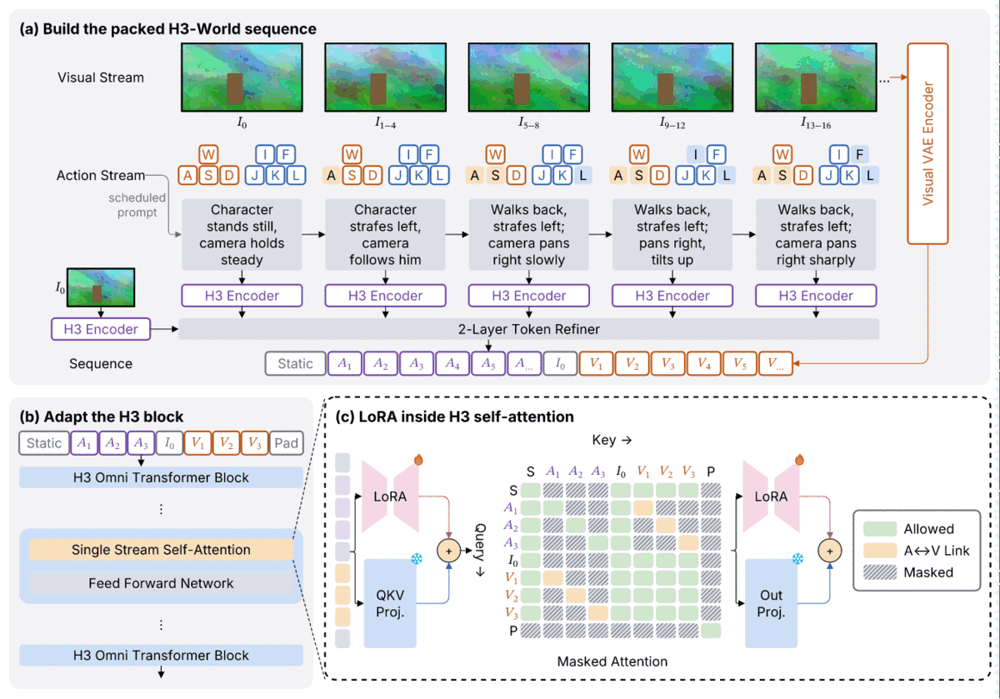

# #248 — パネル内を埋める配置

## #269 の中央ラベルへの復帰

2026-11-01 のユーザー決定に従い、LoRA のラベルは左右の pastel 台形と gap
全体の中央へ戻した。render / preview を再実行してPNGを開き、中央ラベル・
バッジ・辺端・伸ばした投影列と token 列を確認した。
180 ×125.71mm、0 errors / 0 warnings / 6 infos、PNG 101,820 bytes。
再生成したPNGは既存previewとバイト一致。
互換性の全比較は [#269 検証記録](../../docs/verification/269-centered-bowtie.md) を参照。

## 原因と変更

元は `../233-lora/c-h3world.sumi.yaml`。そのコミット済み assets をそのまま複製。
空きの分類・API の判断・数値は [設計 §6.71](../../docs/design/phase1.md#671-248-のパネル内の空きと主軸の-fill)。

- `align: stretch` は既に row にも存在。足りないのは伸ばした列の内部の主軸の配分。
- `justify: stretch` で余りを伸ばせる項目へ等分加算、`space-between` で間隔へ等分加算。
- 明示サイズ、outline、固定アスペクト比は保持。省略時の出力は不変。
- (c) だけを (b) の高さに無理に合わせず、軸見出しと caption を matrix に attach。
- token は同じ9色の無文字 box を明示し、固定 height を外して新機能で高さを合わせる。
  9件の構造 lint `lint/empty-label` は意図したもの。内容・関係は元の図のまま。



PNG は101,820 bytes。元の preview と目視比較済み。render は0 errors / 0 warnings /
1 info（既存の縮小された添字）。全体は180 ×125.71mm、(c) の高さは148.86 →144.22pt。
projection 列の body は59.68 →96.34pt（badge 予約を含めて matrix 99.75pt に一致）、
token 列は63.94 →99.75pt。見出し→Key は3.88 →2.77pt、caption→枠は6.22 →5.12pt。
詳細は [`panel-metrics.json`](panel-metrics.json)。

## 空き面積の分布

[`occupancy.json`](occupancy.json) は変更前の150図（自テーマ、コピーを含む）を対象に、
描画できた114図・225 group を測定した生データ。残り36図は不正 fixture や追加 registry、
旧研究図の route / assets 等で描画不可。矩形 union、直接の子＋title、edges を除外。
入れ子 group の中は別に測定し、生成された matrix / tokens / legend の内部枠は対象外。

| percentile | 空き |
| --- | ---: |
| p50 | 56.81% |
| p75 | 69.28% |
| p90 | 75.25% |
| p95 | 76.56% |
| max | 93.19% |

p90 を丸めた75%以上を info とする（24/225 group）。元の (c) は60.63%で診断されない。
この控えめな全体比率では局所的な短い列を網羅できないため、診断の有無だけで判断しない。
描き直し後は54.77%。

## 再現

```sh
# 実装前に1回保存し、実装後に比較する（.sumi は git 管理外）
bun research/248-fill/verify.ts before
bun research/248-fill/verify.ts after
bun research/248-fill/report.ts
# 分布は新しい受け入れ図を除く全 YAML、自テーマで測定
bun research/248-fill/measure.ts
bun research/248-fill/redraw.ts
bun src/cli/index.ts fmt research/248-fill/c-h3world.sumi.yaml
bun src/cli/index.ts lint research/248-fill/c-h3world.sumi.yaml
bun src/cli/index.ts render research/248-fill/c-h3world.sumi.yaml
bun research/248-fill/panel-metrics.ts
bun research/248-fill/preview.ts # preview の縮小・減色に ImageMagick のみ使用
```

verify は既存150 YAML × 自テーマ＋組み込み全5 theme の900通りを対象とする。
生成できた628通りのSVG / PDF / picture PPTX とautoのD2（222通り）の sha256、
生成不可272通りの error code を記録する。structured はD2を生成しない。
全900通りが一致し、変更0。両manifestのsha256は
`b935f1789c3ce83c220f7c536faefb401df8f4778fe27363d7bda0c55ab1fc43`。
集計は [`compatibility.json`](compatibility.json)、完全なmanifestは `.sumi/248-{before,after}.json`。
golden の hash ファイルを手で編集しない。gallery は全 theme × variant を生成して検証する。

今回の比較元は `61e6c20`（v0.8.0）。その `git archive` を worktree 内の
`.sumi/248-base/` に展開し、`SUMI_248_BASELINE=1` を付けて `verify.ts before`
を実行すると、実装後でも変更前の renderer で baseline を再現できる。
Theme は CLI と同じ `overrides.theme` で差し替え、成功した出力の theme ID も検査する。
