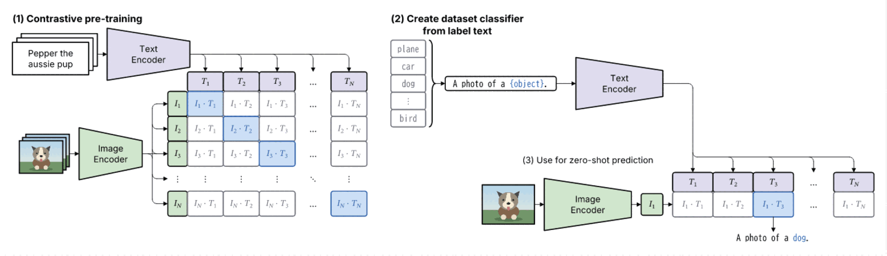

# CLIP Figure 1 の再現実験（#271）

Sumi 0.9.0 / Bun 1.3.14 の既存機能だけで、CLIP 論文の Figure 1
「Summary of our approach」を再構成した（当初）。その後 #280 で `matrix` がセルの文字・省略・`flush` を
持ったため、I·T 行列だけをそれで描き直した（preview.png は画素まで同一）。SVG の後加工はない。
一次ソースは [clip.sumi.yaml](clip.sumi.yaml)。



## 参照と比較範囲

- Radford et al. (2021), *Learning Transferable Visual Models From Natural Language
  Supervision*, [arXiv:2103.00020v1](https://arxiv.org/abs/2103.00020v1)。
- [論文 HTML](https://arxiv.org/html/2103.00020v1) の Figure 1 キャプション、
  §2.3（バッチ内の N×N 組合せと正例）、§3.1.2（テキストから生成する分類器）、
  §3.1.4（プロンプト）を確認した。
- 比較は依頼文の原図記述と上記本文に基づく**構造比較**。
  原図画像のダウンロード・切り出し・保存やピクセル差分比較は行っていない。
  出力の `preview.png` は実際に開いて目視した。
- 写真の代わりに、ImageMagick のグラデーションと図形で生成した犬の合成画像を使用。
  `assets/synthetic-dog.png` は原図の画像・外部写真・個人情報を含まない。
  実写の再現ではなく、入力画像の位置と役割を示す仮画像である。

## テーマ・レイアウトの判断

`paper` は紫の Text Encoder、緑の Image Encoder、青の正例・選択結果を
同時に区別でき、細い矢印と Inter の本文もカラー論文図に適している。
`academic` は色がグレーになるため採用しなかった。
`paper-double`（180mm）を論文の全幅図として選び、structured の
grid / row / stack で左に事前学習、右上に分類器生成、右下に予測を配置した。
右側は同じ plain グループにまとめ、(2)/(3) 共通の T 行とスコア行を直接接触させた。
`attach` でセルに hidden junction を配置し、`line` で結んだ共有幹から各セルへ分岐する。
これは #101 の既存機能であり、集合ポートや専用括弧の追加は不要だった。
`fit: scale` により約62.6%に縮小し、最終サイズは **180 × 52.01mm**。
任意の色・座標・フォント設定は追加していない。

## 原図の構造との比較

| パネル | 原図の構造 | 今回再現したもの | 残る差分と理由 |
| --- | --- | --- | --- |
| (1) 対比事前学習 | 左のキャプション → 横向き Text Encoder → T 行への下向き分岐。画像 → Image Encoder → I 列への右向き分岐。N×N 表と青い対角 | 両台形を `narrow: east` に統一。T 行の真上の水平幹、I 列の左の垂直幹から1,2,3,…,Nの各セルへ矢印。T 行33pt幅 / I 列23pt高を式セルに合わせ、grid と tokens の gap 0 で接触。対角4セルと … / ⋮ / ⋱ を保持（`matrix` 1個、#280） | 合成犬画像、同じ文のカード、罫線なしの省略セルは YAML / 素材の選択。テーマの角丸・色・台形の固定傾斜は原図の厳密なトレースではない |
| (2) 分類器生成 | plane / car / dog / ⋮ / bird の箱を括ってプロンプトへ → 横向き Text Encoder → 共通 T 行への下向き分岐 | 全ラベルを箱にし、ラベル列へ attach した波括弧 `bracket`（列の高さに自動で合わせる）の先端から「A photo of a {object}.」へ矢印。紫の横向き台形から水平幹を経て各 T へ矢印 | クラス名・プロンプト・結果文は `mono: true`（#279）で同梱の BIZ UDGothic の等幅にした。括弧は `bracket` 部品（#281） |
| (3) ゼロショット予測 | 写真 → Image Encoder → I₁ → T 行直下の I₁·T 行、T₃ を選んで犬の文へ | I₁から第1スコア左端へ短い直線。共通 T 行とスコア行の全列を37ptで揃え、gap 0 で上下に接触。青い I₁·T₃ から結果文へ真下に矢印。旧末尾セル間の長い迂回線を削除 | 写真は仮画像。行の高さ・列幅・結果文の色と文字密度はテーマ / YAML の選択。T とスコアの接触自体が対応を示し、セル間に追加の矢印は描かない |

ここで N は任意のバッチ数 / クラス数を表す記号であり、5クラスに固定した実験結果ではない。
スコアも数値の実測値ではなく、原図同様に内積の記号表示である。

## できること・異なること・不足機能

「未対応」を既存機能と混同しないように、今回実際に使えたものも記録する。
以下の英語タイトルは**フォローアップ Issue 案**であり、新規 Issue は作成していない。

| 項目 | 判定・観察 | 現在の対処 / 提案する修正・Issue タイトル |
| --- | --- | --- |
| 3パネルの配置 | 対応済み。grid の空セル、attach、共通の T / スコア行を使用 | パネル(3)は独立コンテナでなくタイトルラベル。上下間隔と空白は YAML の選択で、配置機能の不足ではない |
| 台形エンコーダ | 対応済み。すべて `narrow: east` で横向き | 寸法は YAML で調整可能。固定傾斜を厳密に合わせる機能はない。案: `Expose validated trapezoid slant presets` |
| 重なったテキストカード | 対応済み。`stack` で3枚の輪郭と前面テキスト | 枚数・ずれは固定で、カードごとに異なる文は持てない。案: `Support heterogeneous content in stacked cards` |
| 重なった写真 | 対応済み。`image.props.layers` で3枚を上右にずらせる | すべて同じ合成画像のコピー。異なる写真のバッチは単一ノードで表せない。案: `Support distinct assets in image layers` |
| 等幅ラベル | 対応済み（#279）。ノード / tokens セルの `mono: true` | plane / car / dog と「A photo of a {object}.」の文を BIZ UDGothic にした。`\textcolor` の色付き範囲もそのまま使える |
| 色付き文字列 | 対応済み。数式内の `\textcolor{blue}{\text{…}}` で `{object}` と dog を着色 | プレーンテキストの任意 span ではない。現方式を使用し、使い勝手の改善案: `Add semantic colored spans to plain text labels` |
| 行列の対角強調と接触グリッド | 対応済み（#280）。(1) の I·T 行列も (3) の I₁·T 行も `matrix` 1 個で、セルの数式（`{ class, text }`）と青い対角の class を併用。`flush: true` で枠の余白をなくし、上の T 行・左の I 列と gap 0 で接する | 以前は tokens 5行を gap 0 の stack で重ねていた。セル単体は辺の端点・attach にできないため、(3) は行列全体を端点にしている（中央セルの dog の真下なので位置は同じ） |
| 省略セル | 対応済み（#280）。`ellipsisRows: [4]` / `ellipsisColumns: [4]` で … / ⋮ / ⋱ を自動配置（交点は ⋱）。省略のスロットはセルの大きさを保ち、記号だけを描く（枠・塗り・斜線なし。隣のセルは枠を保つ） | tokens の `component: label` の代用は不要になった |
| ラベル列の括弧 | 対応済み（#281）。`bracket`（波括弧 / 角括弧）をラベル列へ attach すると列の長さに合わせて描かれ、先端が辺の端点になる | 以前の junction の縦幹は廃止。1 本の辺でプロンプトへ進む |
| トークン集合への接続 | 対応済み（#281）。tokens の ID を端点に書くと列全体（枠の group）に 1 本の辺がつながる | 原図の fan-out を保つため、この図のエンコーダ出力は共有幹から `<node>.<cell>` へ個別に接続。全体端点の機能は [tokens ギャラリー](../../docs/gallery/components/sumi-tokens.md) で例示している |
| 原図の線・配色・文字密度 | テーマのパレット、角丸、線幅、フォント、表の大きさが原図と異なる | 厳密なトレースではなく意味の一致を優先。案: `Add compact paper table styling presets` |
| 縮小後の読みやすさ | 本文約5.09pt、添字約3.56pt。PNG では読めるが印刷時の添字は小さい | 横向きフロー全体を180mmへ収める YAML の選択。info として記録。案: `Add fit-aware math script sizing for paper figures` |
| 矢印の曲がり | 明示的な junction チェーンで水平 / 垂直幹と十分な直線部を確保。cramped info も解消 | 丸い角は既存 router の固定仕様。分類器から共通 T 行への縦区間の長さは YAML の42pt行間隔による。旧 Tₙ→スコア末尾の迂回接続はない |

## 再現手順

リポジトリのルートで実行する。Bun と ImageMagick 7 が必要。
structured のため描画時に D2 は不要。

```sh
# 合成画像を再生成する場合のみ（コミット済み PNG でも描画可能）
sh research/271-clip/generate-assets.sh

# fmt → lint --geometry → render → 同じ Sumi/resvg エンジンで PNG 化
bun research/271-clip/render.ts

bun run check
bun run typecheck
bun run test
```

`render.ts` は CLI の JSON summary に errors / warnings があれば失敗し、
プレビューが150,000 bytes以上でも失敗する。Sumi の既存 picture-PPTX 用 PNG
fallback をメモリ上で取り出し、ImageMagick で1500px幅・128色にする。
SVG のレイアウト・テキスト・画像は変更しない。

| ファイル | 役割 |
| --- | --- |
| `clip.sumi.yaml` | 編集対象の一次ソース |
| `assets/synthetic-dog.png` | ImageMagick で生成した仮画像（コミット対象） |
| `generate-assets.sh` | 外部入力なしの仮画像生成手順 |
| `render.ts` | 描画・診断・プレビュー生成手順 |
| `preview.png` | 目視したプレビュー、39,130 bytes（150KB未満） |
| `out/clip.svg` | 再生成可能な SVG、git 管理外 |
| `out/lint.json`, `out/render.json` | 絶対パスを含むローカル診断、git 管理外 |

`.gitignore` は `out/` のみを無視し、`assets/` は無視しない。
生成物を `out/` に集約することで既存の Biome 除外規則とも整合させる。

## 検証結果

- Sumi の `doctor`: フォント・geometry lint・D2 がすべて正常。
- `lint --geometry --json` と `render --json`: **errors 0 / warnings 0 / infos 2**。
- info 内訳: `geometry/script-too-small` 1件（添字3.56pt）、
  `geometry/group-empty-area` 1件（右の共通グループ、空白75.6%、線は面積に含まない）。
  空白は分類器生成と予測を分け、共有幹を通すための YAML の選択。
- 最終 `preview.png` を実際に開いて目視: 横向きの両エンコーダ、全 T / I への矢印、
  見出しと表の接触、青い対角4セル、全クラスからプロンプトへ合流する幹、
  共通 T 行に密着するスコア行、青い第3スコアから dog 文への下向き矢印を確認。
- `bun run check`: 423ファイル、指摘なし。`bun run typecheck`: 成功。
- `bun test`: **3321 pass / 13 skip / 0 fail**（133ファイル、約277秒、今回再実行）。
  既存の #124 prototype のスキップ通知も出たが、失敗はない。

共有幹・括弧状の接続・全セルへの分岐は既存機能で再現できた。
残る不足機能と、画像・間隔などの YAML / 素材選択を分けて記録し、
原図の厳密なトレースではないため、関連付けは引き続き `Refs #271` とする。
