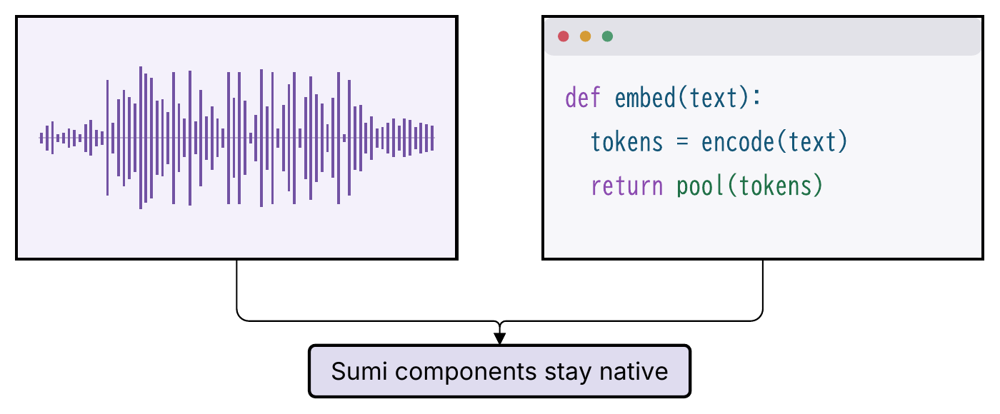
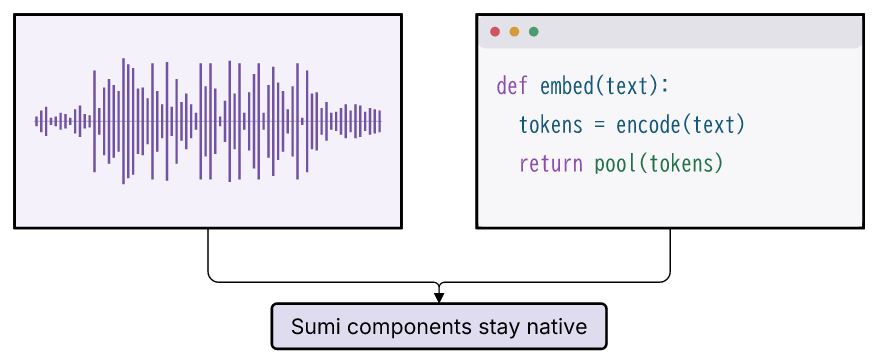

# #272: 箱の中だけを別記法で描く rich content の調査

## 結論

**可能。図全体の配置・接続・枠は Sumi に残し、箱の内容だけを「検査済み SVG の不透明な資産」か「型付きデータを描く小部品」に分ける。HTML / `foreignObject` は採用しない。**

v0.10.0 には、既存 importer と画像配置を共有する **inline SVG 資産の最小入口**と、テーマに従う **waveform 小部品**を推奨する。コード窓の本格対応（文字を文字として保つ）、film-strip の合成部品、scatter / sparkline、編集可能 PPTX の資産混在は後続へ分ける。写真・動画の静止フレーム・汎用プロットは既存 `image` が当面の手段になる。

この調査は設計提案であり、製品 API・ロードマップの確定ではない。`src/`・schema・Skill は変更していない。試作は本ディレクトリ内だけ。PR 本文の作業用ファイルだけ `.sumi/review/pr-body.md` に置く。

## 1. 対象と現状

対象は [EmbeddingGemma 2, arXiv:2610.37364v1, Figure 1](https://arxiv.org/html/2610.37364v1#S1.F1)。HTML の Figure 1 の [diagram.png](https://arxiv.org/html/2610.37364v1/diagram.png) を取得し、画像を開いて確認した（2026-10-31）。原図は保存・再配布する成果物に含めず、試作は自作の模式波形と架空のコードを使う。

観察した特徴:

- テキスト箱は角丸矩形と数行の文章。Code は暗い角丸窓、3 色の丸ボタン、色付き `def detect_note():` と省略記号。
- Images はギターの写真。Video は静止画、上下のフィルム穴、中央の再生三角形。Audio は赤い縦線の波形と外側の説明文。
- 中央は通常の encoder / backbone の箱と接続線、色付きセルのトークン列。
- 下端の散布図は X/Y/Z 軸と多色の点（一部は扇形の混色）。対話的な 3D 描画を要求する図ではない。

確認した基盤:

| 現状 | 根拠・今回の意味 |
| --- | --- |
| SVG の strict XML / inspection / フォント / 幾何 lint | [設計 §6.3・§6.4・§6.5](../../docs/design/phase1.md)、[inspect.ts](../../src/render/inspect.ts)。完成図の SVG を丸ごと信頼して差し込む入口ではない |
| 画像とアイコンの allow-list | [設計 §6.25](../../docs/design/phase1.md)、[svg-import.ts](../../src/assets/svg-import.ts)。`svg/g/path/rect/circle/ellipse/line/polyline/polygon` と限定的な描画属性を再直列化する |
| importer の限界 | `text/tspan/defs/clipPath/mask/filter/gradient` は unsupported。`foreignObject/script/image/use/href/on*` 等は unsafe。style **属性**の許可済み paint 宣言と `<style>` 要素の禁止を区別する |
| 資産と測定の境界 | importer は transform と円弧を許すが、測定対象の `g.shape` 等は原則 transform・円弧を拒否する。資産を測定対象の輪郭にしてはいけない |
| 現行 PDF | [§6.12](../../docs/design/phase1.md)、krilla 0.8.2 + krilla-svg 0.8.1 / usvg 0.47.0 の固定 WASM。ブラウザを使わない |
| 現行 PPTX | [§6.16・§6.17・§6.25](../../docs/design/phase1.md)、[editable.ts](../../src/render/pptx/editable.ts)。picture は図全体を 1 枚の SVG + PNG fallback にする。editable は画像・アイコン・badge を `pptx/unsupported-asset` で拒否する |
| 既存の表現力 | `tokens`、色付きラベル範囲と左揃え（§6.61）、画像 layers（§6.60）は既にある。ただしコード用の空白保存・言語解析・窓 chrome はない |

§6.25 の「Sumi は画像を生成・加工せず、検査して埋め込む」という方針は維持する。waveform は画像加工機能ではなく、数値データを描く汎用コンポーネントとして提案する。外部生成器・任意コード実行を core に追加する案ではない。

## 2. 4 方式の比較

「editable 対応」は、将来の実装可能性と現在の動作を区別する。ベクターであることは、PowerPoint の文字や図形として編集できることを意味しない。

| 評価軸 | (1) HTML / foreignObject | (2) 検査済み inline SVG | (3) データ駆動小部品 | (4) 既存 image |
| --- | --- | --- | --- | --- |
| 表現力 | HTML/CSS による組版は強い。canvas や JS に依存すると静的図の範囲を越える | 任意 SVG 全般ではなく、現在は線・面・パス。文字は輪郭化が必要。写真の入れ子も禁止 | 部品の契約内で強い。波形・コード・film・点群を短いデータで表現できる。任意 UI ではない | 写真・完成済みのグラフ等に強い。SVG は同じ allow-list、PNG/JPEG は画素表現 |
| SVG | HTML 対応ブラウザでは表示できるが、SVG の画像利用先・非ブラウザ描画系まで保証できない | 既存許可 subset なら可。inline でもフォント非依存 | 既存 writer の基本図形・管理された文字なら可 | 現在対応。SVG は検査後 data URI、PNG/JPEG は元バイト |
| PDF / krilla | HTML レイアウトなし。試作は成功扱いで内容が消失 | 対応可能、試作は画像数 0 のベクター | 基本図形と既存のフォント経路で対応可能。コードは検索可能な文字を目指せる | 現在対応。SVG はベクター、PNG/JPEG はラスタ画像 |
| picture PPTX | usvg/resvg に HTML がないので HTML 部分が消える | SVG + PNG fallback にできる（試作で生成確認） | 既存 SVG 経路で可能 | 現在対応。図全体が 1 枚 |
| editable PPTX | ネイティブ HTML 表現なし。画像化は別途ブラウザ依存 | **現在不可**。将来 `p:pic` 混在で内容単位の移動・拡縮は可能、内部は非編集 | **自動対応ではない**。waveform は line/freeform、code は text runs + chrome、film は画像混在、scatter は点/軸への個別 lowering が必要 | **現在不可**。将来の `p:pic` 混在は (2) と共通の課題 |
| 決定性 | CSS・フォント・layout engine・非同期資源まで固定が必要。browser 同梱は高コスト | 正規化 SVG・寸法・入力 hash・固定 engine で決定的にできる。外部フォント不要 | samples / points / text を固定、PRNG と丸め・構文解析版・フォントを固定すれば強い | 固定されたファイル bytes からは強い。外部での生成過程は Sumi が保証しない。`sha256` で固定可 |
| 幾何 lint | HTML の内部寸法を現行 TTF 計測では求められない | 外側の箱・配置だけ。内部の文字・線幅・はみ出しは現状検査しない | content bounds、各行・run、点・線の範囲を IR に持てば内部まで検査可能。実装が必要 | 箱の配置だけ。画像内の文字サイズや写真の内容は検査しない |
| 安全性 | 現在は unsafe として拒否。CSS 資源取得・script・イベント等の別境界が必要 | 現行 importer を通して再直列化。DTD/entity/参照/イベントを禁止。inline 用も byte/要素/深さ予算を維持 | 型検証、数値範囲・配列長・文字長制限、XML escape。code は描くだけで実行しない | 相対パス・実パスの base 検査、サイズ/画素数制限、SVG importer が既にある |
| Skill ergonomics | 見慣れた HTML でも CSS 調整と表示先差分の修正が多い | XML block scalar は局所的な escape hatch として便利だが、座標と長い path は書きづらい。text の禁止が重要なつまずき | 最も短く意味が残る。`samples` / `text + language` / `points` から記述でき、catalog で発見可能 | 操作は簡単だが別ファイル・生成ツール・配色調整が必要。既存 fallback として安定 |
| 実装費用の目安 | 非常に高い。browser と別 raster pipeline、形式ごとの fallback が必要 | 小〜中。入口だけでなく locator、asset hash、予算、両 writer、診断、Skill が要る | waveform 小〜中、code 中〜大、film 中、2D scatter/sparkline 中、3D 高。editable 対応は追加費用 | 追加費用ゼロ。混在 editable は中〜大 |

費用は相対的な設計見積もりで、日数やバイナリ増分を実測したものではない。特に「データから描けば全形式に出せる」は設計上の利点であり、現行 editable writer に SVG を差し込むだけで実現するわけではない。

## 3. 試作と実測

### 3.1 手順と再現

[prototype.ts](prototype.ts) と [prototype.sumi.yaml](prototype.sumi.yaml) が一次ソース。Bun 1.3.14 / darwin-arm64 / Sumi 0.9.0 の checkout と同梱 WASM・フォントを使用する。D2 は doctor で v0.9.0 を確認したが、試作の配置は structured のため D2 を呼ばない。

```sh
bun research/272-rich-content/prototype.ts
bunx biome format --write research/272-rich-content/results.json
bun src/cli/index.ts fmt research/272-rich-content/prototype.sumi.yaml
bun src/cli/index.ts lint --geometry research/272-rich-content/prototype.sumi.yaml
pdftoppm -scale-to 1400 -png -singlefile research/272-rich-content/out/image.pdf research/272-rich-content/previews/image-pdf
pdftoppm -scale-to 1400 -png -singlefile research/272-rich-content/out/inline.pdf research/272-rich-content/previews/inline-pdf
bun run check
bun run typecheck
bun run test
```

初回は YAML が既に fmt 済み。YAML を変更した場合は fmt を先に実行してから prototype を再生成する。`results.json` の Biome 整形は byte 表現だけを整え、hash の値は変更しない。出力 SVG/PDF/PPTX と入力の外部資産は gitignore の `out/` に生成する。レビュー用 PNG と測定 JSON は保存する。

1. seed=272 の明示的な整数 LCG から 72 本の模式波形を作る。`Math.random()`・時刻・実音声は使わない。配列を `results.json` に記録する。
2. 3 行の架空の Python 風コード、手動で分類した色付き run、丸ボタンを作る。これは言語 highlighter の実装ではない。
3. コードの `<text>` が importer に拒否されることを確認。同梱 BIZ UDGothic と既存 WASM の `picture` で文字を path にし、空の `<defs>` だけを除き、**全体を本物の `importSvg()` に通す**。非空 defs を緩和したり未検査の path を出力したりはしない。
4. 波形・コードを既存 `image` として `renderFigure()` へ渡す（外側の box と edge は Sumi）。これが現在の製品機能だけの baseline。
5. 同じ内容スロットの `<image>` を、importer の再直列化済み markup と変換行列を持つ `<g>` に置換する throwaway writer を使う。`g.shape` の外に置き、`inspectSvg()` → geometry lint → `svgToPdf()` / `svgToPptx()` を通す。

5 は inline の **合成位置と後段互換性の実験**であり、現在の YAML に `svg:` フィールドがあるという意味ではない。Figure IR は image のままなので editable 拒否もそのまま。仮の inline 出力では baseline の provenance を引き継いでいる。正式実装では inline の原文・正規化値の hash の規約と IR が必要で、このファイル置換を製品に持ち込まない。

### 3.2 結果

詳細は [results.json](results.json)。

| 検査 | image baseline | inline 合成実験 |
| --- | --- | --- |
| render / inspect / geometry | 成功、診断 0 | 成功、診断 0 |
| PDF | 1 ページ、329.5 × 136.5pt（約116.24 × 48.15mm）、画像 0 | 同寸法、画像 0 |
| PDF からの文字抽出 | `Sumi components stay native` のみ | 同左。コードは path なので抽出できない |
| picture PPTX | パッケージ生成成功、SVG と PNG を保持 | 同左 |
| editable PPTX | `pptx/unsupported-asset` が 2 件 | 同左（IR の image を変更していない） |
| 同一ホストの繰り返し | render 2 回の SVG byte 一致、PDF/PPTX 各 2 回の hash 一致 | 同一合成 SVG から PDF/PPTX 各 2 回の hash 一致 |

クロス OS の今回の試作の byte 一致、実 Office の表示・操作、editable 内部要素の実装は検証していない。picture PPTX は生成物と付属 PNG の確認までで、PowerPoint での表示保証を新しく追加するものではない。

負の実験:

- コードの `<text>` は `unsupported`、HTML は `unsafe` を返す。黙って欠落させない importer の挙動は妥当。
- importer を迂回して `foreignObject` だけの SVG を既存 engine に直接渡すと、PDF 変換は成功するが文字 0・画像 0。Poppler でラスタライズして開くと **白紙**だった。resvg の PNG も空の SVG と byte 一致した。変換成功だけで機能対応と判断できない。
- `viewBox="0 0 320 176"` の外の x=500 の矩形も importer は受理する。**安全な SVG ≠ 内容が箱に収まる SVG**。inline 化で画像 viewport の clipping を失うと外にはみ出せる。正式版はこの差を解決する必要がある。

### 3.3 目視確認

SVG は picture PPTX と同じ resvg で PNG にし、PDF は独立の Poppler `pdftoppm` で PNG にした。原図と以下の 4 PNG を Read で開き、実際に見比べた。

| 経路 | SVG の表示 | PDF の表示 |
| --- | --- | --- |
| 既存 image |  |  |
| inline SVG |  |  |

波形の細線・左右の静かな領域、紫/青/緑のコード、3 つのボタン、インデント、下のネイティブ box と接続線が両形式で見える。文字欠落・重なり・枠外への描画は見られなかった。画像方式と inline に目視上の差はなかった。PDF と SVG のプレビューのピクセル寸法が違うため、ピクセル一致を主張しているわけではない。

原図のコード窓は dark、試作は色と字形を追いやすい light。原図の正確な配色・数値・音声・コードを再現する試作ではない。コードは配置後およそ 8.16pt 相当だが、画像内部なので現行 `text-too-small` の検査対象外である。

## 4. 提案する契約

### 4.1 v0.10.0: inline SVG は「資産の入力方法」

最小変更の案は `image` の props に `svg: |` を追加し、`src` と排他的にすること。以下は **未実装の提案構文**。

```yaml
# Proposed only; current CLI rejects props.svg.
- id: detail
  component: image
  props:
    width: 40pt
    height: 20pt
    fit: contain
    svg: |
      <svg xmlns="http://www.w3.org/2000/svg" viewBox="0 0 200 100">
        <path d="M 10 50 L 50 20 L 90 75 L 130 35 L 190 50" fill="none" stroke="currentColor"/>
      </svg>
```

- 裸の fragment や HTML ではなく、サイズの根拠を持つ完全な `<svg viewBox>` を要求する。`src` / `svg` は厳密に片方。`width` / `height` / fit / 枠 / tone は既存契約を共有する。
- v0.10.0 は内部出力を無理に `<g>` に変えず、**検査済み SVG の data URI**として既存画像経路に流すのを第一候補にする。入力を YAML に局所化することと DOM に inline で描くことは独立。今回の測定では直接 `<g>` にする画質上の利益はなかった。
- importer の許可範囲は拡大しない。`currentColor` は node の文字色に解決する案（明示色は保持）。Theme が任意のパスの配色を意味的に塗り替える保証はしない。
- 現行の 16MiB/資産・32MiB/図の予算に inline 原文も数える。20,000 要素・32 段の parser 上限を保ち、YAML 自体の既存入力制限も尊重する。全図の資産集計を別々にして抜け道を作らない。
- shared Diagnostic の `asset/unsafe-svg` 等を再利用し、`props.svg` の block scalar の行・列へ locator で戻す。引用/エスケープの source map も考慮する。
- 元の SVG 原文を hash して provenance に入れ、inline の node id と hash を安定順で集計する。inline 用の仮ファイル名や絶対パスを生成物に残さない。外部資産の `sha256` と inline の扱いは schema 設計時に明示する。
- 外側は layout / routing の障害物、内部は opaque。`fit: fill` の変形・`cover` の切り取りも既存と同じ。direct `<g>` を将来選ぶ場合は viewport clipping / 座標変換 / stroke はみ出しを専用契約にする。
- SVG/PDF/picture PPTX を受け入れ条件とし、editable は現在同様明示拒否。拡張子だけで fallback したり、内容を落として成功扱いにしたりしない。

### 4.2 v0.10.0: waveform の最小部品

別の小部品として `samples: number[]`（正規化した振幅、有限、範囲を検証）と明示サイズを受け、Theme の線色と線幅で描く。配列長に上限（例: 2,048、値は設計時に固定）を設け、密なデータの間引き方法と丸めも仕様にする。ファイルの audio decoding、FFT、再生は扱わない。

seed モードを入れるなら samples と排他、整数 PRNG とアルゴリズム版を固定し「模式図」と明示する。実データに見えるランダム波形を Skill が勝手に生成しない。最初は samples のみでもよい。

測定は外枠と実際の線の範囲を返し、stroke の半幅を含めた containment と最小実効線幅を確認する。Sumi の `tokens` と同様、型付き IR から writer / inspector / editable lowerer へ一貫して渡す。v0.10.0 の受け入れでは波形を DrawingML の line / freeform としても出し、編集可能 PPTX のために図全体を画像へ変換しない。

### 4.3 後続: code window / film strip / scatter

**Code window:** `text + language` を基本にし、言語未指定・未対応は明示的な plain モード。言語 grammar と highlighter の版・配色トークンを固定し、テーマが keyword/string/comment/chrome を解決する。window buttons は decoration として扱い、実行や UI イベントは持たせない。`tabSize`、行末、空白保存、行番号、折り返し/overflow、長文上限が必要。既存のラベルは空白を畳むので、`textcolor` で包むだけでは正確なコード組版にはならない。

文字を importer の外で無検査に許可するのではなく、内部の管理された文字 run を使い、mono の計測・font subset・PDF の ToUnicode・DrawingML の run 色へつなぐ。長文の最小文字サイズや内容 overflow を lint する。純 TS・固定 grammar 等の候補は後続で評価し、Node 専用や runtime fetch の依存を入れない。一般の user SVG text 対応は別の判断とする。

**Film strip:** frame の `src` 配列と fit を受け、穴・再生三角形を Theme に沿う基本図形で描く。実動画を CLI が読み出す機能ではない。動画の frame 抽出は外部で固定ファイルにして image に渡す。最初は recipe（画像と枠の組み合わせ）で需要を測り、再利用が多ければ合成部品にする。画像の `<image>` は user SVG importer が禁止するため、写真を含む全体を単一の「安全な SVG fragment」に入れることはできない。

**Scatter / sparkline:** まず 2D の有限な points、固定範囲・欠損値方針・系列順・ラベルの契約。seed は実データと区別する。3D は camera/投影（まず正射影）・同深度時の安定順・z-sort・軸・凡例を固定する必要がある。原図の扇形の多色点まで一般部品へ要求するとスコープが急増するので、v0.10.0 は外部生成の SVG/PNG と外側の Sumi ラベルを使う。

**Editable の混在:** opaque な SVG/image は独立 `p:pic`、周囲の Sumi box/text/edge は native とする後続機能を提案する。これは画像内部の path やコードを編集する機能ではない。asset dedup、relationships、crop/fit、outline SVG + PNG fallback、グループと z-order、Open XML 検証・Office 実機確認が必要。native 小部品の lowering と分けて扱う。

## 5. Figure 1 の各部分への適用

| 部分 | v0.10.0 の推奨 | 後続・編集可能性 |
| --- | --- | --- |
| テキスト箱 | 既存 box + 複数行 label + `textAlign: left`。encoder/backbone も既存 box/group/edge。HTML 不要 | 色付き範囲は既存機能。native text のまま SVG/PDF/editable へ |
| コード窓 | 局所 inline SVG または外部 SVG（文字は輪郭化）。簡略な色付き説明なら既存ラベルも使えるが、コードレイアウトの代替と混同しない | `code-window` に `text + language`、mono・空白保存・検索可能 PDF・native DrawingML runs。opaque 資産は混在 `p:pic` まで |
| 写真 | 既存 image の PNG/JPEG、必要なら layers。写真を Sumi で生成しない | 混在 editable では独立 picture、写真内部の編集は対象外 |
| 動画の枠 | 外部で静止 frame とフィルム枠を合成して image、または既存部品の recipe。ラベル/接続は Sumi | 型付き film-strip は写真と装飾図形を別層にする。動画再生や frame 自動抽出は別問題 |
| 波形 | 再利用向けは samples 駆動 waveform。単発の特殊波形は inline SVG、説明は外の label | native line/freeform なら editable 可。音声の読込/解析は外部 |
| トークン列 | **既存 tokens を使う**。色セル・囲み・並びは既存の tone/variant と group で表す | セル参照と native 編集を保つ。新しい rich-content 機能は不要 |
| 3D 散布図 | 決定的な外部プロットを、許可 subset の SVG か PNG として image。X/Y/Z は外の Sumi label にできる | 2D scatter/sparkline の需要を確認後、固定投影 3D を検討。混色点は汎用性・費用を再評価 |

## 6. Skill と実装時の受け入れ条件

Skill は「既存 component → 型付き小部品 → opaque SVG/image」の順で選ぶ。HTML を試して失敗する修正ループを避け、SVG の text/defs/参照の禁止、outline 化で検索性を失う点を説明する。複雑な path の手書きを標準手順にはしない。

新部品は `catalog --json` に props と版・例を登録し、全 Theme の gallery を作る。一次ソースは YAML、fmt → lint → render → **SVG と PDF の目視確認**を共通にする。コードは YAML block scalar、数値は samples/points として短く書けることを目標にする。

実装 Issue の受け入れには、strict schema / source diagnostics / 資産予算、危険 XML と unsupported の明示拒否、幾何 containment、同梱フォント・固定版による決定性、SVG/PDF/picture PPTX の corpus、editable の明示契約、単一 binary build を含める。内部を測れない方式の lint を「内部も検査済み」と案内しない。

## 7. 後続 Issue のタイトル案と順序

新 Issue はこの調査で自動作成しない。#236 の変更も採用判断後に行う。

1. **Add sanitized inline SVG sources to image components** — v0.10.0 / P0。`src` 排他、同じ importer/data URI、予算・hash・位置診断・Skill を含む。
2. **Add a deterministic sample-driven waveform component** — v0.10.0 / P1。typed IR、Theme、内容 bbox、SVG/PDF と native editable lowering。
3. **Support picture assets alongside native shapes in editable PPTX** — 後続の共通基盤。内部の完全編集と区別し、既存拒否を黙って外さない。
4. **Add a code window component with preserved whitespace and syntax runs** — v0.11.0 以降。language と固定 highlighter、フォント、検索可能 PDF、native text、Skill。
5. **Add a film-strip recipe for fixed video frames** — v0.11.0 以降。まず recipe、再利用実績を得て合成部品化を判断。
6. **Add bounded data-driven sparklines and two-dimensional scatter plots** — v0.11.0 以降。欠損値・series・軸・lint・editable を明記。
7. **Evaluate fixed-projection three-dimensional scatter content** — 2D の後。camera / depth / 混色点と外部画像の費用対効果を調査。

## 8. 検証記録

- `bun src/cli/index.ts doctor`: D2・7 同梱フォント・geometry-lint が正常。
- prototype: baseline SVG の 2 回描画と、両方式の PDF/PPTX の 2 回変換は byte/hash 一致。`results.json` に記録。
- `sumi fmt` / `sumi lint --geometry`: error 0 / warning 0 / info 0。
- SVG の resvg プレビュー 2 枚、PDF の Poppler プレビュー 2 枚、foreignObject の白紙 PDF を目視確認。
- `bun run check`: 424 ファイル成功。`bun run typecheck`: 成功。
- `bun test`: **3321 pass / 13 skip / 0 fail**、133 ファイル・3334 tests、約285秒。初回の120秒上限では完了しなかったため600秒上限で再実行して完走した。既存 #124 の研究用パッチは現行ソースと一致せず skip の案内が出る。

参照: [Issue #272](https://github.com/nishide-dev/sumi-diagram/issues/272)、[現行設計](../../docs/design/phase1.md)、[SVG importer](../../src/assets/svg-import.ts)、[PDF engine](../../src/render/pdf/engine.ts)、[picture PPTX](../../src/render/pptx/pptx.ts)、[editable PPTX](../../src/render/pptx/editable.ts)。
