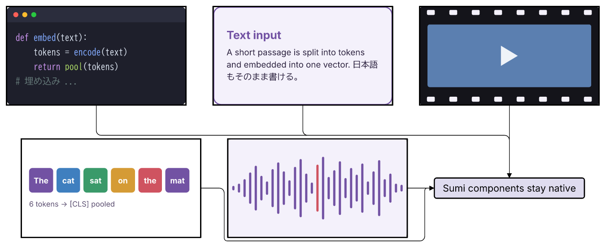
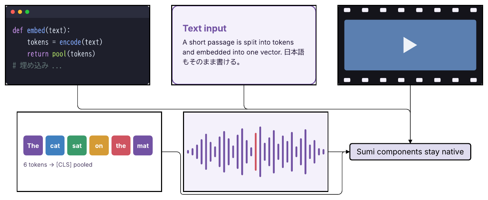
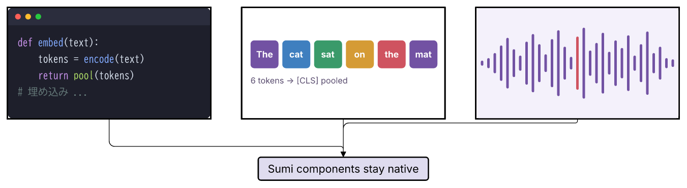
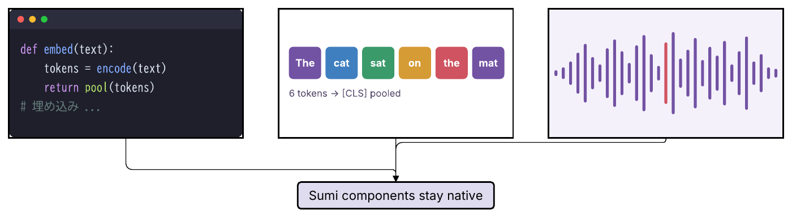
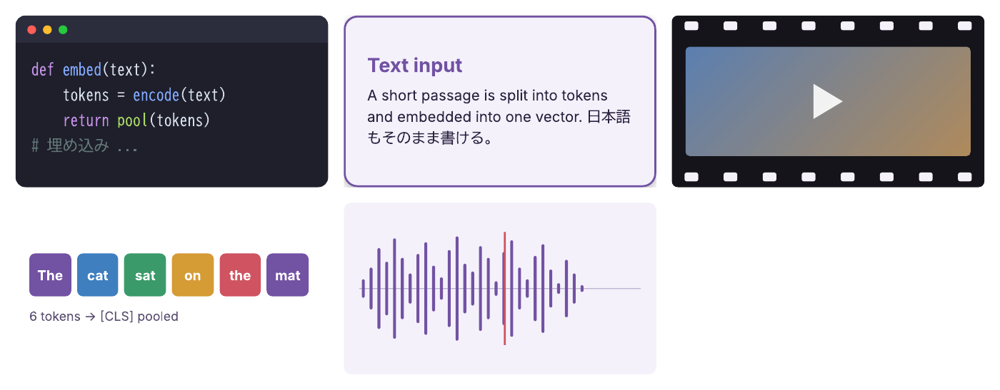
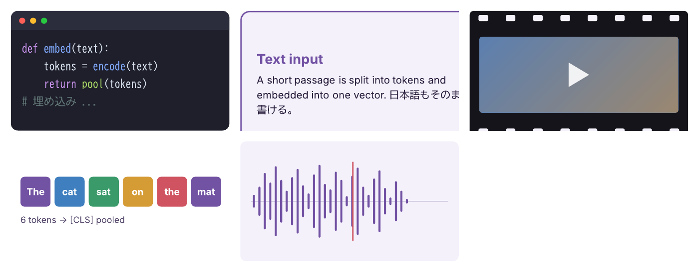
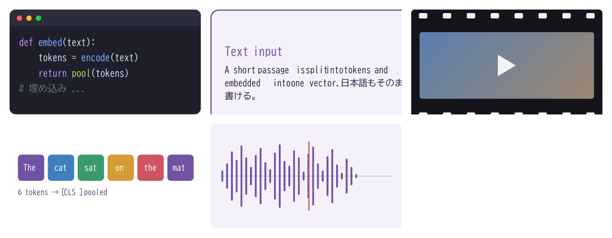

# #277: 箱の中身を HTML/CSS の部分集合で書き、ブラウザなしで SVG にする調査

## 結論

**可能。ただし「HTML をそのまま通す」のではなく、「厳しく制限した HTML/CSS の部分集合」を Takumi（WASM）で SVG にし、既存の importer に通す形なら成立する。Satori は採用しない。**

| 項目 | 結果 |
| --- | --- |
| 推奨ライブラリ | **`@takumi-rs/wasm` 2.19.0**（MIT OR Apache-2.0）。Bun で動き、`bun build --compile` で +4.28 MB。`measure()` で文字の大きさと内容の範囲を測れる |
| Satori 0.63.2 | 動くが非推奨。MPL-2.0、`satori-html` が Bun で落ちる、全要素に `mask` を出す、`measure` がない、レイアウトが Takumi と食い違う |
| 出力 | SVG → 既存の `image` 経路 → SVG / PDF / picture PPTX。試作 5 部品を目視確認した。editable PPTX は従来どおり不可 |
| 文字 | **常に輪郭化（path）**。PDF から検索できない。importer の「`<text>` 禁止」規則とは両立する |
| 決定性 | 33 出力すべてで Bun 2 回・Node・TZ/ロケール変更が byte 一致。**他 OS は未検証**（両方とも WASM なので期待はできる） |
| 条件 | importer を**変更せずに**通すには、`overflow:hidden`・グラデーション・影・インライン `<svg>` を使わず、usvg（Sumi 同梱 PDF エンジン）で正規化する。この制限は HTML の事前検査で強制する |

提案するタイミング: **v0.10.0 の #277 は inline SVG（`props.svg`）を先に入れ、HTML 部分集合は後続（v0.11 候補）にする。** HTML の価値は「レイアウト（flex・折り返し・余白）を AI が書き慣れた形で書ける」ことにあり、SVG では座標を手計算させる部分が消える。一方で、制限の強制・フォント統制・診断の実装が必要で、inline SVG より明らかに重い。#278（waveform）は HTML で代替しない。データから描く小部品のままがよい（理由は §6）。

この調査は設計提案であり、`src/`・`package.json`・`bun.lock`・schema・Skill は変更していない。試作はすべて本ディレクトリ内（依存は `research/277-html-subset/package.json` と `bun.lock` だけ。`node_modules/` と `out/` は gitignore）。

## 1. 試作と再現

対象は #272 と同じ EmbeddingGemma 2 風の部品。原図は使わず、自作の架空コードと模式波形を HTML/CSS で書いた（[html/](html/)、制限版は [html-safe/](html-safe/)）。

| 部品 | 内容 |
| --- | --- |
| code-window | 暗い角丸窓、3 色の丸、色付き等幅コード（`white-space:pre`）、日本語コメント |
| text-card | 角丸＋枠線の文字カード（日本語混じり、折り返し、影） |
| film-strip | 上下のフィルム穴、中央の再生三角形（グラデーションあり／なし） |
| token-strip | 色付きトークン 6 個と説明文 |
| waveform | インライン `<svg>` 版と、`<div>` の縦棒だけで描く版（`waveform-bars`） |

```sh
cd research/277-html-subset
bun install                                  # satori 0.63.2 / satori-html 0.3.2 / @takumi-rs/wasm 2.19.0
bun probe.ts                                 # importer 適合・安全性・CSS 挙動・文字の確認
bun figure.ts                                # HTML → SVG → usvg 正規化 → importSvg → image → SVG/PDF/PPTX
bun lint-demo.ts                             # Takumi measure() による範囲・文字の大きさの測定
bun pitfall.ts                               # 失敗例（white-space:pre の落とし穴）
for n in baseline satori takumi; do bun build --compile bin/$n.ts --outfile out/bin-$n; done
bun collect.ts                               # results.json を生成（バイナリ寸法・起動時間・決定性を再測定。Node 比較は bundle して実行）
for n in takumi satori; do pdftoppm -scale-to 1400 -png -singlefile out/$n.pdf out/$n-pdf; done
```

変換経路（`figure.ts`）:

1. HTML 文字列を Takumi（`renderSvg`）または Satori で SVG にする。フォントは Sumi 同梱の BIZ UD Gothic と Inter だけを渡す。
2. Sumi 同梱の PDF エンジン（usvg）の `picture` モードを通す。文字は path に、`<use>` / `<defs>` の glyph は展開される。
3. **既存の `importSvg()` を変更せずに**通す。通れば `image` の `src` として配置する。
4. `renderFigure()` → `inspectSvg()` → 幾何 lint → `svgToPdf()` / `svgToPptx()`。

Satori の HTML 変換は `satori-html` を使わず、ultrahtml だけを使う 50 行の変換器（[html-vdom.ts](html-vdom.ts)）で代用した。理由は §3。

## 2. 結果

### 2.1 目視確認（PNG を実際に開いて確認した）

Takumi・制限版 HTML 5 部品を既存 `image` で配置した図。左が SVG（picture PPTX の fallback PNG と同じ resvg 描画）、右が PDF（Poppler 描画）。

| SVG | PDF |
| --- | --- |
|  |  |

コード窓の 3 色の丸・色付きコード・インデント・日本語、角丸カードの折り返し、フィルム穴、トークン列、波形の細線と赤いマーカーが両形式で崩れずに出ている。外側の枠と接続線は Sumi 側。importer で拒否された部品はなし。

Satori で同じ制限版を試すと、5 部品中 text-card と film-strip は importer が拒否する（`<defs>` / `<clipPath>`）。通った 3 部品だけの図が次。見た目は同等。

| SVG | PDF |
| --- | --- |
|  |  |

制限なしの HTML（`overflow:hidden`、グラデーション、`box-shadow`）をそのまま SVG にして、importer を**通さず** PDF エンジンへ直接渡した 5 部品のシート。PDF エンジン自体は clipPath・mask・グラデーション・ぼかしを描ける（影は PDF 内でラスタ画像 2 枚になる）。つまり問題は PDF/PPTX ではなく importer の許可範囲にある。

| Takumi（文字は path） | Satori（文字は path） | Satori（`embedFont:false`、文字を残す） |
| --- | --- | --- |
|  |  |  |

Satori のカードは横・下が切れている。同じ `width:320px; padding; border` を Satori は content-box（368×216）、Takumi は border-box（320×176）で解釈するため（§5）。

### 2.2 importer への適合（変更なしの `importSvg()`）

「raw」は変換器の出力そのまま、「usvg 後」は usvg で正規化した後。数字は拒否された問題数。全 22 組の詳細は [results.json](results.json) の `importerCompat`。

| 部品（制限版 = `html-safe/`） | Takumi raw | Takumi usvg 後 | Satori raw | Satori usvg 後 |
| --- | --- | --- | --- | --- |
| code-window | 61 件拒否 | **通る** | 40 件 | **通る** |
| text-card | 77 件 | **通る** | 18 件 | 拒否（clipPath） |
| film-strip | **通る** | **通る** | 109 件 | 拒否（clipPath） |
| token-strip | 37 件 | **通る** | 33 件 | **通る** |
| waveform-bars（div の棒） | **通る** | **通る** | 100 件 | **通る** |
| waveform（インライン svg） | 3 件 | 拒否 | 8 件 | 拒否 |

制限なし版では、code-window・text-card・film-strip・waveform が usvg 後も拒否される。拒否理由は `clipPath`（`overflow:hidden` や、子を持つ角丸）、`linearGradient`、`filter`（影）、`mask`（Satori は全要素）、`<defs>`。生の出力は Takumi が glyph を `<use>` で出すため、usvg なしでは `<use>` が `unsafe` になる。

制限の要点（これで通った）: `overflow:hidden` を使わない（ヘッダ帯は自分で上だけ角丸にする）、`linear-gradient` と `box-shadow` を使わない、インライン `<svg>` を使わない（波形は `div` の棒か、別の小部品にする）。

### 2.3 文字の扱い

- Takumi・Satori とも**既定で文字を輪郭化**する。Takumi は glyph を `<defs>` + `<use>` で出し、Satori は path で出す。usvg 後はどちらも path だけになり、importer の「`<text>` 禁止」を満たす。
- 結果として **PDF から文字を検索・コピーできない**。#272 の「コードを文字として保ちたい」は満たせない。PDF の `pdfText` はネイティブの Sumi ラベルだけ。
- フォント: 渡した BIZ UD Gothic（OFL）と Inter（OFL）だけで描かれ、日本語も出る。ただし **Takumi は WASM に Geist（OFL）を同梱しており、フォント未指定や欠字では黙ってそれに落ちる**。Sumi の「同梱フォントだけ」を守るには、必ず `font-family` を固定し、欠字を lint する必要がある。
- Satori は `embedFont:false` で `<text>` を残せる（PDF で `pdfText` が取れた）が、**レイアウトした時のフォントと PDF エンジンが選ぶフォントが食い違う**。試作では Inter が見つからず BIZ に落ち、単語間隔が崩れた（上の右端のシート）。importer は `<text>` を拒否するので、この経路は importer の変更が前提になる。採用しない。

### 2.4 単一バイナリ

`bun build --compile` を、何も import しない 1 行、Satori を使うスクリプト、Takumi を使うスクリプトの 3 通りで比較した（darwin-arm64、Bun 1.3.14）。`node_modules` を退避した状態で実行して、WASM が埋め込まれていることも確認した。

| バイナリ | サイズ | 増分 | 起動 + 1 回描画（暖機後の中央値） |
| --- | --- | --- | --- |
| 1 行だけ | 63,446,114 B | 0 | 10 ms |
| Satori | 65,625,698 B | **+2.18 MB** | 72 ms |
| Takumi | 67,722,722 B | **+4.28 MB** | 39 ms |

- 時間はマシン負荷で大きく変わる（同じマシンで他の作業が走っていた先の測定では 17 / 133 / 83 ms）。順序は一貫して「1 行 < Takumi < Satori」。
- 成功。WASM は自動的に埋め込まれ、実行時の外部ファイルは不要（Takumi の `node` 入口は `readFileSync(new URL(...))` で、Bun がこれを静的に解決する）。ネイティブアドオンは使わない（`@takumi-rs/core` は使えないので注意）。
- `--target=bun-linux-x64` のクロスコンパイルも両方成功（実行は未確認）。
- 各バイナリの初回実行だけ約 0.8 秒かかる。macOS の初回実行検査によるもので、3 つとも同じ。
- 参考: Sumi は既に PDF エンジン（krilla / usvg）の WASM を同梱している。同じ方式の上乗せになる。

### 2.5 決定性

`html/` と `html-safe/` の全 11 入力 × 3 方式（33 出力）の SVG の SHA-256 を比べた。

- Bun 2 回: 一致。Bun と Node 26: 一致。`TZ=Asia/Tokyo`・`LANG=ja_JP.UTF-8` に変えても一致。
- id は固定の命名（Takumi は `cp0`、`g0`、Satori は `satori_om-id`）で、実行ごとに変わらない。
- **他 OS は未検証**。両方とも WASM とバンドルフォントだけで描くので期待できるが、CI での確認が必要。
- 注意: 部品ごとに id が衝突する（`cp0`、`g0`、`satori_om-id` が全部品で同名）。複数を 1 枚に合成する場合は id の接頭辞付けが必要。既存の importer 経路は再直列化で id を落とすので、画像として入れる限り問題ない。
- PDF / PPTX の決定性は既存の仕組み（同じ SVG → 同じバイト）に従う。

### 2.6 PDF / PPTX

| 経路 | 結果 |
| --- | --- |
| PDF（Takumi 5 部品の図） | 1 ページ 506.5 × 207.5 pt、画像 0（すべてベクター）、36 KB。目視で崩れなし |
| picture PPTX | 生成成功（約 86 KB、fallback PNG 付き）。目視確認は fallback PNG まで。PowerPoint での表示は未検証 |
| editable PPTX | **不可**。`pptx/unsupported-asset` が部品ごとに出る（#272 と同じ。HTML 固有ではない） |

幾何 lint は診断 0。ただし画像の内部は lint の対象外（#272 と同じ）。

## 3. Satori の問題点

| 問題 | 内容 |
| --- | --- |
| `satori-html` が Bun で落ちる | `TypeError: undefined is not an object (evaluating 'selector.type')`（ultrahtml の selector）。最小の `<div>` でも再現。Node 26 では動く |
| テキストを trim する | `<span>def </span>` が `def` に、`    x` が `x` になり、**コードのインデントと末尾空白が消える** |
| 全要素に `mask` | importer が許さない。制限版でも text-card と film-strip が通らない |
| `measure` なし | 描画前に範囲や文字の大きさを測る API がない（`onNodeDetected` はあるが未評価） |
| ライセンス | **MPL-2.0**。ファイル単位のコピーレフト。未改変のまま同梱するなら実害は小さいが、Sumi の配布物にソース提供の義務が生じ得る |
| CSS | `var()` は**黙って落ちる**（fill が消える） |

## 4. 安全性

ローカルの HTTP サーバーを立て、アクセスの有無を数えて確認した（[results.json](results.json) の `safety`）。

| 入力 | Takumi | Satori |
| --- | --- | --- |
| ``、`background-image:url(http://..)` | 描画せず、**リクエストなし**（黙って無視） | SSRF 保護でエラー（`blocked address`）。公開ホストは取得に行くと思われる（未検証） |
| `` | 無視 | エラー |
| `` | 無視（黙って） | 受理して `<image>` を出す（importer は `image` を拒否する） |
| `<script>`、`<link>`、`<iframe>`、`@import`、`@font-face url()`、`on*` | 無視。出力に残らない | 無視。出力に残らない |

結論として、いずれも出力 SVG に script・外部参照は出なかった。ただしそれは**ライブラリの既定動作**であり、Takumi は `images` / `fonts` に URL を渡せる設計（型定義で確認、未実行）、Satori は画像を取得しに行く実装なので、設定次第で変わり得る。Sumi が守るべき点は次のとおり。

1. **HTML を事前に許可リストで検査する**。タグ（`div` / `span` / `p`、`b` / `i` / `br` 程度）、属性（`style` のみ）、CSS プロパティ（flex・サイズ・余白・色・角丸・枠線・フォント・`white-space`・`line-height`）を許可し、それ以外は診断にする。`img` / `svg` / `style` / `link` / `script` / `url()` / `@` ルール / `var()` の外部値は禁止。
2. **ライブラリに URL を渡さない**。`images` / `fonts` オプションは使わず、フォントは同梱ファイルだけを固定の順で渡す。
3. 変換後の SVG は、必ず usvg 正規化 → `importSvg()` を通す。importer を二重の安全網にする（拒否されたら診断にする）。
4. 入力サイズ・要素数・深さ・ビューポートに予算を設ける。

重要な理由: **ライブラリは未知の CSS を黙って捨てる**（§5）。「無視された」ことは出力からは分からない。Sumi が事前に検査しないと、AI の意図と違う図が無診断で出る。

## 5. 表現力と失敗の型

CSS を 1 つずつ試した結果（`results.json` の `cssBehaviour`）。「ok」はエラーなしの意味で、期待どおりとは限らない。

| CSS | Takumi | Satori |
| --- | --- | --- |
| `display:grid`（2 列 × 2 行で確認） | 対応 | 対応 |
| `position:absolute`、`calc()`、`transform` | 対応 | 対応 |
| `var(--x)` | 対応 | **黙って落ちる** |
| `float` | **無視**（左端に出る） | 無視 |
| `box-shadow`、`filter:blur`、`text-shadow` | 対応（SVG では `filter`） | 対応（同） |
| 未知のタグ、`display` 無しの `<p>` | 描画する | 描画する |
| `box-sizing` の既定 | **border-box** | **content-box**（ブラウザの既定と同じ） |
| 欠字（絵文字、記号） | 同梱 Geist などに黙って落ちる | 同様 |

**失敗の型（AI が書きがちな誤り）:**

1. **未対応・無視された CSS が無診断**（`float`、Satori の `var()`）。事前検査でしか防げない。
2. **ブラウザと違うボックス計算**。Takumi は border-box、Satori は content-box。Sumi では `box-sizing:border-box` を必須にするか、片方のエンジンに固定する。
3. **`white-space:pre` を親に付けるとインデントの空白行が行として描かれる**（[html-pitfall/](html-pitfall/)、[previews/pitfall-takumi-pre-container.png](previews/pitfall-takumi-pre-container.png)）。Takumi は flex の子の間の空白文字列を行として扱い、コード窓が間延びして 4 行目が切れた。`white-space:pre` は行ごと（`div`）に付ける。
4. **欠字がフォールバックする**。Sumi の欠字 lint を HTML の文字にも通す必要がある。
5. 内容が枠に収まらない。下で測れる。

### 診断と lint（Takumi `measure()`）

`measure()` は各ノードの幅・高さ・絶対座標（root 基準）と、文字の run（テキスト、位置、幅、高さ）を返す。[lint-demo.ts](lint-demo.ts) で次を確認した。

- **範囲**: 固定幅 60px の箱に長い 1 行を入れたケースで、run の幅が 348 px、root の幅 320 px を超えるのを検出できた（`overflowsRoot: true`）。
- **文字の大きさ**: 5px の文字は run の高さ 6.05px として出る。この高さは行ボックスで、font-size そのものではないが、`text-too-small` の下限判定には使える（font-size は検査済みの CSS から取れる）。
- **コード窓**: 各 run のテキストと幅が取れるので、等幅なら折り返し・はみ出しを予測できる。
- Satori にはこの API がない。

HTML の範囲外のものを測る必要はなく、既存の幾何 lint（外側の箱、接続線）と組み合わせられる。画像の内部の測定は #272 では未対応だったので、これは inline SVG に対する優位点になる。

## 6. inline SVG 案との比較

| 観点 | inline SVG（#272 の推奨） | HTML/CSS 部分集合（Takumi） |
| --- | --- | --- |
| AI の書きやすさ | 座標・path の手計算が必要。文字は輪郭化済みでないと書けない | flex・余白・折り返しがそのまま使える。日本語の文章もそのまま書ける |
| 文字 | 書けない（importer が拒否）。外で path にする必要あり | 書ける（変換が輪郭化する）。検索不可は同じ |
| 決定性 | importer で再直列化。強い | 同一マシンで一致。他 OS は未検証 |
| 安全性 | 既存の importer で完結 | 事前検査 + usvg + importer の 3 段が必要 |
| lint | 内部は測れない | `measure()` で範囲・文字の大きさが測れる |
| 実装費用 | 小〜中 | 中〜大（許可リスト、CSS 検査、フォント統制、診断、Skill） |
| 依存・配布 | 追加なし | +4.28 MB（Takumi）。ライセンス表記が増える |
| 失敗の型 | 構文エラーは importer が行・列で返す | 無診断の無視が起きる。事前検査の網羅が品質を決める |
| editable PPTX | 不可（共通） | 不可（共通） |
| 波形などデータの図 | 手書き path | `div` の棒でも書けるが、サンプルが 70 本だと HTML が長くなる。#278 は別の小部品のまま |

どちらも「完成図の部品を不透明な資産として差し込む」点は同じで、**HTML は inline SVG の上位互換ではなく、入力の書き方の追加**に当たる。importer、画像配置、PDF/PPTX の経路は共有できる。そのため v0.10.0 は inline SVG で入口を作り、HTML は同じ入口（`image` の `props`）の別の書き方として後から足せる。

## 7. ライセンス

| パッケージ | ライセンス | 備考 |
| --- | --- | --- |
| `@takumi-rs/wasm` 2.19.0 | MIT OR Apache-2.0 | WASM に Geist（OFL）、IJG libjpeg、Chromium/Skia 由来、emoji-segmenter（Apache-2.0）、ICU（Unicode License）、libwebp などを含む。公式の THIRD-PARTY-NOTICES に記載。配布時にこれらの表記が必要 |
| `satori` 0.63.2 | **MPL-2.0** | 未改変の同梱なら影響は小さいが、他より重い |
| `satori-html` 0.3.2 | MIT | Bun で動かず、trim の問題もあるため使わない |
| `ultrahtml`、`@shuding/opentype.js`、`harfbuzzjs` など上記以外の推移的依存 | MIT / ISC | インストールされた他の依存はすべて MIT / ISC（各 `package.json` の license で確認） |

## 8. 提案する YAML 記法（未実装）

`image` の `props` に `html` を足す。`src` / `svg` / `html` は排他。幅・高さ・fit・枠・tone は既存の契約を共有する。

```yaml
# Proposed only; current CLI rejects props.html.
- id: code
  component: image
  variant: framed
  props:
    width: 150pt
    height: 82.5pt
    fit: contain
    viewport: 320x176        # CSS px。内容の寸法の根拠。必須
    html: |
      <div style="display:flex;flex-direction:column;width:320px;height:176px;background:#1e1f2b;border-radius:10px">
        <div style="display:flex;white-space:pre;color:var(--sumi-fg);font-family:var(--sumi-mono)">def embed(text):</div>
      </div>
```

- 色とフォントは Sumi が**テーマの値を CSS 変数として注入**する案（`--sumi-fg`、`--sumi-mono` など）。Takumi は `var()` に対応する。Satori は黙って落とすので使えない（もう一つの採用しない理由）。ただし注入できる値は固定の一覧にして、`var()` の許可はこの一覧だけにする。
- `font-family` は変数だけを許可する。
- `viewport` を必須にする（#272 の「安全な SVG ≠ 枠に収まる SVG」と同じ理由）。変換後に範囲を測り、はみ出しは診断にする。
- 診断は shared Diagnostic（`asset/unsafe-html`、`asset/unsupported-css`、`asset/html-overflow` など）で、`props.html` の行・列へ locator を戻す。

## 9. 制約と未検証

- 他 OS での byte 一致、PowerPoint / Keynote での picture PPTX の表示、editable PPTX への変換は未検証。
- Takumi が**未知の CSS プロパティを診断なしで捨てる**ことは `float` で確認した。全プロパティの網羅は未実施。許可リストは実装時に決める。
- Takumi のバージョン固定（2.19.0）。主要な変更が速い可能性があり、更新時に決定性テストが必要。
- 部品は 5 つだけ。実際の論文図（3D 散布図など）は対象外。
- Takumi の `takumi-pdf`（別パッケージ）は評価していない。Sumi の PDF は既存の krilla を使う。

## 10. 後続 issue の提案

1. `feat(assets): add inline SVG source (props.svg) to image` — #272 の推奨。まず入口を作る（#277 の v0.10.0 範囲）。
2. `feat(assets): render a restricted HTML/CSS subset with Takumi (props.html)` — 本調査の推奨。
3. `feat(lint): pre-validate the HTML/CSS subset with an allow-list and report unsupported CSS as diagnostics`
4. `feat(assets): normalize generated SVG through usvg before importSvg and report importer rejections with source locations`
5. `feat(lint): measure HTML content bounds and text size with Takumi measure()`
6. `feat(fonts): pin the HTML renderer font chain to bundled fonts and report missing glyphs`
7. `ci: verify byte-identical Takumi output across macOS, Linux and Windows`
8. `docs(skill): teach the HTML subset and its pitfalls (white-space:pre per line, box-sizing, no overflow:hidden)`

## 11. 主なファイル

- [results.json](results.json): 全測定（importer 適合、安全性、CSS、バイナリ寸法、決定性、図の PDF/PPTX、lint）
- [html/](html/)、[html-safe/](html-safe/)、[html-pitfall/](html-pitfall/): 入力 HTML
- [gen.ts](gen.ts)、[probe.ts](probe.ts)、[figure.ts](figure.ts)、[lint-demo.ts](lint-demo.ts)、[pitfall.ts](pitfall.ts)、[determinism.ts](determinism.ts)、[collect.ts](collect.ts)、[bin/](bin/): スクリプト
- [previews/](previews/): 目視確認用の PNG（すべて 150 KB 未満）
